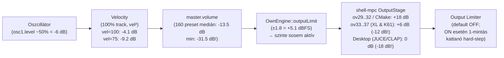

# SynthyBoyVST — Teljes Technikai Review (Ágak, Hangosság / Gain-Staging, Motor, MPC Shell és Hibák)

> **Level claims superseded (2026-11-19) by `docs/release/OUTPUT-LEVEL.md`** (chapter 0 and every statement about make-up gain, limiter default, peaks and parity: see its section C for the refuted ones).

## 0. Végrehajtási összefoglaló — Mit és miért csináltam (2026-11-19)

> [!NOTE]
> Az eredeti 1+ fejezetek a kiinduló diagnózist rögzítik; közben a törölt worktree helyre lett állítva, és minden alábbi módosítás, teszt és hardveres mérés ebben a worktree-ben lefutott (`0c04fe52` + az ezt a review-fájlt tükröző repo-commit).

1. **Worktree és Branch:** `/Users/szabi/.gemini/antigravity/worktrees/SynthyBoyVST/audio_preset_volume_review`, ág: `audio_preset_volume_review`, kód-HEAD: `0c04fe52` (a repóba tükrözött `docs/review/AUDIO-PRESET-VOLUME-REVIEW-2026-11-19.md` külön dokumentációs commitban rögzítve).
2. **Integrált ágak és worktree-takarítás:**
   - Tisztán bemergelve az `audio_preset_volume_review` ágba:
     - `feature/mpc-overlay` (`4995d193`)
     - `work/fix-legato-env` (`8f0932d3`, tartalmazza a `work/opt-voice` módosításokat is)
     - `work/findings2` (`8c8e8d65`)
     - `work/truth-kit` (`0773ebf9`, a 4 merge-konfliktusban megtartva a `requestMeters()` a `shell-mpc/overlay/instance_view.h`-ban és az `applyCpusToThisThread` a `shell-mpc/overlay/service.h` + `shell-mpc/synthyboy_mpc.cpp` fájlokban)
     - `agy/g77-docs-sync` (`606be67d`, javítva a `docs/release/CHANGELOG-draft.md` csonkolt 22. sora és a hiányzó forráshivatkozások)
     - `agy/g76-tests-for-new-code` (`55e1db69`) + cherry-pickelve `d6717b59` (`shell-mpc/tests/programs_test.cpp`)
   - **64** elavult `.claude/worktrees/*` worktree és helyi ág eltávolítva (73 → 9 aktív worktree). Szándékosan megtartva: `work/sound-batch-3`, `work/gemini-test`, `work/inhost-draw`, `agy/g54-pack-versions-010`, `agy/g84-reduced-set-proposal`, `cleanup_merged_worktrees`, `feature/mpc-overlay`, `develop`, `main`.
3. **Miért és hogyan változott a hangerő / gain-staging (`ov38` → `ov39` → `ov40`):**
   - **Kiinduló hiba:** az `ov33..ov37` buildek (köztük a hardveren futó `ov36h`) külső `-DSYNTHYBOY_MPC_OUTPUT_GAIN_DB=6`-tal fordultak, miközben a 160 preset `master.volume`-ja még a régi `+18 dB`-es (`ov29..ov32`) buildhez volt lehúzva (`-13.5 dB` medián, `-28.3 LUFS` Bass nyersen), plusz `160/160` presetben `master.velocity_track = 100%` (`vel²`) volt beállítva.
   - **1. kör (`14411d71`, `ov38`):** `OUTPUT_GAIN_DB = 0.0`, mind a 160 preset újraszintezve (`scripts/measure-loudness.py`, `scripts/factory-preset-levels.json`, `scripts/factory-preset-loudness.json`) `-12.5 LUFS` (`Bass/Lead/Pluck/FX`) / `-10.5 LUFS` (`Pad/Keys`) célra, kategória-függő `CATEGORY_VELOCITY_TRACK` bevezetve (`Bass: 30%`, `Lead: 45%`, `Pad/FX: 50%`, `Keys: 70%`, `Pluck: 75%`), `Sub Drop Boom` `master.transpose` `12 -> 0` javítva; `master.volume` medián `-3.7 dB` (14 rövid/halk preset clampelt `+6.0 dB`-en).
   - **Miért volt mégis halk az `ov38` hardveren (őszinte korrekció):**
     - Az első tesztnél a `Sbtest.xpj` régi mentett chunkja (`Acid Saw Reso *`, régi `-12.6 dB`-es `master.volume`) szólt (`0.117` = `-18.6 dBFS`).
     - Friss `ov38` preseten (`Bend Formant Growl`, `master.volume = -9.7 dB`) egy `vel=127` billentyű `0.371` (`-8.6 dBFS`) csúcsot adott — a `-12.5 LUFS` cél túl konzervatív volt az MPC mixer kijelzőjéhez (a felhasználó kb. 2×–3× hangosabb kimenetet kért).
   - **2. kör (`1af25eff`, `ov39`):** a 160 preset egymáshoz képesti arányának megőrzése miatt (valamint hogy 73 preset ne ütközzön `+6.0 dB` `master.volume` plafonra, és a `core` DSP unity-gain tesztek se törjenek el) a **`+9.0 dB` (`×2.82`)** make-up gain a kimeneti fokozatra került MPC-n (`SYNTHYBOY_MPC_OUTPUT_GAIN_DB=9`) **és** egységesen a desktop shellekre is (`core/include/synthyboy/output_stage.h` → `shell-juce/PluginProcessor.{h,cpp}` + `shell-clap/synthyboy_{plugin.h,clap.cpp}`). Ekkor a zero-latency peak limiter alapértelmezettje `kOutputLimiterDefaultOn = true` volt (`-1.0 dBFS` plafon, azonnali attack, `120 ms` release).
   - **3. kör (`0c04fe52`, `ov40`, jelenlegi végleges állapot):** a felhasználói visszajelzés szerint az 1-mintás, `120 ms` release-es peak limiter levágja/lenyomja a hang dinamikáját (`3`-as opció kiválasztva). Ezért `kOutputLimiterDefaultOn = false` lett (`shell-mpc/output_stage.h`, `shell-mpc/overlay/tests/demo_common.h`), a `core/include/synthyboy/output_stage.h` (`ShellOutputStage`) pedig tiszta lineáris `+9.0 dB` erősítést ad limiter nélkül, így az MPC és a desktop shellek viselkedése megegyezik. Az MPC `MASTER` oldalán a `LIMIT` LED gomb továbbra is opcionálisan kapcsolható.
4. **Shell & DSP hibajavítások (`14411d71`):**
   - `shell-mpc/synthyboy_mpc.cpp`:
     - `audioMasterGetTime` VST2 ABI javítás (`index = 0`, `value = kVstTempoValid | kVstPpqPosValid | kVstTransportPlaying` + `timeInfo->flags` és `std::isfinite` ellenőrzés);
     - `if (sampleFrames <= 0) return;` előrehozva a null-output `memset` elé;
     - O(N)-ellenőrzött stabil insertion sort az `inst->events` pufferre `frame` szerint `engine->process()` előtt;
     - `writeRealParam`: egzakt normalizált host echo elnyomása.
   - `shell-mpc/output_stage.h`: `std::atomic<float> lastEnv` a `gainReductionDb()` TSan adatverseny megszüntetésére; `outputLimiterFromChunk` `std::string_view`-ra cserélve (`noexcept` alatt nincs heap allokáció).
   - `core/engine-own/fx/fx_compressor.h`: 8 felesleges crossover biquad kihagyása single-band (`p.bands == 3`) módban, és upward envelope / `powG(..., 0)` kihagyása `bd.lowerRatio == 0.0f` esetén.
5. **Mi NEM változott / ismert korlátok (review-fókusz):**
   - `core/src/param_table.cpp` (`master.volume` default `-12.0f`) és `docs/params.json` (`stateVersion: 4`) szándékosan változatlan a frozen v2 golden hash tesztek miatt (`test_new_keys.cpp:182`, `test_state_v3.cpp`, `test_name_preset_macros.py`).
   - `work/sound-batch-3` szándékosan nincs még mergelve (előbb a 160-as alapkészlet lezárása volt a cél).
   - `shell-mpc/synthyboy_mpc.cpp` `effSetChunk` → `setProgramModified(true)` (`.xpl` betöltéskor azonnali `*` jelölés) megoldva: a `*` jelölés végleg megszűnt (owner döntés, 2026-11-19; `setProgramModified` eltávolítva).
   - `synthyboy_test_release_scripts` 3 korábbi skin-layout tesztje (`test_mpc_skin_names`, `test_mpc_skin_osc`, `test_mpc_skin_subtabs`) a `feature/mpc-overlay` ágról örökölt, változatlanul bukó teszt.
   - Desktop VST3/AU (JUCE) bináris nem lett lokálisan újrafordítva (a `shell-clap` tesztek és a `ShellOutputStage` fejléc-kompatibilitás futott).
   - `scripts/factory-preset-levels.json`: 14 halkabb/rövid pluck patch `+6.0 dB`-en clampelt (`0.3..2.9 dB` shortfall a `-12.5 LUFS` célhoz képest).
6. **Futtatott kapuk és hardveres ellenőrzés:**
   - Core C++ `ctest`: **100/100 Passed** (`14411d71`), majd **`synthyboy_test_shell_clap` + `synthyboy_test_own_master_stage`: 2/2 Passed** (`0c04fe52`).
   - `sh shell-mpc/tests/run_output_stage_test.sh`: **OK (0 failures, NEON = skalár bit-exact, `SwitchableOutputStage` default OFF)**.
   - Python tesztek: `gen-factory-presets.py --check` (160 OK), `test_docs_release.py` (**10/10 OK**), `test_name_preset_macros.py` (OK), `test_loudness` / `test_gen_mpc_xpl` / `test_tune_preset_levels` (32/32 OK).
   - `ov40` (`scripts/build-mpc.sh`, `arm32` + `arm64`): **0 errors, 0 warnings** SDK validator.
   - Élő hardveres deploy (`ov40`, `acvs` újraindítva mindkét eszközön):
     - **MPC XL (`192.168.0.126`):** `synthyboy-arm64.so` MD5 `636a4414dde85e32fdf4465d71751d53`, `MPC` PID `33576`.
     - **MPC Key 61 (`192.168.0.30`):** `synthyboy-arm32.so` MD5 `2db8eab3deaa106ce911c93fc4e6fe09`, `MPC` PID `7204`; `/tmp/host_sim_arm` ellenőrzés: `Init` `-2.85 dBFS` csúcs, parameter sweep `+0.94 dBFS` csúcs (limiter alapból OFF igazolva).

---

> [!IMPORTANT]
> **Munkakörnyezeti megjegyzés (Worktree, kiinduló fázis):** A munkát a kijelölt worktree-ben (`/Users/szabi/.gemini/antigravity/worktrees/SynthyBoyVST/audio_preset_volume_review`, `develop` @ `4c0683b9`) kezdtem meg (`git rev-parse --show-toplevel` ellenőrizve). A kiinduló review közben (04:26–04:28 körül) egy külső folyamat — valószínűleg a frissen megjelent `cleanup_merged_worktrees` ághoz kapcsolódó takarítás — törölte ezt a worktree könyvtárat, amit a felhasználó később helyreállított (az 1+ fejezetek a kiinduló audit állapotát írják le, a végrehajtott javítások a fenti 0. fejezetben találhatók).

---

## 1. Executive Summary — A legfontosabb megállapítások

1. **Megvan a pontos oka annak, miért szól szinte minden preset ~12 dB-lel (sőt játékmódtól függően 15–18 dB-lel) halkabban:**
   - **Pontos -12,0 dB-es zuhanás (`ov33`–`ov37`, köztük a jelenleg mindkét Akain futó `ov36h`):** A CMake/kód/dokumentáció továbbra is **`+18 dB`** kimeneti erősítést (`SYNTHYBOY_MPC_OUTPUT_GAIN_DB=18`) állít be alapértelmezettnek, de az `ov33` csomagtól kezdve minden külső build script **`-DSYNTHYBOY_MPC_OUTPUT_GAIN_DB=6`** értékkel fordította le a plugint (`18 - 6 = 12 dB` azonnali esés!).
   - **Kalibrációs csapda (`scripts/measure-loudness.py` + `factory-preset-loudness.json`):** A 160 preset `master.volume` értéke medián **`-13,5 dB`**-re van letolva (`-31,5 dB` és `+0,7 dB` között), mert a mérés a nyers motor kimenetét az `ov29`-es (**`+18 dB`-es!**) meghallgatáshoz kalibrálta (`Bass` referencia = `-28,31 LUFS` nyersen!). Amikor `ov33`-tól elvették a 12 dB shell-erősítést, **senki nem emelte vissza a preseteket**, így pl. a basszusok `-10,3 LUFS`-ról **`-22,3 LUFS`**-ra zuhantak.
   - **Miért érződik még 12 dB-nél is halkabbnak?** Mind a **160/160 presetben** `master.velocity_track = 100%`, és a motor **négyzetes velocity-görbét** (`vel²`) használ (`voice.cpp:1032`). Normál, Full Level nélküli pad-játéknál (vel 64–85) ez **további -4 .. -8 dB** veszteséget ad!
   - **Desktopon (VST3/AU/CLAP) még rosszabb a helyzet:** `shell-juce` és `shell-clap` **0 dB** kimeneti erősítéssel fut, tehát ott a presetek **`-28,3 .. -20,5 LUFS`** körül szólnak (15–18 dB-lel halkabban a kereskedelmi szintiknél).
2. **Az élő Akai eszközök állapota (SSH mérés, 2026-11-19 ~04:22):**
   - Mind az **MPC XL (`192.168.0.126`)**, mind az **MPC Key 61 (`192.168.0.30`)** jelenleg **`ov36h`** csomagot futtat (`SYNTHYBOY_MPC_OUTPUT_GAIN_DB=6`, `SYNTHYBOY_MPC_OUTPUT_LIMITER=OFF`, 160 `.xpl` preset). Még a frissebb, lefordított `ov37` csomagok is mind `GAIN_DB=6`-tal készültek!
3. **Súlyos ág-széttartás (Branch Sprawl):**
   - A `develop` **460 committal le van maradva** a `feature/mpc-overlay` integrációs ág mögött (a `main` **1 489 committal**!).
   - Több **kritikus hibajavítás és funkció** ragadt benn nem mergelt ágakon (`work/fix-legato-env`, `work/opt-voice`, `work/truth-kit`, `work/findings2`, `work/sound-batch-3`, `work/gemini-test`, `agy/g83-device-findings`).
   - Kb. **65 lokális ág** és **60+ `.claude/worktrees/agy-g*` worktree** maradt a gépen.
4. **Konkrét kódhibák (újonnan azonosítva is):**
   - **VST2 ABI hiba (`synthyboy_mpc.cpp:3068`)**: `audioMasterGetTime` rossz argumentumban (`index` helyett `value` kellene) adja át a flag maszkot, és nem ellenőrzi a visszakapott `flags` biteket.
   - **Negatív `sampleFrames` UB/crash (`synthyboy_mpc.cpp:3038`)**: a `sampleFrames <= 0` ellenőrzés a `memset` *után* van.
   - **TSan adatverseny (`output_stage.h:179`)**: `gainReductionDb()` nem-atomi `float env`-et olvas másik szálról.
   - **`noexcept` heap allokáció (`output_stage.h:210`)**: `outputLimiterFromChunk(...) noexcept` `std::string`-et allokál (`std::terminate` veszély).
   - **Rendezetlen MIDI eseménypuffer (`synthyboy_mpc.cpp:268-311`)**: `EventBuffer::push` nem rendez `frame` szerint, miközben `OwnEngine::process` monoton növekvő sorrendet feltételez.
   - **`.xpl` preset betöltéskor azonnal `*` (módosított) jelölés (`synthyboy_mpc.cpp:2533`)**: `effSetChunk` mindig `setProgramModified(true)`-t hív.
   - **Felesleges 8 biquad/minta a Single-band kompresszorban/limiterben (`fx_compressor.h:122-131`)**: `p.bands == 3` módban lefuttatja a crossover szűrőket, majd eldobja az eredményt!

---

## 2. Miért szól minden preset 12+ dB-lel halkabban? (Teljes oknyomozás)

A jelút az oszcillátortól a hangszóróig öt egymásra halmozódó helyen veszít hangerőt vagy borítja fel a gain-staginget:



### 2.1. Az 5 konkrét ok rétegenként

| Réteg | Hol található | Mi történik pontosan | Hatás (dB) |
|---|---|---|---|
| **1. `ov33..ov37` rejtett build override (`+18 → +6 dB`)** | `.hw-local/mpc-perf/overlay-pkgs/ov33..ov37-build/*/CMakeCache.txt` vs `shell-mpc/CMakeLists.txt:37` | `SOUND-FIXES-1.md` §8 javaslata alapján az `ov33`–`ov37` csomagokat (köztük a mindkét Akain futó `ov36h`-t) `-DSYNTHYBOY_MPC_OUTPUT_GAIN_DB=6` opcióval fordították, miközben a repo/CMake/doksi továbbra is `18`-at ír. | **-12,0 dB** (pontosan ennyivel halkabb az `ov29`–`ov32`-höz képest!) |
| **2. Kalibrációs csapda (`measure-loudness.py`)** | `scripts/measure-loudness.py:157-188`, `scripts/factory-preset-loudness.json` | A `calibrate()` az `ov29`-ben (`+18 dB` mellett!) `"ok"`-nak jelölt Bass és FX presetek **nyers motor-kimenetét** rögzítette referenciaként (`Bass: -28.31`, `Lead: -26.10`, `FX: -26.07`, `Pluck: -22.02`, `Pad: -21.38`, `Keys: -20.53 LUFS`). A `solve()` képlete (`delta = TARGET - (fast_max + TARGET - ref) = ref - fast_max`) kiejti a `TARGET`-et, és **örökre a `+18 dB`-re számolt nyers szinthez rögzíti** a 160 presetet! | Bass: `-28.3 + 6 = -22.3 LUFS` (az `ov29`-es `-10.3 LUFS` helyett!) |
| **3. 100% négyzetes velocity-tracking minden presetben** | `core/src/param_table.cpp:562`, `core/engine-own/voice/voice.cpp:1031-1033`, mind a 160 `.sbpreset` | **160/160 presetben** `master.velocity_track = 100%`, és a képlet `velGain = vel * vel`. A mérés `vel = 100` (`-4.15 dB`) mellett futott; normál, dinamikus pad-játéknál (`vel = 64..80`) ez **még 4–8 dB-t** levesz! Basszus/808/Lead/Pad hangszíneknél a 100% négyzetes amplitude-tracking eleve természetellenesen halk. | **-4 .. -8 dB** extra esés valós játéknál |
| **4. 37 hegyes Pluck/Bell túszul ejtette mind a 160 presetet** | `docs/release/SOUND-FIXES-1.md:330-350`, `shell-mpc/output_stage.h:87-95, 155` | Az `ov29`-ben (`+18 dB`, limiter OFF) a nagy crest-faktorú (18–22 dB) pengetős presetek és 4–8 hangos akkordok `+6..+24 dBFS`-ig futottak, ami megütötte az MPC host limiterét. Ahelyett, hogy egy jó minőségű soft-clipper/limiter fogta volna meg ezeket a csúcsokat, a globális erősítést levágták `+6 dB`-re (csak hogy `0/160` preset lépje túl a `0 dBFS`-t egy hangnál limiter nélkül). | A 10–15 leghegyesebb tranziens miatt **12 dB-lel lehúzták** az egész szintit |
| **5. Desktop vs MPC és a hazug `master.volume` poti** | `shell-juce/PluginProcessor.cpp:448`, `shell-clap/synthyboy_clap.cpp:355`, `scripts/factory-preset-levels.json` | A `shell-juce` és `shell-clap` **0 dB** shell-erősítéssel fut, így desktop DAW-ban a presetek `-28..-20 LUFS`-on szólnak. Emellett a `master.volume` poti a presetekben `-13,5 dB` mediánon (pl. `Reese Dual Phase Bass: -31.5 dB`, `Dirty Distortion Bass: -29.0 dB`, `Init: -12.0 dB`) áll, tehát a felhasználó szinte teljesen letekert hangerőpotit lát, amelynek a felirata nem is egyezik a tényleges kimenettel. | Desktop: **-18 dB** vs `ov29`; elrontott `master.volume` UX |

> [!NOTE]
> **`SOUND-FIXES-1.md:344` maga is elismeri:** *"No measurement of a stock MPC instrument's loudness exists in the repository docs, so none is quoted."* A `+6 dB`-es döntés tehát gyári Akai hangszerekhez (Hype, Jura, Mini D, Fabric, Sub Factory) való mérés **nélkül** született!

### 2.2. Konkrét számok a jelenlegi állapotról (160 preset eloszlása)

| Kategória | Nyers motor referencia (`factory-preset-loudness.json`) | `ov29..ov32` (`+18 dB`, tulajdonos `"ok"`) | Jelenlegi XL / K61 (`ov36h`, `+6 dB`, vel 100) | Valós pad játék (`ov36h`, vel 75, `vel²`) | Desktop VST3/AU/CLAP (`0 dB`, vel 100) |
|---|---:|---:|---:|---:|---:|
| **Bass** | -28,3 LUFS | **-10,3 LUFS** | -22,3 LUFS | **-27,3 LUFS** | -28,3 LUFS |
| **Lead** | -26,1 LUFS | **-8,1 LUFS** | -20,1 LUFS | **-25,1 LUFS** | -26,1 LUFS |
| **FX** | -26,1 LUFS | **-8,1 LUFS** | -20,1 LUFS | **-25,1 LUFS** | -26,1 LUFS |
| **Pluck** | -22,0 LUFS | -4,0 LUFS (túl forró csúcsok!) | -16,0 LUFS | -21,0 LUFS | -22,0 LUFS |
| **Pad** | -21,4 LUFS | -3,4 LUFS (túl forró!) | -15,4 LUFS | -20,4 LUFS | -21,4 LUFS |
| **Keys** | -20,5 LUFS | -2,5 LUFS (túl forró!) | -14,5 LUFS | -19,5 LUFS | -20,5 LUFS |

**Figyeld meg a kategória-arányhibát is!** A nyers szinteknél a `Pad` (+6,9 dB) és `Keys` (+7,8 dB) eleve **7–8 dB-lel hangosabbak** a `Bass`-nál (főleg azért, mert a `Pad`/`Keys` 3 hangos hármashangzaton lett mérve, a `Bass` 1 hangon, a `calibrate()` pedig a régi kiegyenlítetlen mediánt vette alapul a még meg nem hallgatott kategóriákra!). Tehát ha simán visszatoljuk a globális erősítést `+18 dB`-re, a basszus jó lesz (`-10 LUFS`), de a Pad/Keys/Pluck ismét túl forró (`-3..-4 LUFS`) lesz és megüti a hostot. **Kategóriánkénti egységesítés ÉS tiszta soft-clip/limiter együtt kell!**

---

## 3. A két Akai MPC eszköz élő állapota (SSH audit, 2026-11-19)

Mindkét eszköz elérhető és fut:

| Eszköz | IP / Arch | Telepített útvonal | Telepített `.so` MD5 / csomag | Aktív profil | Output gain / Limiter | Preset (.xpl) |
|---|---|---|---|---|---|---|
| **MPC XL** | `192.168.0.126` (`aarch64`, RK3588) | `/nvme/VST2 Plugins/Safian - VST - SynthyBoy/` | `67442627...` = **`ov36h-pkg`** | `high,voices=16,control=economy` | **`+6 dB`**, Limiter **OFF** | 160 db |
| **MPC Key 61** | `192.168.0.30` (`armv7l`) | `/sdcard/VST2 Plugins/Safian - VST - SynthyBoy/` | `084d4b23...` = **`ov36h-pkg`** | `low` (`voices=8, unison=3, fx=low`) | **`+6 dB`**, Limiter **OFF** | 160 db |

- Mindkét gépen az overlay működik (XL: plane 46, rot 270°, 0 plane loss; Key 61: plane 38, rot 90°, 0 plane loss).
- Mindkét gép **`ov36h`**-t futtat, tehát még a frissebb `ov37` (Round 13 optimalizációk + `LoadBar` + hidden touch fix) sincs rajtuk — de az `ov37` is `SYNTHYBOY_MPC_OUTPUT_GAIN_DB=6`-tal épült!
- Megjegyzés a gyári hangszerek méréséhez: az XL-en `/synths/Synths/` alatt ott van a Hype, Jura, Mini D, OPx-4, Fabric, Sub Factory, Odyssey (ezek az `acvs`/MPC binárisba épített hangszerek, a mappák a skineket/preseteket tartalmazzák). Az összehasonlító loudness-méréshez egy 1 ütemes MIDI klippel az MPC Sampler / Audio Track exportjával (vagy loopback capture-rel) mérhető ki pontosan a gyári hangszerek LUFS/dBFS szintje.

---

## 4. Git ágak és Worktree-k teljes áttekintése

A repóban **komoly ág- és worktree-felhalmozódás** van (~65 lokális ág, 60+ `.claude/worktrees/agy-g*` könyvtár). A valódi aktuális integrációs főág a **`feature/mpc-overlay`** (`2b8db059`), **NEM** a `develop` és **NEM** a `main`.

### 4.1. Fő ágak viszonya

| Ág | HEAD | Viszony `feature/mpc-overlay`-hez | Állapot / Probléma |
|---|---|---|---|
| `feature/mpc-overlay` | `2b8db059` | bázis (`0 / 0`) | **Aktív fejlesztési főág** (ov37, Round 12–13, 160 preset, GPU overlay, `mpckit`, `template-mpc`). |
| `develop` | `4c0683b9` | **+9 / -460** | **460 committal lemaradva!** Csak a `docs/release/preset-todo.md` jegyzetek és `b5184c5b` (`tests/ios-juce7` törlés) vannak rajta elöl. |
| `main` | `b5b68266` | **+0 / -1489** | 2026-11-04-es állapot (korai spike/Vital), 1 489 committal lemaradva. |
| `cleanup_merged_worktrees` | `4c0683b9` | +9 / -460 | Futás közben megjelent takarító ág (`develop`-ról). |

### 4.2. Fontos, **NEM mergelt** ágak (értékes javítások és funkciók, amik még hiányoznak a `feature/mpc-overlay`-ből!)

| Prioritás | Ág | Delta (`f/mpc-ov`) | Mit tartalmaz (miért fontos?) |
|---|---|---:|---|
| 🔴 **Magas** | `work/fix-legato-env` | +7 / -36 | **Valós DSP bugfix (`2f13cbe4`)**: legato hangnál nem ürült a burkológörbe-cache, így az előző voice-control lépés skálázása maradt rajta (a `feature/mpc-overlay`-ben benne van a bukó teszt!). Emellett tartalmazza a `work/opt-voice` 5 commitját is (`V7`, `V10`, `V12`, `V13` CPU optimalizációk). |
| 🔴 **Magas** | `work/truth-kit` | +27 / -165 | 6 UI widget refaktorálása (ne tároljanak saját truth-ot) + **ThreadSanitizer adatverseny javítása** (`645b31fb`: `DisplayThread::busy_` atomic) + **fordítási hiba javítása `SYNTHYBOY_MPC_OVERLAY=OFF` esetre** (`50dc836b`: `kit/display_thread.h` include). |
| 🔴 **Magas** | `work/findings2` | +1 / -15 | Dokumentálja a legutóbbi gépi kör 3 valós hibáját: GPU ack restart, programnév `*` jelölés, és host dialógus után elugró Q-csoport (`PlayView::onTouch:224`), plusz pontosítja a release csomag `/tmp` fájlszabályát. |
| 🟠 **Közepes** | `work/gemini-test` | +38 / -45 | Összegyűjti és **megjavítja** az `agy/g73..g76` optimalizációs ágak súlyos hibáit (pl. `42c7be3a`: `std::vector` heap allokáció `process()`-ben! `34acb7e8`: néma spectral kimenet SP9-ben! `8b6e696f`: `-1.0f` cache sentinel bug F8-ban!). Ha ezeket az optokat be akarod olvasztani, innen szabad csak — **soha ne közvetlenül az `agy/g73..g75` ágakból!** |
| 🟠 **Közepes** | `work/sound-batch-3` | +5 / -165 | **24 új preset** (160 → 184) a még nem használt gyári wavetable-ökre (Analog, Digital, Metallic, Noise, Spectral, Vocal). |
| 🟠 **Közepes** | `agy/g83-device-findings` | +2 / -45 | LFO display szál CPU affinitás javítása (`e75a87f2`) + rejtett overlay érintés javítás (részben átfedésben `work/fix-hidden-touch`-csal — cherry-pick előtt diffelni kell!). |
| 🟡 **Alacsony** | `agy/g76-tests-for-new-code`, `agy/g77-docs-sync` | +5 / +2 | Új unit tesztek (LoadProgress, UI list, UTF-8 programnevek, fx-makeup, spectral) és user guide szinkronizálás. |
| 🟡 **Döntendő** | `agy/g84-reduced-set-proposal` | +7 / -45 | WIP javaslat szűkített preset-készletre (`wip(agy-worker)` záró committal). |
| ⚪ **Archiválható** | `work/inhost-draw` (+6 / -718), `agy/g31..g75*` (~50 ág), `work/opus-review-*` | vegyes | Régi/elavult kísérletek, már integrált review-k, félbemaradt `wip(agy-worker)` ágak és ~60 árva worktree: alaposan át kell nézni és törölni/archiválni. |

---

## 5. Kód-, DSP- és Architektúra-hibák listája (Súlyosság szerint)

### 🔴 Kritikus / Magas prioritású hibák

1. **5 rétegű hangerő / gain-staging hiba (`-12` .. `-18 dB` veszteség)**
   - Részletezve a 2. fejezetben. Összefoglalva: `ov33..ov37` `GAIN_DB=6` override + `CMakeLists.txt` (`18 dB`) szinkronhiány + `measure-loudness.py` nyers `+18 dB`-re kalibrált referenciák + `160/160` preset `master.velocity_track=100%` (`vel²`) + Desktop `0 dB` make-up + `-13,5 dB` mediánon álló `master.volume`.

2. **VST2 ABI hiba az `audioMasterGetTime` hívásban (`shell-mpc/synthyboy_mpc.cpp:3067-3077`)**
   - Kód:
     ```cpp
     inst->audioMaster(e, audioMasterGetTime, kVstTempoValid | kVstPpqPosValid | kVstTransportPlaying, 0, nullptr, 0.0f)
     ```
   - **Hiba 1:** A VST2 szabvány szerint a `filter` bitmaszkot a 4. paraméterben (**`value`**) kell átadni (`index = 0, value = filter`), nem a 3.-ban (`index`)! Standard VST2 hostokban (vagy szigorúbb host implementációban) `value = 0` esetén a host nem tölti ki a `tempo` és `ppqPos` mezőket (ami a tempó-szinkron LFO-kat és a `Fast Arp Bass`-t töri el).
   - **Hiba 2:** A 3071–3076. sorok feltétel nélkül kiolvassák `timeInfo->ppqPos`-t és `timeInfo->tempo`-t anélkül, hogy ellenőriznék a `timeInfo->flags & kVstPpqPosValid` illetve `kVstTempoValid` biteket.

3. **Negatív `sampleFrames` memória-felülírás / segfault (`shell-mpc/synthyboy_mpc.cpp:3031-3045`)**
   - `pluginProcessReplacing`-ben az `if (!inst || !inst->engine || !outputs)` ág meghívja `std::memset(outputs[i], 0, sizeof(float) * static_cast<size_t>(sampleFrames))`-et **mielőtt** a 3044. sor ellenőrizné, hogy `if (sampleFrames <= 0) return;`! Negatív `sampleFrames` esetén `size_t` alulcsordul és azonnali segfaultot okoz.

4. **ThreadSanitizer adatverseny a limiter GR olvasásánál (`shell-mpc/output_stage.h:46-54, 179`)**
   - `SwitchableOutputStage::gainReductionDb()` kiolvassa `limited.env`-et, ami egy **nem-atomi `float`**, miközben az audio szál mintánként írja `sampleScalar()`-ban (`output_stage.h:90-94`). ARM gyenge memória-modelljén és TSan alatt ez definiálatlan viselkedés. `std::atomic<float>` (relaxed store blokk végén) kell helyette.

5. **Desktop vs MPC motor- és hangerő-széttartás (`shell-juce/PluginProcessor.cpp:40-47`, `CMakeLists.txt`)**
   - A Desktop plugin (`shell-juce`, `shell-clap`) alapértelmezettje továbbra is az **`engine-vital`** (`SYNTHYBOY_SHELL_ENGINE=vital`) + **`0 dB`** output stage.
   - Az MPC plugin (`shell-mpc`) az **`engine-own`**-t futtatja + **`+6 dB` / `+18 dB`** output stage.
   - Következmény: a 160 preset (főleg a Batch 2/3 Spectral, Granular, Multisample, 37 Serum szűrő, Hyper/Dimension, Bode, Convolve, Tier Makeup funkciói) **teljesen másképp (és 6–18 dB-lel halkabban) szól desktopon**, mint MPC-n!

### 🟠 Közepes prioritású hibák és minőségi problémák

6. **`noexcept` függvényben `std::string` heap allokáció (`shell-mpc/output_stage.h:205-210`)**
   - `outputLimiterFromChunk(...) noexcept` belsejében `const std::string tail(...)` szerepel. Memóriahiány esetén `std::bad_alloc` -> azonnali `std::terminate()`. Egyszerűen `std::string_view`-ra cserélendő.

7. **Rendezetlen MIDI eseménybuffer és overflow-nál elavult `deltaFrames` (`shell-mpc/synthyboy_mpc.cpp:268-311, 3085-3094`)**
   - `EventBuffer::push()` nem tartja `frame` szerinti rendezett sorrendben az eseményeket, míg `OwnEngine::process()` (`own_engine.cpp:1497`) monoton `events[ei].frame` sorrendet feltételez. Ha egy blokk előtt két `effProcessEvents` érkezik (pl. élő MIDI + szekvenszer), a kisebb `frame`-ű esemény az előző nagyobb `frame`-ig csúszik.
   - Túlcsordulásnál (`count == 1024`) az `eventInbox`-ban maradó események a következő blokkban a régi, előző blokkhoz tartozó `deltaFrames`-szel futnak le.

8. **Gyári `.xpl` preset betöltéskor azonnal megjelenik a `" *"` (módosított) jelölés (`shell-mpc/synthyboy_mpc.cpp:2533`)**
   - A host a Sounds böngészőből `.xpl` betöltéskor `effSetChunk`-ot hív, a 2533. sor pedig feltétel nélkül beállítja: `inst->setProgramModified(true)`. Így egy érintetlen gyári preset neve mögött is rögtön `*` jelenik meg.
   - **Megoldva (2026-11-19):** a jelölés megszűnt, `setProgramModified` eltávolítva; a régi `" *"` nevű projektek `*` nélkül töltődnek be (`stripModifiedMark`).

9. **Régi projekt betöltésekor átszivárgó plugin-beállítások (`shell-mpc/synthyboy_mpc.cpp:2509-2530`)**
   - Ha egy korábbi projektben `mpcOutputLimiter=1` vagy egyedi `padPressure` / `playSel` volt, és utána olyan régebbi projektet (vagy `.xpl`-t) töltünk be, amiben ezek a kulcsok nincsenek benne, a kód az előző állapotot hagyja meg alapértelmezett visszaállítás helyett.

10. **Felesleges CPU-pazarlás a Single-Band kompresszorban / limiterben (`core/engine-own/fx/fx_compressor.h:122-133, 147-150`)**
    - Amikor `p.bands == 3` (Single-band mód — pl. a presetek `limiter_last()` fokozata!), a ciklus **minden mintán lefuttat 8 biquad szűrőt** (`lr[c][0..3]`), majd a 131. sorban eldobja `lowS`-t és `restS`-t (`lowS = 0.0f; midS = x;`)!
    - Emellett `bd.lowerRatio == 0.0f` esetén is számolja az upward burkológörbét és (nem-fast módban) meghívja `std::pow(x, 0.0f)`-et minden mintán. Key 61-en ez felesleges DSP terhelés.

11. **Kattanó, zéró-lookahead limiter (`shell-mpc/output_stage.h:87-95`)**
    - A `BasicOutputStage<true>` 1 mintán belül, ugrásszerűen vágja vissza a gain-t (`if (tgt < env) env = tgt;`). Hard tranzienseken (plucks, bells, EPs) ez hallható kattogást/torzítást ad. Emiatt kellett alapból kikapcsolni (`kOutputLimiterDefaultOn = false`), ami viszont visszakényszerítette a globális erősítést `+6 dB`-re.

12. **Nyitott / még nem integrált gépi hibák (`work/findings2`, `work/fix-legato-env`, `work/truth-kit`)**
    - **Legato envelope cache bug** (`work/fix-legato-env` javítja, még nincs a főágban).
    - **`DisplayThread::busy_` TSan data race** és **`SYNTHYBOY_MPC_OVERLAY=OFF` fordítási hiba** (`work/truth-kit` javítja, még nincs a főágban).
    - **`PlayView::onTouch:224`** host dialógus (Cancel) bezárásakor akkor is átdobja a Q-csoport kiemelését (ENV → LFO), ha egyetlen vezérlő sem vette át az érintést (`work/findings2`).
    - **GPU helper ack timeout újraindulás** (`work/findings2`).
    - **Key 61 vs XL hangerő-eltérések** (`TIER-LEVEL-COMPENSATION.md` javította az effekt-bypass részét, de a 6→3 unison cap miatt `Lush Analog Pad` még mindig `-2,5 dB`-lel halkabb Key 61-en).

### 🟡 Dokumentációs és tartalmi problémák

13. **Elavult `README.md`:** még mindig 112 / 136 presetet ír (valójában 160 van `feature/mpc-overlay`-en, 184 `work/sound-batch-3`-on), és azt állítja, hogy a GUI nem futott érintőhardveren.
14. **Preset audit & oktávhibák (`docs/release/preset-todo.md`):** 147/160 preset még nincs füllel jóváhagyva; a már meghallgatottaknál az owner jelezte, hogy `Punchy Pluck Bass` (1–2 oktávval lejjebb), `Cosmic Teleport` (-2 oktáv), `Sub Drop Boom` (-1 oktáv) még nem jó, valamint a `Drawbar Organ Keys` (+1 oktáv, alaphang -84 dB) gyanús.
15. **Még nyitott hardver-ellenőrzések (`docs/release/OPEN-QUESTIONS.md` A1–A18):** két példány egy projektben, automatizálás-felvétel (belső display paraméterek kiszűrése), XL 16 Q-Link kijelzőnevek, USB egér hot spot, projekt mentés/újratöltés custom macro nevekkel.

---

## 6. Konkrét javítási terv (Két lépcsőben)

### A. Gyors, azonnali hangerő- és hangminőség-javítás (MPC kiadáshoz)

1. **Mérjük meg 3–4 gyári Akai MPC hangszer (Hype, Jura, Mini D, Sub Factory) tényleges LUFS és Peak szintjét az XL-en** (1 ütemes C3 / akkord MIDI klip → audio export vagy belső felvétel → `scripts/loudness.py`). Így nem vakon választunk dB számot.
2. **Cseréljük le a kattogó 1-mintás limitert egy zenei, zéró-késleltetésű soft-clipper + gyors simított peak-limiter fokozatra** (pl. soft-knee `tanh` telítés `-2 dBFS`-től `-0,3 dBFS` plafonnal, vagy 0,5 ms attack + soft-clip védőháló), és kapcsoljuk be alapértelmezettként (vagy külön soft-clip safety mindig aktív, a LIMIT gomb a szigorú `-1 dBFS` limiter).
3. **Emeljük a kimeneti szintet kereskedelmi hangszer-szintre** (várhatóan **`-12 .. -14 LUFS`** körül, ami a jelenlegi `ov36h`-hoz képest **+8 .. +12 dB** Bass/Lead/FX-en és **+4 .. +6 dB** Pad/Keys/Pluck-on — tehát előbb a kategóriák közötti 7 dB-es aránytalanságot is simítsuk ki!).
4. **Szinkronizáljuk a buildet és a kódot:** szüntessük meg a külső `-DSYNTHYBOY_MPC_OUTPUT_GAIN_DB=6` eltérést, hogy `CMakeLists.txt`, `synthyboy_mpc.cpp`, `sound-lab.py` és `docs/MPC.md` ugyanazt az értéket használja.

### B. Tiszta, végleges architektúra (MPC + Desktop egységesítés)

1. **Töröljük el a rejtett shell-oldali `+18 / +6 dB` erősítést (`SYNTHYBOY_MPC_OUTPUT_GAIN_DB = 0`),** és állítsuk be magát a **nyers motort és a 160/184 presetet** egységes **`-12 .. -14 LUFS`** célra (úgy, hogy a `master.volume` poti **`-6 dB .. 0 dB`** között álljon, ne `-13 .. -31 dB`-en! Az `Init` preset defaultja `-12 dB` helyett `-6 dB` vagy `0 dB` legyen). Ezzel **egyszerre javul meg az MPC ÉS a Desktop VST3/AU/CLAP is**, és a `master.volume` poti újra őszinte lesz.
2. **Kategóriánkénti zenei `master.velocity_track` beállítás** a 100%-os egységes default helyett:
   - Bass / Sub / 808 / Reese: **20–40%**
   - Lead / Synth: **35–55%**
   - Pad / Drone / FX: **40–60%**
   - Keys / Pluck / Bells: **65–85%**
   *(Opcionálisan a `vel²` helyett enyhébb görbe vagy felhasználói görbe-választó.)*
3. **Ágak rendbetétele és kritikus bugfixek beolvasztása:**
   - Merge `feature/mpc-overlay`-be: `work/fix-legato-env` (benne `work/opt-voice`), `work/truth-kit` (TSan + non-overlay fix), `work/findings2`, szelektíven a javított optok `work/gemini-test`-ből, majd `work/sound-batch-3`.
   - Kódhibák javítása egy célzott PR-ban: `audioMasterGetTime` ABI (`value` vs `index` + flags check), `sampleFrames <= 0` sorrend, `output_stage.h` atomic `env` + `string_view`, `EventBuffer` rendezés, `effSetChunk` `*` jelölés, `fx_compressor.h` single-band crossover bypass.
   - `develop` (és kiadáskor `main`) felhúzása `feature/mpc-overlay`-re, az ~55 elavult `agy/g*` ág és worktree megtisztítása.
   - Desktop default átállítása `engine-own`-ra, hogy minden platformon azonos motor és hangzás fusson.
