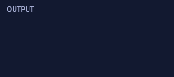

# Natív blokkpanel (PANEL)

Címkézett kártya, amely egy képernyőblokk vezérlőit fogja össze (Master: OUTPUT, PITCH, VOICES, GLIDE, SCALE, TUNING, MPE; Voice: SEQUENCE, RANDOM, SCALING, TARGETS). Forrás: [`components/native/panel/panel.py`](../../components/native/panel/panel.py).

- **Rajz:** a host rajzolja, csak egyszínű kitöltésekből: kitöltés `surface.panel`, 1 px keret `panel.border` (négy közös `keyline` definíció), cím natív Text címkével `text.caption` színben (`panel.title`: x 14, y 4, magasság 28, betű 16). Nincs képfájl, nincs textúramemória.
- **Viselkedés:** nem fogad érintést, nincs fókusza (`ignoreMousePresses`, `acceptsHWFocus: No`). A fülön a panelek állnak elöl a listában, így minden vezérlő, jelölő és felirat fölöttük van.
- **API:** `panel_definitions([(kind, (w, h), title, subtitle)], keyline=...)` a definíciókat adja (oldalanként saját `keyline` névvel, mert a skin egy nevet egyszer regisztrál); `panel_entry(name, kind, rect, gates=...)` helyezi el; a Key 61 miatt a passzív elem is kap érvényes modellt (`Parameter 0`).
- **Elhelyezés adatból:** a panelek téglalapjai a képernyő elrendezésfájljában vannak (`scripts/native_master/master_layout.json`, `scripts/native_voice/voice_layout.json`), ugyanonnan, ahonnan a C++ Q/állapot adapterek a blokkjaikat veszik.
- **Állapot:** a katalógusban még nem jóváhagyott (`catalog.json`: `approved: false`); az eszközön az owner ellenőrzi.

A közös név–érték mező egymás alatti (stacked) változata ugyanehhez az újratervezéshez készült: [nativ-nev-ertek-mezo.md](nativ-nev-ertek-mezo.md).
