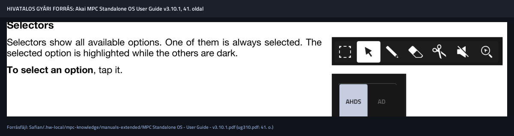
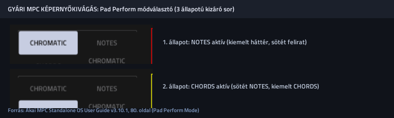
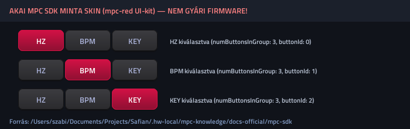
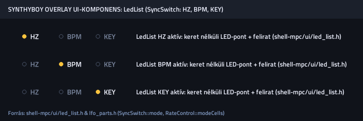
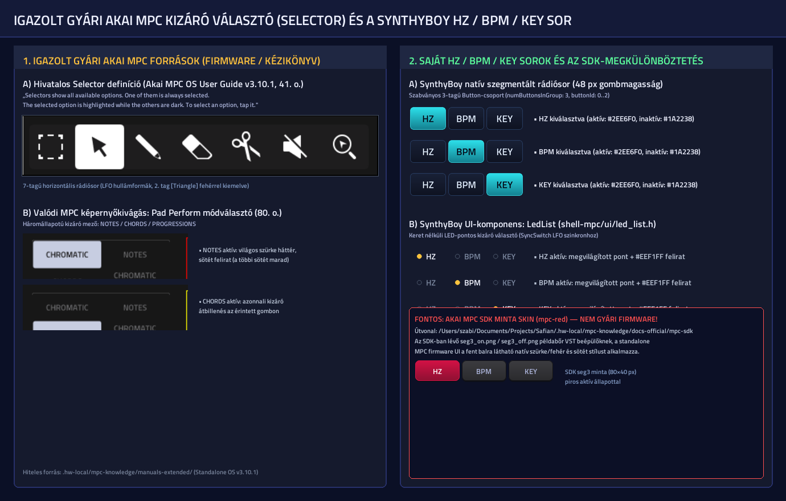

# Akai MPC gyári rádió/kizáró választás (Selector) és a SynthyBoy HZ / BPM / KEY sor

> **KIVEZETÉSRE (owner, 2026-11-27):** a mai szegmentált RadioButton (88 × 56 lapos cellák, `radio_button.py`) túl sok helyet foglal és megkerüli a Button komponenst. Helyette a kompakt család: [radio_family.md](radio_family.md) (RadioList, RadioGrid, SlideSwitch, RotarySelector). A skin átállítása külön kör.

Ez a dokumentum egy **különálló előnézet és kutatási dokumentáció** (nem a végleges komponenskatalógus része). Célja az igazolt gyári Akai MPC rádiógombos / kizáró választó vezérlők (Selectors) bemutatása a hivatalos forrásokból, összevetve a SynthyBoy saját `HZ / BPM / KEY` szinkronmód-választó sorával, valamint az Akai MPC SDK mintabőrök pontos elhatárolásával.

---

## 1. Igazolt gyári Akai MPC források

### A) Hivatalos Akai kézikönyvi definíció: „Selectors”
- **Forrásdokumentum:** `MPC Standalone OS - User Guide - v3.10.1.pdf` (és `ug310.pdf`), 41. oldal
- **Helyi abszolút elérési út:**  
  `/Users/szabi/Documents/Projects/Safian/.hw-local/mpc-knowledge/manuals-extended/MPC Standalone OS - User Guide - v3.10.1.pdf`  
  `/Users/szabi/Documents/Projects/Safian/.hw-local/mpc-knowledge/manuals/ug310.pdf`
- **Fejezet:** *Operation > General Features > Control Types > Selectors*

> **Idézet az Akai hivatalos leírásából (41. oldal):**  
> *„Selectors show all available options. One of them is always selected. The selected option is highlighted while the others are dark.*  
> *To select an option, tap it.”*

Az Akai Professional ebben a fejezetben definiálja a teljes MPC érintőképernyős vezérlőtípus-készletet (Knobs, Parameter Values, Drop-Down Menus / Lists, Selectors, Buttons, Checkboxes, Tabs, Sliders). A kizáró választásra a hivatalos tankönyvi illusztráció egy **7-tagú horizontális rádiósor** (az MPC LFO hullámformaválasztója):
- **1. szegmens:** Sine (Szinusz)
- **2. szegmens:** Triangle (Háromszög) — **AKTÍV / KIJELÖLT**: teli fehér (#FFFFFF) háttérrel és sötét ikonnal kiemelve!
- **3. szegmens:** Saw (Fűrészfog)
- **4. szegmens:** Square (Négyszög)
- **5. szegmens:** S&H (Sample & Hold)
- **6. szegmens:** Saw Down (Fordított fűrészfog)
- **7. szegmens:** Random / Noise (Zaj)

---

### B) Valódi MPC képernyőkivágás: Pad Perform módválasztó
- **Forrásdokumentum:** `MPC Standalone OS - User Guide - v3.10.1.pdf`, 80. oldal
- **Fejezet:** *Pad Perform Mode (Chromatic Notes, Notes, Chords, Chromatic Chords, Progressions, Custom Map)*

A képernyő bal felső részén elhelyezkedő 3-tagú kizáró funkciógomb-sor:
`[ NOTES ] [ CHORDS ] [ PROGRESSIONS ]`
- **Működése:** Kölcsönösen kizáró választósor. A kiválasztott gomb felülete világosra vált (világos kékes-szürke / fehér kiemelés, sötét betűkkel), míg az inaktív opciók sötét háttérrel és tompább fehér/szürke szöveggel maradnak.
- Érintésre azonnal átváltja a nézetet és a padok hozzárendelését.

---

### C) Hardveres XL referenciaképek a helyi könyvtárból
- **Helyi könyvtár:** `/Users/szabi/Documents/Projects/Safian/.hw-local/screen-library/xl/`
  - `host/project-select.png`: gyári Akai MPC XL firmware képernyőmentés.
  - `host/plugin-track-play-synthyboy.png`: az MPC host által kirajzolt alapréteg.
  - `overlay/lfo1.png`, `voice.png`: a hardveren futó felületi és rétegillesztési ellenőrzések.

---

## 2. FONTOS: Az SDK skin elhatárolása a gyári firmware-től

> [!WARNING]
> **Az SDK skin NEM firmware!**  
> Az Akai MPC SDK (`/Users/szabi/Documents/Projects/Safian/.hw-local/mpc-knowledge/docs-official/mpc-sdk`) mappában található fájlok – például az `ui-kit/mpc-red/seg3_on.png` és `seg3_off.png` elemek – **külső beépülőmodul-fejlesztőknek szánt minták (example skin kit)**, nem pedig a hardver operációs rendszerének firmware felülete.

Az SDK specifikációja (`docs/ui-reference.md`, *Radio group*):
- Szabványos Button komponens: `numButtonsInGroup: N > 1`, `buttonId: 0 .. N-1`
- Az MPC SDK minta skin (`mpc-red`) mérete: **80 × 40 px szegmensenként** (a 3-tagú gomb 240 × 40 px), aktív állapotban piros kitöltéssel (`#9B0F34`).
- Ezzel szemben az önálló Akai MPC firmware (lásd a fenti A és B pontokat) szürke/fehér kontrasztos kiemelést alkalmaz 48–56 px magas érintési sávokkal.

---

## 3. SynthyBoy saját HZ / BPM / KEY sora

A SynthyBoyban az LFO szinkronizálási módja 3 kizáró állapotot vesz fel:
1. **HZ:** Szabadon futó oszcilláció hertzben (0.01 – 30.00 Hz)
2. **BPM:** Tempóhoz kötött zenei osztás (1/4, 1/8, Trip, Dot)
3. **KEY:** Billentyűkövetés (Key follow, a hangmagassággal arányos sebesség)

A SynthyBoy ezt a feladatot két kompatibilis szinten valósítja meg:

### 1. Natív MPC rádióválasztó (Jóváhagyott 1-es változat: teljes aktív felület)
> [!IMPORTANT]
> **Tulajdonosi döntés:** Az 1-es, teljes aktív felületű kinézet az elfogadott. A komponens a natív MPC rádióválasztó újraskinezve, közös értékkel és kölcsönösen kizáró választással. Független akciógombok helyett a meglévő `scripts/native_choice_group.py` közös natív rádiócsoportját használjuk (`VARIANT_SEGMENTED`). Az SDK belső Button primitívjére épül, de a felhasználói felületen valódi rádióválasztóként viselkedik.

- **Komponens:** 3 egymás melletti összekapcsolt Button (`numButtonsInGroup: 3`, `buttonId: 0, 1, 2`, azonnali gesztus: `gestureBehaviour: "Instant"`, közös `Data` handle értékkötés). Támogatja a 2-tagú bankválasztást is (`numButtonsInGroup: 2`).
- **Méretezés:** **48 px magasság** (a katalógusban jóváhagyott standard gombarc-magasság), vagy **56 px magasság** (széles érintési tartomány).
  - Szélesség: 216 px (3 × 72 px), 240 px (3 × 80 px) vagy 202 px (illeszkedik a standard 202 px-es WAVE/SHAPE választók szélességéhez).
  - Érintési felület: a teljes opciócellák érinthetők (≥ 56 px).
- **Színpaletta (Jóváhagyott 1-es változat):**
  - **Aktív állapot:** Teljes aktív cián színátmenet (`#2EE6F0` – `#127A8A`), sötét félkövér felirat (`#06101E`), keret `#38ECF8`.
  - **Inaktív állapot:** Sötétkék felület átmenettel (`#1A2238` – `#0E1220`), világos kékesszürke szöveg (`#D4E0F2`), keret `#2C456D`.

A jelenlegi, képernyőkön használt natív minták: [képes katalógus](kepes-katalogus.html).

---

### 2. Overlay UI-könyvtári komponens: `LedList`
- **Forráskód:** [`shell-mpc/ui/led_list.h`](file:///Users/szabi/Documents/Projects/Safian/SynthyBoyVST/.claude/worktrees/agy-radio-gyari-ui-folytatas/shell-mpc/ui/led_list.h), [`shell-mpc/ui/lfo_parts.h`](file:///Users/szabi/Documents/Projects/Safian/SynthyBoyVST/.claude/worktrees/agy-radio-gyari-ui-folytatas/shell-mpc/ui/lfo_parts.h) (`SyncSwitch::mode`, `RateControl::modeCells`).
- **Működése:** Keret nélküli, lapos LED-jelzőpontos kizáró választó.
  - **Aktív opció:** Világító LED-pont (Q-Link aktív állapotban `#FFC23D` sárga, egyedi módban `#5CFF9D` vagy `#00FFFF`) + világos `#EEF1FF` felirat.
  - **Inaktív opciók:** Vékony sötét gyűrű kontúr `#465064` + tompa `#768299` felirat.
  - **Elrendezések:**
    - Horizontális 1 soros: 3 cella egymás mellett (Random LFO panel).
    - Vertikális 3 soros: egymás alatti sorok (Timing blokk, LFO teljes képernyő).

---

## 4. Részletes összehasonlító táblázat

| Szempont | Gyári Akai MPC Firmware (User Guide p. 41 & 80) | Akai MPC SDK Minta Skin (`mpc-red`) | SynthyBoy Natív Rádiósor (`scripts/native_play`) | SynthyBoy Overlay `LedList` (`shell-mpc/ui`) |
| :--- | :--- | :--- | :--- | :--- |
| **Környezet** | Standalone Linux MPC OS | VST3 SDK példa UI | Natív host skin réteg | Saját rajzolt GPU overlay |
| **Megjelenés** | Szegmentált sötét sáv / gombok | Domborított piros/szürke gombok | Szegmentált gombcsoport | Keret nélküli LED-pont + szöveg |
| **Aktív állapot** | Világos szürke/fehér teli kitöltés, sötét felirat | Piros teli kitöltés (`#9B0F34`), fehér felirat | Kékesszürke (`#175A76`), fehér felirat | Világító pont (`#FFC23D`), fehér felirat (`#EEF1FF`) |
| **Inaktív állapot** | Sötét felület (`#232730`), világos felirat | Sötét szürke felület (`#2A2A2D`), tompa felirat | Sötétkék felület (`#151A2D`), kékesszürke felirat (`#829BC4`) | Halvány gyűrű (`#465064`), tompa felirat (`#768299`) |
| **Gombmagasság** | ~40–48 px (arányos) | 40 px | **48 px** (alap) vagy **56 px** (érintőcél) | 44–56 px (cella magasság) |
| **Szélesség** | Egész blokkot kitöltő | 3 × 80 = 240 px | 202 px (kompakt) vagy 216 px (3 × 72) | 202–220 px (3 oszlop) |
| **Q-Link vezérlés** | Lépésenként léptethető | Parameter step index (0..2) | Virtuális Q / Host knob step | QGroup tag (`turn` léptet) |

---

## 5. Összegző összehasonlító mesterkép

A valódi gyári források és a SynthyBoy megvalósításai egymás mellett megtekinthetők az alábbi nagy felbontású összehasonlító táblán:

