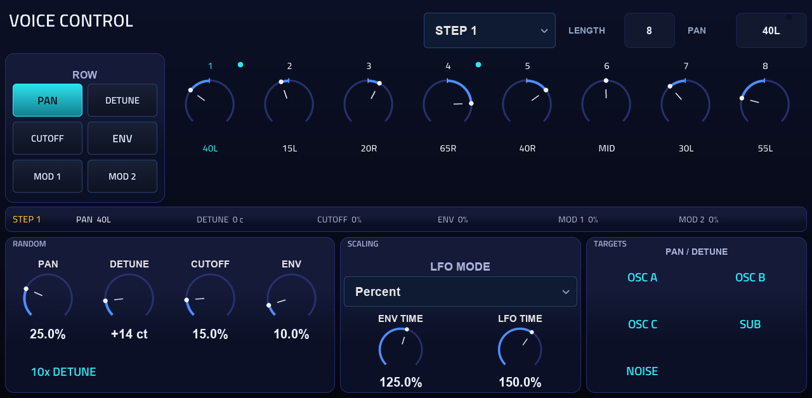

# Voice Control screen

The production Voice page uses the existing native Pan, Level, ActiveText, Selector, Name–Value and segmented radio component APIs. The real C++ VoiceGrid layer draws live step indicators, selection and the contextual readout; native knobs own their value drags.

This is an offline generated-TUI + C++ VoiceUi/scene_cpu fixture, not an MPC screenshot. [Fixture states and layer evidence](../ui-map/voice-current/README.md).

## Controls

- Header STEP uses the shared Selector and the host's `fx editor choice menu`; LENGTH and the selected row value use Name–Value fields. The value title follows PAN / DETUNE / CUTOFF / ENV / MOD1 / MOD2 and shares the grid's MID/L/R/cents/percent formatting.
- RANDOM has four own blue dials. PAN reuses Pan artwork in **unipolar variation-depth** mode0…100%; it is not a fixed bipolar L/R position.10× DETUNE is ActiveText, grayOFF/cyanON, and multiplies random detune depth only.
- SCALING puts the LFO MODE selector above ENV TIME and LFO TIME / LFO RATE. Its face is 48px high inside a 56px choice hit area with a title above, constructed portably using `build_titled_selector` from [`components/native/selector/selector.py`](../../components/native/selector/selector.py). Percent scales cycle duration (200%=half frequency); Rate scales frequency (200%=double frequency).
- TARGETS uses ActiveText for A/B/C/SUB/NOISE grouped into a passive composite via `build_titled_active_text_group_definition` from [`components/native/active_text/active_text.py`](../../components/native/active_text/active_text.py). The visible PAN/DETUNE scope label and child relative positions are derived from [`scripts/native_voice/voice_layout.json`](../../scripts/native_voice/voice_layout.json): CUTOFF and ENV sequence/random variation still act on the shared per-voice filters/envelopes. GlobalENV/LFO scaling is global; MOD1/MOD2 are matrix sources.

## Geometry and ownership

[`scripts/native_voice/voice_layout.json`](../../scripts/native_voice/voice_layout.json) is the native control geometry source. [`scripts/gen-voice-native-layout.py`](../../scripts/gen-voice-native-layout.py) generates [`voice_native_layout.h`](../../shell-mpc/ui/voice_native_layout.h) for the C++ screen. No shared component/style implementation was copied or changed for this page.

The eight visible sequence controls reuse the existing native Pan (PAN row) and blue bipolar Level (all other rows) filmstrips. Forty-eight parameter references share exactly two knob definitions; row gates show eight controls, each with a90×90px actual touch target. The overlay owns only step numbers, selected value text and sounding-voice dots, and yields every knob aperture to the host. Relative knob drags stay with their starting step; cross-column bar painting was removed. The obsolete native voice_grid component, assets, catalog entry and bar-only tooling were deleted. The C++ VoiceGrid remains the sequence model/format/live-indicator adapter.

In production, dragging a knob edits its fixed parameter through the host. Step header/footer taps select without changing the value. Native and fallback knob drags stay with their original step.

## Q-Link

Four existing groups are preserved: STEP [step,row,length,value], RANDOM [four depths], SCALING [10×,ENV time,LFO scale,mode], TARGETS [A,B,C,Sub]. NOISE remains touch-only. Gen1 adjacent RANDOM/TARGETS banks draw the shared single unnumberedQ frame; spread-out STEP/SCALING groups retain their frameless contract. Gen2 compiles out Q frames and markers.

## Safe updates and verification

Row/step proxies carry source/selection/preset identity. A queued value from the previous row, step, preset, tab or modal cannot write the current field. Native sequence knobs bind fixed engine parameters; their values feed the same overlay readout.

Targeted Python tests cover bindings, actual ActiveText buttons≥56px, assets/state masks, geometry, shared knob definitions, mode ordering and the actual C++ geometry dump. C++ Voice-only tests cover production native knob apertures/no duplicate capture, selection/preset/modal safety and both generation policies. Engine evidence and remaining parity/coverage limits: [Voice Control facts](../dsp-knowledge/voice-control.md), [review](../review/VOICE-CONTROL-REVIEW-2026-11-24.md).
