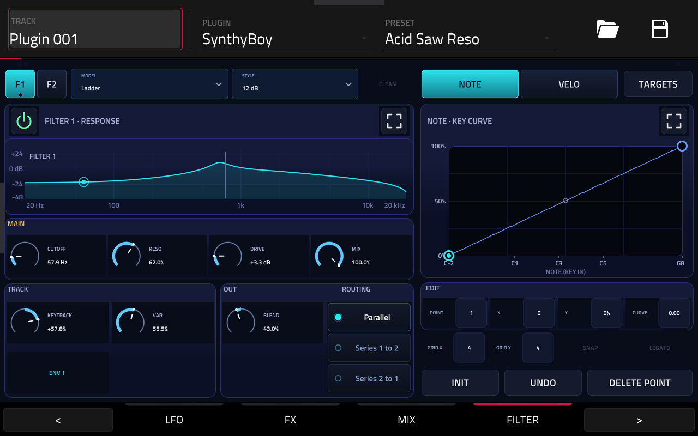

# UI Map: Filter Page (`filterui`)

> **Update 2026-11-26 (one tab page = one screen).** The Filter key has FOUR sub-tabs again: `Filter`, `Filter 2`, `Note`, `Velo` (views `filter1`, `filter2`, `filternote`, `filtervelo` of `shell-mpc/overlay/overlay_layout.json`; the view's `index` 1 .. 4 is the state of the page: F1, F2, NOTE, VELO). `pages::make` puts the page in sub-tab mode (`FilterUi::setSubTab`): the state comes from `page::Input::instance`, the chunk view state `mpcTabView.filter` is neither read nor written, the in-screen VIEW selector, the NOTE | VELO selector, the 60/40 split and both expand toggles do not exist (the skin has no cells for them and the plugin ignores the old actions). The F1+F2 curve view toggle stays on the filter pages. The skin carries only what a state can show: Filter and Filter 2 the filter surface, the chain, the PZ launcher and toolbars; Note and Velo the curve surface and their GLIDE readout (`scripts/mpc-skin-extras/98_filter_native.py`). The passages below that speak of the selector, of the split or of expand describe the old single tab; the chain menu still lists the rows F1 and F2 until the Mixer peek is gone (next commit).

Rewritten 2026-11-21 for the ONE Filter tab (step 4 of `docs/ui-map/env-filter-lfo-plan.md`, spec `SIMPLIFY.md` E; before / after pictures and the control counts: `docs/ui-map/filter-bold-cut/README.md`). Line numbers are left out on purpose (the file changes): names of members and functions are the references.

## Purpose

The Filter page is the page of the ONE tab `Filter` (the view `filter1` of `shell-mpc/overlay/overlay_layout.json`, the page `Filter` of `scripts/overlay-skin/mpc-ui-pages-overlay.json`; `filter2` and the second tab are gone: 15 pages in 9 function keys). Kind `filterui` (`kKindFilterUi`), element `FilterUi::kElementFilter = 4`. Code: `FilterUi` (`shell-mpc/overlay/filter_ui.h`), `FilterFullScreen`, `FilterDisplay`, `FilterOutReadout` (`shell-mpc/ui/filter_display.h`), `ScalarCurveUi` (`shell-mpc/overlay/scalar_curve_ui.h`) with `ScalarCurveEditor` (`shell-mpc/ui/scalar_curve_editor.h`), `ModTargetsPage`. The page fills the tab (1280 x 628).

## Split and expanded views (2026-11-24)

The root uses a 751 px Filter column and a 501 px NOTE/VELO column with a 12 px gap and 8 px outer margins. This is the 1280 × 628 **plugin content area**, inside a 1280 × 800 offline frame. The left F1/F2 selection and right NOTE/VELO selection are independent. MODEL, STYLE and CLEAN share the left header. Power is inside the response window's upper-left corner; expand is upper-right. The independent scalar graph has its own upper-right expand action and no invented ON control.

The selector row is 48 px high. Its top margin and bottom gap bring the total header to 64 px above a 751 × 378 px response window. F1 and F2 use the shared segmented selection face. The power button in the response window controls the selected filter. Beneath the graph, MAIN and TRACK each occupy one row of four controls. MAIN contains CUTOFF / RESO / DRIVE / MIX. TRACK contains KEYTRACK, ENV 1, VAR (or Formant F RESO), and conditional COMB. OUT places BLEND above a 200 × 48 px horizontal radio labelled Parallel, 1 → 2 and 2 → 1. The right compact `ScalarCurveEditor` keeps its real point canvas, POINT / X / Y / CURVE, GRID X / GRID Y / SNAP / LEGATO, INIT / UNDO / DELETE POINT and TARGETS. Its expand action opens the full editor with USED BY and conditional GLIDE. Filter expand exposes the full original Filter controls, read-only Mixer output information, Formant X/Y/TRANSPOSE/SPREAD and F1+F2 resultant view. No MORE popup is introduced.

The owner stores all twelve combinations of filter, scalar and expanded mode in `mpcTabView.filter`; `tabview::encodeFilterSplit` and `decodeFilterSplit` are the source of truth. Old values 0/1 restore F1/F2 with NOTE in split mode; 2/3 restore the full NOTE/VELO editor. No parameter indices move and no engine parameter is added. Expanding and collapsing preserve both selections. Standalone F1/F2 and Mixer PEEK retain the full Filter geometry.

The selected Filter's OFF state disables its touch, drag, wheel, Q-Link and queued native proxy edits while retaining stored values. Power and navigation remain usable; NOTE/VELO is independent. `filter.routing` belongs to both filters: it remains editable when either filter is ON, and becomes passive only when both are OFF. Native OFF controls have passive component artwork/read-only engine values and no edit actions; the shell formats raw STYLE using that filter's current model list, including while OFF; their visual apertures are separate from writable hit apertures.

The production skin composes the shared Level/Pan, Selector, ActiveText, Radio, Button and NameValue factories. Basic native controls have a single input owner; the overlay draws the actual response/XY and scalar canvas/live marker. Native child targets retain a minimum 56 px dimension. Gen1 has one unnumbered Q bank frame, while the Gen2 frame drawing path is compiled out.



The current image is a generated TUI/component-art + production C++ scene composition, **not an MPC capture**. [The historical reference](../screens/filter_old.jpg) is fixed and never overwritten by the renderer. `scripts/render_filter_screen_preview.py` publishes only `docs/screens/filter.jpg` by default; state variants, fixture JSON and comparisons use explicit temporary output outside the repository. The renderer rejects unknown dial types and missing assets instead of inventing a host widget appearance.

## PZ SVF curve

Choose PZ SVF on F1 or F2 and tap the four-corner expand icon at the top right of the response graph. The host calls the button **Edit PZ Curve**. It is inactive while the filter is off, and the rest of the response graph keeps its usual touch behavior. Tap the graph to add a point and drag a point to change its frequency or gain. **Delete Point** removes the selected point when three or more remain. **Reset** previews a flat curve. **Apply** stores the shape in the selected filter's preset content. **Back** discards the preview. Turning the filter off, changing its model or switching instance closes the editor. The standalone MPC toolbar uses native host buttons with separate F1 and F2 actions. Disabled Delete Point and Apply stay visible. A preset that keeps the active filter on and in PZ mode reloads its saved curve. The curve is saved with the preset or project chunk. The current own-engine audio path still uses its low-pass/notch blend, independently of that drawing.

## Expanded Filter layout (F1 / F2)

```
y=110 +-------------------------------------------------------------------------------------------------------------------------+
      |  chip lane (16 px: the chips of MODEL and STYLE)                                                                         |
      | [F1|F2|NOTE|VELO] (o) F1+F2   [<  MODEL  >]  [<  STYLE  >]  (o) CLEAN                                          | top bar (56 px)
      +-------------------------------------------------------------------------------------------------------------------------+
      |                                  [POWER]   FREQUENCY RESPONSE DISPLAY / FORMANT XY   [EXPAND]      |
      +----------------------------+-------------------------------+----------------------------------------------------------+
      | MAIN                       | TRACK                         | OUT                                                      |
      | CUTOFF RESO DRIVE MIX      | KEYTRACK ENV 1 VAR  COMB      | BLEND  ROUTING (3 rows)  SET ON MIXER: DEST BUS 1 BUS 2   |
      |                            | (Formant: ... F RESO)         |                           LEVEL PAN (read only)           |
      +----------------------------+-------------------------------+----------------------------------------------------------+
```

Hidden, not dimmed: COMB unless the Comb model (the fourth TRACK slot); VAR, CLEAN and COMB with the Formant model, CLEAN with the Comb model; the FORMANT block (X, Y, TRANSPOSE, SPREAD at the right of the XY pad) unless the Formant model; the formant RESONANCE (label `F RESO`, `filterN.formant.resonance`) stands in the third TRACK slot (the place of VAR) while the model is Formant. Controls: 15 (a normal model), 16 (Comb), 18 (Formant), 13 (NOTE / VELO).

## Controls

| control | parameter | gesture | note |
|---|---|---|---|
| POWER | `filterN.on` | tap | N = the selected filter; standalone instances bind to `filter1.on` / `filter2.on` |
| state selector | view state | tap | F1, F2, NOTE, VELO; remains live when filter is powered OFF |
| F1+F2 | - | tap | view only |

### Native Power Switches & OFF Navigation Invariants

Standalone Filter 1 and Filter 2 native power switches bind per-instance to `filter1.on` and `filter2.on` (the engine parameter is `.on`, not `.power`).
- **Transparent Host Aperture:** On standalone filter tabs, the plugin overlay cuts a transparent aperture in the background ground around `power.rect()` (coordinates `(16, 190, 56, 56)` on screen, `(16, 80, 56, 56)` in tab coordinates) and suppresses plugin drawing of `power`, allowing the underlying host native switch to show through seamlessly in both ON and OFF states.
- **Exclusive Native Touch Ownership:** Touch handling in `FilterUi::covers()` excludes `power.rect()` when native power is active, rejecting touch and wheel events in the plugin overlay so the host control receives them exclusively.
- **OFF Navigation Invariants:** When powered OFF (`0`):
  - Power toggle remains operable and visible (`showWhenDataModelInvalid="Show"`, `whenVisible="Always"`, `acceptsHWFocus="Yes"`; self-disabling `Enable` and `IndexedEnabling` handles stripped).
  - Native touch ownership and transparent host aperture are preserved in the OFF state, allowing the user to turn the filter back ON via the native host switch.
  - Tab navigation and state selection (`view`, `close`, `both`) remain active and selectable without lockout.
  - Engine DSP parameter controls (cutoff, resonance, drive, mix) and Q-Link writes are suppressed to prevent accidental edits while powered OFF.

| MODEL | `filterN.model` | chevrons, wheel, Q, centre tap = list of the 27 models | no separate list button; Q member of OUT |
| STYLE | `filterN.style` | chevrons, wheel, Q, centre tap = list (one style: plain label, no list) | Q member of OUT |
| CLEAN | `filterN.clean_mode` | tap | hidden for Comb and Formant |
| display | `cutoff` + `resonance`, or `formant.x` + `formant.y` | drag | handle on the curve; dual: two handles |
| CUTOFF, RESO, DRIVE, MIX | `cutoff`, `resonance`, `drive`, `mix` | drag, wheel, Q, long press = modulations | MAIN |
| KEYTRACK, ENV 1, VAR | `keytrack`, `env1`, `var` | same | TRACK |
| COMB | `comb_offset` | same | Comb model only |
| F RESO | `formant.resonance` | same | Formant model only, TRACK slot 3 |
| X, Y, TRANSPOSE, SPREAD | `formant.x`, `.y`, `.transpose`, `.spread` | same | Formant model only, FORMANT |
| BLEND, ROUTING | `filterN.blend`, `filter.routing` | knob, list | editable (no Mixer home) |
| DEST, BUS 1, BUS 2, LEVEL, PAN | `filterN.destination`, `.bus1_send`, `.bus2_send`, `.level`, `.pan` | none | native readouts of the selected filter. PAN is a signed percentage. The Mixer F1 / F2 strips edit these values. |

Removed (safe list K, 2026-11-21): the OUTPUT button and its popup (`FilterRoutePanel`, `kPageRoute`), the model list button (D10), the dead OUT button, the LEVEL and PAN knobs of the OUT block (U5), the dimmed COMB (U4).

## NOTE and VELO

The editor is the step 5 component (`docs/ui-components/scalar-curve-editor.md`): the graph (points, bend, 2 to 64 points), INIT, UNDO, DELETE POINT, LEGATO (`curve.note.legato` / `curve.velocity.legato`) with the native GLIDE readout (`master.portamento.time`, shown while LEGATO is on), the fields POINT, X, Y, CURVE, GRID X, GRID Y, SNAP, USED BY (the slots whose source or AUX source is the key / velocity, up to four rows) and TARGETS. The curve is CONTENT (`content.curves.note / .velocity`; the identity is the empty vector), written through `IInstanceView::setScalarCurve`. The NOTE axis is named C-2, C1, C3, C5, G8 (`ui::keyName`, key 60 = C3). The live marker (a line from the axis to the curve and a dot) follows the last note-on (`IInstanceView::lastPlayed`: the key for NOTE, the velocity for VELO), drawn by `drawLive` on the animated layer.

The curve editor's UNDO restores a snapshot of the active curve. The XL's clock menu shows MPC project history, with Undo and Redo commands. The plugin SDK exposes parameter gesture begin/end with a parameter index and automation with a single numeric value. Neither the documented callbacks nor the skin actions specify how to submit a before/after content chunk to project history. Hardware integration needs an observed MPC history entry and the host callback that restores the original and final point sets. [MPC XL guide, p. 56](https://cdn.inmusicbrands.com/Software/MP3108CNOVOP/MPC%20Live%20III%2C%20MPC%20XL%20-%20User%20Guide%20-%20v3.10.1.pdf#page=56) · [Plugin SDK host callbacks](https://github.com/inmusic-software/mpc-plugin-builder-sdk/blob/febd2ca5bd9eb16c4a412837196e145566bc981b/framework/mpc_vst2_abi.h#L176-L230)

Native MPC components own all base control artwork and gestures, including MODEL/STYLE host menus. The overlay retains response/XY/curve content, live markers and non-rendering geometry/Q adapters; invalid native bindings never reveal an overlay control fallback. Native NOTE/VELO selection in the expanded Filter opens the corresponding full curve editor.

## Pages above the tab

| page | id | what |
|---|---|---|
| modulations of a control | `kPageMods = 22` (`ModulationsPage`) | a long press on a knob; the board of the sources when nothing modulates it |
| targets of NOTE / VELO | `kPageTargets = 23` (`ModTargetsPage`) | TARGETS of the editor; rows with depth, polarity, ON, remove; ADD TARGET |
| list of the destinations | `kPageDest = 24` (`ListPopup`) | the groups, then the parameters of a group; the slot is written with the source 23 / 24 |

## Q-Link groups

Split root has exactly four banks (sixteen slots): MAIN, TRACK, OUT, scalar EDIT. Full Filter keeps the Formant bank; full scalar adds LEGATO/GRID. Disabled Filter banks publish empty targets, while the independent scalar EDIT bank stays live. XL slots remain fixed; four-knob devices put the touched live bank first, following the shared QSlots rule.

The following table describes the expanded views:

| state | groups |
|---|---|
| F1 / F2 | MAIN [CUTOFF, RESO, DRIVE, MIX]; TRACK [KEYTRACK, ENV 1, VAR (Formant: F RESO), COMB (Comb only)]; OUT [BLEND, ROUTING, MODEL, STYLE] (frameless: MODEL and STYLE stand in the top bar); FORMANT [X, Y, TRANSPOSE, SPREAD] (Formant only). A tap on a member makes its group the active one |
| NOTE / VELO | EDIT [POINT, X, Y, CURVE] (the virtual targets 0 .. 3); LEGATO AND GRID [LEGATO, GRID X, GRID Y, SNAP] (the legato key, the virtual targets 4 .. 6). The Filter page has no virtual target of its own |
| targets / modulations pages | one group per row (depth, polarity, ON) |

Key 61: the active group on Q 1 .. 4, the next groups follow (banks 1 .. 4); XL: Q 1 .. 16 (up to four groups stay on their knobs). Proof: `qslots_host` (both devices, every state), `coverage_host` (the two legato keys are Q members; level, pan, destination and the sends are covered by the Mixer module).

## Live parts

The response curves are the engine's own filter on an impulse (`curve_source.h`, once per change, with the live cutoff and resonance of the voice that is heard); the sounding voices' key-tracked cutoff markers and the modulated cutoff line on the display; the NOTE / VELO marker. A switched-off filter is drawn dim.

## Tests

`filter_ui_host` (states, F1+F2 view only, hidden by model, read-only OUT, NOTE / VELO embedded, writes, TARGETS, virtual Q targets, marker), `qslots_host`, `coverage_host`, `layout_lint_host --only filter1` (every state: main, f2, formant, f2-formant, comb, dual, note, velo, custom curves, targets, mods: 0 findings), `page_view_host`, `ui_scalar_curve_host`, `scalar_curve_ui_host`, `scalar_curve_chunk_host` (live plugin), `play_restore_host`.

## Open

- Whole generated TUI size remains above the global 750000-byte gate: comparable current generator with the prior Filter hook is 893716 B; the split hook is 998167 B (+104451 B). This is a feature-size increase, not a size optimisation result.

- The device check of the whole page (all 15 tabs, the states, Q-Links, reload, editing a curve and hearing it, the live marker): `TODO.md`.
- The Mixer chips that jump to F1 / F2 (tap to navigate) are held (no host-tab mechanism known).
