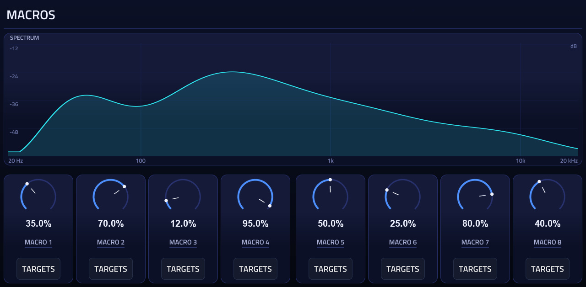

# Macros page

## Purpose

The MACROS page arranges all eight macros in a single horizontal row along the bottom beneath a continuous full-width upper spectrum display, with a clean header (no top `BANK 1 / BANK 2` switcher):
- **Clean Header (`{0, 0, 1280, 64}`)**: `"MACROS"` title at `{14, 4, 260, 56}` and divider keyline at `y = 62`. No UI bank switch widget, popup, or carousel.
- **Studio Spectrum Display (`SpectrumStrip`)**: Full-width rectangular upper display `{8, 72, 1264, 290}` showing a 256-bin log-frequency response (`20 Hz .. 20 kHz`, `-60 dB .. 0 dB`) with cyan harmonic curve stroke and shaded fill.
- **Single Bottom Row (`{8, 382, 1264, 238}`)**: All 8 compact `MacroCard` controls (`152 × 238 px` each) directly visible side by side:
  - Hardware Bank 1 (Macros 1..4): `x = 8, 166, 324, 482` (`6 px` inner gap).
  - `12 px` bank divider gap (`482+152 = 634 .. 646`) separating Cards 1..4 from Cards 5..8.
  - Hardware Bank 2 (Macros 5..8): `x = 646, 804, 962, 1120` (`6 px` inner gap).
- Each compact card stacks a proportional square `90 × 90 px` unipolar blue dial (`#3568c0`), centered single value readout, centered interactive macro name button (touch height `56 px`), and a standalone `48 px` `TARGETS` native action button in a `144 × 56 px` slot—with zero touch overlaps.
- Hardware Q-Link mapping stays fixed (`Q 1..4 = macro.1..4`, `Q 5..8 = macro.5..8`). On Key 61 (`Gen1`), a yellow bank frame + single unnumbered `'Q'` chip tracks the focused 4-card bank; MPC XL suppresses the frame (`wideDevice() == true`); Gen2 compiles out frame/marker cleanly.

---

## Canonical View State and Previews

*(Canonical reference from offline synthetic fixture: [../screens/macros.jpg](../screens/macros.jpg), mirrored in [docs/user-guide/img/macros.png](https://github.com/Safian/SynthyBoy/blob/b91c23c3/docs/user-guide/img/macros.png), [docs/user-guide/img/ui_screen_macros_preview.png](https://github.com/Safian/SynthyBoy/blob/b91c23c3/docs/user-guide/img/ui_screen_macros_preview.png), and [docs/ui-components/komponensek/ui_screen_macros_preview.png](https://github.com/Safian/SynthyBoy/blob/b91c23c3/docs/ui-components/komponensek/ui_screen_macros_preview.png))*

### Multi-State Previews (Synthetic Offline Renders)
- **Default Fixture (MPC XL, All 8 Visible, No Frame)**: [../screens/macros.jpg](../screens/macros.jpg)
- **Key 61 Gen1 Bank 1 Focus (Unnumbered 'Q' Frame on Cards 1..4)**: [macros-screen-preview-key61.png](https://github.com/Safian/SynthyBoy/blob/b91c23c3/docs/ui-map/macros-screen-preview-key61.png)
- **Key 61 Gen1 Bank 2 Focus (Unnumbered 'Q' Frame on Cards 5..8)**: [macros-screen-preview-bank2.png](https://github.com/Safian/SynthyBoy/blob/b91c23c3/docs/ui-map/macros-screen-preview-bank2.png)
- **Sound Design Named Fixture (MPC XL, Adaptive Underlines)**: [macros-screen-preview-named.png](https://github.com/Safian/SynthyBoy/blob/b91c23c3/docs/ui-map/macros-screen-preview-named.png)
- **Component & Layout Comparison Graphic**: [macros-component-comparison.png](https://github.com/Safian/SynthyBoy/blob/b91c23c3/docs/ui-map/macros-component-comparison.png)

---

## Contract Source and Synthetic Verification Origin

1. **Single Geometry Contract**:
   - All token coordinates originate in [components/sizes.json](../../components/sizes.json) (`macro_card.*` and `macros.*`) and are generated into C++ constants in [macro_card_contract.h](../../shell-mpc/ui/macro_card_contract.h) by [gen-macro-contract.py](../../scripts/gen-macro-contract.py).
2. **Synthetic Test Fixtures (Not Hardware Screenshots)**:
   - The `default`, `named`, and spectrum preview fixtures are synthetic offline test inputs for verifying geometry, layer ownership, non-overlapping touch zones, and state resolution; they are not physical hardware measurements or hardware captures.

---

## Image Source & Generation Pipeline

Canonical preview PNGs are rendered via [render_ui_screen_macros_preview.py](../../scripts/render_ui_screen_macros_preview.py) by compositing two authentic layers at identical state:

1. **Generated Native Host Skin Layer (1280 × 628 px)**:
   - Rendered via `MacrosSketch` (`render-mpc-skin-preview.py`) on the static host background [overlay_canvas.png](../../scripts/mpc-skin-extras/overlay-backgrounds/overlay_canvas.png) (1280 × 628 lossless compressed RGB PNG).
   - Leaves `nameRect` clear (`include_name=False`) so overlay name labels never collide with host text.
   - Renders the `90 × 90 px` 127-frame `play_sub_level_90.png` dial, centered `20 px` value readout, and centered `48 px` `TARGETS` button face.

2. **Authentic C++ Overlay Layer (1280 × 628 px)**:
   - Rendered by C++ `synthyboy_mpc::ui::MacroView` and `SpectrumStrip` via [render_macros_overlay.cpp](../../tools/render_macros_overlay.cpp) and `overlay::renderScene`.
   - Built with content-keyed SHA-256 caching to avoid stale-header builds across worktrees.
   - **Fixture 1 (`default`)**: `"MACRO 1"` .. `"MACRO 8"` (`nameId = 500 + i`) with values `[0.35, 0.70, 0.12, 0.95, 0.50, 0.25, 0.80, 0.40]`.
   - **Fixture 2 (`named`)**: `["CUTOFF", "RESO", "DRIVE", "WARP", "SPACE", "ATTACK", "DECAY", "RATE"]` with values `[0.50, 0.75, 0.45, 0.85, 0.60, 0.30, 0.15, 0.90]`.
   - **Hardware Q-Link Frame**: `MPC XL` (`wideDevice() == true`) draws no bank frame; `Key 61` Gen1 (`wideDevice() == false`) draws one yellow focus frame around the active 4-card bank with a single unnumbered `'Q'` badge.

---

## Layout and Geometry Specification

The page occupies the full tab region (1280 × 628 px).

### 1. Spatial Structure
- **Canvas Dimensions**: 1280 × 628 px; outer horizontal margin `8 px`.
- **Header (`y = 0..64`)**: `"MACROS"` semibold title `{14, 4, 260, 56}`, keyline `y = 62`. Clean background elsewhere in header.
- **Studio Spectrum Display (`{8, 72, 1264, 290}`)**:
  - Dedicated clear upper display spanning all 8 cards' combined width.
  - 256 log-frequency points (`20 Hz .. 20 kHz`), `-60 dB .. 0 dB` grid every `12 dB`, cyan stroke + shaded fill via `SpectrumStrip::drawLive`.
- **Bottom Macro Row (`y = 382..620`, gap `20 px` below spectrum)**:
  - Card 0..3 (Bank 1): `{8, 382, 152, 238}`, `{166, 382, 152, 238}`, `{324, 382, 152, 238}`, `{482, 382, 152, 238}`
  - Card 4..7 (Bank 2): `{646, 382, 152, 238}`, `{804, 382, 152, 238}`, `{962, 382, 152, 238}`, `{1120, 382, 152, 238}`

### 2. Card Interior Layout (`152 × 238 px`, vertical stack)
Inside each `MacroCard` (all interactive touch targets `>= 56 px` and strictly disjoint):
- **Rotary Dial (`dial_rect` `{0, 0, 152, 118}`)**:
  - `90 × 90 px` square dial at `{31, 4, 90, 90}`, native touch well `{29, 2, 94, 92}`.
  - Unipolar custom blue arc (`#3568c0`), white needle & dot, `#1a2d5a` track.
- **Value Readout (`value_rect` `{8, 96, 136, 22}`)**:
  - Centered single value text (`20 px`, e.g. `"35.0%"`), host-skin rendered inside the bottom of the dial region.
- **Macro Name Button (`name_hit_rect` `{4, 120, 144, 56}`)**:
  - Vertically separated below dial (`120 > 118`), `56 px` touch height, centered label `{8, 136, 136, 24}` with adaptive width underline (highlighted in yellow on Key 61 active bank). Fits/ellipsizes long names cleanly. Tapping opens `TextEntry` (`kPageKeyboard = 52`).
- **Targets Action Button (`target_rect` `{4, 178, 144, 56}`)**:
  - Vertically separated below name hitbox (`178 > 176`), `56 px` touch height hosting a centered `48 px` native `TARGETS` button face. Tapping opens modulation targets (`kPageTargets = 50`) without altering the macro's value.

### 3. Active Q-Link Bank Frame & Fixed Routing
- **Fixed Q-Link Mapping** ([macro_ui.h](../../shell-mpc/overlay/macro_ui.h)):
  - Always publishes `Q 1..4 = macro.1..4` (Bank 1) and `Q 5..8 = macro.5..8` (Bank 2), `Q 9..16 = -1` (`kNone`) via `qSlots_.publish(v, 2, 0, ...)`.
  - Touching a card or rotating hardware Q-Link encoders on Key 61 updates only visual bank focus (`view_.setBank(0 | 1)`); Bank 1/2 parameter slots are never swapped.
- **Gen1 Key 61 (`!wideDevice()`, `SYNTHYBOY_MPC_QFRAME_ENABLED == 1`)**: Draws one yellow focus frame around the focused bank (`x = 8..634` or `x = 646..1272`) and one unnumbered `'Q'` marker at upper-left (`{5, 367, ...}` or `{643, 367, ...}`). Zero numbered Q badges.
- **MPC XL (`wideDevice() == true`) & Gen2 (`SYNTHYBOY_MPC_QFRAME_ENABLED == 0`)**: No bank frame or `'Q'` marker is drawn.

---

## Sub-Pages and Modals

- **Targets page** (`kPageTargets = 50`, [mod_targets.h](../../shell-mpc/ui/mod_targets.h)): Tapping `TARGETS` opens modulation slots routed from that macro (`modN.amount`, `modN.bipolar`, `modN.bypass`, `ADD TARGET`, remove `"X"`). Q1..Q4 focus the active target row on the Targets sub-page.
- **Destination list popup** (`kPageList = 51`): Opens on `ADD TARGET`.
- **Keyboard page** (`kPageKeyboard = 52`): Opens full-screen `TextEntry` when tapping a macro's centered name hitbox.

---

## Live parts

- **Spectrum display**: updated ~16 ms from `SpectrumRing` (`MacroUi::refresh`).
- **Macro card target indicator / live values**: refreshed from preset content and parameter/modulation state without touching other cards' GPU cache cells (18 cached cells total in Key 61 mode).

---

## Duplicates and Single Value Principle

- `macro.1` through `macro.8`: unique per card; no duplicate parameter bindings or bank-switch parameters.
- **Single value principle**: One value readout per card (host-owned), one name label per card (overlay-owned), clean static host background pixel-identical across composed vs all-in-one renders.

The macro dial/value and TARGETS action have one native implementation. Host unavailability never selects a GPU replacement. The overlay retains macro names/rename, spectrum and Q-Link focus decoration.
