# SynthyBoy for MPC - User Guide (first draft)

Status: first draft, written from the source code and the developer notes of the branch `feature/mpc-overlay`
(commit a9251b1b) and from pictures rendered by the code, not from a device session. Every point marked
`TODO(owner)` is a question that the code and the developer notes do not answer. Other pages are being
reworked while this draft is written; the last chapter lists what will need an update.

How to read the pictures: they are rendered by the developer's test program with the default ("Init")
sound, cut to the plugin's own area (1280 x 628 pixels). They are not photographs of the device, and the
values on your screen will differ. The MPC's own header and tab bar are not in the pictures.

Contents

1. What it is
2. Install and first start
3. The screen
4. Controls
5. The pages
   - 5.1 Play
   - 5.2 Macros
   - 5.3 Osc A / B / C
   - 5.4 Sub
   - 5.5 Noise
   - 5.6 Mixer
   - 5.7 Filter 1 / 2
   - 5.8 Envelopes
   - 5.9 LFOs and the drawn-shape editor
   - 5.10 Mod matrix
   - 5.11 FX
   - 5.12 Master
   - 5.13 Voice control
6. Modulation
7. Presets
8. Known limitations
9. Troubleshooting
10. To update when the UI changes

---

## 1. What it is

SynthyBoy is a synthesizer plugin for Akai MPC hardware (VST2 format, loaded by the MPC's external plugin
support). It has three oscillators (A, B, C) that play wavetables, samples or grains, a sub oscillator, a
noise generator, two filters, six envelopes, ten LFOs and four random LFOs, eight macros, a 64-slot
modulation matrix, a set of 13 effect types, and a master section with tuning, MPE and voice control.
112 factory presets come with it.

**Tested devices.** MPC Key 61 with MPC OS 3.10.1.12, and MPC XL. Other MPC models have not been tested.

**What "experimental display overlay" means for you.** The MPC does not let a plugin draw its own screens,
so the plugin draws its pages itself, on a separate display layer on top of the MPC's picture. The MPC's
header and tab bar are still the MPC's own, and the MPC firmware does not know about the plugin's pictures,
so a firmware update or an unusual host situation (for example a pop-up of the host over the page, or the
device dimming in standby) can make the plugin's picture disappear or flicker. The sound is not affected.

This guide describes the version with the plugin-drawn pages ("overlay build").

## 2. Install and first start

Steps, as given in the developer notes (`docs/MPC.md`, "Install on the MPC"):

1. Copy the whole folder `Safian - VST - SynthyBoy` into a folder named exactly `VST2 Plugins` at the root
   of a USB drive, an SD card, or the MPC's internal drive.
2. The MPC must run MPC OS 3.10.1 or later.
3. In **Preferences > Enhancements (Beta)** turn on both **Enable Enhancements** and **External Plugin
   Support**. The plugin stays hidden until both switches are on.
4. A plugin that was copied while the MPC application was running appears only after the MPC application
   is restarted.
5. Open the plugin browser (the developer notes name: instrument track, plugin program, browse; or an
   insert slot). The plugin is listed under **External Plugins**.
   TODO(owner): Give the exact on-screen steps and button names, on the Key 61 and on the XL, for putting
   SynthyBoy on an instrument track (the notes only say "instrument track -> plugin program -> browse, or an
   insert slot").
6. Replacing the plugin: copy the new folder over the old one, then remove and re-add the plugin on the
   track (or restart the MPC if the skins changed). Uninstalling: delete the folder from `VST2 Plugins`;
   projects that used it then load without the plugin.

The package contains two builds of the plugin (32-bit for the Key 61, 64-bit for the XL); the MPC picks the
one that fits.

TODO(owner): The pages in this guide exist only in the "overlay" package. How does a user get that package,
and how can he tell it from a package without the drawn pages (name of the folder, version number, the
Play page looks like chapter 5.1)?

**First start.** Put the plugin on a track and press the key **Play** (the first function key). You should
see the three panels of chapter 5.1. If you see only a dark empty area, see chapter 9.

A project that already had SynthyBoy on a track with an older version keeps that track's old Q-Link
assignment until the plugin is inserted again (chapter 8).

## 3. The screen

The screen is 1280 x 800 pixels and touch sensitive.

- **Header** (top): track, plugin and preset (the PRESET field). Drawn by the MPC.
- **Tab bar** (bottom): the function keys of the MPC. Drawn by the MPC.
- **Plugin area** (between them, 1280 x 628 pixels): drawn by SynthyBoy. All the pictures in this guide
  show this area.

**Function tabs and sub-pages.** SynthyBoy has ten function tabs. Pressing a tab shows its first page;
**pressing the same tab again steps to its next sub-page** (the dots under the tab show how many there
are). The name on the tab shows the first page's short name; after stepping on, it shows the name of the
page that is on the screen.

| Function tab | Pages (in stepping order) | Chapter |
|---|---|---|
| Play | Play, Play Env, Play LFO | 5.1 |
| Macros | Macros | 5.2 |
| Osc | Osc A, Osc B, Osc C, Sub, Noise | 5.3, 5.4, 5.5 |
| Mix | Mixer | 5.6 |
| Filter | Filter 1, Filter 2 | 5.7 |
| Env | Env 1, Env 2, Env 3, Env 4 | 5.8 |
| LFO | LFO 1, LFO 2, LFO 3, LFO 4 | 5.9 |
| Mod | Mod | 5.10 |
| FX | FX | 5.11 |
| Master | Master, Voice | 5.12, 5.13 |

24 pages in all. Inside the Filter, Env and LFO pages you can switch to the other filter, envelope or LFO
without leaving the page (a second set of buttons on the page): the tab only decides which one is shown first.
There are six envelopes and ten LFOs plus four random LFOs; the tabs Env 1 - 4 and LFO 1 - 4 are just the first
entries.

**Opening and closing inside a page.** Several pages have a full-screen button, a "MORE" button, a gear, or a
list: they open a page over the current one. A **BACK** or **CLOSE** button returns. Leaving the Play tab closes everything that was opened
over its pages.

Only the plugin of the track whose page is on the screen is drawn; with several SynthyBoy instances the
picture follows the track you are looking at (up to 16 instances; chapter 8).

## 4. Controls

### 4.1 Touch

The touch screen follows **one finger**: while a finger is down, a second finger is ignored until the first
is lifted.

| Gesture | What it does |
|---|---|
| **Tap** | Presses buttons and switches, selects a card, row or cell, steps a list, opens a page. On a stepper with arrows (< Name >): the left half goes back, the right half forward; on a stepper with a name, a tap on the middle half opens the list of all choices, the outer quarters still step. |
| **Drag up / down** on a knob or number field | Changes the value (up = more). A knob covers its whole range over 200 pixels of drag. A number field changes one step per its own number of pixels. |
| **Horizontal drag** on a bar (modulation depth bars) | Changes the value; the whole bar is the whole range. |
| **Vertical drag** on a fader (Mixer) | Changes the level. |
| **Double tap** (two taps within 0.4 seconds and 30 pixels) | Sets a knob, number field, fader or depth bar to its default value; on an envelope handle sets that handle's default. |
| **Long press** (0.6 seconds without moving) on a knob or number field | Opens the modulation page of that control (chapter 6). On the drawn-shape editor: deletes a point. |
| **Drag on the colored tab** at the top left of a knob that is modulated | Changes the depth of the modulation of the selected source (chapter 6). |
| **Tap on a pictogram or cell** | Selects it (oscillator type, LFO shape, Sub waveform, ...). |

Not every control has every gesture; the chapters say what each control does.

### 4.2 The Q frame and the numbered chips

Every page that has controls groups them in **Q groups** of four values. One group is **active**: it has a
**yellow frame**, and its four members have yellow **numbered chips** (1 to 4) at their top left corner. The
chip number is the Q-Link knob that turns that control.

- **Make another group active:** touch (tap or start a drag on) a control of that group; the frame moves to
  it. Pages that have a "bank" (Macros) or a selected strip (Mixer) also move the frame when you tap their
  buttons or strips.
- **Quiet chips** on the other groups show which knob would turn them (see 4.3).
- A page can have fewer groups than knobs; the knobs without a group do nothing.

### 4.3 The Q-Link knobs

SynthyBoy always maps the 16 Q-Link slots: slots 1 - 4 belong to the **active group**, slots 5 - 8, 9 - 12 and 13 - 16 to the
**next groups of the page in reading order**, wrapping around, each group once. A page with fewer than four
groups leaves the rest of the slots without a function.

**MPC XL (16 knobs).** All 16 knobs are alive at once: knobs 1 - 4 turn the active group, knobs 5 - 16 the next
groups. The quiet chips on those groups show the numbers 5 - 16.

**MPC Key 61 (4 knobs, four banks).** The four knobs always turn four values. The bank button steps through
four banks: bank 1 = slots 1 - 4 (the active group), bank 2 = slots 5 - 8, bank 3 = 9 - 12, bank 4 = 13 - 16. On
this device the quiet chips show numbers 1 - 4 relative to the bank, so you know which group a bank leads
to. The host remembers the bank per tab.
TODO(owner): What is the exact label of the bank button on the Key 61 hardware (the notes say "the bank button")?

**Stepped targets** (switches, lists, integer steppers such as polyphony): a Q-Link does not sweep them from 0 to
100 percent of its travel; it makes **one step per small turn** (3/128 of the knob's travel). The ends of a
list do nothing. After a step the host's knob display follows the real position.

**Knob displays.** The name, value text, unit and dial position the MPC shows for a knob are those of the
real parameter it currently controls (for example "Filter 1 Cutoff" or "Macro 5"). When you change the
active group or the page, the names change with it. A knob without a target shows "Q n" and nothing else.

**Key 61 pop-up.** On the Key 61 the host shows a "Q-Link Status" pop-up on the right when a knob is touched. See
chapter 8 on how to switch it off. On the XL there is no such pop-up (the knobs have their own displays).

### 4.4 USB mouse

A USB mouse works like a finger on the plugin's pages: the **left button** is a touch (press and drag work
as on the screen), and the **wheel** steps the control under the pointer: one wheel notch is one Q-Link step
on a knob or bar, one step on a stepper or number, and the wheel moves a list up when you roll away from yourself.
The mouse pointer you see is the MPC's own pointer. Plug the mouse in at any time; it is picked up within about
two seconds.

### 4.5 Value displays

Every control shows its value in the parameter's own unit. Pan is written C, L 35 or R 35; levels in dB or percent;
times in ms or s; tunings in semitones (st) or cents (ct).

## 5. The pages

In every chapter below, "range" is the range of the real parameter from `docs/params.json`; the text on the
screen is quoted in capitals as it appears.

### 5.1 Play

The Play tab has three sub-pages, **Play**, **Play Env** and **Play LFO**. All three show the same picture:
three live panels side by side, an **oscillator** panel (left), an **envelope** panel (middle) and an **LFO**
panel (right). The sub-page decides which panel's group is active (yellow frame) for the Q-Links: the
oscillator on Play, the envelope on Play Env, the LFO on Play LFO.
The envelope panel with the ADSR group framed:

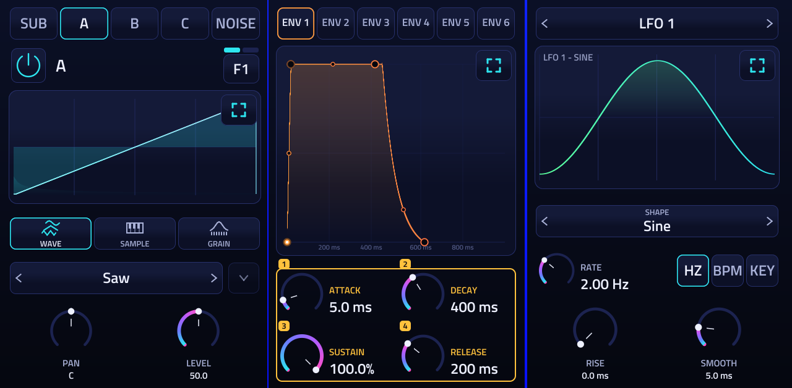

The LFO panel with its group (SHAPE, RATE, RISE, SMOOTH) framed:

**Oscillator panel.**

| Control | What it does |
|---|---|
| SUB, A, B, C, NOISE buttons | Choose which oscillator the panel shows and edits (saved with the project). |
| Power button and name | Switch the shown oscillator on and off. |
| Route button (F1 / F2 / F12 / M / DIR / BAL / OFF) | Tap: opens the output popup (target, balance, BUS 1, BUS 2) of that oscillator. |
| Display + full-screen button | One cycle of the oscillator; the button opens the full-screen oscillator page (chapter 5.3 / 5.4 / 5.5). |
| WAVE / SAMPLE / GRAIN | Oscillator type (wavetable / multisample / granular). Q 1. |
| Source stepper and the list button | Wavetable name, or the loaded file. In the compact view the list button for wavetables is dim; the list opens from the full screen. Q 2. |
| PAN | -100 .. +100 percent (C, L n, R n). Q 3. |
| LEVEL | 0 .. 100 percent. Q 4. |

Sub and Noise have different controls (waveform, octave; noise colour, filter): see 5.4 and 5.5.

**Envelope panel.** ENV 1 .. ENV 6 buttons (a small dot marks an envelope that modulates something), the
envelope graph with a full-screen button, and the knobs ATTACK, DECAY, SUSTAIN, RELEASE (Q 1 - 4). Details
in 5.8.

**LFO panel.** The stepper LFO 1 .. LFO 10, RND 1 .. RND 4 (a tap on the name opens the list), the
shape display with a full-screen button, SHAPE stepper, RATE knob with the buttons HZ / BPM / KEY, RISE and SMOOTH
(Q 1 - 4). Details in 5.9.

**Full screen.** The full-screen button opens the page of that element over the whole plugin area (the same
page as the corresponding Osc, Env or LFO tab, with a CLOSE button). Leaving the Play tab closes it.

### 5.2 Macros

Eight macros as cards, two rows of four, with the live spectrum of the plugin's output under them.
Buttons **BANK 1: 1-4** and **BANK 2: 5-8** choose which row is the active Q group.

- Each card: a knob (name MACRO n, value 0 .. 100 percent, default 0) and chips naming what the macro
  drives. A card without targets says "NO TARGET - TAP TO ADD". A tap on the chips area opens the **targets
  page** of the macro (list of routes with depth, polarity UNI/BI, ON/OFF and remove, and ADD TARGET, see
  chapter 6).
- Q-Links: Bank 1 = macros 1 - 4, Bank 2 = macros 5 - 8. The macro names are fixed.
- **Spectrum** (bottom strip): the spectrum of the plugin's output after the output stage (20 Hz to 20 kHz,
  scale -12 to -48 dB). It is a display only.

### 5.3 Osc A / B / C

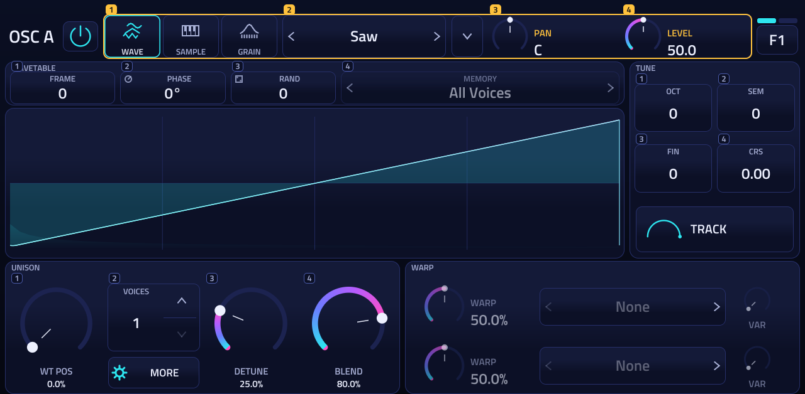

Three identical wavetable oscillators (Osc A = Osc 1, B = Osc 2, C = Osc 3 in the parameter list). The page is the
full-screen page of one oscillator.

**Header** (left to right): the name (OSC A), the power button (Off/On), the type bar **WAVE / SAMPLE /
GRAIN**, the source stepper with a list button, **PAN**, **LEVEL** and the **route button**.

| Control | Parameter and range | Notes |
|---|---|---|
| Power | Osc N On, Off/On | |
| WAVE | Osc N Type = Wavetable | |
| SAMPLE | Osc N Type = Multisample | |
| GRAIN | Osc N Type = Granular | The engine also has the types Sample and Spectral; they are not selectable from this page, a preset that uses them shows the type name with an empty bar. |
| Source stepper (Wave type) | Osc N Wavetable, 15 choices: Sine, Saw, Square, Triangle, Pulse 25%, Saw to Square, Sine to Saw, Harmonic Series, Odd Harmonics, Formant Sweep, FM Sweep, PWM Sweep, Bell Partials, Preset table, Saw Down | A tap on the name or the list button opens the list; the outer quarters step. |
| PAN | -100 .. 100 percent, default 0 | Q 3 |
| LEVEL | 0 .. 100 percent, default 50 | Q 4 |
| Route button | Osc N Destination: F1, F2, F12 (Filters 1+2), M (Effects only), DIR (Direct out), BAL (Filter blend), OFF (None) | Tap opens the output popup: target, balance (Osc N Filter Blend, 0 .. 100 percent, only for Filter blend), BUS 1 and BUS 2 sends (0 .. 100 percent). Default F1. |

**Wavetable bar.** FRAME (the position, read only), PHASE (0 .. 360 degrees), RAND (random phase, 0 .. 100 percent),
MEMORY (phase memory: All Voices, Contiguous, Per Voice; shown dim, the engine does not use it).

**Display.** One cycle of what the oscillator produces now, including warp and unison; a faint stack shows
the frames of the table when they differ.

**TUNE block.** OCT (whole octaves, -4 .. +4), SEM (-11 .. +11 semitones; the transpose is 12 x OCT + SEM, limited to +-48), FIN
(fine, -100 .. +100 cents), CRS (coarse, -48 .. +48 semitones, shown with two decimals), TRACK (pitch tracking Off/On, default On).

**UNISON block.** WT POS (Osc N Frame, 0 .. 100 percent), VOICES (1 .. 16, up/down by tapping the upper or lower half),
the gear button **MORE** (opens the unison page), DETUNE (0 .. 100 percent, default 25), BLEND (0 .. 100 percent, default 80).

**WARP block.** Two rows (warp 1, warp 2): a knob for the amount (0 .. 100 percent, default 50), a stepper for the
type (99 types, "None" is off; a tap on the name opens the list) and a VAR knob that is dim: it has no
parameter behind it.

**Unison page** (button MORE):

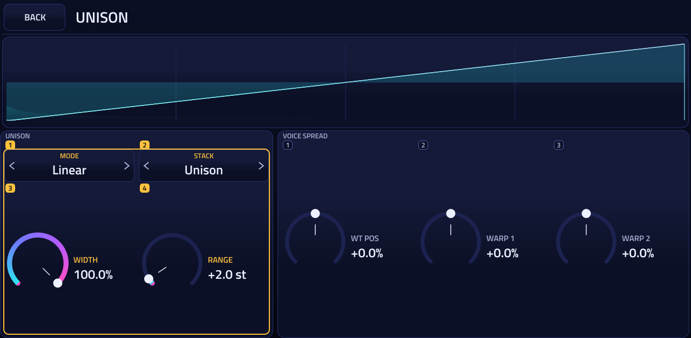

Block UNISON: MODE (Linear, Super, Exp, Inv, Random), STACK (Unison, Center Drop 12, Center Drop 24, Octaves, Two
Octaves, Power Chord, Two Power Chords, Major Chord, Minor Chord, Harmonic Series, Odd Harmonics), WIDTH (stereo
spread, 0 .. 100 percent), RANGE (0 .. 48 semitones, default 2). Block VOICE SPREAD: WT POS, WARP 1, WARP 2 (each
-100 .. +100 percent: how much the frame and the two warps differ from voice to voice). The picture above the
blocks is the oscillator picture. BACK returns.

**Modulation page of a control** (long press on a knob or number):

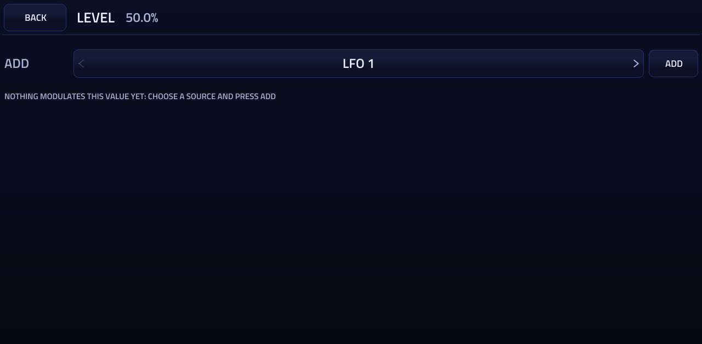

The title is the control and its value. ADD: choose a source with the arrows and press ADD; the rows list the
sources that already modulate that control with the depth bar, UNI/BI, ON/OFF and a remove button (chapter 6).

**Q groups of the page** (in reading order): Basic (type bar, source, PAN, LEVEL), Tune (OCT, SEM, FIN, CRS), Unison
(WT POS, VOICES, DETUNE, BLEND), Warp. On the XL these are the four sets of knobs 1 - 4, 5 - 8, 9 - 12, 13 - 16 when
the Basic group is active.

**The SAMPLE and GRAIN pages.** The code describes them as follows (no rendered picture; see the TODO at the end of this
chapter).
- SAMPLE (multisample): the source is a file (SFZ or WAV) chosen in a browser that opens when you tap the name or the
  list button (roots: SD CARD, USB drives, PLUGIN CONTENT); top controls TIMBRE (-100 .. +100 percent), the unison box, DETUNE,
  BLEND, the warp pair; VEL TRK switch and AMOUNT (0 .. 100 percent); an ENVELOPE page with DELAY, ATTACK, HOLD, DECAY, SUSTAIN,
  RELEASE and OVERRIDE (milliseconds, 0 .. 10000; delay 0 .. 2000).
- GRAIN (granular): source = a file, blocks GRAIN (SCAN 0 .. 100 percent, DENS 0.1 .. 1000 Hz, LENGTH 1 .. 4000 ms, WARP menu),
  PLAYBACK (OFFSET, DIR 0 .. 100 percent, PITCH 0 .. 24 semitones), RANDOM (LEN RAND, PAN RAND, LVL RAND, 0 .. 100 percent), a grain window
  page (SHAPE Hann, Welch, Gaussian, Blackman-Harris, Sinc, Tukey, Triangle, Trapezoid, ExpDec, Exp Dec Rev; AMOUNT, RAND, SKEW, RAND),
  crossfade XFADE (0 .. 1000 ms, steps of 10), loop mode One-shot / Loop grains / Manual.
TODO(owner): Add device pictures of the SAMPLE and GRAIN pages, and confirm the layout described above; the rendered gallery has only the WAVE page.

### 5.4 Sub

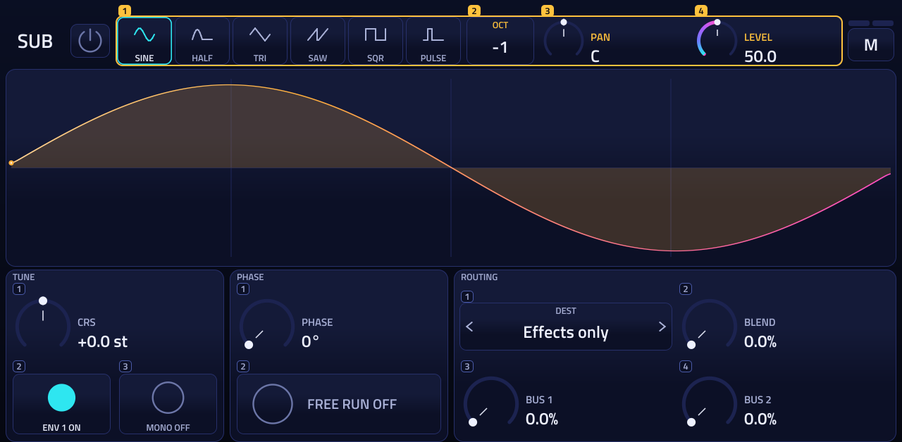

The sub oscillator. Header: power (Sub On), the waveform pictograms **SINE, HALF, TRI, SAW, SQR, PULSE** (Sub Waveform:
Sine, Rounded Rect, Triangle, Saw, Square, Pulse; the pictogram HALF is the choice "Rounded Rect"), **OCT** (-4 .. +4, default -1),
**PAN** (-100 .. +100 percent), **LEVEL** (0 .. 100 percent, default 50), the route button (M = Effects only by default).

- Display: one cycle of the waveform.
- TUNE: CRS (Sub Coarse, -48 .. +48 semitones), ENV 1 (switch: Env 1 shapes the Sub), MONO (switch).
- PHASE: PHASE (0 .. 360 degrees shown, 0 .. 100 percent in the parameter), FREE RUN (switch; the parameter is "Sub Phase Contiguous").
- ROUTING: DEST (Filter 1, Filter 2, Filters 1+2, Effects only, Direct out, Filter blend, None), BLEND (0 .. 100 percent), BUS 1, BUS 2 (0 .. 100 percent).
- Q groups: Basic (waveform, OCT, PAN, LEVEL), TUNE, PHASE, ROUTING.

### 5.5 Noise

The noise generator. Header: power (Noise On), the source stepper (the colour: White Noise, Pink Noise, Brown Noise, Geiger,
Tape Hiss, Vinyl Clicks, Digital Hash, Velvet Noise, Atmosphere), **FILTER** (-100 .. +100 percent), **PAN**, **LEVEL**
(0 .. 100 percent, default 25), route button.

- TUNE: PITCH (-48 .. +48 semitones), FINE (-100 .. +100 cents), KEY TRACK (switch).
- Bottom: with TYPE = Noise (generated) one block NOISE: TYPE stepper (Noise / Sample), STEREO (0 .. 100 percent), ENV 1.
  With TYPE = Sample: block SOURCE (TYPE, START = Noise Phase 0 .. 100 percent, STEREO, ENV 1) and block PLAYBACK (RANDOM, LOOP, BOUNCE switches).
- Q groups: header (source, FILTER, PAN, LEVEL), TUNE, the bottom blocks.

### 5.6 Mixer

Ten channel strips from left to right: **SUB, A, B, C, NOISE, F1, F2, BUS1, BUS2, MASTER**, and above them a routing
bar (FLT 1, FLT 2, MAIN FX, DIRECT, MASTER) that draws the path of the **selected strip** (a tap on a strip selects it).

Each strip (top to bottom):
- **Power button**: the source's On (oscillators, Sub, Noise, filters). On BUS1, BUS2 and MASTER it is the FX switch of that rack: lit
  means the rack's effects are active (parameters "Bus 1 FX Bypass", "Bus 2 FX Bypass", "Main FX Bypass", shown inverted).
- **Destination button** (a tap opens the list):
  - SUB, A, B, C, NOISE: Filter 1, Filter 2, Filters 1+2, Effects only, Direct out, Filter blend, None.
  - F1, F2: Effects only, Direct out, None.
  - BUS1, BUS2: Main, Direct, Other bus.
  - MASTER: OUT (fixed).
- **LEVEL fader** with a peak meter beside it: SUB, A, B, C, NOISE 0 .. 100 percent; F1, F2 -60 .. +12 dB (default 0); BUS1, BUS2 -60 .. +6 dB
  (default 0); MASTER = Master Volume -60 .. +6 dB (default -12). Vertical drag; double tap = default. A hold line falls slowly from the highest level.
- **PAN** (-100 .. +100 percent), **B1** and **B2** (sends to bus 1 and bus 2, 0 .. 100 percent): on SUB, A, B, C, NOISE, F1, F2 only. The buses and MASTER have a level only.

Q group: the strip you touched: LEVEL (1), PAN (2), B1 (3), B2 (4). On the XL the next strips (wrapping) follow on knobs 5 - 16.

### 5.7 Filter 1 / 2

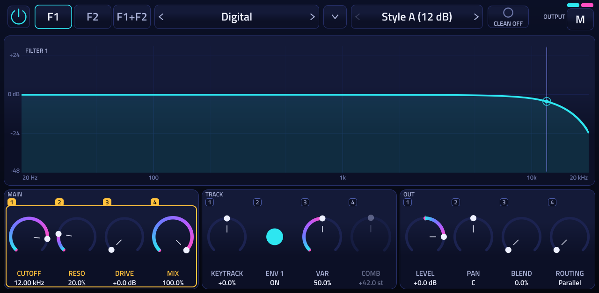

The page of the Filter tab shows **one filter at a time**: the tab Filter 1 starts on F1, Filter 2 on F2; the cells **F1, F2, F1+F2**
in the header switch between them (F1+F2 draws both response curves and the combined one).

**Header:** power (Filter N On), model stepper (27 models: Analog, Dirty, Ladder, Digital, Diode, Formant, Comb, Phaser, Multi SVF, Slope, EQ 6 dB,
Ring Mod, Sample Hold, Smear, French LP, Add Bass, Scream, New Wsp, DJ Mixer, Diffusor, EMS Ladder, PZ SVF, Normal, Multi Morph, Flanges, Misc, New)
with a list button, style stepper (12 styles, "Style A (12 dB)", "Style B (24 dB)" ... "Style L"), **CLEAN** switch (dim for Comb and Formant),
**OUTPUT** route button (M = Effects only by default; Filter N Destination: Effects only, Direct out, None; the popup also has BUS 1, BUS 2, level, pan).

**Display.** The response curve the filter really has (log frequency 20 Hz .. 20 kHz, dB scale from +24 down to -48), drawn with the live cutoff and resonance of the voice that sounded last
(also moved by modulation). Drag the handle on the curve to change cutoff and resonance together; a bubble shows the values.

**Blocks (one Q group each):**

| Block | Control | Parameter, range |
|---|---|---|
| MAIN | CUTOFF | 20 .. 20000 Hz, default 12 kHz |
| | RESO | 0 .. 100 percent, default 20 |
| | DRIVE | 0 .. 20 dB |
| | MIX | 0 .. 100 percent, default 100 |
| TRACK | KEYTRACK | -100 .. +100 percent |
| | ENV 1 | switch: Env 1 shapes the filter (default On) |
| | VAR | 0 .. 100 percent, default 50 (dim with Formant) |
| | COMB | Comb Blend Offset 0 .. 84 semitones, default 42 (dim unless the model is Comb) |
| OUT | LEVEL | -60 .. +12 dB |
| | PAN | -100 .. +100 percent |
| | BLEND | 0 .. 100 percent |
| | ROUTING | Filter Routing: Parallel, Series 1 to 2, Series 2 to 1 (one setting for both filters) |

With the model **Formant** a fourth group FORMANT appears with X, Y (0 .. 100 percent), TRANSPOSE (-12 .. +12 semitones) and SPREAD (-100 .. +100 percent), and the display shows the formant pad.
TODO(owner): Describe the Formant page from a picture (the rendered gallery shows only the default model), including which control sets Formant Resonance (30 .. 100 percent).

Controls that do not apply to the current model are dimmed, including their value text. A long press on a knob opens its modulation page (chapter 6).

### 5.8 Envelopes

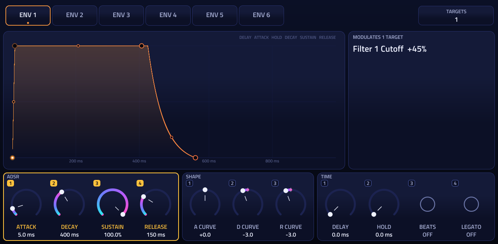

The pages Env 1 - Env 4 each show one envelope full screen; the buttons **ENV 1 .. ENV 6** at the top switch the page to another envelope (a dot under the button marks an envelope that modulates something).
The tab only decides which envelope is shown first.

- **Graph.** Time axis (auto-zoom 100 ms .. 50 s), the handles of DELAY, ATTACK, HOLD, DECAY, SUSTAIN, RELEASE (stage names on top). Drag a time handle to change the time; the DECAY handle changes decay time and sustain level at once; the small handle in the middle of attack, decay and release bends the curve; double tap on a handle = its default. A dot and a soft line follow the playing voice(s).
- **TARGETS** (top right, with the number of targets): opens the list of what the envelope modulates, with depth, UNI/BI, ON/OFF, remove, and ADD TARGET (chapter 6). The panel right of the graph ("MODULATES n TARGET(S)") lists the targets and their depth.
- **ADSR** (Q 1 - 4): ATTACK 0 .. 10000 ms (default 5), DECAY 0 .. 10000 ms (400), SUSTAIN 0 .. 100 percent (100), RELEASE 0 .. 10000 ms (200).
- **SHAPE:** A CURVE, D CURVE, R CURVE: -20 .. +20, defaults 0, -3, -3.
- **TIME:** DELAY 0 .. 4000 ms, HOLD 0 .. 4000 ms, **BEATS** (switch: times in beats instead of milliseconds: delay 0 .. 8, attack 0 .. 16, hold 0 .. 8, decay 0 .. 16, release 0 .. 16 beats), **LEGATO** (the parameter is "Legato Inverted", Off/On).
  TODO(owner): What does the LEGATO switch do, in words a musician understands (the notes only name the parameter "Env N Legato Inverted")?

### 5.9 LFOs and the drawn-shape editor

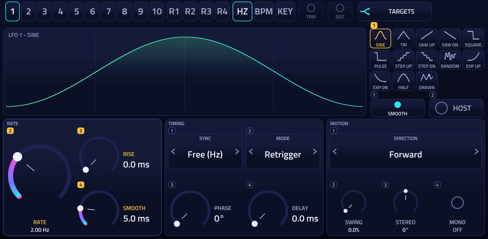

The pages LFO 1 - LFO 4 each show one LFO; the top bar switches to **1 .. 10** (LFOs) or **R1 .. R4** (random LFOs). The tab only decides which is shown first.

**Top bar:** instance cells, the sync mode **HZ / BPM / KEY**, switches **TRIP** (triplet) and **DOT** (dotted) (active only in BPM), the **TARGETS** button (what the LFO modulates, chapter 6).

**Display** (left): the shape of one cycle, with the phase marker, a cursor that runs with the sounding voice. A strip above the graph shows delay and rise when set.

**Shape picker** (right, 13 cells): SINE, TRI, SAW UP, SAW DN, SQUARE, PULSE (25 percent), STEP UP, STEP DN, RANDOM (random steps), EXP UP, EXP DN, HALF (half sine), DRAWN (your own shape). Under it two switches: **SMOOTH** and **HOST**.
TODO(owner): What does HOST (parameter "LFO N Host Sync") do for a musician?

**Blocks (one Q group each):**

| Block | Control | Parameter, range |
|---|---|---|
| RATE | the shape picker is Q 1; RATE | 0.01 .. 200 Hz, default 2 (in BPM mode: DIVISION, 13 choices Freeze, 32 bars, 16 bars, 8 bars, 4 bars, 2 bars, 1 bar, 1/2 note, 1/4 note, 1/8 note, 1/16 note, 1/32 note, 1/64 note; dim in KEY) |
| | RISE | fade in 0 .. 8000 ms |
| | SMOOTH | smooth time 1 .. 1000 ms (dim when the SMOOTH switch is off) |
| TIMING | SYNC | Free (Hz), Tempo, Tempo dotted, Tempo triplet, Key follow (this is the same as the HZ / BPM / KEY buttons and TRIP / DOT) |
| | MODE | Retrigger, Free-run, Envelope, Sustain envelope, Loop at point, Loop and hold |
| | PHASE | 0 .. 360 degrees |
| | DELAY | 0 .. 4000 ms |
| MOTION | DIRECTION | Forward, Reverse, Ping pong |
| | SWING | 0 .. 100 percent |
| | STEREO | -180 .. +180 degrees (offset between left and right) |
| | MONO | switch |
| KEY FOLLOW (only in KEY sync) | TRANSPOSE | -60 .. +36 semitones, default -12 |
| | TUNE | -100 .. +100 cents |

**Random LFOs (R1 - R4):**

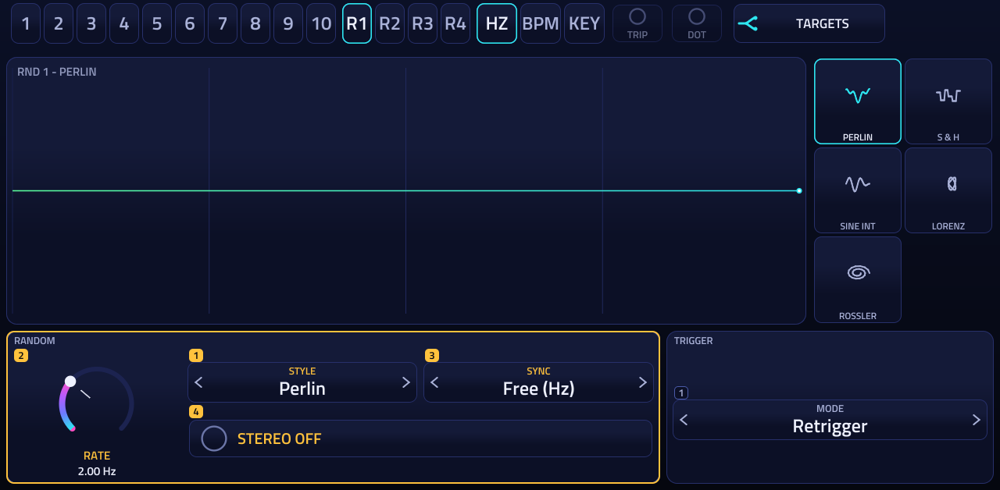

Style picker: PERLIN, S & H (sample and hold), SINE INT (sine interpolate), LORENZ, ROSSLER; block RANDOM: RATE 0.01 .. 200 Hz (default 2), STYLE, SYNC (Free (Hz), Tempo, Tempo dotted, Tempo triplet, Key follow), STEREO (Off/On); block TRIGGER: MODE (Retrigger or Free-run); a KEY FOLLOW block in KEY sync. The display is the trace of the output.

**The drawn-shape editor.** The **EDIT** button at the top right of the display opens the editor page over the page (BACK returns). If you press EDIT on a built-in shape, the shape is copied into points and becomes a drawn shape (the LFO's shape is then DRAWN). Choosing the cell DRAWN in the picker only makes the shape a drawn one (a triangle when it has no points yet); it does not open the editor.
TODO(owner): In the rendered gallery picture the EDIT button is not visible on the LFO page, although the code places it at the top right of the display. Confirm where the user opens the editor on the device.

- **Tools** (a row of four): **POINT**, **FLAT**, **RAMP+**, **RAMP-**.
  - POINT: tap on empty ground adds a point (snapped to the grid when SNAP is on), and dragging moves it; touching a point selects and drags it (the two end points only up and down); the small handle in the middle of a segment drags its curve (power -20 .. +20); a **long press** on a point deletes it.
  - FLAT / RAMP+ / RAMP-: touching a cell of the grid draws a flat piece, a rising or a falling ramp over the cell's column; dragging across draws a staircase or saw.
- Buttons: **UNDO**, **DELETE**, switches **SNAP**, **LOOP**, **SMOOTH**.
- **EDIT Q group** (the SELECTED POINT): X, Y, CURVE, GRID (virtual knobs of the plugin: they change the selected point).
- A drawn shape that has no points is read as a flat line.

### 5.10 Mod matrix

The page shows the modulation slots (up to 64; the counter at the top reads "5 / 64 SLOTS"). Tabs **ALL**, **BY SOURCE**, **BY DEST** filter the list (BY SOURCE and BY DEST show a stepper to choose the source group or destination module). **+ ADD** makes a new slot in the first unused place (source Env 1, the first destination of the list, amount +50 percent) and opens its slot page (MORE, below), where you change SOURCE and TARGET.

Each row: the number (a tap selects the row), **SOURCE** (a button that opens the list of sources), an arrow, **TARGET** (opens the grouped list of destinations: first the groups, then the parameters), the **AMOUNT** bar (-100 .. +100 percent, horizontal drag, double tap = default 0; the dot is the live value), **POLARITY** (UNI / BI), **STATE** (ON / OFF) and **MORE**.

**Q group:** the selected row: Q 1 = row (steps through the rows), Q 2 = SOURCE, Q 3 = TARGET, Q 4 = AMOUNT.

**MORE** opens the page of the slot (BACK, a title, **DELETE** with a confirmation) with the same row for editing and three blocks:

| Block | Control | Parameter, range |
|---|---|---|
| AUXILIARY SOURCE | SOURCE | Aux Source: a second source that multiplies the first |
| | SCALE | Output Scale 0 .. 200 percent, default 100 |
| | INVERT | Aux Invert, Off/On |
| | CURVE | Aux Curve -10 .. +10 |
| SHAPE | CURVE | Curve -10 .. +10 |
| | STEREO | Off/On |
| TIME | RISE | 0 .. 5000 ms |
| | FALL | 0 .. 5000 ms |
| | DELAY or BEATS | Delay 0 .. 4000 ms, or 0 .. 8 beats when tempo sync is on |
| | SYNC | Delay Tempo Sync, Off/On |

**With no slot in use** the page shows the **source board** (every one of the 57 sources as a chip, in groups ENVELOPES, LFOS, MACROS, PLAYER, SOUND). Tap a chip, then pick the target. The board disappears when the first slot exists; **+ ADD** is always there.

More in chapter 6.

### 5.11 FX

**The chain bar** (top) shows the effects in processing order as cards with a type icon, the name, a power switch, and a tag of the rack (MAIN, B1, B2); empty places show "+". Tap a card to select it, tap the power part to switch it, **drag a card sideways to reorder**, **+ ADD** (or the first free place) adds an effect: pick the type from the list. When the chain is empty, the page shows the **gallery** of the 13 effect types: one tap on a card adds that effect to the end of the Main rack and opens it.

**The effect page.** Header: power switch, the effect's name, **RACK** stepper (MAIN / BUS 1 / BUS 2: the effect moves to that rack), **PAGE n / m** stepper (the knobs in rows of four; one Q group per row; 8 knobs on a page under a display, 12 without), **REMOVE**. Knobs show the parameter's own name and value. The effects EQ, compressor, delay, FX filter and distortion have a **display** (EQ: the frequency response with a dot per band; compressor: the transfer curve of the bands; delay: the taps in time; FX filter: the response; distortion: the transfer curve and the present level); the others use the room for knobs.

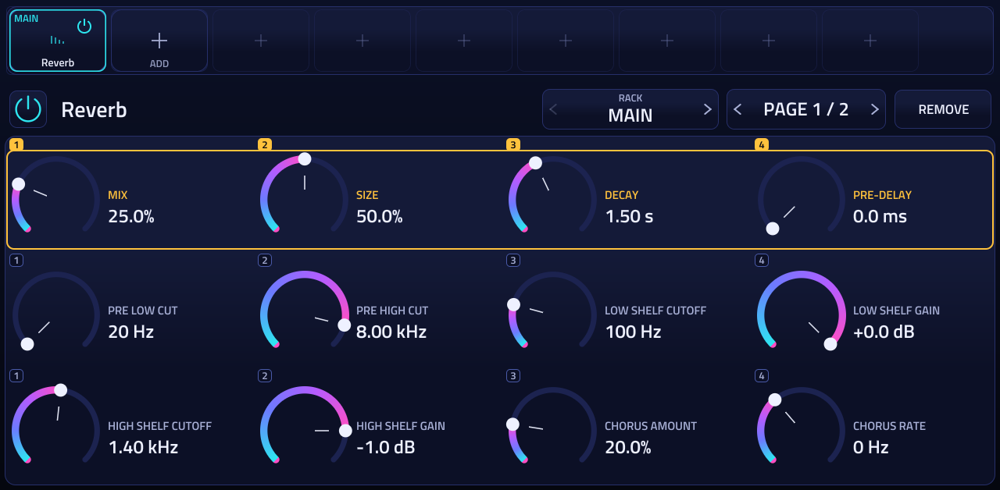

TODO(owner): How many effects does the chain hold, and what do the "MAIN / B1 / B2" racks do for a musician (the notes only say the effect moves to another rack)?

The knobs follow the order of the parameter table. Parameters of the 13 effect types (name, range, default):

1. **Chorus** (page of 12): Mix 0 .. 100 percent (50), Rate 0.02 .. 8 Hz (0.4), Sync (Free (Hz), Tempo, Tempo dotted, Tempo triplet), Division (Freeze ... 1/64 note, 11 choices from 32 bars), Depth 0 .. 100 percent (50), Feedback -95 .. +95 percent (40), Delay 1 and Delay 2 1 .. 20 ms (2, 8), Voices 1 .. 4 (4), Filter Cutoff 20 .. 20000 Hz (260), Filter Spread 0 .. 100 percent (100), Level -24 .. +12 dB (0). A modulated delay line effect.
2. **Compressor** (3 pages, display): Mix 0 .. 100 percent, Attack 0 .. 100 percent, Release 0 .. 100 percent, Bands (Multiband, Low band, High band, Single band), for Low, Mid, High: Lower Threshold -120 .. +12 dB (-40), Upper Threshold (-20), Lower Ratio -100 .. +100 percent (0), Upper Ratio 0 .. 100 percent (50), Gain -36 .. +36 dB (0); Level -24 .. +12 dB; Mode (Compress, Limit, Serum); Limiter Latency Comp (Off/On); Low Crossover 20 .. 1000 Hz (120); High Crossover 200 .. 16000 Hz (2500).
3. **Delay** (display): Mix 0 .. 100 percent (30), Feedback -100 .. +100 percent (40), Time and Time 2 2 .. 4000 ms (300), Sync (Free, Tempo, dotted, triplet; default Tempo), Division and Division 2 (4 bars ... 1/32 note), Style (Mono, Stereo, Ping pong, Mid ping pong, Tap->Delay; default Stereo), Filter Cutoff 20 .. 20000 Hz (260), Filter Spread 0 .. 100 percent, Level, High Quality (Off/On), Offset and Offset Left 0.25 .. 4 (1).
4. **Distortion** (display): Type (14 choices: Soft clip, Hard clip, Linear fold, Sine fold, Bit crush, Down sample, Tube, Diode 1 ...), Drive -30 .. +30 dB, Mix 0 .. 100 percent (100), Filter Order (None, Pre, Post), Filter Cutoff 20 .. 20000 Hz (4000), Filter Resonance 0 .. 100 percent (50), Filter Blend 0 .. 100 percent, Level, Filter Key Track -100 .. +100 percent.
5. **EQ** (3 pages, display): bands Low (Mode Shelf or High pass; Cutoff 100 Hz; Gain -24 .. +24 dB; Resonance 0 .. 100 percent), Mid (Peak or Notch; 1000 Hz), High (Shelf or Low pass; 8000 Hz), Mid 2 (Off, Peak, Notch; 3000 Hz), each Cutoff 20 .. 20000 Hz; Level -24 .. +12 dB; Law (Vital, Serum).
6. **FX Filter** (display): the same controls as a Filter page (Model, Style, Cutoff 20 .. 20000 Hz, Resonance, Drive 0 .. 20 dB, Blend, Mix, Key Tracking, Comb Blend Offset, Formant X, Y, Resonance, Spread, Transpose, Var, Pan, Level -60 .. +12 dB, Clean Mode).
7. **Flanger**: Mix (50), Feedback -100 .. +100 percent (50), Rate 0.04 .. 4 Hz (0.25), Sync, Division, Depth 0 .. 100 percent, Center 20 .. 16000 Hz (330), Phase Offset 0 .. 360 degrees (120), Level.
8. **Phaser**: Mix, Feedback 0 .. 100 percent, Rate 0.04 .. 4 Hz (0.12), Sync, Division, Depth 0 .. 48 semitones (24), Center 20 .. 16000 Hz (2000), Blend 0 .. 100 percent, Phase Offset 0 .. 360 degrees (120), Level, Depth 2 -48 .. +48 semitones.
9. **Reverb** (2 pages): Mix 0 .. 100 percent (25), Size 0 .. 100 percent, Decay 20 .. 30000 ms (1500), Pre-delay 0 .. 300 ms, Pre Low Cut and Pre High Cut 20 .. 12000 Hz, Low and High Shelf Cutoff and Gain (-6 .. 0 dB), Chorus Amount 0 .. 100 percent, Chorus Rate 0.01 .. 8 Hz, Force Enable (Off/On), Level, Type (Vital, Plate, Hall, Vintage, Nitrous, Basin), Room (Space, Marble, Rectangle, Hexagon, Box), Width 0 .. 200 percent, ER Size, Diffusion A, Diffusion B, Feedback (0 .. 100 percent).
10. **Hyper/Dimension**: Hyper Rate 0.05 .. 10 Hz, Hyper Unison 0 .. 7 voices, Hyper Detune 0 .. 100 percent, Hyper Retrigger (Off/On), Hyper Mix, Dimension Size 0 .. 100 percent, Dimension Mix 0 .. 100 percent, Level.
11. **Utility**: Polarity Left and Right (Off/On), Low Pass 20 .. 20000 Hz, High Pass 20 .. 20000 Hz, Mono Bass (Off/On) and its Frequency 20 .. 500 Hz (120), Width 0 .. 200 percent (100), Pan -100 .. +100 percent, Mix, Level.
12. **Bode**: Mono Input (Off/On), Shift 0 .. 100 percent, Range 1 .. 5000 Hz (100), Direction -100 .. +100 percent (100), Width 0 .. 100 percent, Delay 1 .. 2000 ms (100), Sync, Division, Feedback 0 .. 100 percent, Balance -100 .. +100 percent, Blur 0 .. 100 percent, Retrigger (Off/On), Mix (50), Level.
13. **Convolve**: Impulse (None, Preset IR), Size 0 .. 100 percent, Tone -100 .. +100 percent, Minimum Phase (Off/On), Pre-delay 0 .. 500 ms, Sync, Division, Attack 0 .. 2000 ms, Decay 0 .. 100 percent (100), Damping 0 .. 100 percent, IR Gain -40 .. +24 dB, Mix (30), Level, Law (Vital, Serum).

For Q-Links: one Q group per row of four knobs on the page that is on screen.
TODO(owner): The rendered pictures show the rate of the Chorus and the Reverb chorus as "0 Hz" although the parameters are 0.4 Hz and 0.25 Hz. Is that a display fault that will be fixed, or is it the intended rounding?

### 5.12 Master

Two sides, chosen by the buttons **MAIN** and **TUNING & MPE** at the top.

**MAIN side** (four blocks):

| Block | Control | Parameter, range |
|---|---|---|
| OUTPUT | meters L / R (the engine's master peak, with hold line) | |
| | VOLUME | Master Volume -60 .. +6 dB, default -12 |
| | SPREAD | Stereo Spread 0 .. 100 percent, default 100 |
| | STEREO | Stereo Routing 0 .. 100 percent, default 100 |
| | VOICE OVERRIDE | Kill / Steal |
| PITCH | TUNE | -100 .. +100 cents |
| | TRANSPOSE | -48 .. +48 semitones |
| | BEND UP, BEND DOWN | 0 .. 24 semitones, default 2; **LINK ON** makes the down range follow the up range |
| VOICES | POLY | Polyphony 1 .. 32, default 16 |
| | LEGATO, POLY LEG, PHASE LEG | switches (Master Legato, Master Poly Legato, Voice Phase Legato) |
| | SAME NOTE | Steal, Stack, Ignore |
| | STEAL | Newest, Oldest, Highest, Lowest, Velocity |
| | VEL TRACK | -100 .. +100 percent, default 100 |
| | voice bar | sounding voices / polyphony |
| GLIDE | GLIDE | Portamento Time 0 .. 8000 ms |
| | SLOPE | -8 .. +8; the glide curve is drawn below |
| | ALWAYS | Portamento Always, Off/On |
| | SCALED | Portamento Scaled By Interval, Off/On |

Q groups: OUTPUT (VOLUME, SPREAD, STEREO, VOICE OVERRIDE), PITCH, VOICES (POLY ... SAME NOTE) and the second VOICES row, GLIDE.

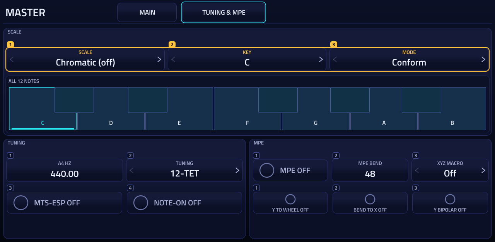

**TUNING & MPE side:**

- **SCALE:** SCALE (Chromatic (off), Major, Natural Minor, Harmonic Minor, Melodic Minor, Dorian, Phrygian, Lydian, Mixolydian, Locrian, Major Pentatonic, Minor Pentatonic, Blues, Whole Tone, Diminished (H-W), Diminished (W-H), Phrygian Dominant, Hungarian Minor, Double Harmonic, Hirajoshi), KEY (C ... B; the keyboard drawing below sets the key when you tap or drag a key), MODE (Conform, Mark only). The keyboard shows the notes of the scale.
- **TUNING:** A4 HZ (400 .. 480 Hz, default 440), TUNING (12-TET, Pythagorean, Just intonation, User file), MTS-ESP switch, NOTE-ON switch (MTS-ESP note-on only).
- **MPE:** MPE on/off, MPE BEND (1 .. 96 semitones, default 48), XYZ MACRO (Off, XYZ -> Macro 1, 2, 3, YZ -> Macro 1, 2), Y TO WHEEL, BEND TO X, Y BIPOLAR (switches).

**Pad pressure (MPC XL pads).** The plugin opens Filter 1 with the pressure of each held pad: on by default, 35 percent (a full pressure opens the cutoff by about one octave); it works only with **Full Level switched off** (with Full Level on every hit has velocity 127 and sends no pressure). The setting is not part of a preset. Polyphonic pressure only; channel aftertouch is ignored.
TODO(owner): There is no control for "Pad Pressure" and "Pad Pressure Amount" on the plugin-drawn Master page. Where does the user change them (host parameter list, Q-Link assignment)?

### 5.13 Voice control

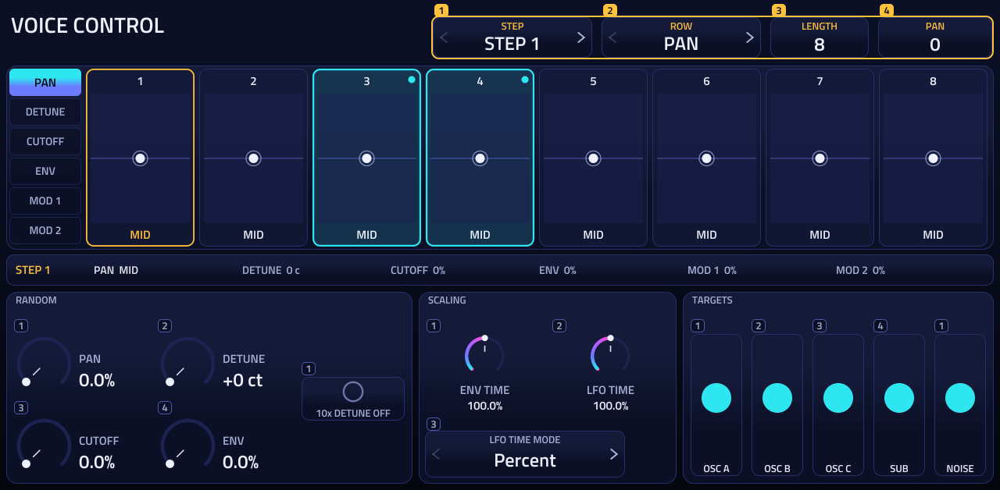

A sequencer of per-voice offsets: eight steps and six rows.

- **Header** (Q group STEP): STEP (1 .. 8: which step the Q-Link edits), ROW (PAN, DETUNE, CUTOFF, ENV, MOD 1, MOD 2), LENGTH (1 .. 8 steps), and the value of the selected step in that row.
- **Grid:** the row buttons on the left choose the row. Touching a column sets that step to the height of your finger; dragging across columns draws through them (fast strokes fill the columns between). The middle line is zero. The step a sounding voice plays is lit (cyan, with a dot).
  Ranges: PAN -100 .. +100 percent, DETUNE -100 .. +100 cents, CUTOFF -100 .. +100 percent, ENV (envelope time) -100 .. +100 percent, MOD 1 and MOD 2 -100 .. +100 percent.
- **Strip** under the grid: all six values of the selected step (STEP n: PAN, DETUNE, CUTOFF, ENV, MOD 1, MOD 2).
- **RANDOM:** PAN 0 .. 100 percent, DETUNE 0 .. 100 cents, CUTOFF 0 .. 100 percent, ENV 0 .. 100 percent, and a switch **10x DETUNE**.
- **SCALING:** ENV TIME and LFO TIME 25 .. 400 percent (default 100), LFO TIME MODE (Percent / Rate).
- **TARGETS:** switches OSC A, OSC B, OSC C, SUB, NOISE (all on by default): which sound sources the voice control acts on.
- Q groups: STEP, RANDOM, 10x DETUNE, SCALING, TARGETS, NOISE.

TODO(owner): Explain in plain words how a voice picks its step (does each new note advance one step, and is the sequence reset on a new chord?). The code lights the step a voice plays but the notes do not state the advance rule.

---

## 6. Modulation

A **modulation** connects a **source** to a **destination** (a parameter) with a **depth** (-100 .. +100 percent), a polarity (UNI or BI) and an on/off switch. The engine has 64 slots.

**Sources (57):**
- Envelopes: Env 1 .. Env 6.
- LFOs (14): LFO 1 .. LFO 10, RLFO 1 .. RLFO 4 (the random LFOs).
- Macros: Macro 1 .. Macro 8.
- Player (17): Velocity, Note, Aftertouch, Pitch Wheel, Mod Wheel, Random per Note, Lift, Slide, Oct Note, Poly Aftertouch, Note-On Alt 1, Note-On Alt 2, Note-On Rand 2, Note-On Rand (Discrete), Release Velocity, Expression X, Fixed.
- Sound (12): Stereo, Voice Index, Voice Mod 1, Voice Mod 2, Oscillator A, Oscillator B, Oscillator C, Noise, Sub, Filter 1, Filter 2, Active Voices.

**Destinations:** every modulatable parameter (1248 entries in the parameter list), chosen from a list that first shows groups and then the parameters of a group. On the MPC XL pads the host passes note, velocity and per-pad pressure to the plugin; the pad's X/Y position does not reach it.

**Making a route:**

1. **From the Mod page.** Tap a source chip on the **source board** (shown when no slot is in use) and pick the destination, or press **+ ADD** (a slot with Env 1 and +50 percent is made and its page opens) and change SOURCE and TARGET. Edit SOURCE, TARGET, AMOUNT, UNI/BI, ON/OFF on the row; MORE has the aux source, curve and time.
2. **From an envelope or an LFO.** On the Env or LFO page press **TARGETS**, then **ADD TARGET** and pick a group and a parameter. The new route starts at half depth (bipolar if the parameter swings around zero). On that page the target rows have depth, UNI/BI, ON/OFF and remove.
3. **From a macro.** On the Macros page tap the chips area of the macro card ("NO TARGET - TAP TO ADD"), then ADD TARGET.
4. **From a control.** **Long press** (0.6 s) a knob or number field anywhere on a plugin page: its modulation page opens. Choose a source with the arrows beside ADD and press ADD; the depth bar, UNI/BI, ON/OFF and the remove button are on each row.
5. **Depth by dragging.** A knob that is modulated by the source selected on the Play page (the last envelope or LFO you touched) has a colored tab at its top left; dragging on the tab changes that depth (200 pixels = the whole -100 .. +100 percent).

Knobs show the modulation: a marker at the live (modulated) value, and an arc from the value over the depth of the selected source. The tab at the top left is colored when the selected source is among the sources of the knob, grey when other sources modulate it, hollow when the selected route is bypassed.

**Macros.** Eight macros (0 .. 100 percent, default 0) are sources only: a macro does nothing until it has a target. A macro appears in the list of sources as "Macro n".

## 7. Presets

The plugin offers **113 programs** to the host: "Init" (the default sound) and 112 factory presets in six categories. The list is sorted by category (alphabetically: Bass, FX, Keys, Lead, Pad, Pluck) and then by name.

| Category | Count | Presets |
|---|---|---|
| Bass | 23 | 808 Boom; Acid Saw Reso; Click Attack Bass; Comb Metal Bass; Custom Shape Wobble; Diode Saturated Bass; Dirty Distortion Bass; EMS Squelch Bass; Fast Arp Bass; Fat Reese; Formant Vowel Bass; Gritty Square Bass; Harmonic Sine Bass; Moog Ladder Bass; Odd Harmonics Bass; Pulse Width Bass; Punchy Pluck Bass; Scream Filter Bass; Solid Sub; Space Wobble Bass; Sub Duo Octave; Sync Growl Bass; Warm Analog Bass |
| FX | 11 | Alien Communication; Bode Shifter Drone; Cosmic Teleport; Game Over Zap; Metal Gong Strike; Noise Riser; Sci-Fi Laser Sweep; Sonar Ping; Space Wind Storm; Sub Drop Boom; Vinyl Dust Crackle |
| Keys | 17 | Accordion Reed; B3 Drawbar Organ; Celesta Bells; Clavinet Funk; Dream Grand Piano; Dyno Electric Piano; FM Soft Organ; Glass Organ Tones; Harpsichord Bar; Just Intonation Keys; Lo-Fi Rhodes; Muted Honky Tonk; Rotary Rock Organ; Utility Width Keys; Vibraphone Bars; Vintage Electric Tine; Warm Toy Piano |
| Lead | 22 | Bell Chime Lead; Chorused Saw Solo; Cosmic Drift Lead; Diode Bite Lead; Dirty Peak Lead; Dual Octave Hero; FM Digital Lead; Harmonic Shimmer Lead; Hyper Saw Lead; Laser Beam Lead; Metallic Edge Lead; MPE Pressure Lead; Phaser Sweep Lead; Plucked Lead Tone; Pulse Width Mod Lead; Screaming Sync Lead; Solo Square Lead; Staccato Bleep Lead; Tri Soft Solo; Twin Warp Lead; Vocaloid Lead; Warm Vintage Lead |
| Pad | 23 | Cathedral Choir; Comb Reso Swell; Dark Cinema Drone; Deep Sea Ambient; Diffusor Cloud Pad; Ethereal Glass; Frozen Aurora; Gentle Flute Pad; Golden Dawn Pad; Harmonic Cloud; Hyper Dimension Pad; Infinite Horizon; Lush Analog Pad; Odd Harmonics Pad; Radiant Pulse Pad; Slow Motion Waves; Space Odyssey Pad; Starlight Shimmer; Subtle Tape Drift; Tri-Band Split Texture; Velvet Strings; Vintage Brass Pad; Vowel Choir Pad |
| Pluck | 16 | Acoustic Style Pluck; Aux Keyscale Pluck; Bell Mallet Pluck; Chime Drop; Comb Zither; Digital Glass Tap; Electric Mute Pluck; Formant Pop Pluck; Harmonic Tine Pluck; Harp Drops; Kalimba Tines; Marimba Synth; Pizzicato Strings; Rubber Bass Pluck; Spruce Guitar; Trance Short Pluck |

The presets are CC0 licensed (Safian Szabolcs). They are chosen in the host's **PRESET** field of the header; the host lists them by name (the category is not part of the name).
TODO(owner): Describe the exact gesture and screen for choosing a preset in the PRESET field on the Key 61 and the XL (the developer notes say only that the presets are exposed as programs and appear in the host's preset browser).

**The "*" mark.** The plugin puts " *" after the preset name when you changed a parameter after loading the preset, or when a project was loaded that held changed settings. Loading a preset again clears the mark. A project remembers the preset by name and finds it again even when a later version has a different preset list; if the name is not found the saved sound is kept without a preset.

The Pad Pressure settings are not part of a preset (a preset change leaves them alone). The Play-page selectors (which oscillator, envelope and LFO the Play page shows) are saved with the project.

## 8. Known limitations

- **Key 61: switch off the host's "Q-Link Status" pop-up.** When a Q-Link knob is touched the Key 61 shows a pop-up on the right. The plugin's picture can flicker around it. Switch it off: **Preferences > General > Show Q-Link Status When Touched**, or hold the Q-Link button and tap **Q-Link Status**. With the pop-up off the picture is stable. The XL has no such pop-up.
- **Standby.** The plugin's picture disappears while the device is dimmed in standby and comes back when the device wakes. (This is being worked on.)
- **Older projects keep their old Q-Link map.** A project saved with an older version of the plugin keeps the old Q-Link assignment of that track until you **insert the plugin on the track again**. Symptom: on the plugin pages the knobs change other parameters than the ones the display shows. A new project does not have this problem.
- **No limiter, loud output.** The output has a fixed make-up gain of +18 dB and no limiter. Loud presets can exceed full scale. Lower the track level (or put a limiter on the track). The level control of the plugin is Master Volume (default -12 dB).
- **Q-Link automation.** Recording automation on a Q-Link knob records the host's "Q n" slot, which replays into whatever group is active at that moment. Record automation on the real parameter instead (its own control; on a page where you can reach it, a parameter of the host's list).
- **Experimental display layer.** It uses a display plane that the MPC firmware does not offer to plugins. A firmware update, or the MPC itself using the plane, can make the plugin's picture disappear for the rest of the session; the sound continues. Only the Key 61 (MPC OS 3.10.1.12) and the MPC XL were tested.
- **Host pop-ups.** A pop-up of the host over the middle of the plugin's area can hide the picture while it is on screen.
- **One finger.** Only one finger is followed.
- **Up to 16 instances.** The 17th and later instances never show the drawn pages.
- **Controls that are dim.** The wavetable MEMORY stepper, the WARP VAR knobs and the oscillator types Sample and Spectral cannot be set from the plugin pages.
- **Channel aftertouch** (a Key 61 key) is ignored by the pad-pressure layer; only per-pad polyphonic pressure acts.
- **Pad Pressure** works only with Full Level off (XL pads: with Full Level on every hit has velocity 127 and no pressure).

## 9. Troubleshooting

| Problem | What to check |
|---|---|
| The plugin is not in the browser | The folder must be named `Safian - VST - SynthyBoy` inside `VST2 Plugins` at the root of the drive. MPC OS 3.10.1 or later. In Preferences > Enhancements (Beta) both **Enable Enhancements** and **External Plugin Support** must be on. After copying a plugin, restart the MPC application. |
| The plugin loads but the pages are plain host pages or dark areas | The picture needs the overlay package (chapter 2). The display layer disables itself for the rest of the session when the display driver refuses it or no free display plane is left; restart the MPC application. A pop-up of the host over the area also hides it. |
| The picture flickers or is cut at the right edge (Key 61) | Switch off the Q-Link Status pop-up (chapter 8). Changing the tab (for example Play, Macros, Play) takes a new reference. |
| The picture disappears when the device dims | Standby: it returns on wake (chapter 8). |
| The picture is missing on one track | Only the instance whose page is on screen is drawn. More than 16 instances: the extra ones are never drawn. |
| Q-Link knobs change other parameters than shown | The project has an old Q-Link map (chapter 8): insert the plugin on that track again. |
| Knob names in the Key 61 pop-up are old | The host updates names when a group changes; touch the knob again (about half a second). |
| A knob steps a list or switch instead of sweeping | By design: stepped values move one step per small turn. |
| Touch does nothing | Only one finger is followed; lift the first finger. Touch to the right of a host pop-up on the Key 61 is not taken. |
| No sound | On the plugin pages check: Mixer: the strip's power is lit and its destination is not None; level not at 0; BUS and MASTER FX power as expected; Master VOLUME is not at its minimum; the filters are not on a Direct/None route you did not intend. TODO(owner): Which host-side checks belong here (track mute, MIDI channel, the track's plugin program, input routing)? |
| Too quiet next to stock instruments, or clipping | The plugin adds +18 dB and has no limiter (chapter 8): adjust the track level. |
| Preset changes after project reload | The project stores the preset by name; if the name is gone from the list the saved sound stays. |

## 10. To update when the UI changes

These chapters describe the current tree and depend on pages that are being reworked now:

- **5.8 Envelopes:** the graph (zoom steps, lock, handles, the legend bar and value texts). Also 5.1 (the compact envelope panel and the graph in it) and the Env pictures.
- **5.9 LFOs and the drawn-shape editor:** the editor page (tools, EDIT button, the grid, the EDIT Q group), the grid and shape picker, the KEY FOLLOW block, the HOST and SMOOTH switches. Also 5.1 (the compact LFO panel) and the pictures lfo, lfo-key, lfo-random.
- **Toggles and option lists** on **5.12 Master / 5.13 Voice** (switch looks and ON/OFF text), **5.7 Filter** (CLEAN, ENV 1, and the model and style lists) and **5.11 FX** (switch cells such as Sync, Mode, Law, Type; the list popups): the pictures filter, master-main, master-tuning, voice, fx-reverb, fx-eq, fx-compressor, fx-chorus, and the control tables.
- **Standby:** chapter 8 (limitation), chapter 9 (the row about dimming).
- **Q-Link behaviour** (4.3, the Q-group lists of each chapter): when the Env and LFO pages publish their blocks as separate groups, the Q-Link lines of 5.1, 5.8, 5.9 change.
- **Chapter 2 and chapter 7:** the install steps and the PRESET field, once the TODO(owner) answers are in.
- **All pictures** in `img/` are rendered with `scripts/render-ui-gallery.py` and must be re-rendered after a UI change.
