# SynthyBoy for MPC - User Guide (second draft)

Status: second draft, brought up to the plugin-drawn screens of the branch `feature/mpc-overlay` (the oscillator pages with five types and seven detail
pages, LED controls, the LFO editor with a grid, the 16 effect pages and the splitters, 16 Q-Link knobs, the mouse, and the per-device sound quality).
It is written from the source code, the developer notes (`docs/MPC.md`), pictures rendered by the code and, for the Q-Link chips and the header, one XL screenshot;
it is not the result of a full device session. What could not be confirmed is collected in chapter 11 ("To confirm on the device").

How to read the pictures: they are rendered by the developer's test program with the default ("Init")
sound, cut to the plugin's own area (1280 x 628 pixels). They are not photographs of the device, and the
values on your screen will differ. The MPC's own header and tab bar are not in the pictures, except in the XL screenshot of chapter 4.3.
The pictures are rendered for a wide device: the small numbers 5 .. 16 are the Q-Link knobs of the XL (chapter 4.3).

Contents

1. What it is
2. Install and first start (see dedicated [INSTALL.md](INSTALL.md))
3. The screen
4. Controls
5. The pages
   - 5.1 Play
   - 5.2 Macros
   - 5.3 Osc A / B / C
   - 5.4 Sub
   - 5.5 Noise
   - 5.6 Mixer
   - 5.7 Filter 1 / 2
   - 5.8 Envelopes
   - 5.9 LFOs and the drawn-shape editor
   - 5.10 Mod matrix
   - 5.11 FX
   - 5.12 Master
   - 5.13 Voice control
6. Modulation
7. Presets
   - 7.1 Browsing presets
   - 7.2 The factory sounds
   - 7.3 Sound quality on each device
8. Known limitations
9. Troubleshooting
10. Second-generation pads (MPCe), MPC XL and other gen 2 devices (see [mpce-pads.md](mpce-pads.md))
11. To confirm on the device

---

## 1. What it is

SynthyBoy is a synthesizer plugin for Akai MPC hardware (VST2 format, loaded by the MPC's external plugin
support). It has three oscillators (A, B, C) that each play wavetables, a multisample instrument, a sample, grains or a spectrum, a sub oscillator, a
noise generator, two filters, six envelopes, ten LFOs and four random LFOs, eight macros, a 64-slot
modulation matrix, 16 effects (13 effects and three band splitters), and a master section with tuning, MPE and voice control.
160 factory presets come with it.

**One package, two hardware generations.** SynthyBoy is one package: the plugin with its own drawn screens (there is no
second, plainer version). It is built for both generations of standalone MPC hardware, the first generation (32-bit) and
the second generation (64-bit); the MPC loads the build that fits.

**Devices.** Built for both generations. It was developed and tried by its author on the **MPC Key 61** (first
generation, MPC OS 3.10.1.12) and the **MPC XL** (second generation). It has not been tried on other MPC models. Some
details described for the XL are the design and are not yet confirmed on the device (chapter 11).

**Where the two generations differ** (first generation = MPC Key 61, second generation = MPC XL):
- Q-Link knobs: 4 knobs and a bank button on the Key 61, 16 knobs on the XL (chapter 4.3).
- Q-Link Status pop-up: on the Key 61 only; switch it off (chapter 8).
- Sound quality: 8 voices, at most 3 unison voices, five effects skipped on the Key 61; 16 voices, up to 16 unison voices, all effects on the XL (chapter 7.3).
- Pads with pressure: XL only (chapter 10); the Key 61 has keys with aftertouch.
- The mouse: the pointer position is measured on the Key 61, not yet on the XL (chapters 4.4, 11).

**What "experimental display overlay" means for you.** The MPC does not let a plugin draw its own screens,
so the plugin draws its pages itself, on a separate display layer on top of the MPC's picture. The MPC's
header and tab bar are still the MPC's own, and the MPC firmware does not know about the plugin's pictures,
so a firmware update or an unusual host situation (for example a pop-up of the host over the page, or the
device dimming in standby) can make the plugin's picture disappear or flicker. The sound is not affected.

## 2. Install and first start

> For full details on package contents, hardware compatibility, updating in-place warnings, and troubleshooting, see the dedicated installation guide: [INSTALL.md](INSTALL.md).

The Akai manuals describe the host side. Where this guide names a manual, it means the **MPC Standalone OS User
Guide v3.10.1** (MPC Key 61 and the other first-generation devices) and the **MPC Live III, MPC XL User Guide v3.10.1**
(MPC XL). The two guides have the same chapters for these steps.

1. **Put the plugin on a drive.** Copy the whole folder `Safian - VST - SynthyBoy` into a folder named exactly
   `VST2 Plugins`. The manuals say this folder can be on the internal MPC drive or on an attached drive (the developer
   notes: at the root of a USB drive, an SD card, or the internal drive). The MPC must run MPC OS 3.10.1 or later.
2. **Switch on external plugins.** Press **Menu**, tap the **Preferences** icon, open the **Enhancements** tab, tap
   **Enable Enhancements** so that it is On, then switch on **External Plugin Support**. The plugin stays hidden until both
   are on. The manual chapter is "Updates in v3.10.1 > Experimental Enhancements" (also described in Preferences >
   Enhancements). The manual warns that these plugins are not tested or supported by inMusic and that a faulty plugin can
   freeze the device: save your work often.
3. **Restart.** A plugin copied while the MPC application was running appears only after the MPC application is
   restarted.
4. **Make a plugin track.** In Main Mode tap **+ New Track** at the bottom left, choose **Plugin** as the type, then use the
   **Plugin** field to open the plugin window and pick SynthyBoy (the window can be sorted by Type or Manufacturer; tap
   **Select** to confirm or **Close** to cancel). Manual chapters: "Getting Started > Adding and Recording with a Plugin
   Track" and "Track Types > Plugin Tracks". The **Preferences > General > Default Plugin Synth** setting decides which
   plugin a new plugin track starts with.
5. **Choose a preset.** Use the **Preset** field of the plugin track (see chapter 7), or **Sounds Mode** (chapter 7).
6. **Open the plugin's screens.** The plugin's own pages come up in the area between the MPC's header and its tab
   bar; see chapter 3.
7. Replacing the plugin: copy the new folder over the old one, then remove and re-add the plugin on the track (or restart
   the MPC if the skins changed). Uninstalling: delete the folder from `VST2 Plugins`; projects that used it then load
   without the plugin.

The manuals do not say where SynthyBoy appears in the plugin window (the developer notes say under
"External Plugins"); see chapter 11.

**First start.** Put the plugin on a track and open Track Edit Mode (the **Edit Instrument** button in Sounds Mode does
this); press the key **Play** (the first function key). You should see the three panels of chapter 5.1. If you see only a
dark empty area, see chapter 9.

A project that already had SynthyBoy on a track with an older version keeps that track's old Q-Link
assignment until the plugin is inserted again (chapter 8).

## 3. The screen

The screen is 1280 x 800 pixels and touch sensitive.

- **Header** (top): track, plugin and preset (the PRESET field). Drawn by the MPC.
- **Tab bar** (bottom): the function keys of the MPC. Drawn by the MPC. In the XL screenshot of chapter 4.3 it shows four tabs at a time (OSC, MIX, FILTER, ENV) with a **<** and a **>** button at its ends, and a row of dots under a tab that has sub-pages.
- **Plugin area** (between them, 1280 x 628 pixels): drawn by SynthyBoy. All the pictures in this guide
  show this area.

**Function tabs and sub-pages.** SynthyBoy has ten function tabs. Pressing a tab shows its first page;
**pressing the same tab again steps to its next sub-page** (the dots under the tab show how many there
are). The name on the tab shows the first page's short name; after stepping on, it shows the name of the
page that is on the screen.

| Function tab | Pages (in stepping order) | Chapter |
|---|---|---|
| Play | Play | 5.1 |
| Macros | Macros | 5.2 |
| Osc | Osc A, Osc B, Osc C, Sub, Noise | 5.3, 5.4, 5.5 |
| Mix | Mixer | 5.6 |
| Filter | Filter 1, Filter 2 | 5.7 |
| Env | Env 1, Env 2, Env 3, Env 4 | 5.8 |
| LFO | LFO 1, LFO 2, LFO 3, LFO 4 | 5.9 |
| Mod | Mod | 5.10 |
| FX | FX | 5.11 |
| Master | Master, Voice | 5.12, 5.13 |

24 pages in all. Inside the Filter, Env and LFO pages you can switch to the other filter, envelope or LFO
without leaving the page (a second set of buttons on the page): the tab only decides which one is shown first.
There are six envelopes and ten LFOs plus four random LFOs; the tabs Env 1 - 4 and LFO 1 - 4 are just the first
entries.

**Opening and closing inside a page.** Several pages have a full-screen button, a "MORE" button, a gear, or a
list: they open a page over the current one. A **BACK** or **CLOSE** button returns. Leaving the Play tab closes everything that was opened
over its pages.

Only the plugin of the track whose page is on the screen is drawn; with several SynthyBoy instances the
picture follows the track you are looking at (up to 16 instances; chapter 8).

## 4. Controls

### 4.1 Touch

The touch screen follows **one finger**: while a finger is down, a second finger is ignored until the first
is lifted.

| Gesture | What it does |
|---|---|
| **Tap** | Presses buttons and switches, selects a card, row or cell, steps a list, opens a page. On a stepper with arrows (< Name >): the left half goes back, the right half forward; on a stepper with a name, a tap on the middle half opens the list of all choices, the outer quarters still step. |
| **Tap on a LED switch or a LED list** | A LED switch (a dot and a name, no frame) flips when you tap its whole cell. In a LED list every choice is visible, the lit dot is the current one; tap a name to choose it. A LED in front of a knob's name (SMOOTH on the LFO page) switches what the knob sets: the knob is dim while the LED is off. |
| **Drag up / down** on a knob or number field | Changes the value (up = more). A knob covers its whole range over 200 pixels of drag. A number field changes one step per its own number of pixels. |
| **Horizontal drag** on a bar (modulation depth bars) | Changes the value; the whole bar is the whole range. |
| **Vertical drag** on a fader (Mixer) | Changes the level. |
| **Double tap** (two taps within 0.4 seconds and 30 pixels) | Sets a knob, number field, fader or depth bar to its default value; on an envelope handle sets that handle's default; on the drawn-shape editor deletes an inner point or resets a curve handle to straight. |
| **Long press** (0.6 seconds without moving) on a knob or number field | Opens the modulation page of that control (chapter 6). On the canvas of the drawn-shape editor: deletes an inner point (a double tap on a point does it faster). |
| **Drag on the colored tab** at the top left of a knob that is modulated | Changes the depth of the modulation of the selected source (chapter 6). |
| **Tap on a pictogram or cell** | Selects it (oscillator type, LFO shape, Sub waveform, ...). |

Not every control has every gesture; the chapters say what each control does.

### 4.2 The Q frame and the numbered chips

Every page that has controls groups them in **Q groups** of four values (a block of the screen, a row, a strip). One group is **active**: it has a
**yellow frame**, and its four members have yellow **numbered chips** (1 to 4) at their top left corner. The
chip number is the Q-Link knob that turns that control.

- **Make another group active:** touch (tap or start a drag on) a control of that group; the frame moves to
  it. Pages that have a "bank" (Macros) or a selected strip (Mixer) also move the frame when you tap their
  buttons or strips. Returning to a page makes its first group active again.
- **Quiet chips** on the other groups show which knob would turn them. On a device with 16 knobs (the XL) they carry the numbers **5 to 16**, in reading order: the next group has 5 - 8, the one after 9 - 12, then 13 - 16. On the Key 61, which has four knobs, they show 1 - 4, relative to the bank (see 4.3).
- Some groups have no frame because their members lie apart on the page (the LFO shape picker and the RATE block, the voice-control ROW list). They show only the chips.
- A page can have fewer groups than knobs; the knobs without a group do nothing. A page with more than four groups (the oscillator page has a fifth, the warps) shows chips on the first four only.
- **A LED switch has its own chip** when it is a member of a group. A switch that only opens a page (MAP, MORE, the gears) has none.

### 4.3 The Q-Link knobs

SynthyBoy always maps the 16 Q-Link slots: slots 1 - 4 belong to the **active group**, slots 5 - 8, 9 - 12 and 13 - 16 to the
**next groups of the page in reading order**, wrapping around, each group once. A page with fewer than four
groups leaves the rest of the slots without a function.

**MPC XL (16 knobs).** All 16 knobs are alive at once: knobs 1 - 4 turn the active group, knobs 5 - 16 the next
groups. The chips 5 - 16 are on the XL's screen: the XL screenshot below shows them on the Osc A page (5 - 8 on the wavetable bar, 9 - 12 on the tune block, 13 - 16 on the unison block; the warp rows are the fifth group and have none until you touch them).
The picture is not a photograph: it is the XL's own screenshot of the host with the plugin's drawn frame laid over it, made with an earlier build (in it the TRACK switch is still an arc icon and the warp rows have a smaller PHASE knob). It also shows the MPC's own header (TRACK, PLUGIN, PRESET) and tab bar.

**MPC Key 61 (4 knobs, four banks).** The four knobs always turn four values. The **Q-Link** button steps through
four banks: bank 1 = slots 1 - 4 (the active group), bank 2 = slots 5 - 8, bank 3 = 9 - 12, bank 4 = 13 - 16. On
this device the quiet chips show numbers 1 - 4 relative to the bank, so you know which group a bank leads
to. The host remembers the bank per tab.
(Standalone OS User Guide, "Other Features Explained > Q-Links": the Q-Link controls are divided into four banks cycled
with the Q-Link button; a yellow box marked with a Q outlines the current Screen-mode control.)

**Stepped targets** (switches, lists, integer steppers such as polyphony): a Q-Link does not sweep them from 0 to
100 percent of its travel. The knob moves **one step per small turn**: one value of the list, or the switch. A small turn is about 6 of the 128 clicks of the knob's travel (about one twentieth), so a whole list is reachable with one sweep and a toggle flips with a short turn. A change of direction starts the count again; the ends of a list stop. A very fast turn moves at most four steps at once.
Fine-grained whole-number values (a grain density, a transpose in semitones) are not stepped this way: they behave as normal knobs.

**Knob displays.** The name, value text, unit and dial position the MPC shows for a knob are those of the
real parameter it currently controls (for example "Filter 1 Cutoff" or "Macro 5"). When you change the
active group or the page, the names change with it. A knob without a target shows "Q n" and nothing else.

**Key 61 pop-up.** On the Key 61 the host shows a "Q-Link Status" pop-up on the right when a knob is touched. **Switch it off** (Preferences > General > "Show Q-Link Status When Touched"; chapter 8). On the XL there is no such pop-up (the knobs have their own displays).

### 4.4 USB mouse

A USB mouse works like a finger on the plugin's pages. Plug it in at any time; it is picked up within about
two seconds. The mouse pointer you see is the MPC's own pointer, and the MPC keeps receiving every mouse event as well.

- **Left button = touch.** Press and drag work as on the screen: a press on a knob and a drag turns it relatively (a vertical drag; the whole range over 200 pixels, as with a finger). **A click on the arc of a knob does not make the value jump** to where the pointer is, just as the factory UI does not.
- **Wheel = Q-Link steps** for the control under the pointer, no press needed. One notch on a knob or a bar is one Q-Link step (1/128 of the range); on a number field, a stepper or an up / down stepper one whole step (rolling away from yourself goes to the next value). On a list, rolling away from yourself moves up the list. On the Mod page the wheel scrolls the rows where no control is under the pointer. A button takes no wheel step. While a finger is down, the wheel is ignored.
- Other mouse buttons belong to the MPC. With two mice the one whose button went down first owns the gesture.
- Where the host's own picture shows through (a pop-up of the host, the part cut away for the Key 61's Q-Link pop-up) the plugin's pages take no mouse input, exactly as for touches.

### 4.5 Value displays

Every control shows its value in the parameter's own unit. On the oscillator, mixer and filter pages pan is written C, L 35 or R 35 (other pages, for example the effects, may write it differently); levels in dB or percent;
times in ms or s; tunings in semitones (st) or cents (ct).

## 5. The pages

In every chapter below, "range" is the range of the real parameter from `docs/params.json`; the text on the
screen is quoted in capitals as it appears.

### 5.1 Play

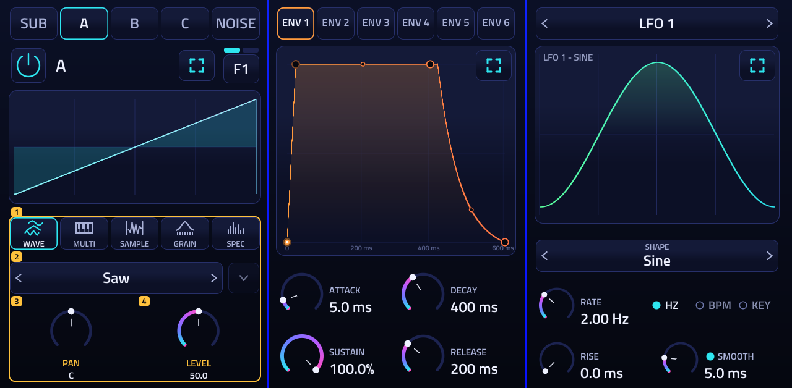

The Play tab is ONE page: three live panels side by side, an **oscillator** panel (left), an **envelope** panel (middle) and an **LFO** panel (right). The first four Q-Links (knobs) belong to the oscillator panel (type, table or OCT, PAN, LEVEL), the next four to the envelope (ATTACK, DECAY, SUSTAIN, RELEASE) and the next four to the LFO (SHAPE, RATE, RISE, SMOOTH). On the MPC XL all twelve are on the knobs at once and every control carries the number of its knob. On the Key 61 the yellow frame marks the four knobs at the moment; touch a control of another panel to bring its group to the four knobs (the others follow), and use the Q-Link bank buttons for the rest. At the top of each panel is a selector: the current entry in the middle, its neighbours at the sides (tap one to step to it, or drag across), and a tap on the name opens the list. A switched-off oscillator is drawn grey (the power button is red).
This is the place to play and tweak: the big controls of the three most used parts are in one view.

The envelope panel with its ADSR group (Q-Links 5 to 8 on the XL; with the Key 61 the frame is on it while it is the active group):
The Play page now features a unified, streamlined layout:
- **No tab rows:** Navigation is handled by a single selector in each third of the screen.
- **Arrows step, tap opens list:** Use the arrows to step, or tap the name to open the full list of options for Sub, Osc A/B/C, Noise, Envelopes 1–6, LFOs 1–10, and R1–R4.
- **Unified layout:** All three displays have the same height. The table selector, PAN, and LEVEL are consolidated into a single row.

### 5.12 Master

The LFO panel with its group (SHAPE, RATE, RISE, SMOOTH: Q-Links 9 to 12 on the XL):

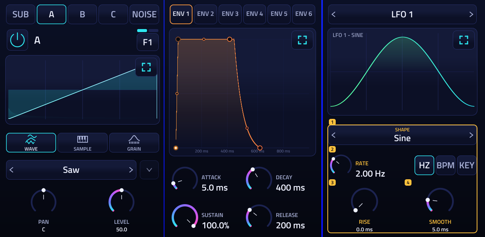

**Oscillator panel.**

| Control | What it does |
|---|---|
| SUB, A, B, C, NOISE buttons | Choose which sound source the panel shows and edits (saved with the project). The five buttons have one width. |
| Power button and name | Switch the shown source on and off. A source that is off shows its picture dimmed with a small OFF tag (see 5.3). |
| Route button (F1 / F2 / F12 / M / DIR / BAL / OFF) | Tap: opens the output popup (target, balance, BUS 1, BUS 2) of that oscillator. Sub has no route button here; its routing is on its own page (5.4). |
| Display + full-screen button | One cycle of the oscillator; the button opens the full-screen oscillator page (chapter 5.3 / 5.4 / 5.5). |
| Type keys WAVE / MULTI / SAMPLE / GRAIN / SPEC | The oscillator type (wavetable, multisample, sample, granular, spectral). Q 1. |
| Source stepper and the list button | Wavetable name (the title of the file for a table from a file), or the loaded file. Both open the wavetable browser (or the content browser); from the compact view the full screen opens first. Q 2. |
| PAN | -100 .. +100 percent (C, L n, R n). Q 3. |
| LEVEL | 0 .. 100 percent. Q 4. |

Sub and Noise have different controls (waveform, octave; noise colour, filter): see 5.4 and 5.5.

**Envelope panel.** ENV 1 .. ENV 6 buttons (a small dot marks an envelope that modulates something), the
envelope graph with a full-screen button, and the knobs ATTACK, DECAY, SUSTAIN, RELEASE (Q 1 - 4). The graph
here is always fitted to the panel; the lock and the time ruler are on the full page. Details in 5.8.

**LFO panel.** The stepper LFO 1 .. LFO 10, RND 1 .. RND 4 (a tap on the name opens the list), the
shape display with a full-screen button, the SHAPE stepper, the RATE knob with the **HZ / BPM / KEY** list (three
dots, the lit one is the mode), RISE and SMOOTH (Q 1 - 4). SMOOTH has a LED in front of its name: it is the switch
of the smoothing and the knob sets its time (the knob is dim while the LED is off). Details in 5.9.

**Full screen.** The full-screen button opens the page of that element over the whole plugin area (the same
page as the corresponding Osc, Env or LFO tab, with a CLOSE button). Leaving the Play tab closes it.
The Master page OUTPUT block includes:
- **LIMIT switch:** The output limiter, off by default. Use it to prevent clipping when pushing the output levels high.
- **QUALITY:** 
  - **NO SMOOTHING:** Disables parameter smoothing, causing changes to jump immediately instead of gliding (ideal for hard rhythmic gating). Stored in the preset.
  - **OVERSAMPLE 4X:** Cleans up high notes of the wavetable oscillator without a warp. Note: Uses more CPU. (2x on the gen 1 profile).

### 5.2 Macros

Eight macros as cards, two rows of four, with the live spectrum of the plugin's output under them. A macro is one knob
that moves as many things as you give it as targets: a good way to put a whole sound change on one Q-Link.
The list **BANK 1: 1-4 / BANK 2: 5-8** (the lit dot is the bank) chooses which row is the active Q group (yellow frame).

- Each card: a knob (name MACRO n, value 0 .. 100 percent, default 0) and chips naming what the macro
  drives. A card without targets says "NO TARGET - TAP TO ADD". A tap on the chips area opens the **targets
  page** of the macro (list of routes with depth, polarity UNI/BI, ON/OFF and remove, and ADD TARGET, see
  chapter 6).
- Q-Links: Bank 1 = macros 1 - 4, Bank 2 = macros 5 - 8. On the Key 61 the Q-Link button steps between the two rows; on the
  XL the other row is on knobs 5 - 8 at the same time (chapter 4.3). The other row carries quiet numbered chips (5 - 8 in the picture; the picture is rendered for a 16-knob device).
- Each macro has a **name** (up to 16 characters, default "Macro n") that is stored in the preset. A tap on the name (it is underlined) on a card opens a keyboard page (OK stores the name, CANCEL or BACK leaves it); a drag that starts on the name still turns the knob. The name is used on the Mod page, in pickers and on the knob displays.
- **Spectrum** (bottom strip): the spectrum of the plugin's output after the output stage (20 Hz to 20 kHz,
  scale -12 to -48 dB). It is a display only.

### 5.3 Osc A / B / C

Three identical oscillators (Osc A = Osc 1, B = Osc 2, C = Osc 3 in the parameter list). The page is the full-screen page
of one oscillator. Each oscillator is one of **five types**, chosen with the five keys at the top: **WAVE** (wavetable), **MULTI**
(multisample instrument), **SAMPLE** (one sample), **GRAIN** (granular) and **SPEC** (spectral). Everything you can set
on an oscillator is reachable on the page or on one of its detail pages, and from the Q-Links.

The picture is rendered for a 16-knob device: the small numbers are the Q-Link knobs (1 - 4 the yellow group, 5 - 16 the next groups,
chapter 4.3). On the Key 61 the same page shows 1 - 4 on the idle groups.

**Header** (left to right): the name (OSC A), the power button, the five **type keys**, the source stepper with a list button,
**PAN**, **LEVEL** and the **route button**.

| Control | Parameter and range | Notes |
|---|---|---|
| Power | Osc N On, Off/On | An oscillator that is off shows the picture of its current content (table, sample or spectrum) dimmed under a dark veil with a small **OFF** tag in the corner of the display. It is never an empty display. |
| WAVE | Osc N Type = Wavetable | |
| MULTI | Osc N Type = Multisample | |
| SAMPLE | Osc N Type = Sample | |
| GRAIN | Osc N Type = Granular | |
| SPEC | Osc N Type = Spectral | |
| Source stepper (WAVE) | Osc N Wavetable, 15 choices: Sine, Saw, Square, Triangle, Pulse 25%, Saw to Square, Sine to Saw, Harmonic Series, Odd Harmonics, Formant Sweep, FM Sweep, PWM Sweep, Bell Partials, Preset table, Saw Down; or the title of a table from a file | A tap on the name or the list button opens the **wavetable browser**: categories (Basic, Morph, the categories of the installed packs, your own folders, User) and their tables, the current one marked. The outer quarters (and the Q knob) step the built-in tables, or, when the table is a file, the previous / next table of its category (nothing at the ends). To add your own tables copy WAV files to `SynthyBoy/Wavetables/<Category>/` on the SD card, a USB drive or the plugin's Content folder (see `factory-content.md`, "Adding your own wavetables"). |
| Source stepper (other types) | the loaded file or instrument | A tap on the name or the list button opens the **content browser** (see below). |
| PAN | -100 .. 100 percent, default 0 | Q 3 |
| LEVEL | 0 .. 100 percent, default 50 | Q 4 |
| Route button | Osc N Destination: F1, F2, F12 (Filters 1+2), M (Effects only), DIR (Direct out), BAL (Filter blend), OFF (None) | Tap opens the output popup: target, balance (Osc N Filter Blend, 0 .. 100 percent, only for Filter blend), BUS 1 and BUS 2 sends (0 .. 100 percent). Default F1. |

**Display.** One cycle of what the oscillator produces now, including warp and unison; a faint stack shows the frames of the table
when they differ. The unison voices are thin lines around the main curve. Sample, grain and spectral oscillators draw their own
picture (the sample with its region and loop, the grains as bars on it, the spectrum).

**TUNE block** (right). OCT (whole octaves, -4 .. +4), SEM (-11 .. +11 semitones; the transpose is 12 x OCT + SEM, limited to +-48), FIN
(fine, -100 .. +100 cents), CRS (coarse, -48 .. +48 semitones, shown with two decimals), **TRACK** (a LED switch: pitch tracking, default on; off
means the oscillator does not follow the keyboard) and **MORE** (the options page, below).

**UNISON block** (bottom left). The first knob (WT POS for wavetables, TIMBRE for MULTI, SCAN for SAMPLE and GRAIN, POSITION for SPEC),
VOICES (1 .. 16, tap the upper or lower half), the gear button **MORE** (the unison page), DETUNE (0 .. 100 percent, default 25),
BLEND (0 .. 100 percent, default 80). More voices make a wider, thicker sound. **How many unison voices you really get depends on the device (chapter 7.1).**

**WARP block** (bottom right). Two rows, **WARP 1** and **WARP 2**: a knob for the amount (0 .. 100 percent, default 50), a stepper for the type
(99 types, "None" is off and the row is drawn dim; a tap on the name opens the list) and a small **PHASE** knob (0 .. 360 degrees, default 180) of that warp.
Warp bends the wave in time or in level; two warps in a row give far more shapes than one. The warp amount and the type are
the strongest controls for changing the character.

**Unison page** (button MORE in the unison box):

Block UNISON: MODE (Linear, Super, Exp, Inv, Random), STACK (Unison, Center Drop 12, Center Drop 24, Octaves, Two
Octaves, Power Chord, Two Power Chords, Major Chord, Minor Chord, Harmonic Series, Odd Harmonics), WIDTH (stereo
spread, 0 .. 100 percent), RANGE (0 .. 48 semitones, default 2). Block VOICE SPREAD: WT POS, WARP 1, WARP 2 (each
-100 .. +100 percent: how much the frame and the two warps differ from voice to voice). The picture above the
blocks is the oscillator picture. For SAMPLE, GRAIN and SPEC the page also has START and SPAN (where in the file the voices start and how far apart). BACK returns.

**Modulation page of a control** (long press on a knob or number field). A control that nothing modulates yet opens the **source board**:
all 57 sources as chips, one tap makes the modulation of that control. With modulations present the page lists them (source, depth bar,
UNI/BI, ON/OFF, remove) and keeps a compact add row under them (chapter 6).

**Q groups of the page** (in reading order, each group is four knobs): the header (type, source, PAN, LEVEL), the type's own bar (WAVE: FRAME, PHASE, RAND, MAP), Tune (OCT, SEM, FIN, CRS),
Unison (the first knob, VOICES, DETUNE, BLEND), then the warp rows.

#### The five types

**WAVE (wavetable).** The bar above the display has FRAME (the frame now playing; shown only, you set the frame with WT POS or modulate it), PHASE
(start phase, 0 .. 360 degrees), RAND (random start phase, 0 .. 100 percent) and **MAP**, which opens the FRAME MAP page.

*FRAME MAP* (what the picture shows): the block FRAME REMAP has the **REMAP** LED switch, a **CURVE** list (Curve 1 .. Curve 4) and the knobs **RISE** and **FALL**
(milliseconds, on while the remap is on). The remap curve is drawn over the display (the orange line). The block SPECTRAL MORPH has TYPE (None, Vocode,
Formant Scale, Harmonic Stretch, Inharmonic Stretch, Smear, Random Amplitudes, Low Pass, High Pass, Phase Disperse, Shepard Tone, Time Skew), AMOUNT and SPREAD.
Use the remap to change how the frame position runs through the table; use the morph to reshape the harmonics of every frame.

**MULTI (multisample instrument).** The source is an instrument file (SFZ, or a WAV that becomes an instrument of one zone). With no file loaded the display shows
NO SAMPLE and a **LOAD INSTRUMENT** button that opens the content browser. The bar has **ENV** (opens the multisample envelope page: DELAY, ATTACK, HOLD, DECAY, SUSTAIN, RELEASE
and the OVERRIDE switch, which lets this envelope replace the instrument's own), the **VEL TRK** LED switch with its AMOUNT (0 .. 100) and RAND (random start phase). The unison box has TIMBRE (-100 .. +100 percent).

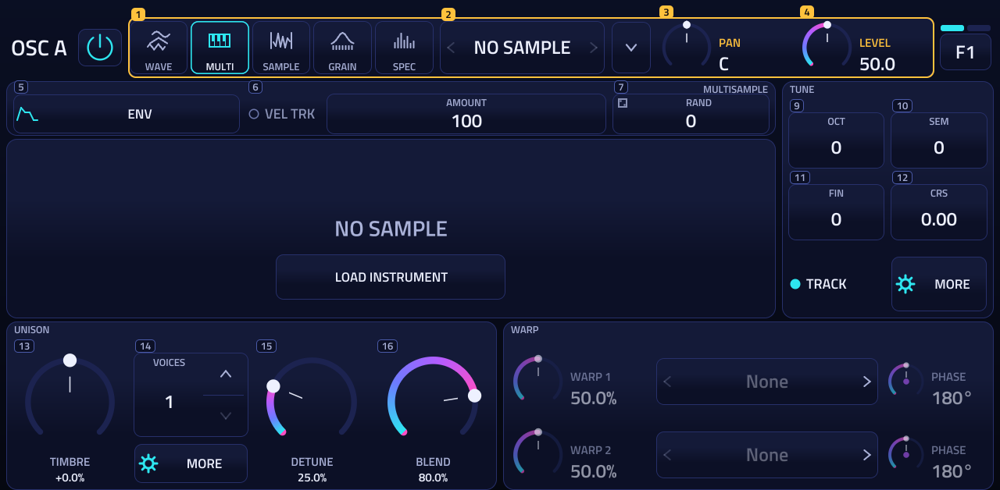

**SAMPLE (one sample).** The display shows the sample with the START and END marks of the region. The bar has PHASE, **REGION** (opens SAMPLE REGION), **SLICE** (opens SAMPLE SLICES AND SCAN) and the unison count; the
knob in the unison box is SCAN. With no file loaded a **LOAD SAMPLE** button opens the content browser.

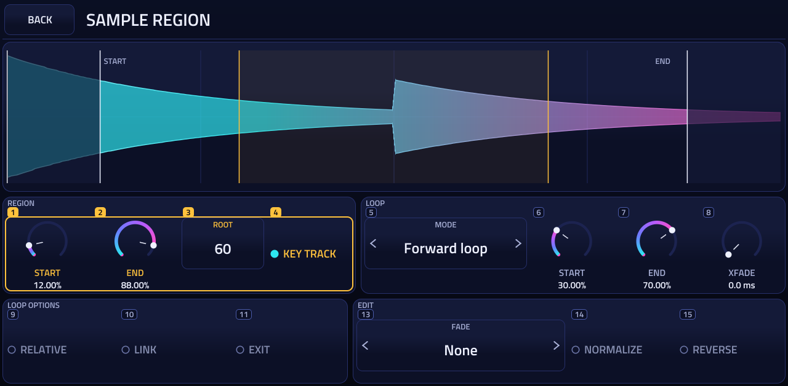

*SAMPLE REGION*: block REGION (START and END of the part that plays, ROOT note, shown while key tracking is on, and the KEY TRACK switch); block LOOP (MODE: One-shot, Forward loop, Reverse loop, Forward/reverse loop, Tailed; loop START, END and XFADE, shown while a loop mode is on);
block LOOP OPTIONS (RELATIVE, LINK = link the loop length, EXIT = leave the loop on release; shown while looping); block EDIT (FADE edges: None, 1 ms .. 128 ms; NORMALIZE; REVERSE).

*SAMPLE SLICES AND SCAN*: block SLICE (MODE: Off, Auto, Manual; THRESHOLD in Auto; the slice select in Manual); block PLAYBACK (PLAY: Play slice to end or Play single slice, and the slice ROOT; shown when slicing);
block SCAN (RANGE +-100 %, +-200 %, +-400 %, +-800 % and REVERSE: how far the SCAN knob can move the read position); block TEMPO (LOCK to tempo, TO BPM, and the length in BEATS while one of them is on).

**GRAIN (granular).** The source is a sample that is played as a cloud of short grains. The display shows the file; a frame marks where the grains read. The bar has the
**GRAIN** button (opens the GRAIN ENGINE page), **AMOUNT** (the grain window amount, with the window icon), the **LOOP** stepper (One-shot, Loop grains, Manual) and the unison count. The bottom blocks are GRAIN (SCAN, DENS = density 0.1 .. 1000 Hz, LENGTH 1 .. 4000 ms, WARP menu), PLAYBACK (OFFSET, DIR, PITCH 0 .. 24 semitones) and RANDOM (LEN RAND, PAN RAND, LVL RAND; random spread of length, pan and level).
With no file loaded a **LOAD SAMPLE** button opens the content browser.

*GRAIN ENGINE*: block DENSITY (MODE Free, BPM Sync, Grains; the DIVISION in BPM Sync; the number of grains in Grains); block LENGTH (MODE Free, BPM Sync, Percent; division, percent);
block SPAWN (PATTERN Together, Even, Exp, Random; MAX grains; JUMP = jump start; REVERSE); block RANDOM WARP (WARP 1, WARP 2: random amount per grain); block POSITION (MANUAL, KEY TRACK, XFADE); block Y AXIS (AXIS: a parameter you hand to the vertical axis, and its Y position while an axis is set).

**SPEC (spectral).** The oscillator plays the spectrum of a sample or table and lets you filter and scan it. The display is the spectrum. The bar has PHASE, **FILTER** (opens SPECTRAL FILTER), **SCAN** (opens SPECTRAL SCAN) and the unison count; the knob in the unison box is POSITION. With no file loaded a **LOAD SAMPLE** button opens the content browser.

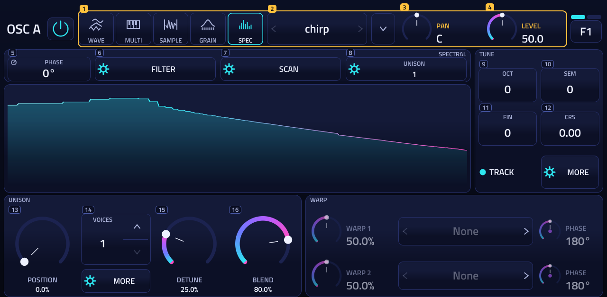

*SPECTRAL FILTER*: block BAND (LOW and HIGH edge in Hz, SMOOTH edges, AFTER WARP = apply the band after the warps); block FILTER (CUT, MIX, SHIFT = frequency shift in Hz); block FILTER FROM WAVETABLE (the WAVETABLE switch, then TABLE and FRAME that shape the filter).

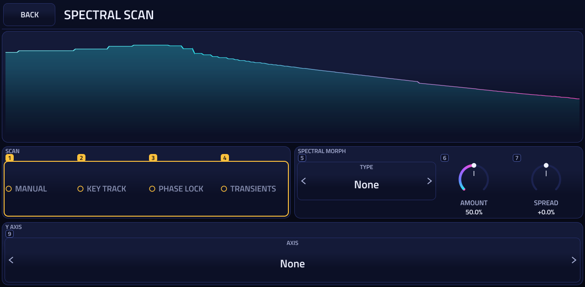

*SPECTRAL SCAN*: block SCAN (MANUAL position, KEY TRACK, PHASE LOCK, TRANSIENTS); block SPECTRAL MORPH (TYPE, AMOUNT, SPREAD, as on the wavetable map page); block Y AXIS (AXIS: None, Level, Warp, Warp 2, Spec Flt Cutoff, Spec Flt Wet/Dry, Freq Lo, Freq Hi).

**The content browser.** The source of MULTI, SAMPLE, GRAIN and SPEC is a file. The browser opens as a list: the first row is the folder you are in (tap to go one up), then folders, then files, sorted by name. The roots at the top are
SD CARD, USB drives (named USB and the drive name) and PLUGIN CONTENT. It opens in the folder of the file loaded last. Only WAV and SFZ files are offered (not FLAC). An SFZ instrument must lie in a folder of its own with its samples below it. A tap on a file loads it; "LOAD FAILED" stays for four seconds if it does not.

#### The oscillator options page (button MORE in the tune block)

The page has no display: the room goes to six blocks, each one Q group of four.

- **OSCILLATOR:** ON (the power switch, so it can be reached from the Q-Links), ENV 1 (Env 1 shapes this oscillator), SMOOTH (smooth interpolation), TRACK (pitch tracking).
- **PITCH:** MODE (Semitones, Harmonics, Ratio, Step), BEND (the oscillator follows the pitch bend, a LED switch), and, while TRACK is off, **FIXED PITCH**: the MIDI note the oscillator plays whatever key you press (0, the default, is the oscillator's own C3).
- **TRANSPOSE SNAP:** the twelve note cells (C to B, the five black notes in the upper row) are the notes the oscillator may play. Tap a cell to allow or forbid it. The nearest allowed note wins; a tie goes down; with no cell lit the snap is off. The **SNAP NOTE** switch snaps the whole played note instead of the transpose alone. This gives you a scale or a chord from one key. The knob that stands for the mask on the Q-Links sweeps it in coarse steps; the editing is by touch.
- **PHASE:** MEMORY (All Voices: PHASE and RAND for every note, the default; Contiguous: a note continues with the phases the previous note has now; Per Voice: every note starts with the phases captured from the previous note), LEGATO (a note that starts while the previous key is still held takes that note's phases instead of starting at PHASE and RAND; it is the same switch as the PHASE LEG switch of the Master page) and RATIO source (Base note, Osc 1, Osc 2, Osc 3, Sub).
- **KEY ZONE:** LOW and HIGH note, **FOLD** (a note outside the zone plays as the note an octave or more away that lies inside; a zone narrower than an octave cannot take it and stays silent) and **WARP** (outside its zone the oscillator keeps running as the source of the other oscillators' warps, but is not heard and not in the mixer strips).
- **VELOCITY ZONE:** LOW and HIGH velocity and OVERRIDE.
- **UNISON SHAPE:** CURVE (detune curve) and SHAPE (blend shape), VOICE LAW (Equal power or Fixed gain: how the blend of the voices is weighted) and STACK repeat (1x, 2x, 3x).

Controls that do not apply in the current state are hidden (FIXED PITCH while TRACK is on, for example) and the others take their room.

### 5.4 Sub

The sub oscillator: a simple wave for weight under the main oscillators. Header: the power button (Sub On), the six waveform keys **SINE, HALF, TRI, SAW, SQR, PULSE** (Sub Waveform:
Sine, Rounded Rect, Triangle, Saw, Square, Pulse; the key HALF is the choice "Rounded Rect"), **OCT** (-4 .. +4, default -1),
**PAN** (-100 .. +100 percent) and **LEVEL** (0 .. 100 percent, default 50). Sub has no route button; its routing is the block ROUTING below.
In the picture the power button is dim: the Sub is off in the Init sound.

- Display: one cycle of the waveform.
- TUNE: CRS (Sub Coarse, -48 .. +48 semitones), **ENV 1** and **MONO** (LED switches: Env 1 shapes the Sub; MONO).
- PHASE: PHASE (0 .. 360 degrees shown), **FREE RUN** (LED switch; the parameter is "Sub Phase Contiguous").
- ROUTING: DEST (Filter 1, Filter 2, Filters 1+2, Effects only, Direct out, Filter blend, None; default Effects only), BLEND (0 .. 100 percent), BUS 1, BUS 2 (0 .. 100 percent).
- Q groups: header (waveform, OCT, PAN, LEVEL), TUNE, PHASE, ROUTING.

### 5.5 Noise

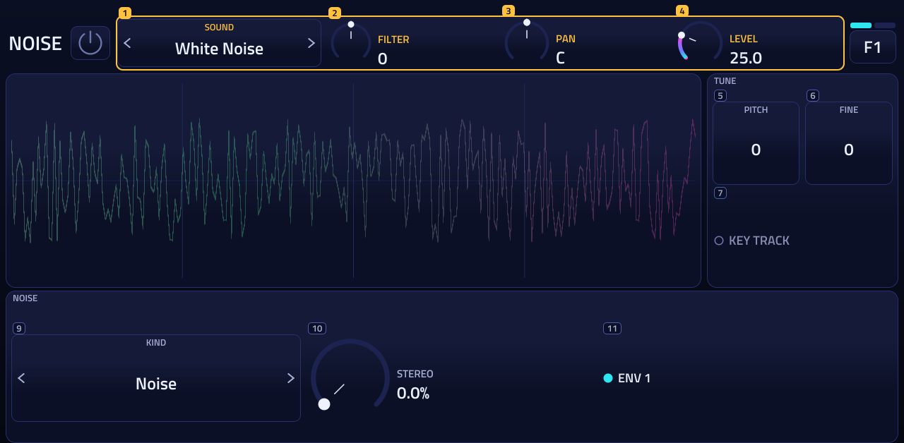

The noise generator. Header: the power button (Noise On), the **SOUND** stepper (Noise Sample: White Noise, Pink Noise, Brown Noise, Geiger,
Tape Hiss, Vinyl Clicks, Digital Hash, Velvet Noise, Atmosphere), **FILTER** (-100 .. +100 percent), **PAN**, **LEVEL**
(0 .. 100 percent, default 25) and the route button. The display draws the colour of the noise (faint while the noise is off).

- TUNE: PITCH and FINE (number fields: -48 .. +48 semitones, -100 .. +100 cents), **KEY TRACK** (LED switch).
- **Two different steppers.** The header stepper SOUND chooses which of the nine noise sources the generator plays. The **KIND** stepper in the bottom block (Noise Type: Noise / Sample) chooses whether the source is that generated noise (Noise) or a sample file from the plugin's content (Sample). If no sample file is loaded in Sample mode, the generated noise plays instead.
- Bottom, KIND = Noise (as in the picture): one block NOISE with KIND, STEREO (0 .. 100 percent) and the **ENV 1** LED switch.
  KIND = Sample: block SOURCE (KIND, START = Noise Phase 0 .. 100 percent, STEREO, ENV 1) and block PLAYBACK (RANDOM, LOOP, BOUNCE LED switches).
- Q groups: header (source, FILTER, PAN, LEVEL), TUNE, the bottom blocks.

### 5.6 Mixer

Ten channel strips, side by side, without frames around the sliders: the name and the value sit over a thin track.
They run from left to right: **SUB, A, B, C, NOISE, F1, F2, BUS1, BUS2, MASTER**, and above them a routing
bar (FLT 1, FLT 2, MAIN FX, DIRECT, MASTER) that draws the path of the **selected strip** (a tap on a strip selects it).

Each strip (top to bottom):
- **Power button**: the source's On (oscillators, Sub, Noise, filters). On BUS1, BUS2 and MASTER it is the FX switch of that rack: lit
  means the rack's effects are active (parameters "Bus 1 FX Bypass", "Bus 2 FX Bypass", "Main FX Bypass", shown inverted).
- **Destination button** (a tap opens the list):
  - SUB, A, B, C, NOISE: Filter 1, Filter 2, Filters 1+2, Effects only, Direct out, Filter blend, None.
  - F1, F2: Effects only, Direct out, None.
  - BUS1, BUS2: Main, Direct, Other bus.
  - MASTER: OUT (fixed).
- **LEVEL fader** with a peak meter beside it: SUB, A, B, C, NOISE 0 .. 100 percent; F1, F2 -60 .. +12 dB (default 0); BUS1, BUS2 -60 .. +6 dB
  (default 0); MASTER = Master Volume -60 .. +6 dB (default -12). Vertical drag; double tap = default. A hold line falls slowly from the highest level. The meter has a dB scale (a mark every 12 dB, or at 0 / -6 / -12 / -24 / -48) and a colour ramp: blue-green when quiet, violet near full scale. At rest it shows a faint base line, never an empty box.
- **PAN** (-100 .. +100 percent), **B1** and **B2** (sends to bus 1 and bus 2, 0 .. 100 percent): thin sliders without a box, on SUB, A, B, C, NOISE, F1, F2 only. The buses and MASTER have a level only; their PAN and sends are left out, not dimmed.

Q group: the strip you touched (yellow frame around the whole strip; in the picture it is SUB): LEVEL (1), PAN (2), B1 (3), B2 (4). On the XL the next three strips (wrapping) follow on knobs 5 - 16: in the picture A has 5 - 8, B has 9 - 12, C has 13 - 16. On the Key 61 the Q-Link button steps to them (chapter 4.3).

### 5.7 Filter 1 / 2

The picture shows Filter 1 with the Digital model, the response curve with the cutoff handle, and the three blocks. The OUTPUT button at the top right shows M (Effects only).

The page of the Filter tab shows **one filter at a time**: the tab Filter 1 starts on F1, Filter 2 on F2. The **CURVES** list at the top
left (F1, F2, F1+F2; the lit dot is the choice) says which curves the display draws and which filter the knobs edit; F1+F2 draws both response curves and the combined one.
It is not the routing list (Parallel / Series) and not the Filter 1 / Filter 2 tabs of the MPC, which only choose where the page opens.

**Header:** power (Filter N On), model stepper (27 models: Analog, Dirty, Ladder, Digital, Diode, Formant, Comb, Phaser, Multi SVF, Slope, EQ 6 dB,
Ring Mod, Sample Hold, Smear, French LP, Add Bass, Scream, New Wsp, DJ Mixer, Diffusor, EMS Ladder, PZ SVF, Normal, Multi Morph, Flanges, Misc, New)
with a list button, style stepper (12 styles, "Style A (12 dB)", "Style B (24 dB)" ... "Style L"), **CLEAN** LED switch (dim for Comb and Formant),
**OUTPUT** route button (M = Effects only by default; Filter N Destination: Effects only, Direct out, None; the popup also has BUS 1, BUS 2, level, pan).

**Display.** The response curve the filter really has (log frequency 20 Hz .. 20 kHz, dB scale from +24 down to -48), drawn with the live cutoff and resonance of the voice that sounded last
(also moved by modulation). Drag the handle on the curve to change cutoff and resonance together; a bubble shows the values.

**Blocks (one Q group each):**

| Block | Control | Parameter, range |
|---|---|---|
| MAIN | CUTOFF | 20 .. 20000 Hz, default 12 kHz |
| | RESO | 0 .. 100 percent, default 20 |
| | DRIVE | 0 .. 20 dB |
| | MIX | 0 .. 100 percent, default 100 |
| TRACK | KEYTRACK | -100 .. +100 percent |
| | ENV 1 | LED switch: Env 1 shapes the filter (default On) |
| | VAR | 0 .. 100 percent, default 50 (dim with Formant) |
| | COMB | Comb Blend Offset 0 .. 84 semitones, default 42 (dim unless the model is Comb) |
| OUT | LEVEL | -60 .. +12 dB |
| | PAN | -100 .. +100 percent |
| | BLEND | 0 .. 100 percent |
| | ROUTING | a LED list of three: Parallel, Series 1 to 2, Series 2 to 1 (one setting for both filters) |

With the model **Formant** a fourth group FORMANT appears with X, Y (0 .. 100 percent), TRANSPOSE (-12 .. +12 semitones) and SPREAD (-100 .. +100 percent), and the display shows the formant pad.
The Formant page has no picture yet (chapter 11).

Controls that do not apply to the current model are dimmed, including their value text (in the picture COMB is dim because the model is not Comb). A long press on a knob opens its modulation page (chapter 6).

### 5.8 Envelopes

The pages Env 1 - Env 4 each show one envelope full screen; the buttons **ENV 1 .. ENV 6** at the top switch the page to another envelope (a dot under the button marks an envelope that modulates something).
The tab only decides which envelope is shown first. An envelope shapes a value over the time of a note: Env 1 is the amplitude envelope in the Init sound, the others are free for the filter, the pitch or anything else you route them to (chapter 6).

- **Graph.** The graph has the whole width. The handles of DELAY, ATTACK, HOLD, DECAY, SUSTAIN, RELEASE are on the curve. Drag a time handle to change the time; the DECAY handle changes decay time and sustain level at once; the small handle in the middle of attack, decay and release bends the curve; double tap on a handle = its default. The name and value of the handle in your hand are written over it. A dot and a soft line follow the playing voice(s); Env 1 lies faintly behind the other envelopes on the same time axis.
- **LOCKED / FREE** (the button at the top left of the graph). **LOCKED** (the default): the envelope always fills the graph, so when you change the times the **time ruler** under the graph changes, not the picture. **FREE**: a horizontal drag along the ruler zooms the time axis (to the right in, to the left out); the envelope may then run past the right edge and the handles beyond it cannot be touched. Switching to FREE keeps the picture as it is; switching back fits again. The compact graph on the Play page is always locked and has no button.
- **Time ruler.** Round marks in ms or s under the graph (in beats when BEATS is on); the marks are also the vertical grid lines.
- A stage of 0 ms takes no width in the graph: drag its handle to the right to give it time.
- **Targets.** What the envelope modulates is written as small tags between the envelope buttons and TARGETS: a dot, the name and the signed depth, for example "Filter 1 Cutoff +45%", as many as fit and then "+n". The tags are text, not buttons. The **TARGETS** button (top right, with the number of targets) opens the list of routes with depth, UNI/BI, ON/OFF, remove and ADD TARGET (chapter 6).

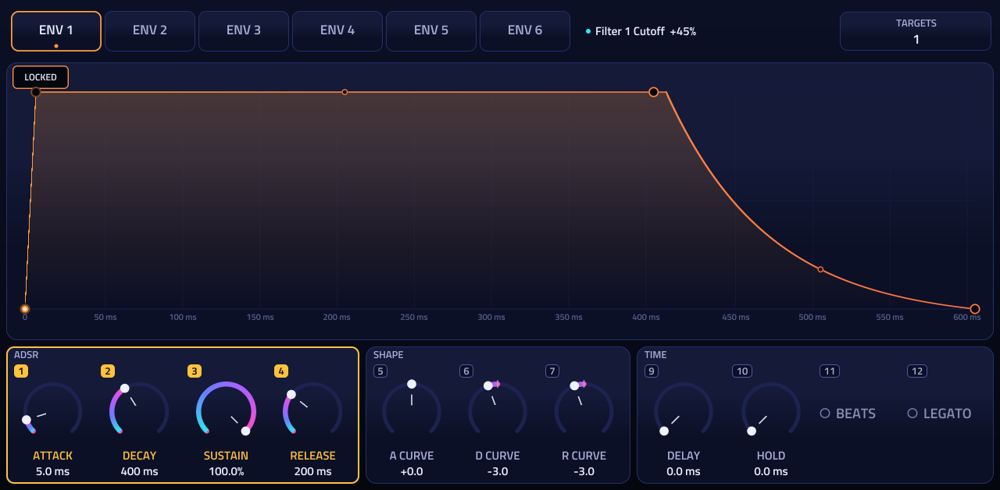

The three blocks under the graph are one Q group each (in the picture: ADSR yellow, SHAPE 5 - 7, TIME 9 - 12):

- **ADSR** (Q 1 - 4): ATTACK 0 .. 10000 ms (default 5), DECAY 0 .. 10000 ms (400), SUSTAIN 0 .. 100 percent (100), RELEASE 0 .. 10000 ms (200).
- **SHAPE:** A CURVE, D CURVE, R CURVE: -20 .. +20, defaults 0, -3, -3.
- **TIME:** DELAY 0 .. 4000 ms, HOLD 0 .. 4000 ms, **BEATS** (a LED switch: times in beats instead of milliseconds: delay 0 .. 8, attack 0 .. 16, hold 0 .. 8, decay 0 .. 16, release 0 .. 16 beats), **LEGATO** (a LED switch; the parameter is "Legato Inverted"). With the main LEGATO switch on the Master page, a note played while another is held takes over the sounding voice and the envelopes do not start again. Switching LEGATO on for an envelope here makes **that envelope** restart on every note, even in that situation (it restarts from its current level, not from zero). It has no effect while the main LEGATO is off.

### 5.9 LFOs and the drawn-shape editor

The pages LFO 1 - LFO 4 each show one LFO; the bar at the top switches to **1 .. 10** (LFOs) or **R1 .. R4** (random LFOs), all in one row. The tab only decides which is shown first.
An LFO is a repeating wave that moves a parameter (vibrato, tremolo, a wobbling filter). You give it targets with the **TARGETS** button (chapter 6).

**Top bar:** the instance cells, **EDIT** (opens the shape editor, below) and **TARGETS** (what the LFO modulates, with the number of routes).

**Display** (left): the shape of one cycle, with the phase marker and a cursor that runs with the sounding voice. A strip above the graph shows delay and rise when set. In KEY follow mode (the sync list on KEY) the display shows the shape at full height.

**Shape picker** (right, 13 cells; Q 1): SINE, TRI, SAW UP, SAW DN, SQUARE, PULSE (25 percent), STEP UP, STEP DN, RANDOM (random steps), EXP UP, EXP DN, HALF (half sine), DRAWN (your own shape).
Under it the **HOST** LED switch. **HOST** only matters when the LFO's MODE is Free-run (and the sync is not KEY): then the LFO's phase is taken from the host's song position while the transport plays, so a song plays the same every time; with HOST off the LFO runs freely and keeps its own clock.

**Blocks (one Q group each; the controls are not framed one by one):**

| Block | Control | Parameter, range |
|---|---|---|
| RATE | RATE (the large knob) | 0.01 .. 200 Hz, default 2 |
| | RISE | fade in 0 .. 8000 ms |
| | SMOOTH | the **LED on the label** is the smoothing switch, the knob is the smooth time 1 .. 1000 ms. The knob is dim while the LED is off. A tap on the label text switches the LED. |
| TIMING | SYNC list **HZ / BPM / KEY** | Free (Hz), Tempo (BPM), Key follow. The tempo variants (dotted, triplet) are the TRIP and DOT switches in the RATE block |
| | MODE | Retrigger, Free-run, Envelope, Sustain envelope, Loop at point, Loop and hold (a stepper with a list; the names are long) |
| | PHASE | 0 .. 360 degrees |
| | DELAY | 0 .. 4000 ms |
| MOTION | DIRECTION | a list: Forward, Reverse, Ping pong |
| | SWING | 0 .. 100 percent |
| | STEREO | -180 .. +180 degrees (offset between left and right) |
| | MONO | LED switch |

**BPM mode.** With the sync list on BPM the RATE knob is replaced by the **DIVISION** stepper (13 choices: Freeze, 32 bars, 16 bars, 8 bars, 4 bars, 2 bars, 1 bar, 1/2 note, 1/4 note, 1/8 note, 1/16 note, 1/32 note, 1/64 note) with the LED switches **TRIP** (triplet) and **DOT** (dotted) under it; they exist only in this mode.

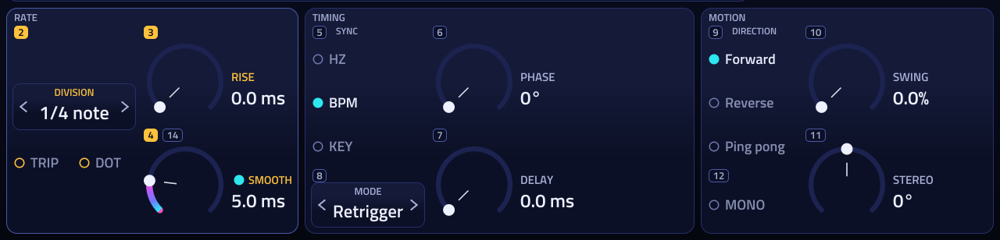

**KEY mode.** With the sync list on KEY the rate follows the note you play, so the RATE knob is not on the page. The block is named "RATE - FOLLOWS THE KEY" and holds **TRANSPOSE** (-60 .. +36 semitones, default -12) and **TUNE** (-100 .. +100 cents), each its own Q group right after RATE.

**Random LFOs (R1 - R4):**

The style grid is Q 1 and has no stepper of its own: PERLIN, S & H (sample and hold), SINE INT (sine interpolate), LORENZ, ROSSLER. The display is the trace of the output. The block RANDOM is one row: the RATE knob (0.01 .. 200 Hz, default 2), the HZ / BPM / KEY list, the STEREO LED switch and the trigger MODE (a list of two: Retrigger, Free-run). In KEY follow the TRANSPOSE and TUNE block replaces the rate as above. Random LFOs have no EDIT button.

**The drawn-shape editor.** The **EDIT** button at the top right of the LFO page opens the editor page over the current view (tap **BACK** to return). If you press **EDIT** while a built-in shape is selected, the shape is converted into editable points and becomes a custom drawn shape (the LFO shape becomes DRAWN). You can switch back to any factory shape at any time with the shape picker on the LFO page. Choosing the cell DRAWN in the shape picker switches to the custom shape (a triangle when it has no points yet), but does not open the editor.

The editor gives you a 956 by 540 pixel canvas to draw and reshape the cycle. The canvas shows between 2 and 128 points. The top right corner displays the count (for example "9 / 128 POINTS"). A shape with no inner points is evaluated as a straight line. The top left corner displays a status message for three seconds whenever you save, load or copy a shape.

**Top bar.** The bar across the top contains navigation, drawing tools and action menus:

- **BACK:** Returns to the LFO page.
- **Tools:** A row of seven tools (**POINT**, **FLAT**, **RAMP+**, **RAMP-**, **SELECT**, **SOFT**, **BEND**). Every touch gesture is one undo step.
- **SHAPES:** Opens the shape preset menu (factory shapes, your saved shapes, save, replace, rename and delete).
- **MORE:** Opens the utility menu (**EDIT**, **GRID** and **COPY** actions).
- **UNDO:** Reverts the previous change (depth of 32 undo states). The button is dim when the undo stack is empty.
- **DELETE:** Deletes all selected inner points at once. The button is dim when no deletable point is selected.
- **MOD:** Opens the point modulation page for the selected points. Enabled when at least one point is selected.

**The seven tools.** Each tool adapts touch gestures to a specific editing role:

| Tool | One touch gesture |
|---|---|
| **POINT** | Tap on empty ground to add a point (snapped to the grid when **SNAP** is active) and drag it. Touch an existing point to select and drag it; the two end points move only vertically. Touch the round middle handle of a segment to drag its curvature (-20 to +20). Double tap on an inner point to delete it (never an end point). Double tap on a curve handle to reset that curve to straight. A long press (0.6 seconds without moving) on an inner point deletes it as well. |
| **FLAT** | Touch a grid cell to draw a horizontal segment across that column at finger height (snapped to a grid line when **SNAP** is active), replacing any points in that column. Dragging across columns fills every passed column with the finger height interpolated. |
| **RAMP+** | Touch a grid cell to draw a rising ramp from the bottom grid line to the top grid line of the cell across that column. Dragging across columns draws rising saw teeth across all touched columns. |
| **RAMP-** | Touch a grid cell to draw a falling ramp from the top grid line to the bottom grid line of the cell across that column. Dragging across columns draws falling saw teeth across all touched columns. |
| **SELECT** | Drag on empty ground to draw a rectangle that selects all points inside it. Tap a point to add it to the selection or, if already part of a multi-point selection, tap to remove it. Tap empty ground to clear the selection. Drag any selected point to move all selected points together, keeping their relative spacing and shape. |
| **SOFT** | Drag a point to move other points with a linear falloff. Closer points move more, shown in rainbow colours by weight. When two or more points are selected, the falloff applies across the selection. With no selection or one point selected, all points within 25 percent of the cycle follow the dragged point. |
| **BEND** | Drag the curve handle of any curved segment to bend all bendable curves in the shape by the same amount. |

**Right column.** The column on the right side contains three titled Q groups and two LED toggles at the bottom:

- **SELECTED POINT** (Q 1 to 4):
  - One point selected: **POINT** (Q 1) shows the point number (1 to n). **X** (Q 2) sets the time position (0.00 to 1.00; disabled on end points). **Y** (Q 3) sets the level (0.00 to 1.00). **CURVE** (Q 4) sets the curvature of the segment after the point (-20 to +20).
  - Two or more points selected: **POINT** (Q 1) shows the selection count (for example "3 SEL"). **X** (Q 2) moves the horizontal centre of the selection, shifting the points in time while keeping their order. **Y** (Q 3) moves the vertical centre of the selection up or down. **SCALE** (Q 4, replaces CURVE) scales the height of the selection (0.01 to 1.00) around its vertical centre.
  - When no point is selected, these fields show a dash.
- **GRID** (Q 5 to 7 on a 16-knob device):
  - **GRID X** (Q 5): Horizontal cycle divisions (2 to 32 columns, default 8).
  - **GRID Y** (Q 6): Vertical height divisions (2 to 32 rows, default 8).
  - **SNAP** (Q 7): LED toggle. When active, point additions, drags, marker movements and cell tool draws snap to grid intersections.
  - The grid is saved with the shape in your preset (state version 5). When loading a preset saved without a grid, the editor automatically chooses the coarsest matching grid from 4, 8, 12, 16, 24, 32, or defaults to 8.
- **TRIGGER** (Q 9 to 11 on a 16-knob device):
  - **MODE** (Q 9): Stepper for the six LFO trigger modes: Retrigger, Free-run, Envelope, Sustain envelope, Loop at point, Loop and hold. Tap the name to open the full list popup.
  - **PHASE** (Q 10): Phase angle (0 to 360 degrees).
  - **BEND ALL** (Q 11): Mean curvature of all bendable segments (-20 to +20); turning it bends every curved segment together.
- **LOOP** (LED toggle): Toggles the loop point flag on the selected point. Dim when no point is selected.
- **SMOOTH** (LED toggle): Enables cosine S-curve smoothing across all segments of the shape.

On the 16-knob MPC XL, all eleven controls are active at once on knobs 1 to 11 (slots 8 and 12 to 16 are unused). On the 4-knob MPC Key 61, the active group is framed in yellow; tap a group or press the Q-Link bank button to switch between SELECTED POINT, GRID and TRIGGER.

**The START / LOOP marker.** A vertical line with a round 56-pixel touch handle at the top marks the phase position on the canvas. Drag the handle to move it. The marker is directly bound to the engine parameter **PHASE** (`lfoN.phase`): moving the marker updates **PHASE**, and turning the **PHASE** knob moves the marker. What the marker represents depends on the trigger **MODE**:

- In **Retrigger** and **Envelope** modes, the marker is labelled **START**. It sets the cycle start position when a note is struck. It drags continuously, snapping to points within 14 pixels or to the grid when **SNAP** is active.
- In **Sustain envelope**, **Loop at point** and **Loop and hold** modes, the marker is labelled **LOOP**. It snaps to existing points and binds the shape's loop point to that point. In Sustain envelope, the LFO holds at this point while you hold the key. In Loop at point, the LFO plays to the end of the shape and loops back to this point. In Loop and hold, the LFO loops between start and this point while the key is held, then releases to the end of the shape.
- In **Free-run** mode, the marker is dimmed and the canvas displays the hint "FREE-RUN: PHASE SHIFTS THE CYCLE" at the bottom. In Free-run the LFO runs on a continuous shared clock and **PHASE** shifts the cycle timing.

**Point modulation (the MOD page).** Tap **MOD** in the top bar when one or more points are selected to open **PointModPage**:

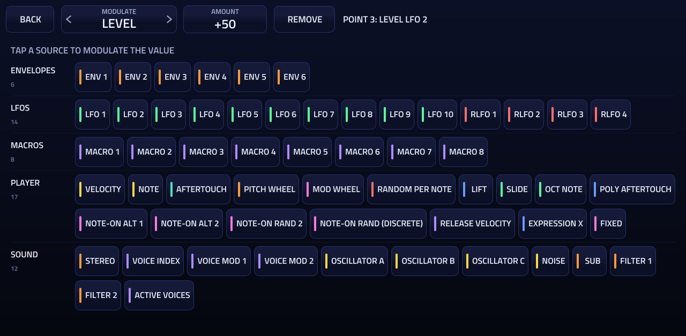

- **BACK:** Returns to the editor canvas.
- **MODULATE** (stepper): Selects the target value to modulate: **TIME**, **LEVEL** or **CURVE**.
- **AMOUNT:** Modulation depth from -100 to +100 percent.
- **REMOVE:** Removes the modulation assignment from the chosen target.
- **Summary:** Displays the status above the board (for example "POINT 3: LEVEL BY LFO 2, +45 PERCENT" or "3 POINTS: TIME NOT MODULATED").
- **Source board:** Lists all 57 modulation sources of the engine in category groups. Tap any source on the board to assign it to the chosen target on all currently selected points.

On the editor canvas, a point with modulated time or level displays a colored bar showing its modulation travel range. A point with a modulated curve displays a colored ring around its segment curve handle.

**The SHAPES list.** Tap **SHAPES** in the top bar to open the two-level shape popup:

- **FACTORY SHAPES:** Lists the twelve built-in shapes (Sine, Triangle, Saw Up, Saw Down, Square, Pulse, Step Up, Step Down, Random Steps, Exp Up, Exp Down, Half Sine) converted to editable points. Sine converts to 3 points with smoothing on; stepped shapes convert to exact vertical steps; curved shapes convert to 16 sampled segments. Loading a factory shape replaces the canvas in one undo step.
- **MY SHAPES:** Lists all user-saved shapes alphabetically. Tap a shape name to load it into the editor.
- **SAVE AS ...:** Opens the on-screen keyboard to enter a name and save the shape.
- **REPLACE A SAVED SHAPE ...:** Lists your saved shapes; choosing one asks for confirmation ("REPLACE <name>?") and overwrites it.
- **RENAME A SAVED SHAPE ...:** Lists your saved shapes; choosing one opens the keyboard to enter a new name.
- **DELETE A SAVED SHAPE ...:** Lists your saved shapes; choosing one asks for confirmation ("DELETE <name>?") and deletes the file.

Saved shapes are stored as files named `<name>.lfoshape.json` inside folder `SynthyBoy/LFO Shapes/`. The folder is created on your SD card, a connected USB drive, or the plugin's own Content folder (the same storage locations used for user wavetables). The file format is standard JSON compatible with the desktop version (`synthyboy::serializeLfoShapeFile`). Any standard JSON shape file copied from a computer into `SynthyBoy/LFO Shapes/` is recognized and listed automatically. Point modulation is not stored in `.lfoshape.json`; saving a shape with modulated points displays the status warning `(POINT MODULATION NOT STORED)`.

**The MORE list.** Tap **MORE** in the top bar to open the actions popup, arranged in three groups:

- **EDIT:**
  - **SELECT ALL:** Selects every point in the shape.
  - **FLIP HORIZONTAL:** Mirrors the shape in time. The first point becomes the last, curve signs invert, and the loop point mirrors.
  - **FLIP VERTICAL:** Inverts all point levels upside down (level y becomes 1 - y).
  - **SHIFT LEFT:** Shifts the shape left by one grid column with wrap-around.
  - **SHIFT RIGHT:** Shifts the shape right by one grid column with wrap-around.
  - **RESET ALL CURVES:** Straightens all segment curves to power 0.
  - **CLEAR LOOP POINT:** Removes the loop point bookmark from the shape.
- **GRID:**
  - **GRID 4 x 4**, **GRID 8 x 8**, **GRID 12 x 12**, **GRID 16 x 16**, **GRID 32 x 32:** Quick resolution presets for columns and rows.
  - **HALVE THE GRID:** Divides both grid resolutions by two (down to minimum 2).
  - **DOUBLE THE GRID:** Multiplies both grid resolutions by two (up to maximum 32).
  - **GRID FOLLOWS THE POINTS:** Sets the grid to the coarsest resolution (from 4, 8, 12, 16, 24, 32) whose lines all points lie on.
- **COPY:**
  - **COPY TO LFO ...:** Opens a list of LFOs (LFO 1 to 10 except current); copies the shape and grid to the selected LFO and sets its shape to DRAWN.
  - **OSC A CYCLE TO THIS LFO**, **OSC B CYCLE TO THIS LFO**, **OSC C CYCLE TO THIS LFO:** Converts one single cycle from the chosen oscillator into up to 128 points on this LFO.
  - **THIS SHAPE TO OSC A**, **THIS SHAPE TO OSC B**, **THIS SHAPE TO OSC C:** Exports the shape as a single-frame wavetable WAV file into `SynthyBoy/Wavetables/` and loads it into the chosen oscillator.

### 5.10 Mod matrix

The matrix connects sources (envelopes, LFOs, macros, keys and pads) to the parameters they move. The picture shows five routes, the first one selected (yellow frame; its Q numbers 1 - 4 stand over SOURCE, TARGET and AMOUNT).

The page shows the modulation slots (up to 64; the counter at the top reads "5 / 64 SLOTS"). Tabs **ALL**, **BY SOURCE**, **BY DEST** filter the list (BY SOURCE and BY DEST show a stepper to choose the source group or destination module). **+ ADD** makes a new slot in the first unused place (source Env 1, the first destination of the list, amount +50 percent) and opens its slot page (MORE, below), where you change SOURCE and TARGET.

Each row: the number (a tap selects the row), **SOURCE** (a button that opens the list of sources), an arrow, **TARGET** (opens the grouped list of destinations: first the groups, then the parameters), the **AMOUNT** bar (-100 .. +100 percent, horizontal drag, double tap = default 0; the dot is the live value), **POLARITY** (a LED: UNI or BI), **STATE** (the power glyph, ON / OFF) and **MORE**.

**Q group:** the selected row: Q 1 = row (steps through the rows), Q 2 = SOURCE, Q 3 = TARGET, Q 4 = AMOUNT.

**MORE** opens the page of the slot (BACK, a title like "SLOT 01 LFO 1 -> Filter 1 Cutoff", **DELETE** with a confirmation) with the same row for editing and three blocks:

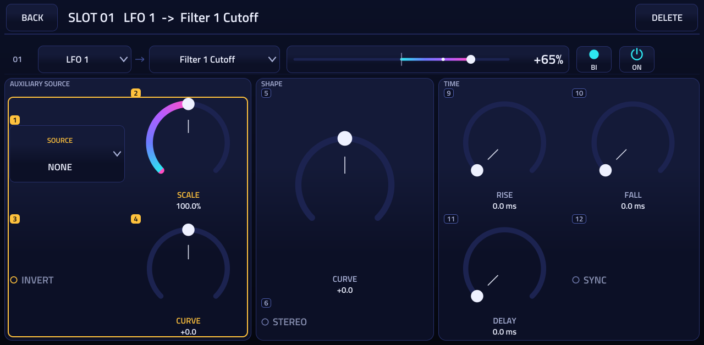

| Block | Control | Parameter, range |
|---|---|---|
| AUXILIARY SOURCE | SOURCE | Aux Source: a second source that multiplies the first |
| | SCALE | Output Scale 0 .. 200 percent, default 100 |
| | INVERT | Aux Invert, a LED switch |
| | CURVE | Aux Curve -10 .. +10 |
| SHAPE | CURVE | Curve -10 .. +10 |
| | STEREO | LED switch |
| TIME | RISE | 0 .. 5000 ms |
| | FALL | 0 .. 5000 ms |
| | DELAY or BEATS | Delay 0 .. 4000 ms, or 0 .. 8 beats when tempo sync is on |
| | SYNC | Delay Tempo Sync, a LED switch |

**With no slot in use** the page shows the **source board** (every one of the 57 sources as a chip, in groups ENVELOPES, LFOS, MACROS, PLAYER, SOUND, each group with its count, "TAP A SOURCE TO START A MODULATION"). Tap a chip, then pick the target. The board disappears when the first slot exists; **+ ADD** is always there.

The same board opens when you long-press **a control that nothing modulates yet** (the title is the control and its value, "TAP A SOURCE TO MODULATE THIS VALUE", see the picture in 5.3). One tap on a source makes the modulation of that control: you do not have to wade through a stepper of 57 sources. Once the control has modulations the page lists them and keeps a compact add row.

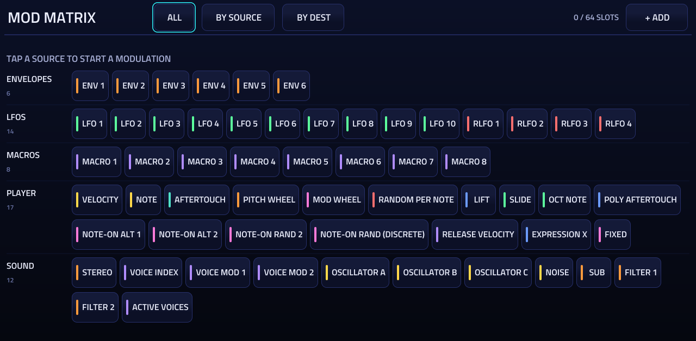

More in chapter 6.

### 5.11 FX

**The chain bar** (top) shows the effects in processing order as cards with an icon of the effect, its name, a power glyph and a small tag of the rack (MAIN, B1, B2 or a band); empty places show "+". Tap a card to select it, tap the power glyph to switch it, **drag a card sideways to reorder**, **+ ADD** (or the first free place) adds an effect: pick the type from the list.
When the chain is empty, the page shows the **gallery**: "TAP AN EFFECT TO ADD IT TO THE CHAIN" and one card for each of the **16 effects** (13 effects and 3 splitters), each with a small picture of what it does (a curve, a response, bands). One tap on a card adds that effect to the end of the Main rack and opens it.

**The effect page.** Every effect has one **table page** of its own, laid out in rows of four cells. The header has the power switch, the place and name ("MAIN CHAIN" and the name), the **RACK** stepper, a **PAGE n / m** stepper when the effect has more rows than fit, and **REMOVE**.
Each row is one block of the effect and one Q group (chapter 4.3): without a display four rows fit on a page, under a display two or three. Knobs show the parameter's own name and value; whole numbers (VOICES) are number fields, on / off values are LED switches, and short lists (3 to 8 choices) show all their choices as a LED list; longer lists are steppers with a popup.
Controls that do not apply in the current state follow one rule: a cell that can hold two controls shows the one that applies (**RATE** or **DIVISION** share one cell, switched by SYNC; **TIME** or **DIVISION** in the delay); a control that does not apply and has no live control after it in its row is **hidden** and the row closes up (its Q group has fewer members; a row with nothing left is gone and the rows below move up, so the pages are made of the rows that remain); otherwise it is drawn **dim** in its place and takes no touch.
The reverb in the picture below hides ROOM and FEEDBACK because the algorithm "Dense" has neither.

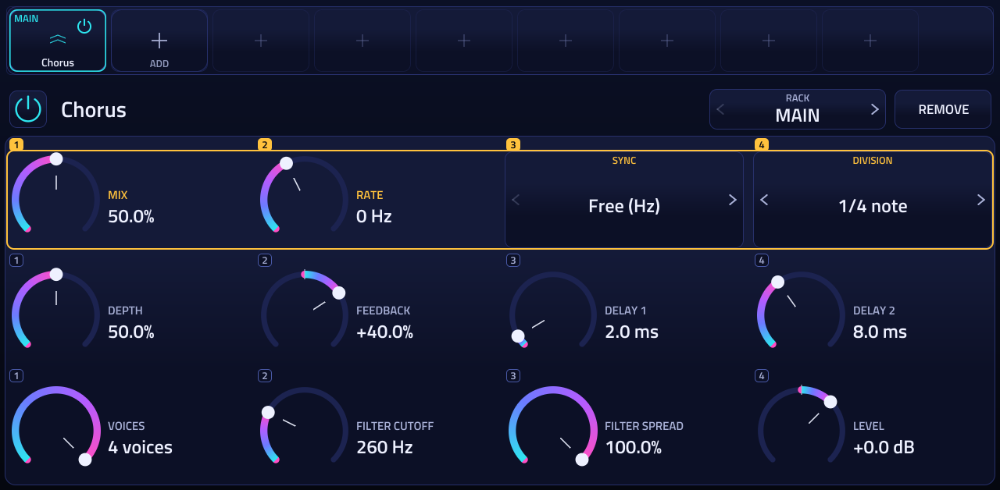

The chorus page: one row per block (MODULATION, VOICES AND DELAY, FILTER AND OUTPUT), three rows on the page, the numbers 1 - 12 are the Q-Link knobs of a 16-knob device. The SYNC list (Free (Hz), Tempo, Tempo dotted, Tempo triplet) decides whether the first cell is RATE or DIVISION.

The effects EQ, compressor, delay, FX filter and distortion have a **display** over the knobs: EQ (the frequency response with a dot per band), compressor (the transfer curve of each band), delay (the taps in time), FX filter (the response), distortion (the transfer curve and the present level as a dot).
The EQ and compressor curves are drawn from the textbook formulas of the settings, not measured from the sound.

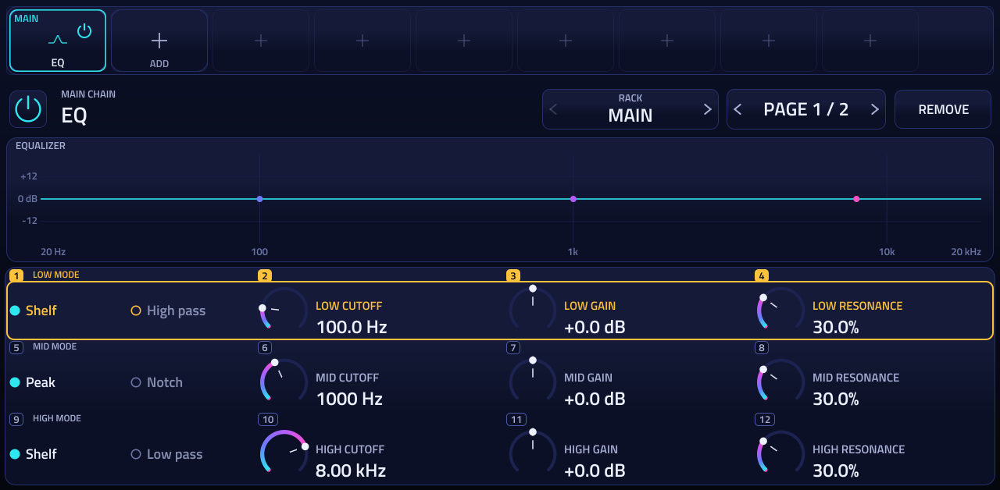

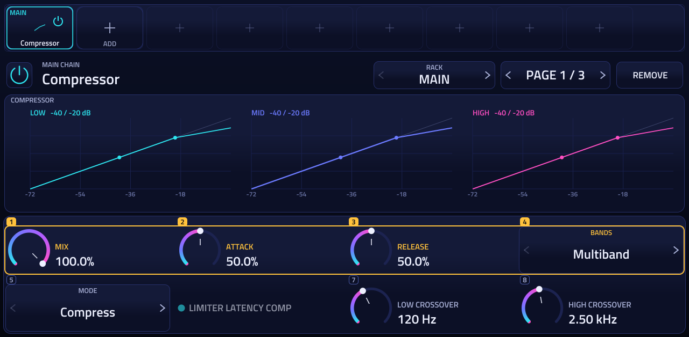

**Racks and limits.** There are three main racks. **MAIN** processes the whole sound that comes out of the filters and the Mixer's "Effects only" routes. **BUS 1** and **BUS 2** are two side paths: each is fed by the **B1** and **B2** sends of the Mixer strips (chapter 5.6), has its own chain of effects, and then goes to the destination set on its Mixer strip (Main, Direct, or the other bus). The engine has **16 effect slots in all**, shared by the three racks: you can add up to 16 effects in total, in any mix of MAIN, BUS 1 and BUS 2; the chain bar only adds an effect while a slot is free. The effects that sit in the engine's fixed chain are listed too, switched on or off.

**Which effects you hear depends on the device (chapter 7.1).** The MPC XL runs all 16 effects. The MPC Key 61 skips the reverb, flanger, Hyper/Dimension, Bode and Convolve: a preset that uses them plays without them (their settings stay in the preset and sound on the XL).

#### The 16 effects

Each effect lists its blocks in page order. Names are as shown on the screen.

1. **Chorus** thickens the sound with delayed copies whose delay time is moved by a slow modulation. Blocks: MODULATION (RATE 0.02 .. 8 Hz or DIVISION, SYNC, DEPTH, FEEDBACK -95 .. +95 percent), VOICES AND DELAY (VOICES 1 .. 4, DELAY 1 and DELAY 2 1 .. 20 ms), FILTER AND OUTPUT (FILTER CUTOFF, FILTER SPREAD, MIX, LEVEL).
2. **Compressor** evens out loud and quiet parts. It can work in three bands (low, mid, high) or as one band; each band has a lower and an upper threshold, ratios and a gain. Display: a curve per band. Blocks: COMPRESSOR (MIX, ATTACK, RELEASE, BANDS: Multiband, Low band, High band, Single band), MODE AND CROSSOVERS (MODE: Compress, Limit, Peak; LIMITER LATENCY COMP, shown in Limit mode; LOW and HIGH CROSSOVER, shown for the bands that use them), LOW BAND, MID BAND, HIGH BAND (thresholds and ratios; a band that the BANDS choice does not use is hidden) and GAINS (a gain per band and LEVEL).
3. **Delay** repeats the sound as echoes. The time is free or tempo-synced, feedback sets the number of repeats, and the styles include ping pong. Display: the taps in time. Blocks: TIME (SYNC, TIME or DIVISION, TIME 2 or DIVISION 2, STYLE: Mono, Stereo, Ping pong, Mid ping pong, Tap->Delay), FEEDBACK AND OUTPUT (FEEDBACK, MIX, LEVEL, HQ = high quality), FILTER AND OFFSET (FILTER CUTOFF, FILTER SPREAD, OFFSET, OFFSET LEFT).
4. **Distortion** adds harmonics by clipping, folding or reducing the signal. Display: the transfer curve. Blocks: DISTORTION (TYPE: Soft clip, Hard clip, Linear fold, Sine fold, Bit crush, Down sample, Tube, Diode 1, Diode 2, Zero-Square, Asym, Rectify, X-Shaper, X-Shaper (Asym); DRIVE -30 .. +30 dB; MIX; LEVEL), FILTER (FILTER ORDER: None, Pre, Post; CUTOFF, RESONANCE, BLEND, shown while the order is Pre or Post) and FILTER KEY (key tracking, shown with the filter).
5. **EQ** is a tone control with three bands plus an optional second middle band. Display: the response with a dot per band. Blocks: LOW BAND (MODE Shelf or High pass; CUTOFF; GAIN -24 .. +24 dB; RESONANCE), MID BAND (Peak or Notch), HIGH BAND (Shelf or Low pass), MID BAND 2 (Off, Peak, Notch; its values show unless it is Off) and OUTPUT (LEVEL and **BAND SHAPE**: State variable or Biquad, the two ways the bands are calculated).
6. **FX Filter** is a filter used as an effect on the whole signal, with the same models as the voice filters. Display: the response. Blocks: FILTER (MODEL, STYLE, CUTOFF, RESONANCE), MODEL (COMB OFFSET in the comb model; X, Y, RESONANCE, SPREAD in the formant model; they are hidden in other models), SHAPE (DRIVE, BLEND, KEY TRACKING, CLEAN MODE), OUTPUT (VAR, PAN, MIX, LEVEL) and FORMANT PITCH (TRANSPOSE, formant model only).
7. **Flanger** sweeps a very short delay with feedback, giving a moving, metallic comb-filter sound. Blocks: MODULATION (RATE 0.04 .. 4 Hz or DIVISION, SYNC, DEPTH, CENTER 20 .. 16000 Hz), FEEDBACK AND OUTPUT (FEEDBACK -100 .. +100 percent, PHASE OFFSET, MIX, LEVEL).
8. **Phaser** sweeps a series of notches through the sound, with feedback, for a swirling movement. Blocks: MODULATION (RATE 0.04 .. 4 Hz or DIVISION, SYNC, DEPTH, DEPTH 2), SWEEP (CENTER, BLEND, FEEDBACK, PHASE OFFSET) and OUTPUT (MIX, LEVEL).
9. **Reverb** adds the space of a room or hall. Two pages (four rows each, no display). Blocks: REVERB (MIX, SIZE, DECAY 20 .. 30000 ms, PRE-DELAY), ALGORITHM (ALGORITHM: Dense, Plate, Hall, Vintage, Nitrous, Basin; WIDTH; ER SIZE; ROOM, shown in Nitrous), DIFFUSION (DIFFUSION A, DIFFUSION B, LEVEL, FEEDBACK, shown in Nitrous and Basin), MODULATION AND INPUT (CHORUS AMOUNT, CHORUS RATE, PRE LOW CUT, PRE HIGH CUT), DAMPING (the low and high shelf cutoff and gain) and TIER (**FORCE ON**: lets the reverb run even on a device that would skip it; it is stored with the preset).
10. **Hyper/Dimension**: Hyper thickens the sound with several detuned copies, Dimension widens the stereo picture. Blocks: HYPER (RATE 0.05 .. 10 Hz, UNISON 0 .. 7, DETUNE, RETRIGGER) and DIMENSION AND OUTPUT (SIZE, DIM MIX, MIX, LEVEL).
11. **Utility** is housekeeping: polarity flip per channel, stereo width, pan, low-pass and high-pass filters, mono bass and level. Blocks: POLARITY AND STEREO (POLARITY L, POLARITY R, WIDTH 0 .. 200 percent, PAN), FILTERS (LOW PASS, HIGH PASS, MONO BASS, and its FREQUENCY 20 .. 500 Hz while mono bass is on) and OUTPUT (MIX, LEVEL).
12. **Bode** shifts all frequencies of the sound by a fixed amount (a frequency shifter), with delay, feedback and blur. Blocks: SHIFT (SHIFT, RANGE, DIRECTION, BALANCE), DELAY (DELAY or DIVISION, SYNC, FEEDBACK, BLUR), STEREO (WIDTH, MONO INPUT, RETRIGGER) and OUTPUT (MIX, LEVEL).
13. **Convolve** gives the sound the character of a recorded space or device by convolving it with an impulse response. Blocks: IMPULSE (IMPULSE: None, Preset IR; SIZE; TONE; MINIMUM PHASE), TIME (PRE-DELAY or DIVISION, SYNC, ATTACK, DECAY), TAIL (DAMPING, IR GAIN, **SCALING**: Relative or Seconds, which says whether size and decay are relative to the impulse or in seconds) and OUTPUT (MIX, LEVEL).
14. **Splitter L/H**, 15. **Splitter L/M/H**, 16. **Splitter M/S** split the sound into bands, and each band gets its own chain of effects (below). The splitter page has SPLIT FREQUENCY (L/H), LOW SPLIT and HIGH SPLIT (L/M/H), LED switches LOW BYPASS, MID BYPASS, HIGH BYPASS or MID BYPASS, SIDE BYPASS (M/S) and LEVEL. M/S splits into the middle (what both channels share) and the sides.

**Splitters and band racks.** On the page of a splitter the place of the display is taken by **one lane per band** (LOW / HIGH, LOW / MID / HIGH or MID / SIDE). Each lane has a **tile** (the band's name and what it is, for example "below 200 Hz" or "200 Hz to 3.0 kHz", its number of effects, or BYPASS, or SPLITTER OFF) and the **chain of the band** as cards, then **+ ADD**.

A tap on a card, on the tile or on + ADD **opens the band**: the chain bar then holds the cards of that band, with the **BACK** card first (it names the splitter and the band and takes you up one level). The title shows the path, for example "MAIN CHAIN > SPLITTER L/M/H > MID BAND", and the page of the selected effect is the same table page as in the main chain (the same rows and Q groups). **+ ADD** inside a band offers the effects that are still free: an effect lives in one place at a time, so a type that is already in the chain or in another band is not offered; the new effect is put at the end of the band and switched on. An empty band shows the gallery of the free effects. You can drag cards to reorder them, in the bar and in a lane; the power glyph on a lane card switches the effect without opening the band; REMOVE switches the effect off and takes it out of its band. The **RACK** switch of an effect has ten racks (MAIN, BUS 1, BUS 2 and the seven bands, for example L/M/H MID); the page follows the effect into its band. An effect in a band only works while its splitter is on.

The picture shows the BACK card, the three effects of the band (FX Filter selected, Phaser, Delay) and the FX Filter page with its response display and twelve controls.

### 5.12 Master

Two sides, chosen by the buttons **MAIN** and **TUNING & MPE** at the top. The picture is rendered for a 16-knob device: the groups are numbered in reading order and the first four are the active group. On the Key 61 the idle groups show 1 - 4 and the Q-Link button steps to them.

**MAIN side** (four blocks):

| Block | Control | Parameter, range |
|---|---|---|
| OUTPUT | meters L / R (the engine's master peak, with hold line, a dB scale in its own column and the colour ramp) | |
| | VOLUME | Master Volume -60 .. +6 dB, default -12 |
| | SPREAD | Stereo Spread 0 .. 100 percent, default 100 |
| | STEREO | Stereo Routing 0 .. 100 percent, default 100 (a knob like the other two) |
| | VOICE OVERRIDE | a LED list: Kill / Steal |
| PITCH | TUNE | -100 .. +100 cents |
| | TRANSPOSE | -48 .. +48 semitones |
| | BEND UP, BEND DOWN | 0 .. 24 semitones, default 2; the **LINK** LED switch makes the down range follow the up range |
| VOICES | POLY | Polyphony 1 .. 32, default 16 (see the note below) |
| | LEGATO, POLY LEG, PHASE LEG | LED switches (Master Legato, Master Poly Legato, Voice Phase Legato) |
| | VEL TRACK | -100 .. +100 percent, default 100 |
| | SAME NOTE | a LED list: Steal, Stack, Ignore |
| | STEAL | a LED list: Newest, Oldest, Highest, Lowest, Velocity |
| | PAD PRESS, PAD % | the plugin-wide pad-pressure switch and its amount (default off, 35 percent; see below). PAD % is dim while the switch is off |
| | voice bar | sounding voices / polyphony, for example "4 / 16 VOICES" |
| GLIDE | GLIDE | Portamento Time 0 .. 8000 ms |
| | SLOPE | -8 .. +8; the glide curve is drawn at the right |
| | ALWAYS | Portamento Always, a LED switch |
| | SCALED | Portamento Scaled By Interval, a LED switch |

**POLY and the device.** The page lets you set up to 32 voices, but the number you really get is capped by the device: **8 on the Key 61, 16 on the XL** (chapter 7.1). A preset saved with more simply plays with the device's number.

Q groups (in reading order): OUTPUT (VOLUME, SPREAD, STEREO, VOICE OVERRIDE), PITCH (TUNE, TRANSPOSE, BEND UP, BEND DOWN), LINK, VOICES (POLY, LEGATO, POLY LEG, PHASE LEG), the second row of VOICES (VEL TRACK, SAME NOTE, STEAL), GLIDE.

**TUNING & MPE side:**

- **SCALE:** SCALE (Chromatic (off), Major, Natural Minor, Harmonic Minor, Melodic Minor, Dorian, Phrygian, Lydian, Mixolydian, Locrian, Major Pentatonic, Minor Pentatonic, Blues, Whole Tone, Diminished (H-W), Diminished (W-H), Phrygian Dominant, Hungarian Minor, Double Harmonic, Hirajoshi), KEY (C ... B; the keyboard drawing below sets the key when you tap or drag a key), MODE (a LED list: Conform, Mark only). The dark keyboard shows the notes of the scale (white keys C to B, the notes of the scale brighter); the title over it reads "ALL 12 NOTES" while the scale is off.
- **TUNING:** A4 HZ (400 .. 480 Hz, default 440), TUNING (a LED list: 12-TET, Pythagorean, Just intonation, User file), MTS-ESP switch, NOTE-ON switch (MTS-ESP note-on only).
- **MPE:** MPE on/off, MPE BEND (1 .. 96 semitones, default 48), XYZ TO MACROS (a LED list: Off, XYZ, YZ; XYZ moves Macro 1, 2, 3 and YZ Macro 1, 2), Y TO WHEEL, BEND TO X, Y BIPOLAR (LED switches).

**Pad pressure (MPC XL pads).** The XL pads send a pressure value for each held pad. There are two ways to use it (see also the detailed guide on expressive pads and playing techniques in [mpce-pads.md](mpce-pads.md)).
- **In a preset:** a modulation route from the source **Poly Aftertouch** to a parameter, for example Filter 1 Cutoff. Many factory presets carry this route (chapter 10.4; [mpce-pads.md](mpce-pads.md)).
- **For every sound:** the **PAD PRESS** switch (VOICES block of this page, default off) lets the pressure open Filter 1, and **PAD %** (default 35) sets how far: a full pressure at 35 percent opens the cutoff by about one octave, at 100 percent by about three. A voice whose preset already has the route from Poly Aftertouch to Filter 1 Cutoff is not opened twice. The switch and the amount belong to the plugin, not to a preset: a preset change leaves them alone, and the project remembers them.

For any pad pressure to arrive, the pad's **Full Level must be off** (with Full Level on every hit has velocity 127 and sends no pressure). Only per-pad (polyphonic) pressure counts; channel aftertouch is ignored by PAD PRESS.

### 5.13 Voice control

A sequencer of per-voice offsets: eight steps and six rows. Every new note takes the next step, so a chord or a run of notes gets slightly different pan, tuning, filter or envelope times for each voice. It is what makes a pad or a unison sound alive instead of identical copies.

- **Header** (Q group STEP): **STEP** (a stepper, 1 .. 8: which step the Q-Link edits), **ROW** (a LED list at the left of the grid: PAN, DETUNE, CUTOFF, ENV, MOD 1, MOD 2; it is Q 2), **LENGTH** (1 .. 8 steps) and the value of the selected step in that row (here PAN, MID).
- **Grid:** eight columns. Touching a column sets that step to the height of your finger; dragging across columns draws through them (fast strokes fill the columns between). The middle line is zero (MID). The step a sounding voice plays is lit (cyan, with a dot). The picture shows steps 3 and 4 lit.
  Ranges: PAN -100 .. +100 percent, DETUNE -100 .. +100 cents, CUTOFF -100 .. +100 percent, ENV (envelope time) -100 .. +100 percent, MOD 1 and MOD 2 -100 .. +100 percent.
- **Strip** under the grid: all six values of the selected step (STEP n: PAN, DETUNE, CUTOFF, ENV, MOD 1, MOD 2).
- **RANDOM:** PAN 0 .. 100 percent, DETUNE 0 .. 100 cents, CUTOFF 0 .. 100 percent, ENV 0 .. 100 percent, and a LED switch **10x DETUNE**.
- **SCALING:** ENV TIME and LFO TIME 25 .. 400 percent (default 100), LFO TIME MODE (a LED list: Percent, Rate).
- **TARGETS:** LED switches OSC A, OSC B, OSC C, SUB, NOISE (all on by default): which sound sources the voice control acts on.
- Q groups: STEP, RANDOM, 10x DETUNE, SCALING, TARGETS, NOISE.

**How the steps are used.** Every new note takes the next step, and the sequence goes round after LENGTH steps (note 1 plays step 1, note 2 step 2 ... note LENGTH+1 step 1 again). A chord takes one step per note. The count is not reset by a new chord or by stopping the transport; it starts again from step 1 only when the plugin's audio is started again (for example a project load).

---

## 6. Modulation

A **modulation** connects a **source** to a **destination** (a parameter) with a **depth** (-100 .. +100 percent), a polarity (UNI or BI) and an on/off switch. The engine has 64 slots.

**Sources (57):**
- Envelopes: Env 1 .. Env 6.
- LFOs (14): LFO 1 .. LFO 10, RLFO 1 .. RLFO 4 (the random LFOs).
- Macros: Macro 1 .. Macro 8.
- Player (17): Velocity, Note, Aftertouch, Pitch Wheel, Mod Wheel, Random per Note, Lift, Slide, Oct Note, Poly Aftertouch, Note-On Alt 1, Note-On Alt 2, Note-On Rand 2, Note-On Rand (Discrete), Release Velocity, Expression X, Fixed.
- Sound (12): Stereo, Voice Index, Voice Mod 1, Voice Mod 2, Oscillator A, Oscillator B, Oscillator C, Noise, Sub, Filter 1, Filter 2, Active Voices.

**Destinations:** every modulatable parameter (1248 entries in the parameter list), chosen from a list that first shows groups and then the parameters of a group. On the MPC XL pads the host passes note, velocity and per-pad pressure to the plugin; the pad's X/Y position does not reach it.

**Making a route:**

1. **From the Mod page.** Tap a source chip on the **source board** (shown when no slot is in use) and pick the destination, or press **+ ADD** (a slot with Env 1 and +50 percent is made and its page opens) and change SOURCE and TARGET. Edit SOURCE, TARGET, AMOUNT, UNI/BI, ON/OFF on the row; MORE has the aux source, curve and time.
2. **From an envelope or an LFO.** On the Env or LFO page press **TARGETS**, then **ADD TARGET** and pick a group and a parameter. The new route starts at half depth (bipolar if the parameter swings around zero). On that page the target rows have depth, UNI/BI, ON/OFF and remove.
3. **From a macro.** On the Macros page tap the chips area of the macro card ("NO TARGET - TAP TO ADD"), then ADD TARGET.
4. **From a control.** **Long press** (0.6 s) a knob or number field anywhere on a plugin page: its modulation page opens. If nothing modulates the control yet, the page is the **source board**: tap one of the 57 sources and the route is made. If the control already has routes, they are listed with the depth bar, UNI/BI, ON/OFF and the remove button, and a compact add row under them.
5. **Depth by dragging.** A knob that is modulated by the source selected on the Play page (the last envelope or LFO you touched) has a colored tab at its top left; dragging on the tab changes that depth (200 pixels = the whole -100 .. +100 percent).

Knobs show the modulation: a marker at the live (modulated) value, and an arc from the value over the depth of the selected source. The tab at the top left is colored when the selected source is among the sources of the knob, grey when other sources modulate it, hollow when the selected route is bypassed.

**Macros.** Eight macros (0 .. 100 percent, default 0) are sources only: a macro does nothing until it has a target. A macro appears in the list of sources as "Macro n".

## 7. Presets

The plugin offers **161 programs** to the host: "Init" (the default sound, program 0) and 160 factory presets in six categories. The list is sorted by category (alphabetically: Bass, FX, Keys, Lead, Pad, Pluck) and then by name.

Each preset is saved as a `.sbpreset` file holding a `synthyboy-state` version 4 document with all 2637 parameter keys explicit, identical in count and state version to the engine's parameter table (`docs/params.json`). In code, the state format version is 5 (`kStateVersion` 5, `core/include/synthyboy/state.h`), which stores the grid settings of drawn LFO shapes (`grid_x` and `grid_y`) with the shape; presets and documents of version 4 load seamlessly with the grid inferred from the points, and version 4 readers safely read version 5 documents.

The presets are CC0 licensed (Safian Szabolcs).

### 7.1 Browsing presets

There are two primary ways to browse and select presets in SynthyBoy:

1. **The PRESET field in the plugin header (VST2 programs, works today):**
   - In Track View or Track Edit mode on a Plugin track, the MPC host header displays the current preset in its **PRESET** field.
   - Tapping the **PRESET** field opens the host's standard scrollable program list containing all 161 programs (program 0 "Init", followed by the 160 factory presets ordered by category and name).
   - Tapping any preset immediately loads that sound into the engine.
   - **The "*" mark:** The plugin appends " *" after the preset name in the header whenever you change a parameter after loading, or when a saved project restores modified settings. Loading a preset again clears the asterisk mark. A project remembers the preset by name and restores it even if a subsequent release updates the program list; if the name is not found, the saved sound is retained without a preset name.

2. **The Sounds browser (Sounds Mode — being verified on the device):**
   - Akai MPC hardware provides a dedicated instrument and preset browser known as **Sounds Mode** (Akai MPC Standalone OS User Guide v3.10.1, "Sounds Mode", pp. 147–148; MPC Live III, MPC XL User Guide v3.10.1, "Sounds Mode", pp. 153–154).
   - **Opening Sounds Mode:** Press the dedicated **Sounds** hardware button (MPC Key 61, MPC Key 37, MPC Live III, MPC XL), press Shift + **Arrange / Sounds** (MPC One G2), or press **Menu** and tap **Sounds**.
   - **Selecting SynthyBoy:** In Sounds Mode, tap **Instruments** (or `<- Instruments` at top left) to display instrument tiles. The SynthyBoy tile appears with its custom 270×110 graphic artwork (`Plugin Skins/browser_images/soundsmode.png`). Tapping the tile opens the preset browser displaying the factory preset list from the package `Content/presets/` directory (or user `.xpl` Plugin Programs).
   - **Locate Preset:** Tapping **Locate Preset** at the top of the touchscreen opens the preset list for the currently selected plugin instrument.
   - **Edit Instrument:** Tapping **Edit Instrument** at the bottom of the touchscreen opens Track Edit Mode, directly revealing SynthyBoy's drawn UI pages.
   - **Favorites:** Tap the **Favorites** tab at the bottom left (or press Shift + **Sounds** on Key 61 / Live III, or the physical **Favorites** button on the XL) to save and quickly recall your most-used presets during live performances.
   - *Status:* Note that loading `.sbpreset` files directly via the Sounds tile browser is currently being verified on physical hardware (see Chapter 11).

**Saving presets and projects** (Akai manuals):
- A **project** is saved from the Save window: press **Menu** and tap **Save**, then **Project** or **Project As** (Standalone OS User Guide v3.10.1, "Save Window", p. 67; MPC Live III, MPC XL User Guide, p. 69). The project keeps the plugin's full state chunk, so your sound comes back exactly as you left it.
- To export an individual sound as a host-level preset file, select the plugin track and tap **Plugin Program** in the Save window ("Tap Plugin Program when a plugin track is selected to save the current plugin program"). In the track's plugin page (Standalone OS guide p. 253, XL guide p. 278) the folder icon next to the preset name opens the file browser to load an `.xpl` plugin preset, and the disk icon saves a new one.
- The plugin-wide pad-pressure switch (PAD PRESS and PAD %, chapter 5.12) is not part of a preset (a preset change leaves it alone). The Play-page selectors (which oscillator, envelope and LFO the Play page shows) are saved with the project.

### 7.2 The factory sounds

The factory library contains **136 presets** divided into six categories:
- **Bass** (27 presets)
- **FX** (14 presets)
- **Keys** (20 presets)
- **Lead** (26 presets)
- **Pad** (30 presets)
- **Pluck** (19 presets)

The host lists them by name (the category is not part of the display name):

| Category | Count | Presets |
|---|---|---|
| Bass | 27 | 808 Boom; Acid Saw Reso; Bend Formant Growl; Click Attack Bass; Comb Metal Bass; Custom Shape Wobble; Diode Saturated Bass; Dirty Distortion Bass; EMS Squelch Bass; Fast Arp Bass; Fat Reese; Formant Vowel Bass; Gritty Square Bass; Harmonic Sine Bass; Moog Ladder Bass; Odd Harmonics Bass; Pitch Drop 808; Pulse Width Bass; Punchy Pluck Bass; Scream Filter Bass; Solid Sub; Space Wobble Bass; Sub Duo Octave; Subterranean Duo; Sync Growl Bass; Triple Fold Reese; Warm Analog Bass |
| FX | 14 | Alien Communication; Bode Barber Riser; Bode Shifter Drone; Breath of Machines; Cosmic Teleport; Detonation Tail; Game Over Zap; Metal Gong Strike; Noise Riser; Sci-Fi Laser Sweep; Sonar Ping; Space Wind Storm; Sub Drop Boom; Vinyl Dust Crackle |
| Keys | 20 | Accordion Reed; B3 Drawbar Organ; Celesta Bells; Clavinet Funk; Dream Grand Piano; Dyno Electric Piano; FM Soft Organ; Glass Organ Tones; Harpsichord Bar; Just Intonation Keys; Lo-Fi Rhodes; Muted Honky Tonk; Rotary Rock Organ; Tempo Gate Chords; Tine Glass Keys; Utility Width Keys; Vibraphone Bars; Vintage Electric Tine; Wah Pressure Clav; Warm Toy Piano |
| Lead | 26 | Bell Chime Lead; Bell FM Ripple Lead; Chorused Saw Solo; Cosmic Drift Lead; Diode Bite Lead; Dirty Peak Lead; Dual Octave Hero; FM Digital Lead; Harmonic Shimmer Lead; Hyper Saw Lead; Laser Beam Lead; MPE Pressure Lead; Metallic Edge Lead; Phaser Sweep Lead; Plucked Lead Tone; Pulse Width Mod Lead; Screaming Sync Lead; Solo Square Lead; Staccato Bleep Lead; Sync Cry Lead; Tri Soft Solo; Triple Fifth Lead; Twin Warp Lead; Vocaloid Lead; Vowel Whistle Lead; Warm Vintage Lead |
| Pad | 30 | Bowed Pressure Strings; Brass Swell Ensemble; Cathedral Choir; Comb Reso Swell; Dark Cinema Drone; Deep Sea Ambient; Diffusor Cloud Pad; Ethereal Glass; Frozen Aurora; Gentle Flute Pad; Golden Dawn Pad; Harmonic Cloud; Hyper Dimension Pad; Infinite Horizon; Lorenz Garden; Lush Analog Pad; Mid Side Halo; Odd Harmonics Pad; Parallel Dusk Pad; Radiant Pulse Pad; Shepard Ascent; Slow Motion Waves; Space Odyssey Pad; Starlight Shimmer; Stretched Glass Choir; Subtle Tape Drift; Tri-Band Split Texture; Velvet Strings; Vintage Brass Pad; Vowel Choir Pad |
| Pluck | 19 | Acoustic Style Pluck; Aux Keyscale Pluck; Bell Mallet Pluck; Chime Drop; Comb Zither; Digital Glass Tap; Electric Mute Pluck; Formant Pop Pluck; Harmonic Tine Pluck; Harp Drops; Kalimba Tines; Karplus Harp; Marimba Synth; Pentatonic Step Pluck; Pizzicato Strings; Ring Mod Gamelan; Rubber Bass Pluck; Spruce Guitar; Trance Short Pluck |

#### The 24 New Presets (Sound Set Batch 1)

For the 24 presets added in sound set batch 1 (`docs/release/SOUND-SET-BATCH-1.md`), here is what each sound is and how to play it:

**Bass (4 new presets):**
- **Subterranean Duo (Bass):** Clean sub sine bypassing the filter paired with a snarling key-folded saw growl; play single staccato or held notes C1–B2, lean on the pad for extra cutoff bite, and use the wheel for drive and detune.
- **Bend Formant Growl (Bass):** Dubstep-style talking bass using Bend warp and a side-by-side Formant filter; play staccato eighth notes C1–G2 while sweeping the wheel to move the vocal vowel and drive.
- **Triple Fold Reese (Bass):** Heavy three-oscillator Reese with detuned saws, an octave-down square, and envelope-shaped sine-fold distortion; play long fifth chords C1–C2, opening Macro Fold and Drive for an aggressive attack that melts into a smooth body.
- **Pitch Drop 808 (Bass):** Punchy 808 kick-bass with a fast pitch fall and pulse knock through tube drive; strike single notes C1–G1 hard for a brighter transient knock and deep sub tail.

**Lead (4 new presets):**
- **Sync Cry Lead (Lead):** Singing hard-sync lead backed by a wide detuned-saw fifth layer; play expressive legato phrases C3–C5, pressing into the pad to open the sync sweep and raising the wheel for delayed vibrato.
- **Vowel Whistle Lead (Lead):** Mono vocal lead with Formant warp and peak resonance that speaks like a human voice; play smooth legato lines C4–C6, sweeping the wheel to morph the vowel and pressing for mouth opening.
- **Triple Fifth Lead (Lead):** Massive power-chord lead stack (saw root, octave pulse, fifth-up triangle) through Multi SVF filtering; play single-note heroic riffs C3–C5 (the stack forms the chord), digging in for filter edge and upper layers.
- **Bell FM Ripple Lead (Lead):** Glassy sine carrier phase-modulated by an upper twelfth with bell partial shimmers; play slow, dynamic melodies C4–C6 where soft hits ring delicate and hard strikes bark like struck metal.

**Pad (7 new presets):**
- **Stretched Glass Choir (Pad):** Ethereal choral pad featuring Harmonic Stretch morph wandering on a random LFO over harmonic partials; hold slow chords C3–C5 for 4+ seconds, using pad pressure to open filter shimmer.
- **Mid Side Halo (Pad):** Wide, atmospheric pad split into a solid mono-compatible center and swirling chorused/phased side halo; play lush chords C2–C4 with immense stereo width that never cancels in mono.
- **Parallel Dusk Pad (Pad):** Dark, cinematic pad running parallel analog low-pass (left) and comb filter (right) with opposed cutoff breathing; play slow headphone chords C2–C4 to immerse in the evolving stereo field.
- **Brass Swell Ensemble (Pad):** Warm 1980s synth brass section with breath noise and a swelling filter attack; play chords C2–C4, striking harder to accelerate the brass bloom and brighten the swell.
- **Shepard Ascent (Pad):** Hypnotic rising drone cycling an endless upward octave climb via Shepard Tone morph; hold one or two root notes C2–C3, pressing the pad to accelerate the ascent speed.
- **Lorenz Garden (Pad):** Organic, never-repeating ambient soundscape driven by chaotic Lorenz and Rössler random modulators; hold sustained chords C3–C5 and let the wandering filters and wavetables evolve.
- **Bowed Pressure Strings (Pad):** Expressive string ensemble that responds intimately to finger weight; play chords C2–C5 with Full Level off, pressing into held pads to dig the bow into the string, open the filter, and bloom delayed vibrato.

**Pluck (3 new presets):**
- **Karplus Harp (Pluck):** Physical-modeling style plucked string synthesized from noise bursts through a tuned comb filter; play sparkling arpeggios C3–C6, using the wheel for palm muting and velocity for pick bite.
- **Ring Mod Gamelan (Pluck):** Metallic inharmonic chime bars synthesized via ring modulation with a 2.76x carrier; play fast pentatonic patterns C3–C6, hitting harder for sharper metallic timbre and longer shimmer.
- **Pentatonic Step Pluck (Pluck):** Self-playing 16-step minor pentatonic sequencer locked to host tempo with per-step pluck envelopes; hold single root notes C3–C4 to let the rhythmic pattern groove.

**Keys (3 new presets):**
- **Tine Glass Keys (Keys):** Dynamic FM electric piano blending round low-velocity Rhodes warmth with cutting tine pings on hard velocity; play soulful chords and solos C2–C6, using the wheel for stereo tremolo.
- **Tempo Gate Chords (Keys):** Rhythmic chopped chords driven by a tempo-synced 16-step rhythmic pattern with filter pumping; hold chords C3–C5 to drive the groove, or dial Macro Smooth up to melt into a pad.
- **Wah Pressure Clav (Keys):** Funky clavinet with an expressive wah pedal right under your finger; play tight comping chords C2–C4, digging into the pads to sweep the Multi SVF wah filter and bark the diode drive.

**FX (3 new presets):**
- **Breath of Machines (FX):** Mechanical industrial drone featuring breathing noise through formant and tuned comb resonators; hold low notes C1–C2 for eerie sci-fi atmospheres and rhythmic machine stutter.
- **Bode Barber Riser (FX):** Dramatic rising tension builder combining upward pitch sweeps with feedback-driven Bode frequency shifting; hold a note C2–C4 for 5–6 seconds up to the drop, leaning into the pad for intense feedback wash.
- **Detonation Tail (FX):** Thunderous cinematic impact combining an explosive noise hit, deep pitch-dropping sub boom, and cavernous stereo reverb tail; strike a single low key C1–C2 and let the rumble ring out.

### 7.3 Sound quality on each device

The same preset is **compatible** between the two devices: presets and projects store only your settings, never what the device can play, and nothing is changed when a project moves. But the two devices do not have the same processing power, so SynthyBoy runs at a different quality on each, chosen once when the plugin starts. A preset can therefore sound **fuller on the XL**.

| | MPC XL | MPC Key 61 |
|---|---|---|
| Voices (notes at once) | 16 | 8 |
| Unison voices per oscillator | up to 16 | at most 3 |
| Effects | all 16 | the reverb, flanger, Hyper/Dimension, Bode and Convolve are skipped |
| Warp | smoother (the wave is calculated at four times the rate) | calculated at two times the rate: extreme warps add a little more aliasing |
| Spectral morph (wavetable and spectral morph) | updates at the full rate | updates at half the rate: a morph that is moved by an LFO or an envelope lags by up to about 12 ms instead of 6 ms |
| Maths inside filters, distortion and effects | exact | fast approximations: the level stays the same, the fine shape of the waveform differs slightly |

In plain words:
- **Voices.** A chord of more than 8 notes (or notes that are still ringing out) steals voices on the Key 61 earlier than on the XL. The POLY control of the Master page cannot raise this above the device's number.
- **Unison.** A patch that asks for 7 unison voices sounds on the Key 61 like the same patch with 3: the same detune width, stereo spread and blend, but a thinner stack. In a measurement the level stayed within 0.5 dB on a plain saw and within 3 dB over the 14 factory presets that ask for more than 3 voices.
- **Effects.** On the Key 61 a preset that uses a reverb plays without it. The remaining effects (chorus, compressor, delay, distortion, EQ, FX filter, phaser) run. The reverb page has a **FORCE ON** switch that lets the reverb run anyway; it is stored with the preset and costs processing power.
- **Heavy sounds.** The busiest factory presets (for example Diffusor Cloud Pad and Scream Filter Bass) use nearly all of the Key 61's processing time when eight notes are held; the XL has room to spare. If a held chord crackles on the Key 61, use fewer notes, fewer unison voices or fewer effects.
- A device that the plugin does not know is treated like the Key 61.

The XL profile was measured with the initial 112 factory presets and 16 held notes; the Key 61 profile is the cautious one (the 24 presets of sound set batch 1 were subsequently designed and measured under both profiles, see docs/release/SOUND-SET-BATCH-1.md).

## 8. Known limitations

- **Key 61: switch off the host's "Q-Link Status" pop-up.** When a Q-Link knob is touched the Key 61 shows a pop-up on the right. The plugin's picture can flicker around it. Switch it off: **Preferences > General > Show Q-Link Status When Touched**, or press and hold the **Q-Link** button to open the Q-Links window and tap **Q-Link Status** (Standalone OS User Guide v3.10.1, section "Q-Links", p. 314: the button enables or disables the pop-up, and the same setting is in Preferences > General). With the pop-up off the picture should be stable (this has not yet been confirmed on a device after the latest rework). The XL has no such pop-up.
- **Standby dim.** When the MPC dims its screen in standby, the plugin darkens its picture with it, and the first touch only wakes the screen (the touch is not passed on to a control). The host's picture is also blurred while dimmed; the plugin's picture is darkened but not blurred. This is handled in the plugin and tested on the Key 61's measured values; the XL's dim values are not measured yet (chapter 11).
- **Older projects keep their old Q-Link map.** A project saved with an older version of the plugin keeps the old Q-Link assignment of that track until you **insert the plugin on the track again**. Symptom: on the plugin pages the knobs change other parameters than the ones the display shows. A new project does not have this problem.
- **No limiter, loud output.** The output has a fixed make-up gain of +18 dB and no limiter. Loud presets can exceed full scale. Lower the track level (or put a limiter on the track). The level control of the plugin is Master Volume (default -12 dB).
- **Q-Link automation.** Recording automation on a Q-Link knob records the host's "Q n" slot, which replays into whatever group is active at that moment. Record automation on the real parameter instead (its own control; on a page where you can reach it, a parameter of the host's list).
- **Experimental display layer.** It uses a display plane that the MPC firmware does not offer to plugins. A firmware update, or the MPC itself using the plane, can make the plugin's picture disappear for the rest of the session; the sound continues. It was tried by its author on the Key 61 (MPC OS 3.10.1.12) and the MPC XL only.
- **Host pop-ups.** A pop-up of the host over the middle of the plugin's area can hide the picture while it is on screen.
- **One finger.** Only one finger is followed.
- **Up to 16 instances.** The 17th and later instances never show the drawn pages.
- **Controls that are dim or missing.** Every oscillator parameter is on the pages. A control that does not apply in the current state is dim (it takes no touch) or, on the effect pages and the oscillator detail pages, hidden with its room used by the others (chapters 5.3 and 5.11).
- **Sound quality differs between the devices.** The Key 61 plays 8 voices, at most 3 unison voices and skips five effects; the XL plays 16 voices, up to 16 unison voices and all effects (chapter 7.3).
- **Heavy sounds on the Key 61.** The busiest presets with eight held notes use nearly all of the available processing time (chapter 7.3).
- **Not supported file types.** The content browser offers WAV and SFZ only (not FLAC). An SFZ instrument must lie in a folder of its own with its samples below it.
- **Pad pressure** needs the pad's Full Level to be off. The plugin-wide pad-pressure switch ignores channel aftertouch (a Key 61 key); only per-pad polyphonic pressure acts.

## 9. Troubleshooting

| Problem | What to check |
|---|---|
| The plugin is not in the browser | The folder must be named `Safian - VST - SynthyBoy` inside `VST2 Plugins` at the root of the drive. MPC OS 3.10.1 or later. In Preferences > Enhancements (Beta) both **Enable Enhancements** and **External Plugin Support** must be on. After copying a plugin, restart the MPC application. |
| The plugin loads but the pages are plain host pages or dark areas | The display layer disables itself for the rest of the session when the display driver refuses it or no free display plane is left; restart the MPC application. A pop-up of the host over the area also hides it. |
| The picture flickers or is cut at the right edge (Key 61) | Switch off the Q-Link Status pop-up (chapter 8). Changing the tab (for example Play, Macros, Play) takes a new reference. |
| The picture is dark or touch does nothing after a pause | The device was dimmed in standby: the first touch only wakes the screen (chapter 8). |
| The picture is missing on one track | Only the instance whose page is on screen is drawn. More than 16 instances: the extra ones are never drawn. |
| Q-Link knobs change other parameters than shown | The project has an old Q-Link map (chapter 8): insert the plugin on that track again. |
| Knob names in the Key 61 pop-up are old | The host updates names when a group changes; touch the knob again (about half a second). |
| A knob steps a list or switch instead of sweeping | By design: a small turn (about 6 of the 128 clicks of the knob's travel) moves a stepped value by one step (chapter 4.3). |
| The sound is thinner than on the other device, or an effect is silent | The Key 61 plays 8 voices, at most 3 unison voices and skips reverb, flanger, Hyper/Dimension, Bode and Convolve (chapter 7.1). |
| A control I expected is not on the page | It does not apply in the current state (for example FIXED PITCH while TRACK is on): it is hidden or dim (chapters 5.3, 5.11). |
| The mouse wheel does nothing | The wheel steps the control under the pointer; a button takes no step, and a finger on the screen keeps the wheel from the page (chapter 4.4). |
| Touch does nothing | Only one finger is followed; lift the first finger. Touch to the right of a host pop-up on the Key 61 is not taken. |
| No sound | Host side (Akai manuals, "Track Types > Plugin Tracks", mixer chapters): the right track is selected and the track is a plugin track with SynthyBoy loaded; the track is not muted and its level is up; the track's MIDI input port and channel match what you play (MIDI Input Port, MIDI Input Channel); the output level of the MPC is up. Our side: the Mixer page (chapter 5.6): the strip's power is lit and its destination is not None; levels are not at 0; MASTER VOLUME on the Master page is not at its minimum. Pads on the XL: pad pressure only acts with Full Level off, but notes sound either way. |
| Distortion or clipping | The output has no limiter (chapter 8): lower the track level. |
| Preset changes after project reload | The project stores the preset by name; if the name is gone from the list the saved sound stays. |

## 10. Second-generation pads (MPCe): playing SynthyBoy expressively

**Second-generation hardware only (MPC XL and the other gen 2 devices). The first generation, for example the MPC Key 61, does not have these pads.** (The Key 61 has keys; its aftertouch and wheels reach SynthyBoy as ordinary MIDI, see the sources in chapter 6.) For a comprehensive standalone reference on expressive pads, hardware sensor dimensions, host MIDI pipeline reality, and five concrete playing recipes, see the companion guide [mpce-pads.md](mpce-pads.md).

Manual references in this chapter are to the **MPC Live III, MPC XL User Guide v3.10.1** (page numbers are those of that guide) and to the release notes 3.6 and 3.7. Read this chapter with one rule in mind: the manual describes what the pads can do **inside the MPC** (drum tracks, layers, the drum track's own modulation matrix). Only what the MPC sends on to a plugin track can drive SynthyBoy. We measured that on an MPC XL (MPC OS 3.10.1.12).

### 10.1 What the pads add, and what reaches the plugin

The manual calls these the **MPCe pads**. Besides the strike velocity, each pad senses **pressure**, the **position of the finger (X and Y)** and the **corner (quadrant)** it is struck in; four corner gestures can select articulations or layers on drum tracks (guide pp. 13, 234; release notes 3.6, 3.7).

| Pad gesture | What the manual says the MPC does with it | What the MPC sends to a SynthyBoy plugin track (measured on the XL) | Arrives in SynthyBoy as |
|---|---|---|---|
| Strike | Note and velocity | Note on / note off on MIDI channel 1; velocity varies (96 and 127 were seen) while Full Level is off | **Velocity** (and Note). Velocity tracking on the Master page, VEL TRACK, scales it |
| Strike with Full Level on | Fixed velocity | Velocity always 127, no pressure | Velocity is always 127; **Poly Aftertouch is zero** |
| Press harder after the strike | Pressure (aftertouch) of each pad; the pad setting Aftertouch can be Off, Channel or Poly in controller mode (guide p. 369) | **Polyphonic aftertouch**, one stream per held pad, values 1 .. 127, about every 6 milliseconds; no channel pressure | **Poly Aftertouch** (per note). The source **Aftertouch** (channel pressure) does not move |
| Finger position left / right (Pad X) and up / down (Pad Y) | Mod sources Pad X, Pad Y, Pad XY Center Dist, Pad XY Press Dist, Pad dX, Pad dY of a **drum track's** modulation matrix; MPCe Q-Link Mode (guide p. 350: only on a Drum Track) | **Nothing**: no pitch bend, no CC (also no CC 74), no other CC, no MPE channel rotation | **Not available**: Slide, Expression X, Pitch Wheel, Mod Wheel do not move from the pads |
| Corner (quadrant) | Articulations and layers on drum tracks | No separate message (it would have to be derived from X / Y) | Not available |
| Lift the finger | Note off | Note off was counted; the release velocity value was not read | Release Velocity / Lift: not verified with SynthyBoy |
| MPCe Q-Link Mode (pads as XY controls of parameters) | Drum tracks only | Not measured toward a plugin track | Not verified with SynthyBoy |
| 8x8 (64 pads) mode, Pad Perform scales and chords, Note Repeat, 16 Levels | Host features (guide p. 72, 83) | Not measured toward a plugin track | Not verified with SynthyBoy |

So with SynthyBoy the pads give you **velocity and per-pad pressure**. They do **not** give you per-note X / Y: do not build performances that wait for Slide, Expression X or MPE messages from the pads.

### 10.2 Host settings

- **Full Level must be off.** The XL button is called **Full Level / Set Level** (guide p. 389, hardware overview). When it is on, every hit has velocity 127 and the pads send no pressure (measured). Also check **Preferences > General > Enable Pads User Level By Default**, which makes pads play at a set level by default (guide p. 66): leave it unchecked for normal velocity response.
- **Pad feel** (guide p. 63, Preferences > Hardware): **Pad Threshold**, **Pad Sensitivity**, **Pad Curve** (A is nearly linear, B to D exponential) and the **Velocity & Aftertouch** meters. Use the meters while pressing a pad to see how much pressure you really produce; the plugin sees the same pressure.
- **Aftertouch on the pads in Pad Perform:** the Pad Perform window has a **Use Aftertouch** box; on the XL, Shift plus **Notes / Pad CTRL** switches pad aftertouch (guide p. 83). Whether this box changes what reaches SynthyBoy was not measured. The measurements above were made with the pads' normal setting.
- **Recording:** **Preferences > Sequencer > Record Pad Aftertouch Events** decides whether pad aftertouch is recorded into the sequence (guide p. 64). Whether recorded pressure replays into SynthyBoy was not measured.
- **MPE on the Master page: leave it off for the pads.** The MPE switches (chapter 5.12) work with MPE controllers that send each note on its own MIDI channel. The XL pads send everything on channel 1 and no X / Y, so MPE ON, XYZ MACRO, Y TO WHEEL and BEND TO X have nothing to act on from the pads.
- Plugin-wide pad pressure: SynthyBoy has a switch that opens Filter 1 with pad pressure; it is off by default (chapter 5.12). You do not need it for the recipes below: they use the modulation matrix per preset.

### 10.3 Recipes

All recipes use the Mod page (chapter 5.10). Put the plugin on a plugin track on the XL, switch Full Level off, and keep a pad pressed while you edit to hear the effect. A route made from the matrix is part of the preset's sound and is saved with the project.

**Recipe 1: pressure opens the filter.**
1. Press the **Mod** function key.
2. With no route in use, the source board shows; tap **POLY AFTERTOUCH** (group PLAYER). With routes in use press **+ ADD** and then tap **SOURCE** of the new row and choose Poly Aftertouch.
3. Pick the destination: the groups list first, then choose **Filter 1 Cutoff** (**TARGET** on an existing row).
4. Drag the **AMOUNT** bar to about +50 to +60 percent (the factory preset "MPE Pressure Lead" uses +55 percent).
5. Choose a preset whose cutoff is low enough to open, play a pad and press into it.

**Recipe 2: pressure moves the wavetable position.**
1. Same as recipe 1, but choose **Osc 1 Frame** as the target (Osc 2 Frame, Osc 3 Frame for the other oscillators).
2. Choose a wavetable that changes along its frames, for example Saw to Square or FM Sweep (Osc page, source stepper, chapter 5.3), set the WT POS knob to the start position and the amount to taste.

**Recipe 3: pressure adds vibrato** (route amount is modulated).
1. Make a route **LFO 1** to **Osc 1 Tune** with a small amount (the Tune parameter is in cents, so a small amount is enough), and set the LFO rate on the LFO page (chapter 5.9).
2. Make a second route from **Poly Aftertouch**, and choose as its target the amount of the first route (the destination is named **Mod NN Amount**, NN being the slot number of the first route).
3. Pressing a pad now fades the vibrato in. The engine lists the route amounts as modulation destinations; this recipe was **not verified with the pads on a device**.

**Recipe 4: per-pad expression with MPE X / Y.** Not possible with the pads, because X / Y do not reach the plugin (10.1). The factory preset "MPE Pressure Lead" also has a **Slide** route; from the XL pads that route stays silent, only an MPE controller moves it.

**Recipe 5: velocity and release velocity.**
- Master page, **VEL TRACK** (-100 .. +100 percent, default +100): how strongly velocity shapes the sound.
- To make velocity brighten the sound, make a route **Velocity** to **Filter 1 Cutoff**.
- **Release Velocity** (and **Lift**, which reads the same value) can be routed in the same way, for example to a release-related parameter. Whether the pads send a useful release velocity was **not verified**.

**Recipe 6: macros on the Q-Links while you play pads.** On the XL all 16 Q-Link knobs are alive (chapter 4.3). Make the macro routes on the Macros page (chapter 5.2), open Macros so that knobs 1 - 4 and 5 - 8 are the eight macros, and turn them with one hand while the pads play. Macros can drive any modulatable parameter, so one knob can change several things at once. Combine with recipe 1 so the pads' pressure and a macro together control the sound.

### 10.4 Factory presets that respond to the pads

Searched in the 136 factory presets for routes from Velocity, Release Velocity, Poly Aftertouch, Aftertouch, Slide, Lift, Expression X, Pitch Wheel, Mod Wheel, Note, Random per Note, the Note-On sources and Oct Note (active routes only). Only Poly Aftertouch and Slide have routes:

| Category | Presets with a route Poly Aftertouch to Filter 1 Cutoff |
|---|---|
| Pad (30 of 30) | all of them: +40 or +45 percent; Lush Analog Pad and Vintage Brass Pad +70 percent; Bowed Pressure Strings +46 percent; Stretched Glass Choir +42 percent; Shepard Ascent +35 percent; Lorenz Garden, Mid Side Halo, Parallel Dusk Pad +40 percent; Brass Swell Ensemble +45 percent |
| Lead (24 of 26) | all except Plucked Lead Tone and Staccato Bleep Lead: +30 percent; Hyper Saw Lead +70 percent; MPE Pressure Lead +55 percent (it also routes Poly Aftertouch to Osc 1 Unison Detune at +20 percent, and **Slide** to Osc 1 Warp Amount at +50 percent, which stays silent from the XL pads); Sync Cry Lead +26 percent; Triple Fifth Lead +24 percent; Vowel Whistle Lead +18 percent; Bell FM Ripple Lead +14 percent |
| Keys (8 of 20) | Accordion Reed, B3 Drawbar Organ, FM Soft Organ, Glass Organ Tones, Vibraphone Bars (+25 percent), Rotary Rock Organ (+70 percent), Tempo Gate Chords (+18 percent), Wah Pressure Clav (+46 percent) |
| FX (2 of 14) | Bode Shifter Drone (+30 percent), Breath of Machines (+35 percent); in addition, Bode Barber Riser routes Poly Aftertouch to Bode Feedback (+30 percent) and Noise Level (+22 percent) |
| Bass (1 of 27) | Subterranean Duo (+18 percent) |
| Pluck | none (0 of 19) |

Together 65 presets open their filter when you press a pad harder (and 66 presets in total route pad pressure). For the others, route the pressure yourself (recipe 1) or switch on PAD PRESS (chapter 5.12). Velocity acts in every preset through VEL TRACK on the Master page. (Update this table when presets are added or changed.)

## 11. To confirm on the device

These points are written from the developer notes, the code or the rendered pictures and have **not** been checked on a device (or not on both devices). Until they are, treat them as the design, not as a promise.

**Oscillators**
- The pictures of the SAMPLE, GRAIN, SPEC and MULTI pages and the seven detail pages are renders with a test sample, not device pictures. Confirm the layout on both devices.
- What the **AMOUNT** cell (with the window icon) on the GRAIN type bar sets, and whether the grain window page of the earlier design is still opened from it.
- What the **Y AXIS** choices (Level, Warp, Warp 2, density, ...) do on the grain and spectral pages.
- The oscillator options (fixed pitch, transpose snap with the note mask, key fold, key warp, phase memory, phase legato) are tested in the engine on the host; they have not been tried by ear on a device. One difference to another synth is known: a stolen voice resets its phase in this engine.
- The Formant filter page (X, Y, TRANSPOSE, SPREAD and the formant pad) has no picture, and which control sets the formant resonance (30 .. 100 percent) is not described.

**Q-Links, mouse, devices**
- The 16-knob Q-Link table on the **MPC XL**: the chips 5 - 16 are seen on an XL screenshot of an earlier build; the knob-by-knob mapping, the names on the XL's knob displays and the stepped-target travel (one step per about 6 clicks, set from a trial on the XL) have to be confirmed with the final build.
- The **mouse on the XL**: the position of the pointer's tip (hot spot) is the default for that rotation and was not measured on the XL; the wheel was not tried there. On the Key 61 the whole mouse chain was tested on the host only.
- **Key 61 Q-Link Status pop-up**: with the option switched off the picture should be stable; the fix is tested on the host only, and it is not known when the host writes the changed option to its settings file.
- **Standby dim**: the dimmed picture and the wake-up touch are tested with the Key 61's measured values; the XL's dim values are not measured.
- The XL tab bar: it shows four tabs and < > buttons in the screenshot; how the ten tabs are reached with them is to be written once seen.
- Chapter 2: the name of the list or tab under which SynthyBoy appears in the plugin window (the developer notes say "External Plugins"). The manuals do not say.

**Presets and Sounds browser**
- **Sounds Browser (.sbpreset via Sounds Mode):** Browsing and loading presets via the host's Sounds Mode (pressing **Sounds** > **Instruments** > tapping the **SynthyBoy** tile > selecting from the package Presets folder) is currently being verified on physical hardware; browsing via the host header's **PRESET** field (VST2 programs 0..136) works today.

**Sound**
- The difference in sound between the XL and the Key 61 on the factory presets has been measured (levels, spectra), not judged by ear.
- Whether the busiest presets really crackle on the Key 61 with eight held notes (the processing time is at the limit in the bench).
- What a device that is neither the Key 61 nor the XL gets (it is treated like the Key 61).
- How the filter opening of PAD PRESS (default 35 percent) sounds on the XL and the Key 61, release velocity from the pads, and the vibrato recipe in 10.3 (recipe 3).
- The meaning of the BYPASS switches of the splitters in the sound, and the cost of FORCE ON on the Key 61.
- The one- and two-sentence descriptions of the effects are to be read over by the author.

**To update when the UI changes**
- All pictures in `img/` are rendered with `scripts/render-ui-gallery.py` (the gallery set `osc-led`, cut to the plugin area; `xl-osc-a.png` is an XL screenshot) and must be re-rendered after a UI change.
- Chapter 10: the table in 10.1 and the recipes depend on what the MPC sends to a plugin track (re-measure after a firmware update) and on the factory presets (10.4).
