# SynthyBoy for MPC - User Guide (first draft)

Status: first draft, written from the source code and the developer notes of the branch `feature/mpc-overlay`
(commit a9251b1b) and from pictures rendered by the code, not from a device session. Every point marked
`TODO(owner)` is a question that the code, the developer notes and the Akai manuals do not answer. Other pages are being
reworked while this draft is written; the last chapter lists what will need an update.

How to read the pictures: they are rendered by the developer's test program with the default ("Init")
sound, cut to the plugin's own area (1280 x 628 pixels). They are not photographs of the device, and the
values on your screen will differ. The MPC's own header and tab bar are not in the pictures.

Contents

1. What it is
2. Install and first start
3. The screen
4. Controls
5. The pages
   - 5.1 Play
   - 5.2 Macros
   - 5.3 Osc A / B / C
   - 5.4 Sub
   - 5.5 Noise
   - 5.6 Mixer
   - 5.7 Filter 1 / 2
   - 5.8 Envelopes
   - 5.9 LFOs and the drawn-shape editor
   - 5.10 Mod matrix
   - 5.11 FX
   - 5.12 Master
   - 5.13 Voice control
6. Modulation
7. Presets
8. Known limitations
9. Troubleshooting
10. Second-generation pads (MPCe), MPC XL and other gen 2 devices
11. To update when the UI changes

---

## 1. What it is

SynthyBoy is a synthesizer plugin for Akai MPC hardware (VST2 format, loaded by the MPC's external plugin
support). It has three oscillators (A, B, C) that play wavetables, samples or grains, a sub oscillator, a
noise generator, two filters, six envelopes, ten LFOs and four random LFOs, eight macros, a 64-slot
modulation matrix, a set of 13 effect types, and a master section with tuning, MPE and voice control.
112 factory presets come with it.

**One package, two hardware generations.** SynthyBoy is one package: the plugin with its own drawn screens (there is no
second, plainer version). It is built for both generations of standalone MPC hardware, the first generation (32-bit) and
the second generation (64-bit); the MPC loads the build that fits.

**Devices.** Built for both generations. It was developed and tried by its author on the **MPC Key 61** (first
generation, MPC OS 3.10.1.12) and the **MPC XL** (second generation). It has not been tried on other MPC models. Some
details described for the XL (see 4.3) are the design and are not yet confirmed on the device.

**What "experimental display overlay" means for you.** The MPC does not let a plugin draw its own screens,
so the plugin draws its pages itself, on a separate display layer on top of the MPC's picture. The MPC's
header and tab bar are still the MPC's own, and the MPC firmware does not know about the plugin's pictures,
so a firmware update or an unusual host situation (for example a pop-up of the host over the page, or the
device dimming in standby) can make the plugin's picture disappear or flicker. The sound is not affected.

## 2. Install and first start

The Akai manuals describe the host side. Where this guide names a manual, it means the **MPC Standalone OS User
Guide v3.10.1** (MPC Key 61 and the other first-generation devices) and the **MPC Live III, MPC XL User Guide v3.10.1**
(MPC XL). The two guides have the same chapters for these steps.

1. **Put the plugin on a drive.** Copy the whole folder `Safian - VST - SynthyBoy` into a folder named exactly
   `VST2 Plugins`. The manuals say this folder can be on the internal MPC drive or on an attached drive (the developer
   notes: at the root of a USB drive, an SD card, or the internal drive). The MPC must run MPC OS 3.10.1 or later.
2. **Switch on external plugins.** Press **Menu**, tap the **Preferences** icon, open the **Enhancements** tab, tap
   **Enable Enhancements** so that it is On, then switch on **External Plugin Support**. The plugin stays hidden until both
   are on. The manual chapter is "Updates in v3.10.1 > Experimental Enhancements" (also described in Preferences >
   Enhancements). The manual warns that these plugins are not tested or supported by inMusic and that a faulty plugin can
   freeze the device: save your work often.
3. **Restart.** A plugin copied while the MPC application was running appears only after the MPC application is
   restarted.
4. **Make a plugin track.** In Main Mode tap **+ New Track** at the bottom left, choose **Plugin** as the type, then use the
   **Plugin** field to open the plugin window and pick SynthyBoy (the window can be sorted by Type or Manufacturer; tap
   **Select** to confirm or **Close** to cancel). Manual chapters: "Getting Started > Adding and Recording with a Plugin
   Track" and "Track Types > Plugin Tracks". The **Preferences > General > Default Plugin Synth** setting decides which
   plugin a new plugin track starts with.
5. **Choose a preset.** Use the **Preset** field of the plugin track (see chapter 7), or **Sounds Mode** (chapter 7).
6. **Open the plugin's screens.** The plugin's own pages come up in the area between the MPC's header and its tab
   bar; see chapter 3.
7. Replacing the plugin: copy the new folder over the old one, then remove and re-add the plugin on the track (or restart
   the MPC if the skins changed). Uninstalling: delete the folder from `VST2 Plugins`; projects that used it then load
   without the plugin.

TODO(owner): The manuals do not say where SynthyBoy appears in the plugin window (the developer notes say under
"External Plugins"). Confirm the name of the list or tab on the device.

**First start.** Put the plugin on a track and open Track Edit Mode (the **Edit Instrument** button in Sounds Mode does
this); press the key **Play** (the first function key). You should see the three panels of chapter 5.1. If you see only a
dark empty area, see chapter 9.

A project that already had SynthyBoy on a track with an older version keeps that track's old Q-Link
assignment until the plugin is inserted again (chapter 8).

## 3. The screen

The screen is 1280 x 800 pixels and touch sensitive.

- **Header** (top): track, plugin and preset (the PRESET field). Drawn by the MPC.
- **Tab bar** (bottom): the function keys of the MPC. Drawn by the MPC.
- **Plugin area** (between them, 1280 x 628 pixels): drawn by SynthyBoy. All the pictures in this guide
  show this area.

**Function tabs and sub-pages.** SynthyBoy has ten function tabs. Pressing a tab shows its first page;
**pressing the same tab again steps to its next sub-page** (the dots under the tab show how many there
are). The name on the tab shows the first page's short name; after stepping on, it shows the name of the
page that is on the screen.

| Function tab | Pages (in stepping order) | Chapter |
|---|---|---|
| Play | Play, Play Env, Play LFO | 5.1 |
| Macros | Macros | 5.2 |
| Osc | Osc A, Osc B, Osc C, Sub, Noise | 5.3, 5.4, 5.5 |
| Mix | Mixer | 5.6 |
| Filter | Filter 1, Filter 2 | 5.7 |
| Env | Env 1, Env 2, Env 3, Env 4 | 5.8 |
| LFO | LFO 1, LFO 2, LFO 3, LFO 4 | 5.9 |
| Mod | Mod | 5.10 |
| FX | FX | 5.11 |
| Master | Master, Voice | 5.12, 5.13 |

24 pages in all. Inside the Filter, Env and LFO pages you can switch to the other filter, envelope or LFO
without leaving the page (a second set of buttons on the page): the tab only decides which one is shown first.
There are six envelopes and ten LFOs plus four random LFOs; the tabs Env 1 - 4 and LFO 1 - 4 are just the first
entries.

**Opening and closing inside a page.** Several pages have a full-screen button, a "MORE" button, a gear, or a
list: they open a page over the current one. A **BACK** or **CLOSE** button returns. Leaving the Play tab closes everything that was opened
over its pages.

Only the plugin of the track whose page is on the screen is drawn; with several SynthyBoy instances the
picture follows the track you are looking at (up to 16 instances; chapter 8).

## 4. Controls

### 4.1 Touch

The touch screen follows **one finger**: while a finger is down, a second finger is ignored until the first
is lifted.

| Gesture | What it does |
|---|---|
| **Tap** | Presses buttons and switches, selects a card, row or cell, steps a list, opens a page. On a stepper with arrows (< Name >): the left half goes back, the right half forward; on a stepper with a name, a tap on the middle half opens the list of all choices, the outer quarters still step. |
| **Drag up / down** on a knob or number field | Changes the value (up = more). A knob covers its whole range over 200 pixels of drag. A number field changes one step per its own number of pixels. |
| **Horizontal drag** on a bar (modulation depth bars) | Changes the value; the whole bar is the whole range. |
| **Vertical drag** on a fader (Mixer) | Changes the level. |
| **Double tap** (two taps within 0.4 seconds and 30 pixels) | Sets a knob, number field, fader or depth bar to its default value; on an envelope handle sets that handle's default. |
| **Long press** (0.6 seconds without moving) on a knob or number field | Opens the modulation page of that control (chapter 6). On the drawn-shape editor: deletes a point. |
| **Drag on the colored tab** at the top left of a knob that is modulated | Changes the depth of the modulation of the selected source (chapter 6). |
| **Tap on a pictogram or cell** | Selects it (oscillator type, LFO shape, Sub waveform, ...). |

Not every control has every gesture; the chapters say what each control does.

### 4.2 The Q frame and the numbered chips

Every page that has controls groups them in **Q groups** of four values. One group is **active**: it has a
**yellow frame**, and its four members have yellow **numbered chips** (1 to 4) at their top left corner. The
chip number is the Q-Link knob that turns that control.

- **Make another group active:** touch (tap or start a drag on) a control of that group; the frame moves to
  it. Pages that have a "bank" (Macros) or a selected strip (Mixer) also move the frame when you tap their
  buttons or strips.
- **Quiet chips** on the other groups show which knob would turn them (see 4.3).
- A page can have fewer groups than knobs; the knobs without a group do nothing.

### 4.3 The Q-Link knobs

SynthyBoy always maps the 16 Q-Link slots: slots 1 - 4 belong to the **active group**, slots 5 - 8, 9 - 12 and 13 - 16 to the
**next groups of the page in reading order**, wrapping around, each group once. A page with fewer than four
groups leaves the rest of the slots without a function.

**MPC XL (16 knobs).** All 16 knobs are alive at once: knobs 1 - 4 turn the active group, knobs 5 - 16 the next
groups. The quiet chips on those groups are meant to show the numbers 5 - 16 (as designed; not yet confirmed on the XL).

**MPC Key 61 (4 knobs, four banks).** The four knobs always turn four values. The **Q-Link** button steps through
four banks: bank 1 = slots 1 - 4 (the active group), bank 2 = slots 5 - 8, bank 3 = 9 - 12, bank 4 = 13 - 16. On
this device the quiet chips show numbers 1 - 4 relative to the bank, so you know which group a bank leads
to. The host remembers the bank per tab.
(Standalone OS User Guide, "Other Features Explained > Q-Links": the Q-Link controls are divided into four banks cycled
with the Q-Link button; a yellow box marked with a Q outlines the current Screen-mode control.)

**Stepped targets** (switches, lists, integer steppers such as polyphony): a Q-Link does not sweep them from 0 to
100 percent of its travel; a small turn of the knob moves one step (one value of the list, or the switch). The ends of a
list stop.

**Knob displays.** The name, value text, unit and dial position the MPC shows for a knob are those of the
real parameter it currently controls (for example "Filter 1 Cutoff" or "Macro 5"). When you change the
active group or the page, the names change with it. A knob without a target shows "Q n" and nothing else. (These names
on the XL's own knob displays are the design; they are not yet confirmed on the device.)

**Key 61 pop-up.** On the Key 61 the host shows a "Q-Link Status" pop-up on the right when a knob is touched. See
chapter 8 on how to switch it off. On the XL there is no such pop-up (the knobs have their own displays).

### 4.4 USB mouse

A USB mouse works like a finger on the plugin's pages: the **left button** is a touch (press and drag work
as on the screen), and the **wheel** steps the control under the pointer: one wheel notch is one Q-Link step
on a knob or bar, one step on a stepper or number, and the wheel moves a list up when you roll away from yourself.
The mouse pointer you see is the MPC's own pointer. Plug the mouse in at any time; it is picked up within about
two seconds.

### 4.5 Value displays

Every control shows its value in the parameter's own unit. On the oscillator, mixer and filter pages pan is written C, L 35 or R 35 (other pages, for example the effects, may write it differently); levels in dB or percent;
times in ms or s; tunings in semitones (st) or cents (ct).

## 5. The pages

In every chapter below, "range" is the range of the real parameter from `docs/params.json`; the text on the
screen is quoted in capitals as it appears.

### 5.1 Play

The Play tab has three sub-pages, **Play**, **Play Env** and **Play LFO**. All three show the same picture:
three live panels side by side, an **oscillator** panel (left), an **envelope** panel (middle) and an **LFO**
panel (right). The sub-page decides which panel's group is active (yellow frame) for the Q-Links: the
oscillator on Play, the envelope on Play Env, the LFO on Play LFO.
This is the place to play and tweak: the big controls of the three most used parts are in one view.

The envelope panel with the ADSR group framed (the yellow frame is on the four envelope knobs):

The LFO panel with its group (SHAPE, RATE, RISE, SMOOTH) framed:

**Oscillator panel.**

| Control | What it does |
|---|---|
| SUB, A, B, C, NOISE buttons | Choose which sound source the panel shows and edits (saved with the project). The five buttons have one width. |
| Power button and name | Switch the shown source on and off. A source that is off shows its picture dimmed with a small OFF tag (see 5.3). |
| Route button (F1 / F2 / F12 / M / DIR / BAL / OFF) | Tap: opens the output popup (target, balance, BUS 1, BUS 2) of that oscillator. Sub has no route button here; its routing is on its own page (5.4). |
| Display + full-screen button | One cycle of the oscillator; the button opens the full-screen oscillator page (chapter 5.3 / 5.4 / 5.5). |
| Type keys WAVE / MULTI / SAMPLE / GRAIN / SPEC | The oscillator type (wavetable, multisample, sample, granular, spectral). Q 1. |
| Source stepper and the list button | Wavetable name, or the loaded file. In the compact view the list button for wavetables is dim; the list opens from the full screen. Q 2. |
| PAN | -100 .. +100 percent (C, L n, R n). Q 3. |
| LEVEL | 0 .. 100 percent. Q 4. |

Sub and Noise have different controls (waveform, octave; noise colour, filter): see 5.4 and 5.5.

**Envelope panel.** ENV 1 .. ENV 6 buttons (a small dot marks an envelope that modulates something), the
envelope graph with a full-screen button, and the knobs ATTACK, DECAY, SUSTAIN, RELEASE (Q 1 - 4). The graph
here is always fitted to the panel; the lock and the time ruler are on the full page. Details in 5.8.

**LFO panel.** The stepper LFO 1 .. LFO 10, RND 1 .. RND 4 (a tap on the name opens the list), the
shape display with a full-screen button, the SHAPE stepper, the RATE knob with the **HZ / BPM / KEY** list (three
dots, the lit one is the mode), RISE and SMOOTH (Q 1 - 4). SMOOTH has a LED in front of its name: it is the switch
of the smoothing and the knob sets its time (the knob is dim while the LED is off). Details in 5.9.

**Full screen.** The full-screen button opens the page of that element over the whole plugin area (the same
page as the corresponding Osc, Env or LFO tab, with a CLOSE button). Leaving the Play tab closes it.

### 5.2 Macros

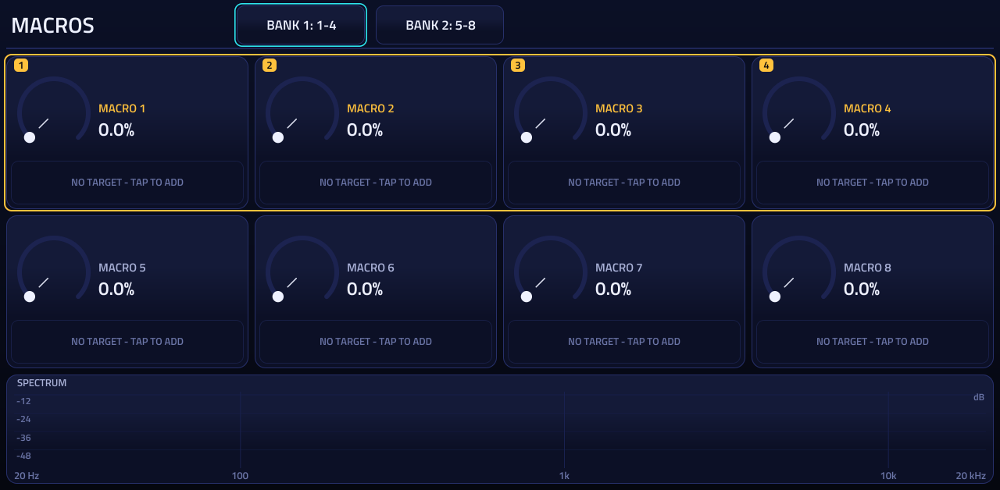

Eight macros as cards, two rows of four, with the live spectrum of the plugin's output under them. A macro is one knob
that moves as many things as you give it as targets: a good way to put a whole sound change on one Q-Link.
The list **BANK 1: 1-4 / BANK 2: 5-8** (the lit dot is the bank) chooses which row is the active Q group (yellow frame).

- Each card: a knob (name MACRO n, value 0 .. 100 percent, default 0) and chips naming what the macro
  drives. A card without targets says "NO TARGET - TAP TO ADD". A tap on the chips area opens the **targets
  page** of the macro (list of routes with depth, polarity UNI/BI, ON/OFF and remove, and ADD TARGET, see
  chapter 6).
- Q-Links: Bank 1 = macros 1 - 4, Bank 2 = macros 5 - 8. On the Key 61 the Q-Link button steps between the two rows; on the
  XL the other row is on knobs 5 - 8 at the same time (chapter 4.3). The other row carries quiet numbered chips (5 - 8 in the picture; the picture is rendered for a 16-knob device).
- Each macro has a **name** (up to 16 characters, default "Macro n") that is stored in the preset. A tap on the name (it is underlined) on a card opens a keyboard page (OK stores the name, CANCEL or BACK leaves it); a drag that starts on the name still turns the knob. The name is used on the Mod page, in pickers and on the knob displays.
- **Spectrum** (bottom strip): the spectrum of the plugin's output after the output stage (20 Hz to 20 kHz,
  scale -12 to -48 dB). It is a display only.

### 5.3 Osc A / B / C

Three identical oscillators (Osc A = Osc 1, B = Osc 2, C = Osc 3 in the parameter list). The page is the full-screen page
of one oscillator. Each oscillator is one of **five types**, chosen with the five keys at the top: **WAVE** (wavetable), **MULTI**
(multisample instrument), **SAMPLE** (one sample), **GRAIN** (granular) and **SPEC** (spectral). Everything you can set
on an oscillator is reachable on the page or on one of its detail pages, and from the Q-Links.

The picture is rendered for a 16-knob device: the small numbers are the Q-Link knobs (1 - 4 the yellow group, 5 - 16 the next groups,
chapter 4.3). On the Key 61 the same page shows 1 - 4 on the idle groups.

**Header** (left to right): the name (OSC A), the power button, the five **type keys**, the source stepper with a list button,
**PAN**, **LEVEL** and the **route button**.

| Control | Parameter and range | Notes |
|---|---|---|
| Power | Osc N On, Off/On | An oscillator that is off shows the picture of its current content (table, sample or spectrum) dimmed under a dark veil with a small **OFF** tag in the corner of the display. It is never an empty display. |
| WAVE | Osc N Type = Wavetable | |
| MULTI | Osc N Type = Multisample | |
| SAMPLE | Osc N Type = Sample | |
| GRAIN | Osc N Type = Granular | |
| SPEC | Osc N Type = Spectral | |
| Source stepper (WAVE) | Osc N Wavetable, 15 choices: Sine, Saw, Square, Triangle, Pulse 25%, Saw to Square, Sine to Saw, Harmonic Series, Odd Harmonics, Formant Sweep, FM Sweep, PWM Sweep, Bell Partials, Preset table, Saw Down | A tap on the name or the list button opens the list; the outer quarters step. |
| Source stepper (other types) | the loaded file or instrument | A tap on the name or the list button opens the **content browser** (see below). |
| PAN | -100 .. 100 percent, default 0 | Q 3 |
| LEVEL | 0 .. 100 percent, default 50 | Q 4 |
| Route button | Osc N Destination: F1, F2, F12 (Filters 1+2), M (Effects only), DIR (Direct out), BAL (Filter blend), OFF (None) | Tap opens the output popup: target, balance (Osc N Filter Blend, 0 .. 100 percent, only for Filter blend), BUS 1 and BUS 2 sends (0 .. 100 percent). Default F1. |

**Display.** One cycle of what the oscillator produces now, including warp and unison; a faint stack shows the frames of the table
when they differ. The unison voices are thin lines around the main curve. Sample, grain and spectral oscillators draw their own
picture (the sample with its region and loop, the grains as bars on it, the spectrum).

**TUNE block** (right). OCT (whole octaves, -4 .. +4), SEM (-11 .. +11 semitones; the transpose is 12 x OCT + SEM, limited to +-48), FIN
(fine, -100 .. +100 cents), CRS (coarse, -48 .. +48 semitones, shown with two decimals), **TRACK** (a LED switch: pitch tracking, default on; off
means the oscillator does not follow the keyboard) and **MORE** (the options page, below).

**UNISON block** (bottom left). The first knob (WT POS for wavetables, TIMBRE for MULTI, SCAN for SAMPLE and GRAIN, POSITION for SPEC),
VOICES (1 .. 16, tap the upper or lower half), the gear button **MORE** (the unison page), DETUNE (0 .. 100 percent, default 25),
BLEND (0 .. 100 percent, default 80). More voices make a wider, thicker sound. **How many unison voices you really get depends on the device (chapter 7.1).**

**WARP block** (bottom right). Two rows, **WARP 1** and **WARP 2**: a knob for the amount (0 .. 100 percent, default 50), a stepper for the type
(99 types, "None" is off and the row is drawn dim; a tap on the name opens the list) and a small **PHASE** knob (0 .. 360 degrees, default 180) of that warp.
Warp bends the wave in time or in level; two warps in a row give far more shapes than one. The warp amount and the type are
the strongest controls for changing the character.

**Unison page** (button MORE in the unison box):

Block UNISON: MODE (Linear, Super, Exp, Inv, Random), STACK (Unison, Center Drop 12, Center Drop 24, Octaves, Two
Octaves, Power Chord, Two Power Chords, Major Chord, Minor Chord, Harmonic Series, Odd Harmonics), WIDTH (stereo
spread, 0 .. 100 percent), RANGE (0 .. 48 semitones, default 2). Block VOICE SPREAD: WT POS, WARP 1, WARP 2 (each
-100 .. +100 percent: how much the frame and the two warps differ from voice to voice). The picture above the
blocks is the oscillator picture. For SAMPLE, GRAIN and SPEC the page also has START and SPAN (where in the file the voices start and how far apart). BACK returns.

**Modulation page of a control** (long press on a knob or number field). A control that nothing modulates yet opens the **source board**:
all 57 sources as chips, one tap makes the modulation of that control. With modulations present the page lists them (source, depth bar,
UNI/BI, ON/OFF, remove) and keeps a compact add row under them (chapter 6).

**Q groups of the page** (in reading order, each group is four knobs): the header (type, source, PAN, LEVEL), the type's own bar (WAVE: FRAME, PHASE, RAND, MAP), Tune (OCT, SEM, FIN, CRS),
Unison (the first knob, VOICES, DETUNE, BLEND), then the warp rows.

#### The five types

**WAVE (wavetable).** The bar above the display has FRAME (the frame now playing; shown only, you set the frame with WT POS or modulate it), PHASE
(start phase, 0 .. 360 degrees), RAND (random start phase, 0 .. 100 percent) and **MAP**, which opens the FRAME MAP page.

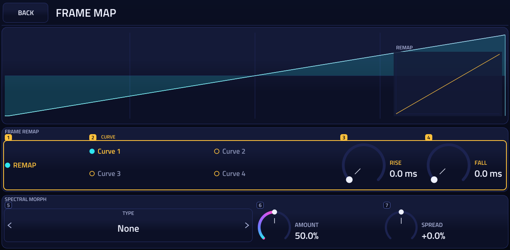

*FRAME MAP* (what the picture shows): the block FRAME REMAP has the **REMAP** LED switch, a **CURVE** list (Curve 1 .. Curve 4) and the knobs **RISE** and **FALL**
(milliseconds, on while the remap is on). The remap curve is drawn over the display (the orange line). The block SPECTRAL MORPH has TYPE (None, Vocode,
Formant Scale, Harmonic Stretch, Inharmonic Stretch, Smear, Random Amplitudes, Low Pass, High Pass, Phase Disperse, Shepard Tone, Time Skew), AMOUNT and SPREAD.
Use the remap to change how the frame position runs through the table; use the morph to reshape the harmonics of every frame.

**MULTI (multisample instrument).** The source is an instrument file (SFZ, or a WAV that becomes an instrument of one zone). With no file loaded the display shows
NO SAMPLE and a **LOAD INSTRUMENT** button that opens the content browser. The bar has **ENV** (opens the multisample envelope page: DELAY, ATTACK, HOLD, DECAY, SUSTAIN, RELEASE
and the OVERRIDE switch, which lets this envelope replace the instrument's own), the **VEL TRK** LED switch with its AMOUNT (0 .. 100) and RAND (random start phase). The unison box has TIMBRE (-100 .. +100 percent).

**SAMPLE (one sample).** The display shows the sample with the START and END marks of the region. The bar has PHASE, **REGION** (opens SAMPLE REGION), **SLICE** (opens SAMPLE SLICES AND SCAN) and the unison count; the
knob in the unison box is SCAN. With no file loaded a **LOAD SAMPLE** button opens the content browser.

*SAMPLE REGION*: block REGION (START and END of the part that plays, ROOT note, shown while key tracking is on, and the KEY TRACK switch); block LOOP (MODE: One-shot, Forward loop, Reverse loop, Forward/reverse loop, Tailed; loop START, END and XFADE, shown while a loop mode is on);
block LOOP OPTIONS (RELATIVE, LINK = link the loop length, EXIT = leave the loop on release; shown while looping); block EDIT (FADE edges: None, 1 ms .. 128 ms; NORMALIZE; REVERSE).

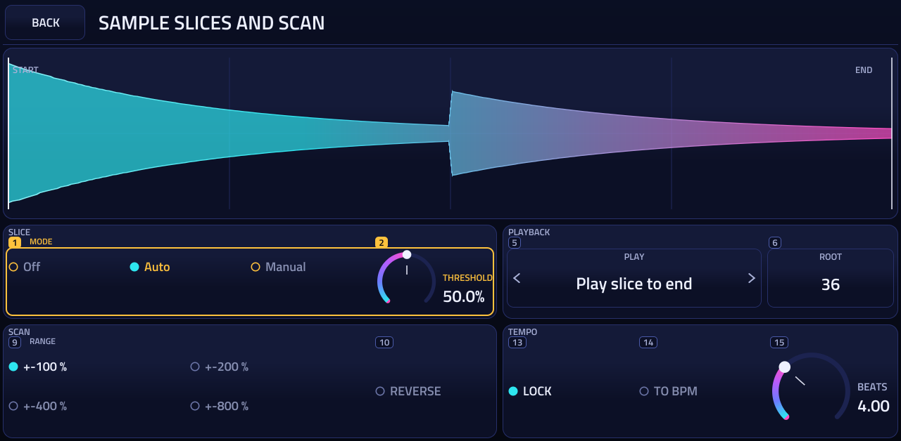

*SAMPLE SLICES AND SCAN*: block SLICE (MODE: Off, Auto, Manual; THRESHOLD in Auto; the slice select in Manual); block PLAYBACK (PLAY: Play slice to end or Play single slice, and the slice ROOT; shown when slicing);
block SCAN (RANGE +-100 %, +-200 %, +-400 %, +-800 % and REVERSE: how far the SCAN knob can move the read position); block TEMPO (LOCK to tempo, TO BPM, and the length in BEATS while one of them is on).

**GRAIN (granular).** The source is a sample that is played as a cloud of short grains. The display shows the file; a frame marks where the grains read. The bar has the
**GRAIN** button (opens the GRAIN ENGINE page), **AMOUNT** (the grain window amount, with the window icon), the **LOOP** stepper (One-shot, Loop grains, Manual) and the unison count. The bottom blocks are GRAIN (SCAN, DENS = density 0.1 .. 1000 Hz, LENGTH 1 .. 4000 ms, WARP menu), PLAYBACK (OFFSET, DIR, PITCH 0 .. 24 semitones) and RANDOM (LEN RAND, PAN RAND, LVL RAND; random spread of length, pan and level).
With no file loaded a **LOAD SAMPLE** button opens the content browser.

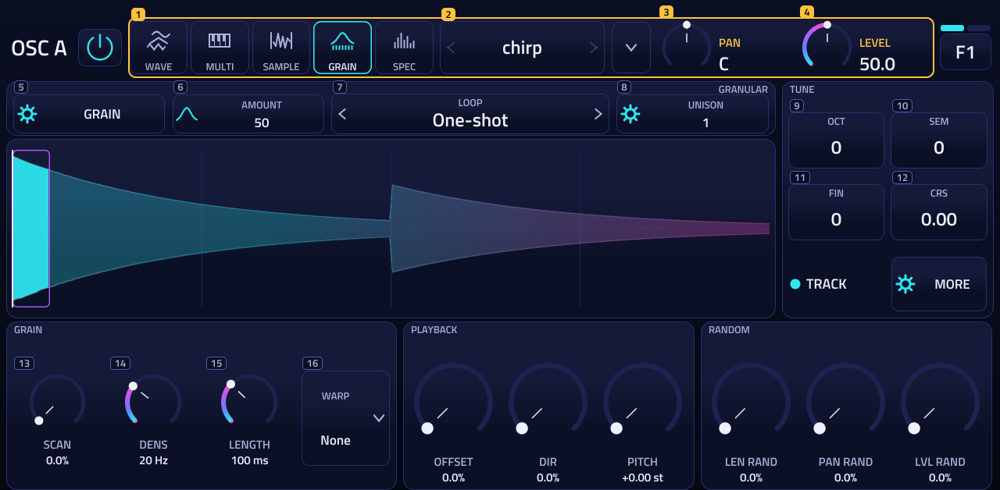

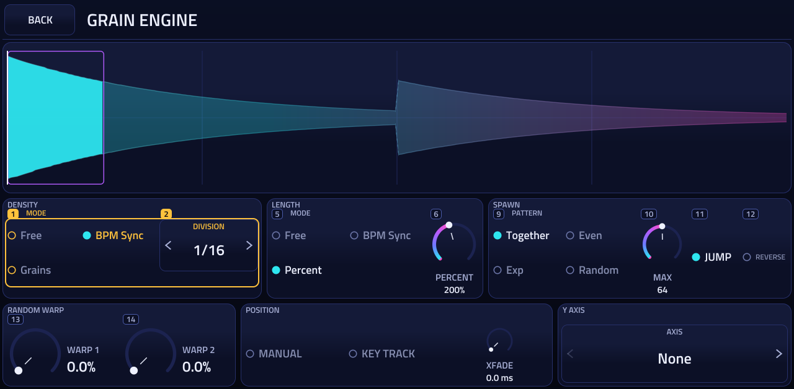

*GRAIN ENGINE*: block DENSITY (MODE Free, BPM Sync, Grains; the DIVISION in BPM Sync; the number of grains in Grains); block LENGTH (MODE Free, BPM Sync, Percent; division, percent);
block SPAWN (PATTERN Together, Even, Exp, Random; MAX grains; JUMP = jump start; REVERSE); block RANDOM WARP (WARP 1, WARP 2: random amount per grain); block POSITION (MANUAL, KEY TRACK, XFADE); block Y AXIS (AXIS: a parameter you hand to the vertical axis, and its Y position while an axis is set).

**SPEC (spectral).** The oscillator plays the spectrum of a sample or table and lets you filter and scan it. The display is the spectrum. The bar has PHASE, **FILTER** (opens SPECTRAL FILTER), **SCAN** (opens SPECTRAL SCAN) and the unison count; the knob in the unison box is POSITION. With no file loaded a **LOAD SAMPLE** button opens the content browser.

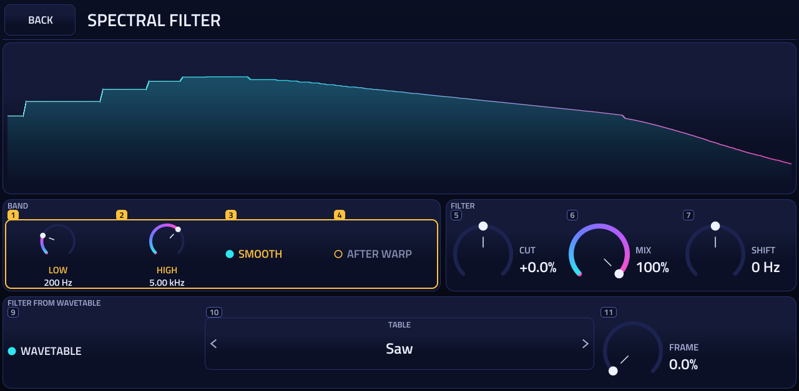

*SPECTRAL FILTER*: block BAND (LOW and HIGH edge in Hz, SMOOTH edges, AFTER WARP = apply the band after the warps); block FILTER (CUT, MIX, SHIFT = frequency shift in Hz); block FILTER FROM WAVETABLE (the WAVETABLE switch, then TABLE and FRAME that shape the filter).

*SPECTRAL SCAN*: block SCAN (MANUAL position, KEY TRACK, PHASE LOCK, TRANSIENTS); block SPECTRAL MORPH (TYPE, AMOUNT, SPREAD, as on the wavetable map page); block Y AXIS (AXIS: None, Level, Warp, Warp 2, Spec Flt Cutoff, Spec Flt Wet/Dry, Freq Lo, Freq Hi).

**The content browser.** The source of MULTI, SAMPLE, GRAIN and SPEC is a file. The browser opens as a list: the first row is the folder you are in (tap to go one up), then folders, then files, sorted by name. The roots at the top are
SD CARD, USB drives (named USB and the drive name) and PLUGIN CONTENT. It opens in the folder of the file loaded last. Only WAV and SFZ files are offered (not FLAC). An SFZ instrument must lie in a folder of its own with its samples below it. A tap on a file loads it; "LOAD FAILED" stays for four seconds if it does not.

#### The oscillator options page (button MORE in the tune block)

The page has no display: the room goes to six blocks, each one Q group of four.

- **OSCILLATOR:** ON (the power switch, so it can be reached from the Q-Links), ENV 1 (Env 1 shapes this oscillator), SMOOTH (smooth interpolation), TRACK (pitch tracking).
- **PITCH:** MODE (Semitones, Harmonics, Ratio, Step), BEND (the oscillator follows the pitch bend, a LED switch), and, while TRACK is off, **FIXED PITCH**: the MIDI note the oscillator plays whatever key you press (0, the default, is the oscillator's own C3).
- **TRANSPOSE SNAP:** the twelve note cells (C to B, the five black notes in the upper row) are the notes the oscillator may play. Tap a cell to allow or forbid it. The nearest allowed note wins; a tie goes down; with no cell lit the snap is off. The **SNAP NOTE** switch snaps the whole played note instead of the transpose alone. This gives you a scale or a chord from one key. The knob that stands for the mask on the Q-Links sweeps it in coarse steps; the editing is by touch.
- **PHASE:** MEMORY (All Voices: PHASE and RAND for every note, the default; Contiguous: a note continues with the phases the previous note has now; Per Voice: every note starts with the phases captured from the previous note), LEGATO (a note that starts while the previous key is still held takes that note's phases instead of starting at PHASE and RAND; it is the same switch as the PHASE LEG switch of the Master page) and RATIO source (Base note, Osc 1, Osc 2, Osc 3, Sub).
- **KEY ZONE:** LOW and HIGH note, **FOLD** (a note outside the zone plays as the note an octave or more away that lies inside; a zone narrower than an octave cannot take it and stays silent) and **WARP** (outside its zone the oscillator keeps running as the source of the other oscillators' warps, but is not heard and not in the mixer strips).
- **VELOCITY ZONE:** LOW and HIGH velocity and OVERRIDE.
- **UNISON SHAPE:** CURVE (detune curve) and SHAPE (blend shape), VOICE LAW (Equal power or Fixed gain: how the blend of the voices is weighted) and STACK repeat (1x, 2x, 3x).

Controls that do not apply in the current state are hidden (FIXED PITCH while TRACK is on, for example) and the others take their room.

### 5.4 Sub

The sub oscillator: a simple wave for weight under the main oscillators. Header: the power button (Sub On), the six waveform keys **SINE, HALF, TRI, SAW, SQR, PULSE** (Sub Waveform:
Sine, Rounded Rect, Triangle, Saw, Square, Pulse; the key HALF is the choice "Rounded Rect"), **OCT** (-4 .. +4, default -1),
**PAN** (-100 .. +100 percent) and **LEVEL** (0 .. 100 percent, default 50). Sub has no route button; its routing is the block ROUTING below.
In the picture the power button is dim: the Sub is off in the Init sound.

- Display: one cycle of the waveform.
- TUNE: CRS (Sub Coarse, -48 .. +48 semitones), **ENV 1** and **MONO** (LED switches: Env 1 shapes the Sub; MONO).
- PHASE: PHASE (0 .. 360 degrees shown), **FREE RUN** (LED switch; the parameter is "Sub Phase Contiguous").
- ROUTING: DEST (Filter 1, Filter 2, Filters 1+2, Effects only, Direct out, Filter blend, None; default Effects only), BLEND (0 .. 100 percent), BUS 1, BUS 2 (0 .. 100 percent).
- Q groups: header (waveform, OCT, PAN, LEVEL), TUNE, PHASE, ROUTING.

### 5.5 Noise

The noise generator. Header: the power button (Noise On), the **SOUND** stepper (Noise Sample: White Noise, Pink Noise, Brown Noise, Geiger,
Tape Hiss, Vinyl Clicks, Digital Hash, Velvet Noise, Atmosphere), **FILTER** (-100 .. +100 percent), **PAN**, **LEVEL**
(0 .. 100 percent, default 25) and the route button. The display draws the colour of the noise (faint while the noise is off).

- TUNE: PITCH and FINE (number fields: -48 .. +48 semitones, -100 .. +100 cents), **KEY TRACK** (LED switch).
- **Two different steppers.** The header stepper SOUND chooses which of the nine noise sources the generator plays. The **KIND** stepper in the bottom block (Noise Type: Noise / Sample) chooses whether the source is that generated noise (Noise) or a sample file from the plugin's content (Sample). If no sample file is loaded in Sample mode, the generated noise plays instead.
- Bottom, KIND = Noise (as in the picture): one block NOISE with KIND, STEREO (0 .. 100 percent) and the **ENV 1** LED switch.
  KIND = Sample: block SOURCE (KIND, START = Noise Phase 0 .. 100 percent, STEREO, ENV 1) and block PLAYBACK (RANDOM, LOOP, BOUNCE LED switches).
- Q groups: header (source, FILTER, PAN, LEVEL), TUNE, the bottom blocks.

### 5.6 Mixer

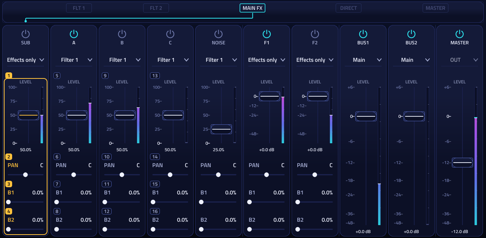

Ten channel strips, side by side, without frames around the sliders: the name and the value sit over a thin track.
They run from left to right: **SUB, A, B, C, NOISE, F1, F2, BUS1, BUS2, MASTER**, and above them a routing
bar (FLT 1, FLT 2, MAIN FX, DIRECT, MASTER) that draws the path of the **selected strip** (a tap on a strip selects it).

Each strip (top to bottom):
- **Power button**: the source's On (oscillators, Sub, Noise, filters). On BUS1, BUS2 and MASTER it is the FX switch of that rack: lit
  means the rack's effects are active (parameters "Bus 1 FX Bypass", "Bus 2 FX Bypass", "Main FX Bypass", shown inverted).
- **Destination button** (a tap opens the list):
  - SUB, A, B, C, NOISE: Filter 1, Filter 2, Filters 1+2, Effects only, Direct out, Filter blend, None.
  - F1, F2: Effects only, Direct out, None.
  - BUS1, BUS2: Main, Direct, Other bus.
  - MASTER: OUT (fixed).
- **LEVEL fader** with a peak meter beside it: SUB, A, B, C, NOISE 0 .. 100 percent; F1, F2 -60 .. +12 dB (default 0); BUS1, BUS2 -60 .. +6 dB
  (default 0); MASTER = Master Volume -60 .. +6 dB (default -12). Vertical drag; double tap = default. A hold line falls slowly from the highest level. The meter has a dB scale (a mark every 12 dB, or at 0 / -6 / -12 / -24 / -48) and a colour ramp: blue-green when quiet, violet near full scale. At rest it shows a faint base line, never an empty box.
- **PAN** (-100 .. +100 percent), **B1** and **B2** (sends to bus 1 and bus 2, 0 .. 100 percent): thin sliders without a box, on SUB, A, B, C, NOISE, F1, F2 only. The buses and MASTER have a level only; their PAN and sends are left out, not dimmed.

Q group: the strip you touched (yellow frame around the whole strip; in the picture it is SUB): LEVEL (1), PAN (2), B1 (3), B2 (4). On the XL the next three strips (wrapping) follow on knobs 5 - 16: in the picture A has 5 - 8, B has 9 - 12, C has 13 - 16. On the Key 61 the Q-Link button steps to them (chapter 4.3).

### 5.7 Filter 1 / 2

The picture shows Filter 1 with the Digital model, the response curve with the cutoff handle, and the three blocks. The OUTPUT button at the top right shows M (Effects only).

The page of the Filter tab shows **one filter at a time**: the tab Filter 1 starts on F1, Filter 2 on F2. The **CURVES** list at the top
left (F1, F2, F1+F2; the lit dot is the choice) says which curves the display draws and which filter the knobs edit; F1+F2 draws both response curves and the combined one.
It is not the routing list (Parallel / Series) and not the Filter 1 / Filter 2 tabs of the MPC, which only choose where the page opens.

**Header:** power (Filter N On), model stepper (27 models: Analog, Dirty, Ladder, Digital, Diode, Formant, Comb, Phaser, Multi SVF, Slope, EQ 6 dB,
Ring Mod, Sample Hold, Smear, French LP, Add Bass, Scream, New Wsp, DJ Mixer, Diffusor, EMS Ladder, PZ SVF, Normal, Multi Morph, Flanges, Misc, New)
with a list button, style stepper (12 styles, "Style A (12 dB)", "Style B (24 dB)" ... "Style L"), **CLEAN** LED switch (dim for Comb and Formant),
**OUTPUT** route button (M = Effects only by default; Filter N Destination: Effects only, Direct out, None; the popup also has BUS 1, BUS 2, level, pan).

**Display.** The response curve the filter really has (log frequency 20 Hz .. 20 kHz, dB scale from +24 down to -48), drawn with the live cutoff and resonance of the voice that sounded last
(also moved by modulation). Drag the handle on the curve to change cutoff and resonance together; a bubble shows the values.

**Blocks (one Q group each):**

| Block | Control | Parameter, range |
|---|---|---|
| MAIN | CUTOFF | 20 .. 20000 Hz, default 12 kHz |
| | RESO | 0 .. 100 percent, default 20 |
| | DRIVE | 0 .. 20 dB |
| | MIX | 0 .. 100 percent, default 100 |
| TRACK | KEYTRACK | -100 .. +100 percent |
| | ENV 1 | LED switch: Env 1 shapes the filter (default On) |
| | VAR | 0 .. 100 percent, default 50 (dim with Formant) |
| | COMB | Comb Blend Offset 0 .. 84 semitones, default 42 (dim unless the model is Comb) |
| OUT | LEVEL | -60 .. +12 dB |
| | PAN | -100 .. +100 percent |
| | BLEND | 0 .. 100 percent |
| | ROUTING | a LED list of three: Parallel, Series 1 to 2, Series 2 to 1 (one setting for both filters) |

With the model **Formant** a fourth group FORMANT appears with X, Y (0 .. 100 percent), TRANSPOSE (-12 .. +12 semitones) and SPREAD (-100 .. +100 percent), and the display shows the formant pad.
TODO(owner): Describe the Formant page from a picture (the rendered gallery shows only the default model), including which control sets Formant Resonance (30 .. 100 percent).

Controls that do not apply to the current model are dimmed, including their value text (in the picture COMB is dim because the model is not Comb). A long press on a knob opens its modulation page (chapter 6).

### 5.8 Envelopes

The pages Env 1 - Env 4 each show one envelope full screen; the buttons **ENV 1 .. ENV 6** at the top switch the page to another envelope (a dot under the button marks an envelope that modulates something).
The tab only decides which envelope is shown first.

- **Graph.** Time axis (auto-zoom 100 ms .. 50 s), the handles of DELAY, ATTACK, HOLD, DECAY, SUSTAIN, RELEASE (stage names on top). Drag a time handle to change the time; the DECAY handle changes decay time and sustain level at once; the small handle in the middle of attack, decay and release bends the curve; double tap on a handle = its default. A dot and a soft line follow the playing voice(s).
- **TARGETS** (top right, with the number of targets): opens the list of what the envelope modulates, with depth, UNI/BI, ON/OFF, remove, and ADD TARGET (chapter 6). The panel right of the graph ("MODULATES n TARGET(S)") lists the targets and their depth.
- **ADSR** (Q 1 - 4): ATTACK 0 .. 10000 ms (default 5), DECAY 0 .. 10000 ms (400), SUSTAIN 0 .. 100 percent (100), RELEASE 0 .. 10000 ms (200).
- **SHAPE:** A CURVE, D CURVE, R CURVE: -20 .. +20, defaults 0, -3, -3.
- **TIME:** DELAY 0 .. 4000 ms, HOLD 0 .. 4000 ms, **BEATS** (switch: times in beats instead of milliseconds: delay 0 .. 8, attack 0 .. 16, hold 0 .. 8, decay 0 .. 16, release 0 .. 16 beats), **LEGATO** (the parameter is "Legato Inverted", Off/On). With the main LEGATO switch on the Master page, a note played while another is held takes over the sounding voice and the envelopes do not start again. Switching LEGATO on for an envelope here makes **that envelope** restart on every note, even in that situation (it restarts from its current level, not from zero). It has no effect while the main LEGATO is off.

### 5.9 LFOs and the drawn-shape editor

The pages LFO 1 - LFO 4 each show one LFO; the top bar switches to **1 .. 10** (LFOs) or **R1 .. R4** (random LFOs). The tab only decides which is shown first.

**Top bar:** instance cells, the sync mode **HZ / BPM / KEY**, switches **TRIP** (triplet) and **DOT** (dotted) (active only in BPM), the **TARGETS** button (what the LFO modulates, chapter 6).

**Display** (left): the shape of one cycle, with the phase marker, a cursor that runs with the sounding voice. A strip above the graph shows delay and rise when set.

**Shape picker** (right, 13 cells): SINE, TRI, SAW UP, SAW DN, SQUARE, PULSE (25 percent), STEP UP, STEP DN, RANDOM (random steps), EXP UP, EXP DN, HALF (half sine), DRAWN (your own shape). Under it two switches: **SMOOTH** and **HOST**. **HOST** only matters when the LFO's MODE is Free-run (and the sync is not Key follow): then the LFO's phase is taken from the host's song position while the transport plays, so a song plays the same every time; with HOST off the LFO runs freely and keeps its own clock.

**Blocks (one Q group each):**

| Block | Control | Parameter, range |
|---|---|---|
| RATE | the shape picker is Q 1; RATE | 0.01 .. 200 Hz, default 2 (in BPM mode: DIVISION, 13 choices Freeze, 32 bars, 16 bars, 8 bars, 4 bars, 2 bars, 1 bar, 1/2 note, 1/4 note, 1/8 note, 1/16 note, 1/32 note, 1/64 note; dim in KEY) |
| | RISE | fade in 0 .. 8000 ms |
| | SMOOTH | smooth time 1 .. 1000 ms (dim when the SMOOTH switch is off) |
| TIMING | SYNC | Free (Hz), Tempo, Tempo dotted, Tempo triplet, Key follow (this is the same as the HZ / BPM / KEY buttons and TRIP / DOT) |
| | MODE | Retrigger, Free-run, Envelope, Sustain envelope, Loop at point, Loop and hold |
| | PHASE | 0 .. 360 degrees |
| | DELAY | 0 .. 4000 ms |
| MOTION | DIRECTION | Forward, Reverse, Ping pong |
| | SWING | 0 .. 100 percent |
| | STEREO | -180 .. +180 degrees (offset between left and right) |
| | MONO | switch |
| KEY FOLLOW (only in KEY sync) | TRANSPOSE | -60 .. +36 semitones, default -12 |
| | TUNE | -100 .. +100 cents |

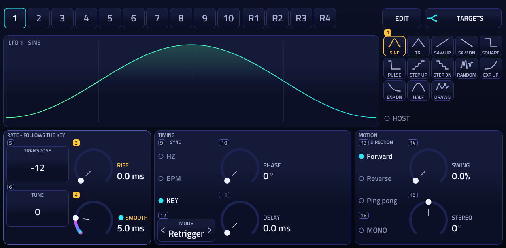

**Random LFOs (R1 - R4):**

Style picker: PERLIN, S & H (sample and hold), SINE INT (sine interpolate), LORENZ, ROSSLER; block RANDOM: RATE 0.01 .. 200 Hz (default 2), STYLE, SYNC (Free (Hz), Tempo, Tempo dotted, Tempo triplet, Key follow), STEREO (Off/On); block TRIGGER: MODE (Retrigger or Free-run); a KEY FOLLOW block in KEY sync. The display is the trace of the output.

**The drawn-shape editor.** The **EDIT** button at the top right of the display opens the editor page over the page (BACK returns). If you press EDIT on a built-in shape, the shape is copied into points and becomes a drawn shape (the LFO's shape is then DRAWN). Choosing the cell DRAWN in the picker only makes the shape a drawn one (a triangle when it has no points yet); it does not open the editor.

- **Tools** (a row of four): **POINT**, **FLAT**, **RAMP+**, **RAMP-**.
  - POINT: tap on empty ground adds a point (snapped to the grid when SNAP is on), and dragging moves it; touching a point selects and drags it (the two end points only up and down); the small handle in the middle of a segment drags its curve (power -20 .. +20); a **long press** on a point deletes it.
  - FLAT / RAMP+ / RAMP-: touching a cell of the grid draws a flat piece, a rising or a falling ramp over the cell's column; dragging across draws a staircase or saw.
- Buttons: **UNDO**, **DELETE**, switches **SNAP**, **LOOP**, **SMOOTH**.
- **EDIT Q group** (the SELECTED POINT): X, Y, CURVE, GRID (virtual knobs of the plugin: they change the selected point).
- A drawn shape that has no points is read as a flat line.

### 5.10 Mod matrix

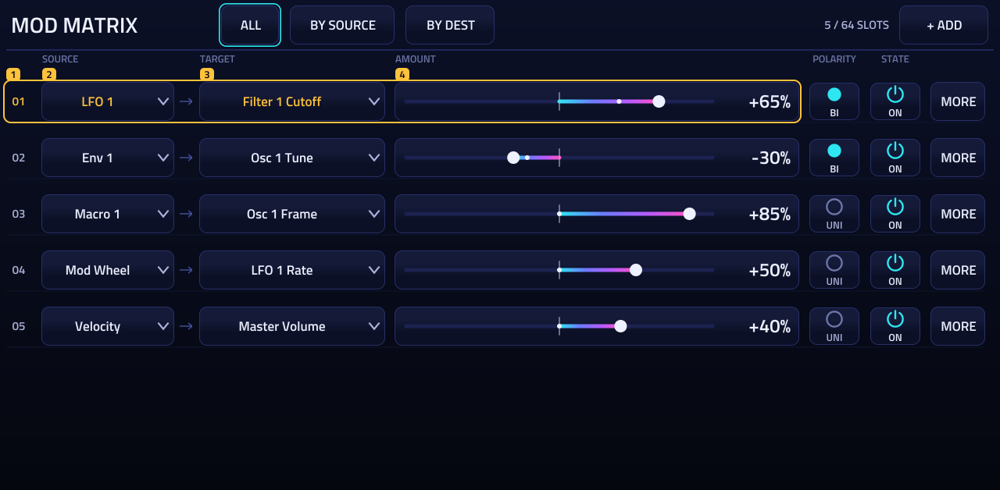

The page shows the modulation slots (up to 64; the counter at the top reads "5 / 64 SLOTS"). Tabs **ALL**, **BY SOURCE**, **BY DEST** filter the list (BY SOURCE and BY DEST show a stepper to choose the source group or destination module). **+ ADD** makes a new slot in the first unused place (source Env 1, the first destination of the list, amount +50 percent) and opens its slot page (MORE, below), where you change SOURCE and TARGET.

Each row: the number (a tap selects the row), **SOURCE** (a button that opens the list of sources), an arrow, **TARGET** (opens the grouped list of destinations: first the groups, then the parameters), the **AMOUNT** bar (-100 .. +100 percent, horizontal drag, double tap = default 0; the dot is the live value), **POLARITY** (UNI / BI), **STATE** (ON / OFF) and **MORE**.

**Q group:** the selected row: Q 1 = row (steps through the rows), Q 2 = SOURCE, Q 3 = TARGET, Q 4 = AMOUNT.

**MORE** opens the page of the slot (BACK, a title, **DELETE** with a confirmation) with the same row for editing and three blocks:

| Block | Control | Parameter, range |
|---|---|---|
| AUXILIARY SOURCE | SOURCE | Aux Source: a second source that multiplies the first |
| | SCALE | Output Scale 0 .. 200 percent, default 100 |
| | INVERT | Aux Invert, Off/On |
| | CURVE | Aux Curve -10 .. +10 |
| SHAPE | CURVE | Curve -10 .. +10 |
| | STEREO | Off/On |
| TIME | RISE | 0 .. 5000 ms |
| | FALL | 0 .. 5000 ms |
| | DELAY or BEATS | Delay 0 .. 4000 ms, or 0 .. 8 beats when tempo sync is on |
| | SYNC | Delay Tempo Sync, Off/On |

**With no slot in use** the page shows the **source board** (every one of the 57 sources as a chip, in groups ENVELOPES, LFOS, MACROS, PLAYER, SOUND). Tap a chip, then pick the target. The board disappears when the first slot exists; **+ ADD** is always there.

More in chapter 6.

### 5.11 FX

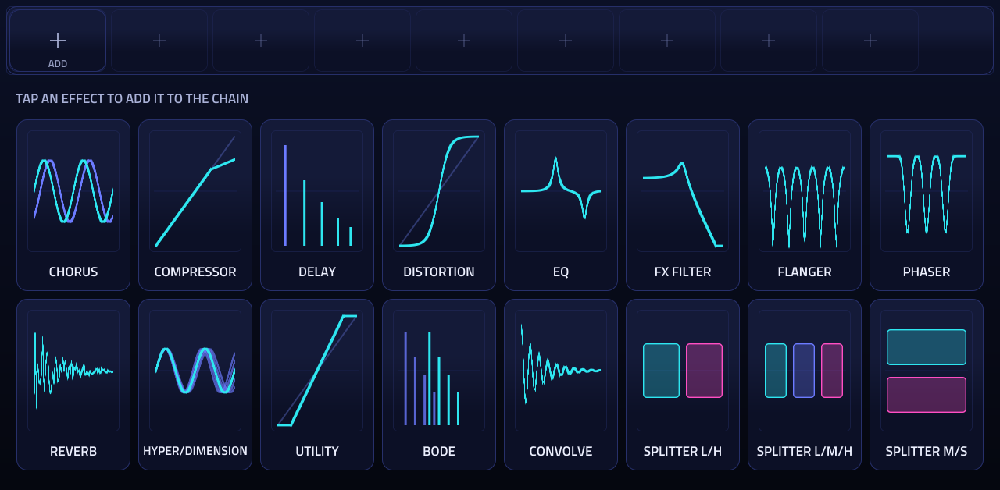

**The chain bar** (top) shows the effects in processing order as cards with a type icon, the name, a power switch, and a tag of the rack (MAIN, B1, B2); empty places show "+". Tap a card to select it, tap the power part to switch it, **drag a card sideways to reorder**, **+ ADD** (or the first free place) adds an effect: pick the type from the list. When the chain is empty, the page shows the **gallery** of the 13 effect types: one tap on a card adds that effect to the end of the Main rack and opens it.

**The effect page.** Header: power switch, the effect's name, **RACK** stepper (MAIN / BUS 1 / BUS 2: the effect moves to that rack), **PAGE n / m** stepper (the knobs in rows of four; one Q group per row; 8 knobs on a page under a display, 12 without), **REMOVE**. Knobs show the parameter's own name and value. The effects EQ, compressor, delay, FX filter and distortion have a **display** (EQ: the frequency response with a dot per band; compressor: the transfer curve of the bands; delay: the taps in time; FX filter: the response; distortion: the transfer curve and the present level); the others use the room for knobs.

**Racks and limits.** There are three racks. **MAIN** processes the whole sound that comes out of the filters and the Mixer's "Effects only" routes. **BUS 1** and **BUS 2** are two side paths: each is fed by the **B1** and **B2** sends of the Mixer strips (chapter 5.6), has its own chain of effects, and then goes to the destination set on its Mixer strip (Main, Direct, or the other bus). The engine has **16 effect slots in all**, shared by the three racks: you can add up to 16 effects in total, in any mix of MAIN, BUS 1 and BUS 2; the chain bar only adds an effect while a slot is free. The effects that sit in the engine's fixed chain are listed too, switched on or off.

The knobs follow the order of the parameter table. Parameters of the 13 effect types (name, range, default). The one- or two-sentence descriptions are to be confirmed by the author.

1. **Chorus** Thickens the sound by mixing in delayed copies whose delay time is moved by a slow modulation. (page of 12): Mix 0 .. 100 percent (50), Rate 0.02 .. 8 Hz (0.4), Sync (Free (Hz), Tempo, Tempo dotted, Tempo triplet), Division (Freeze ... 1/64 note, 11 choices from 32 bars), Depth 0 .. 100 percent (50), Feedback -95 .. +95 percent (40), Delay 1 and Delay 2 1 .. 20 ms (2, 8), Voices 1 .. 4 (4), Filter Cutoff 20 .. 20000 Hz (260), Filter Spread 0 .. 100 percent (100), Level -24 .. +12 dB (0). A modulated delay line effect.
2. **Compressor** Evens out loud and quiet parts. It works in three bands (low, mid, high) with their own thresholds, ratios and gain, or as a single band; the mode can be Compress or Limit. (3 pages, display): Mix 0 .. 100 percent, Attack 0 .. 100 percent, Release 0 .. 100 percent, Bands (Multiband, Low band, High band, Single band), for Low, Mid, High: Lower Threshold -120 .. +12 dB (-40), Upper Threshold (-20), Lower Ratio -100 .. +100 percent (0), Upper Ratio 0 .. 100 percent (50), Gain -36 .. +36 dB (0); Level -24 .. +12 dB; Mode (Compress, Limit, Serum); Limiter Latency Comp (Off/On); Low Crossover 20 .. 1000 Hz (120); High Crossover 200 .. 16000 Hz (2500).
3. **Delay** Repeats the sound as echoes. The time is free or tempo-synced, feedback sets the number of repeats, and the styles include ping pong. (display): Mix 0 .. 100 percent (30), Feedback -100 .. +100 percent (40), Time and Time 2 2 .. 4000 ms (300), Sync (Free, Tempo, dotted, triplet; default Tempo), Division and Division 2 (4 bars ... 1/32 note), Style (Mono, Stereo, Ping pong, Mid ping pong, Tap->Delay; default Stereo), Filter Cutoff 20 .. 20000 Hz (260), Filter Spread 0 .. 100 percent, Level, High Quality (Off/On), Offset and Offset Left 0.25 .. 4 (1).
4. **Distortion** Adds harmonics by clipping, folding or reducing the signal (soft and hard clip, folds, bit crush, down sample, tube, diode ...), with an optional filter before or after. (display): Type (14 choices: Soft clip, Hard clip, Linear fold, Sine fold, Bit crush, Down sample, Tube, Diode 1 ...), Drive -30 .. +30 dB, Mix 0 .. 100 percent (100), Filter Order (None, Pre, Post), Filter Cutoff 20 .. 20000 Hz (4000), Filter Resonance 0 .. 100 percent (50), Filter Blend 0 .. 100 percent, Level, Filter Key Track -100 .. +100 percent.
5. **EQ** A tone control with four bands (low, mid, mid 2, high), each with cutoff, gain and resonance. (3 pages, display): bands Low (Mode Shelf or High pass; Cutoff 100 Hz; Gain -24 .. +24 dB; Resonance 0 .. 100 percent), Mid (Peak or Notch; 1000 Hz), High (Shelf or Low pass; 8000 Hz), Mid 2 (Off, Peak, Notch; 3000 Hz), each Cutoff 20 .. 20000 Hz; Level -24 .. +12 dB; Law (Vital, Serum).
6. **FX Filter** A filter used as an effect on the whole signal, with the same models as the voice filters. (display): the same controls as a Filter page (Model, Style, Cutoff 20 .. 20000 Hz, Resonance, Drive 0 .. 20 dB, Blend, Mix, Key Tracking, Comb Blend Offset, Formant X, Y, Resonance, Spread, Transpose, Var, Pan, Level -60 .. +12 dB, Clean Mode).
7. **Flanger** Sweeps a very short delay with feedback, giving a moving, metallic comb-filter sound. Parameters: Mix (50), Feedback -100 .. +100 percent (50), Rate 0.04 .. 4 Hz (0.25), Sync, Division, Depth 0 .. 100 percent, Center 20 .. 16000 Hz (330), Phase Offset 0 .. 360 degrees (120), Level.
8. **Phaser** Sweeps a series of notches through the sound, with feedback, for a swirling movement. Parameters: Mix, Feedback 0 .. 100 percent, Rate 0.04 .. 4 Hz (0.12), Sync, Division, Depth 0 .. 48 semitones (24), Center 20 .. 16000 Hz (2000), Blend 0 .. 100 percent, Phase Offset 0 .. 360 degrees (120), Level, Depth 2 -48 .. +48 semitones.
9. **Reverb** Adds the space of a room or hall: size, decay time, pre-delay, tone shaping and several reverb types. (2 pages): Mix 0 .. 100 percent (25), Size 0 .. 100 percent, Decay 20 .. 30000 ms (1500), Pre-delay 0 .. 300 ms, Pre Low Cut and Pre High Cut 20 .. 12000 Hz, Low and High Shelf Cutoff and Gain (-6 .. 0 dB), Chorus Amount 0 .. 100 percent, Chorus Rate 0.01 .. 8 Hz, Force Enable (Off/On), Level, Type (Vital, Plate, Hall, Vintage, Nitrous, Basin), Room (Space, Marble, Rectangle, Hexagon, Box), Width 0 .. 200 percent, ER Size, Diffusion A, Diffusion B, Feedback (0 .. 100 percent).
10. **Hyper/Dimension** Hyper thickens the sound with several detuned copies; Dimension widens the stereo picture. Parameters: Hyper Rate 0.05 .. 10 Hz, Hyper Unison 0 .. 7 voices, Hyper Detune 0 .. 100 percent, Hyper Retrigger (Off/On), Hyper Mix, Dimension Size 0 .. 100 percent, Dimension Mix 0 .. 100 percent, Level.
11. **Utility** Housekeeping tools: polarity flip per channel, low-pass and high-pass filters, mono bass, stereo width, pan and level. Parameters: Polarity Left and Right (Off/On), Low Pass 20 .. 20000 Hz, High Pass 20 .. 20000 Hz, Mono Bass (Off/On) and its Frequency 20 .. 500 Hz (120), Width 0 .. 200 percent (100), Pan -100 .. +100 percent, Mix, Level.
12. **Bode** Shifts all frequencies of the sound by a fixed amount (a frequency shifter), with delay, feedback and blur. Parameters: Mono Input (Off/On), Shift 0 .. 100 percent, Range 1 .. 5000 Hz (100), Direction -100 .. +100 percent (100), Width 0 .. 100 percent, Delay 1 .. 2000 ms (100), Sync, Division, Feedback 0 .. 100 percent, Balance -100 .. +100 percent, Blur 0 .. 100 percent, Retrigger (Off/On), Mix (50), Level.
13. **Convolve** Gives the sound the character of a recorded space or device by convolving it with an impulse response. Parameters: Impulse (None, Preset IR), Size 0 .. 100 percent, Tone -100 .. +100 percent, Minimum Phase (Off/On), Pre-delay 0 .. 500 ms, Sync, Division, Attack 0 .. 2000 ms, Decay 0 .. 100 percent (100), Damping 0 .. 100 percent, IR Gain -40 .. +24 dB, Mix (30), Level, Law (Vital, Serum).

For Q-Links: one Q group per row of four knobs on the page that is on screen.

### 5.12 Master

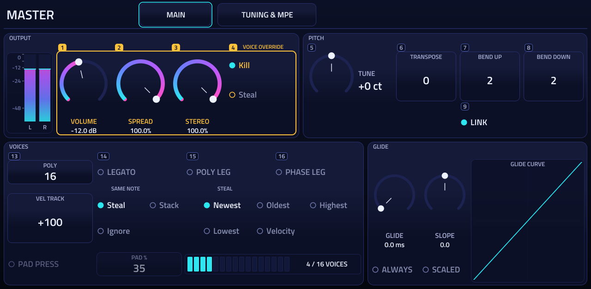

Two sides, chosen by the buttons **MAIN** and **TUNING & MPE** at the top.

**MAIN side** (four blocks):

| Block | Control | Parameter, range |
|---|---|---|
| OUTPUT | meters L / R (the engine's master peak, with hold line) | |
| | VOLUME | Master Volume -60 .. +6 dB, default -12 |
| | SPREAD | Stereo Spread 0 .. 100 percent, default 100 |
| | STEREO | Stereo Routing 0 .. 100 percent, default 100 |
| | VOICE OVERRIDE | Kill / Steal |
| PITCH | TUNE | -100 .. +100 cents |
| | TRANSPOSE | -48 .. +48 semitones |
| | BEND UP, BEND DOWN | 0 .. 24 semitones, default 2; **LINK ON** makes the down range follow the up range |
| VOICES | POLY | Polyphony 1 .. 32, default 16 |
| | LEGATO, POLY LEG, PHASE LEG | switches (Master Legato, Master Poly Legato, Voice Phase Legato) |
| | SAME NOTE | Steal, Stack, Ignore |
| | STEAL | Newest, Oldest, Highest, Lowest, Velocity |
| | VEL TRACK | -100 .. +100 percent, default 100 |
| | voice bar | sounding voices / polyphony |
| GLIDE | GLIDE | Portamento Time 0 .. 8000 ms |
| | SLOPE | -8 .. +8; the glide curve is drawn below |
| | ALWAYS | Portamento Always, Off/On |
| | SCALED | Portamento Scaled By Interval, Off/On |

Q groups: OUTPUT (VOLUME, SPREAD, STEREO, VOICE OVERRIDE), PITCH, VOICES (POLY ... SAME NOTE) and the second VOICES row, GLIDE.

**TUNING & MPE side:**

- **SCALE:** SCALE (Chromatic (off), Major, Natural Minor, Harmonic Minor, Melodic Minor, Dorian, Phrygian, Lydian, Mixolydian, Locrian, Major Pentatonic, Minor Pentatonic, Blues, Whole Tone, Diminished (H-W), Diminished (W-H), Phrygian Dominant, Hungarian Minor, Double Harmonic, Hirajoshi), KEY (C ... B; the keyboard drawing below sets the key when you tap or drag a key), MODE (Conform, Mark only). The keyboard shows the notes of the scale.
- **TUNING:** A4 HZ (400 .. 480 Hz, default 440), TUNING (12-TET, Pythagorean, Just intonation, User file), MTS-ESP switch, NOTE-ON switch (MTS-ESP note-on only).
- **MPE:** MPE on/off, MPE BEND (1 .. 96 semitones, default 48), XYZ MACRO (Off, XYZ -> Macro 1, 2, 3, YZ -> Macro 1, 2), Y TO WHEEL, BEND TO X, Y BIPOLAR (switches).

**Pad pressure (MPC XL pads).** The XL pads send a pressure value for each held pad. A preset uses it through the modulation matrix: a route from the source **Poly Aftertouch** to a parameter, for example Filter 1 Cutoff (the preset "MPE Pressure Lead" does this). The plugin also has a plugin-wide pad-pressure switch for the Filter 1 cutoff; it is **off** by default. For any pad pressure to arrive, the pad's **Full Level must be off** (with Full Level on every hit has velocity 127 and sends no pressure). Only per-pad (polyphonic) pressure counts; channel aftertouch is ignored by that switch.

### 5.13 Voice control

A sequencer of per-voice offsets: eight steps and six rows.

- **Header** (Q group STEP): STEP (1 .. 8: which step the Q-Link edits), ROW (PAN, DETUNE, CUTOFF, ENV, MOD 1, MOD 2), LENGTH (1 .. 8 steps), and the value of the selected step in that row.
- **Grid:** the row buttons on the left choose the row. Touching a column sets that step to the height of your finger; dragging across columns draws through them (fast strokes fill the columns between). The middle line is zero. The step a sounding voice plays is lit (cyan, with a dot).
  Ranges: PAN -100 .. +100 percent, DETUNE -100 .. +100 cents, CUTOFF -100 .. +100 percent, ENV (envelope time) -100 .. +100 percent, MOD 1 and MOD 2 -100 .. +100 percent.
- **Strip** under the grid: all six values of the selected step (STEP n: PAN, DETUNE, CUTOFF, ENV, MOD 1, MOD 2).
- **RANDOM:** PAN 0 .. 100 percent, DETUNE 0 .. 100 cents, CUTOFF 0 .. 100 percent, ENV 0 .. 100 percent, and a switch **10x DETUNE**.
- **SCALING:** ENV TIME and LFO TIME 25 .. 400 percent (default 100), LFO TIME MODE (Percent / Rate).
- **TARGETS:** switches OSC A, OSC B, OSC C, SUB, NOISE (all on by default): which sound sources the voice control acts on.
- Q groups: STEP, RANDOM, 10x DETUNE, SCALING, TARGETS, NOISE.

**How the steps are used.** Every new note takes the next step, and the sequence goes round after LENGTH steps (note 1 plays step 1, note 2 step 2 ... note LENGTH+1 step 1 again). A chord takes one step per note. The count is not reset by a new chord or by stopping the transport; it starts again from step 1 only when the plugin's audio is started again (for example a project load).

---

## 6. Modulation

A **modulation** connects a **source** to a **destination** (a parameter) with a **depth** (-100 .. +100 percent), a polarity (UNI or BI) and an on/off switch. The engine has 64 slots.

**Sources (57):**
- Envelopes: Env 1 .. Env 6.
- LFOs (14): LFO 1 .. LFO 10, RLFO 1 .. RLFO 4 (the random LFOs).
- Macros: Macro 1 .. Macro 8.
- Player (17): Velocity, Note, Aftertouch, Pitch Wheel, Mod Wheel, Random per Note, Lift, Slide, Oct Note, Poly Aftertouch, Note-On Alt 1, Note-On Alt 2, Note-On Rand 2, Note-On Rand (Discrete), Release Velocity, Expression X, Fixed.
- Sound (12): Stereo, Voice Index, Voice Mod 1, Voice Mod 2, Oscillator A, Oscillator B, Oscillator C, Noise, Sub, Filter 1, Filter 2, Active Voices.

**Destinations:** every modulatable parameter (1248 entries in the parameter list), chosen from a list that first shows groups and then the parameters of a group. On the MPC XL pads the host passes note, velocity and per-pad pressure to the plugin; the pad's X/Y position does not reach it.

**Making a route:**

1. **From the Mod page.** Tap a source chip on the **source board** (shown when no slot is in use) and pick the destination, or press **+ ADD** (a slot with Env 1 and +50 percent is made and its page opens) and change SOURCE and TARGET. Edit SOURCE, TARGET, AMOUNT, UNI/BI, ON/OFF on the row; MORE has the aux source, curve and time.
2. **From an envelope or an LFO.** On the Env or LFO page press **TARGETS**, then **ADD TARGET** and pick a group and a parameter. The new route starts at half depth (bipolar if the parameter swings around zero). On that page the target rows have depth, UNI/BI, ON/OFF and remove.
3. **From a macro.** On the Macros page tap the chips area of the macro card ("NO TARGET - TAP TO ADD"), then ADD TARGET.
4. **From a control.** **Long press** (0.6 s) a knob or number field anywhere on a plugin page: its modulation page opens. Choose a source with the arrows beside ADD and press ADD; the depth bar, UNI/BI, ON/OFF and the remove button are on each row.
5. **Depth by dragging.** A knob that is modulated by the source selected on the Play page (the last envelope or LFO you touched) has a colored tab at its top left; dragging on the tab changes that depth (200 pixels = the whole -100 .. +100 percent).

Knobs show the modulation: a marker at the live (modulated) value, and an arc from the value over the depth of the selected source. The tab at the top left is colored when the selected source is among the sources of the knob, grey when other sources modulate it, hollow when the selected route is bypassed.

**Macros.** Eight macros (0 .. 100 percent, default 0) are sources only: a macro does nothing until it has a target. A macro appears in the list of sources as "Macro n".

## 7. Presets

The plugin offers **113 programs** to the host: "Init" (the default sound) and 112 factory presets in six categories. The list is sorted by category (alphabetically: Bass, FX, Keys, Lead, Pad, Pluck) and then by name.

| Category | Count | Presets |
|---|---|---|
| Bass | 23 | 808 Boom; Acid Saw Reso; Click Attack Bass; Comb Metal Bass; Custom Shape Wobble; Diode Saturated Bass; Dirty Distortion Bass; EMS Squelch Bass; Fast Arp Bass; Fat Reese; Formant Vowel Bass; Gritty Square Bass; Harmonic Sine Bass; Moog Ladder Bass; Odd Harmonics Bass; Pulse Width Bass; Punchy Pluck Bass; Scream Filter Bass; Solid Sub; Space Wobble Bass; Sub Duo Octave; Sync Growl Bass; Warm Analog Bass |
| FX | 11 | Alien Communication; Bode Shifter Drone; Cosmic Teleport; Game Over Zap; Metal Gong Strike; Noise Riser; Sci-Fi Laser Sweep; Sonar Ping; Space Wind Storm; Sub Drop Boom; Vinyl Dust Crackle |
| Keys | 17 | Accordion Reed; B3 Drawbar Organ; Celesta Bells; Clavinet Funk; Dream Grand Piano; Dyno Electric Piano; FM Soft Organ; Glass Organ Tones; Harpsichord Bar; Just Intonation Keys; Lo-Fi Rhodes; Muted Honky Tonk; Rotary Rock Organ; Utility Width Keys; Vibraphone Bars; Vintage Electric Tine; Warm Toy Piano |
| Lead | 22 | Bell Chime Lead; Chorused Saw Solo; Cosmic Drift Lead; Diode Bite Lead; Dirty Peak Lead; Dual Octave Hero; FM Digital Lead; Harmonic Shimmer Lead; Hyper Saw Lead; Laser Beam Lead; Metallic Edge Lead; MPE Pressure Lead; Phaser Sweep Lead; Plucked Lead Tone; Pulse Width Mod Lead; Screaming Sync Lead; Solo Square Lead; Staccato Bleep Lead; Tri Soft Solo; Twin Warp Lead; Vocaloid Lead; Warm Vintage Lead |
| Pad | 23 | Cathedral Choir; Comb Reso Swell; Dark Cinema Drone; Deep Sea Ambient; Diffusor Cloud Pad; Ethereal Glass; Frozen Aurora; Gentle Flute Pad; Golden Dawn Pad; Harmonic Cloud; Hyper Dimension Pad; Infinite Horizon; Lush Analog Pad; Odd Harmonics Pad; Radiant Pulse Pad; Slow Motion Waves; Space Odyssey Pad; Starlight Shimmer; Subtle Tape Drift; Tri-Band Split Texture; Velvet Strings; Vintage Brass Pad; Vowel Choir Pad |
| Pluck | 16 | Acoustic Style Pluck; Aux Keyscale Pluck; Bell Mallet Pluck; Chime Drop; Comb Zither; Digital Glass Tap; Electric Mute Pluck; Formant Pop Pluck; Harmonic Tine Pluck; Harp Drops; Kalimba Tines; Marimba Synth; Pizzicato Strings; Rubber Bass Pluck; Spruce Guitar; Trance Short Pluck |

The presets are CC0 licensed (Safian Szabolcs). The host lists them by name (the category is not part of the name).

**Choosing a preset** (Akai manuals, "Track Types > Plugin Tracks" and "Sounds Mode"):
- In the plugin track's settings (and when you make the track) use the **Preset** field to choose a preset of the loaded plugin; the host's header shows the current one in its PRESET field.
- Or use **Sounds Mode**: press **Menu** and tap **Sounds** (or press the **Sounds** button on the Key 61 and the XL), choose the plugin and the preset, and tap **Locate Preset** at the top to open the preset list of the selected plugin instrument. **Edit Instrument** at the bottom opens Track Edit Mode, where the plugin's pages are. Favorites (the first tab at the bottom) saves presets you use most.

**The "*" mark.** The plugin puts " *" after the preset name when you changed a parameter after loading the preset, or when a project was loaded that held changed settings. Loading a preset again clears the mark. A project remembers the preset by name and finds it again even when a later version has a different preset list; if the name is not found the saved sound is kept without a preset.

The plugin-wide pad-pressure switch is not part of a preset (a preset change leaves it alone). The Play-page selectors (which oscillator, envelope and LFO the Play page shows) are saved with the project.

## 8. Known limitations

- **Key 61: switch off the host's "Q-Link Status" pop-up.** When a Q-Link knob is touched the Key 61 shows a pop-up on the right. The plugin's picture can flicker around it. Switch it off: **Preferences > General > Show Q-Link Status When Touched**, or press and hold the **Q-Link** button to open the Q-Links window and tap **Q-Link Status** (Standalone OS User Guide v3.10.1, section "Q-Links", p. 314: the button enables or disables the pop-up, and the same setting is in Preferences > General). With the pop-up off the picture should be stable (this has not yet been confirmed on a device after the latest rework). The XL has no such pop-up.
- **Standby.** The plugin's picture disappears while the device is dimmed in standby and comes back when the device wakes. (This is being worked on.)
- **Older projects keep their old Q-Link map.** A project saved with an older version of the plugin keeps the old Q-Link assignment of that track until you **insert the plugin on the track again**. Symptom: on the plugin pages the knobs change other parameters than the ones the display shows. A new project does not have this problem.
- **No limiter, loud output.** The output has a fixed make-up gain of +18 dB and no limiter. Loud presets can exceed full scale. Lower the track level (or put a limiter on the track). The level control of the plugin is Master Volume (default -12 dB).
- **Q-Link automation.** Recording automation on a Q-Link knob records the host's "Q n" slot, which replays into whatever group is active at that moment. Record automation on the real parameter instead (its own control; on a page where you can reach it, a parameter of the host's list).
- **Experimental display layer.** It uses a display plane that the MPC firmware does not offer to plugins. A firmware update, or the MPC itself using the plane, can make the plugin's picture disappear for the rest of the session; the sound continues. It was tried by its author on the Key 61 (MPC OS 3.10.1.12) and the MPC XL only.
- **Host pop-ups.** A pop-up of the host over the middle of the plugin's area can hide the picture while it is on screen.
- **One finger.** Only one finger is followed.
- **Up to 16 instances.** The 17th and later instances never show the drawn pages.
- **Controls that are dim.** The wavetable MEMORY stepper, the WARP VAR knobs and the oscillator types Sample and Spectral cannot be set from the plugin pages.
- **Pad pressure** needs the pad's Full Level to be off. The plugin-wide pad-pressure switch ignores channel aftertouch (a Key 61 key); only per-pad polyphonic pressure acts.

## 9. Troubleshooting

| Problem | What to check |
|---|---|
| The plugin is not in the browser | The folder must be named `Safian - VST - SynthyBoy` inside `VST2 Plugins` at the root of the drive. MPC OS 3.10.1 or later. In Preferences > Enhancements (Beta) both **Enable Enhancements** and **External Plugin Support** must be on. After copying a plugin, restart the MPC application. |
| The plugin loads but the pages are plain host pages or dark areas | The display layer disables itself for the rest of the session when the display driver refuses it or no free display plane is left; restart the MPC application. A pop-up of the host over the area also hides it. |
| The picture flickers or is cut at the right edge (Key 61) | Switch off the Q-Link Status pop-up (chapter 8). Changing the tab (for example Play, Macros, Play) takes a new reference. |
| The picture disappears when the device dims | Standby: it returns on wake (chapter 8). |
| The picture is missing on one track | Only the instance whose page is on screen is drawn. More than 16 instances: the extra ones are never drawn. |
| Q-Link knobs change other parameters than shown | The project has an old Q-Link map (chapter 8): insert the plugin on that track again. |
| Knob names in the Key 61 pop-up are old | The host updates names when a group changes; touch the knob again (about half a second). |
| A knob steps a list or switch instead of sweeping | By design: a small turn moves a stepped value by one step. |
| Touch does nothing | Only one finger is followed; lift the first finger. Touch to the right of a host pop-up on the Key 61 is not taken. |
| No sound | Host side (Akai manuals, "Track Types > Plugin Tracks", mixer chapters): the right track is selected and the track is a plugin track with SynthyBoy loaded; the track is not muted and its level is up; the track's MIDI input port and channel match what you play (MIDI Input Port, MIDI Input Channel); the output level of the MPC is up. Our side: the Mixer page (chapter 5.6): the strip's power is lit and its destination is not None; levels are not at 0; MASTER VOLUME on the Master page is not at its minimum. Pads on the XL: pad pressure only acts with Full Level off, but notes sound either way. |
| Distortion or clipping | The output has no limiter (chapter 8): lower the track level. |
| Preset changes after project reload | The project stores the preset by name; if the name is gone from the list the saved sound stays. |

## 10. Second-generation pads (MPCe): playing SynthyBoy expressively

**Second-generation hardware only (MPC XL and the other gen 2 devices). The first generation, for example the MPC Key 61, does not have these pads.** (The Key 61 has keys; its aftertouch and wheels reach SynthyBoy as ordinary MIDI, see the sources in chapter 6.)

Manual references in this chapter are to the **MPC Live III, MPC XL User Guide v3.10.1** (page numbers are those of that guide) and to the release notes 3.6 and 3.7. Read this chapter with one rule in mind: the manual describes what the pads can do **inside the MPC** (drum tracks, layers, the drum track's own modulation matrix). Only what the MPC sends on to a plugin track can drive SynthyBoy. We measured that on an MPC XL (MPC OS 3.10.1.12).

### 10.1 What the pads add, and what reaches the plugin

The manual calls these the **MPCe pads**. Besides the strike velocity, each pad senses **pressure**, the **position of the finger (X and Y)** and the **corner (quadrant)** it is struck in; four corner gestures can select articulations or layers on drum tracks (guide pp. 13, 234; release notes 3.6, 3.7).

| Pad gesture | What the manual says the MPC does with it | What the MPC sends to a SynthyBoy plugin track (measured on the XL) | Arrives in SynthyBoy as |
|---|---|---|---|
| Strike | Note and velocity | Note on / note off on MIDI channel 1; velocity varies (96 and 127 were seen) while Full Level is off | **Velocity** (and Note). Velocity tracking on the Master page, VEL TRACK, scales it |
| Strike with Full Level on | Fixed velocity | Velocity always 127, no pressure | Velocity is always 127; **Poly Aftertouch is zero** |
| Press harder after the strike | Pressure (aftertouch) of each pad; the pad setting Aftertouch can be Off, Channel or Poly in controller mode (guide p. 369) | **Polyphonic aftertouch**, one stream per held pad, values 1 .. 127, about every 6 milliseconds; no channel pressure | **Poly Aftertouch** (per note). The source **Aftertouch** (channel pressure) does not move |
| Finger position left / right (Pad X) and up / down (Pad Y) | Mod sources Pad X, Pad Y, Pad XY Center Dist, Pad XY Press Dist, Pad dX, Pad dY of a **drum track's** modulation matrix; MPCe Q-Link Mode (guide p. 350: only on a Drum Track) | **Nothing**: no pitch bend, no CC (also no CC 74), no other CC, no MPE channel rotation | **Not available**: Slide, Expression X, Pitch Wheel, Mod Wheel do not move from the pads |
| Corner (quadrant) | Articulations and layers on drum tracks | No separate message (it would have to be derived from X / Y) | Not available |
| Lift the finger | Note off | Note off was counted; the release velocity value was not read | Release Velocity / Lift: not verified with SynthyBoy |
| MPCe Q-Link Mode (pads as XY controls of parameters) | Drum tracks only | Not measured toward a plugin track | Not verified with SynthyBoy |
| 8x8 (64 pads) mode, Pad Perform scales and chords, Note Repeat, 16 Levels | Host features (guide p. 72, 83) | Not measured toward a plugin track | Not verified with SynthyBoy |

So with SynthyBoy the pads give you **velocity and per-pad pressure**. They do **not** give you per-note X / Y: do not build performances that wait for Slide, Expression X or MPE messages from the pads.

### 10.2 Host settings

- **Full Level must be off.** The XL button is called **Full Level / Set Level** (guide p. 389, hardware overview). When it is on, every hit has velocity 127 and the pads send no pressure (measured). Also check **Preferences > General > Enable Pads User Level By Default**, which makes pads play at a set level by default (guide p. 66): leave it unchecked for normal velocity response.
- **Pad feel** (guide p. 63, Preferences > Hardware): **Pad Threshold**, **Pad Sensitivity**, **Pad Curve** (A is nearly linear, B to D exponential) and the **Velocity & Aftertouch** meters. Use the meters while pressing a pad to see how much pressure you really produce; the plugin sees the same pressure.
- **Aftertouch on the pads in Pad Perform:** the Pad Perform window has a **Use Aftertouch** box; on the XL, Shift plus **Notes / Pad CTRL** switches pad aftertouch (guide p. 83). Whether this box changes what reaches SynthyBoy was not measured. The measurements above were made with the pads' normal setting.
- **Recording:** **Preferences > Sequencer > Record Pad Aftertouch Events** decides whether pad aftertouch is recorded into the sequence (guide p. 64). Whether recorded pressure replays into SynthyBoy was not measured.
- **MPE on the Master page: leave it off for the pads.** The MPE switches (chapter 5.12) work with MPE controllers that send each note on its own MIDI channel. The XL pads send everything on channel 1 and no X / Y, so MPE ON, XYZ MACRO, Y TO WHEEL and BEND TO X have nothing to act on from the pads.
- Plugin-wide pad pressure: SynthyBoy has a switch that opens Filter 1 with pad pressure; it is off by default (chapter 5.12). You do not need it for the recipes below: they use the modulation matrix per preset.

### 10.3 Recipes

All recipes use the Mod page (chapter 5.10). Put the plugin on a plugin track on the XL, switch Full Level off, and keep a pad pressed while you edit to hear the effect. A route made from the matrix is part of the preset's sound and is saved with the project.

**Recipe 1: pressure opens the filter.**
1. Press the **Mod** function key.
2. With no route in use, the source board shows; tap **POLY AFTERTOUCH** (group PLAYER). With routes in use press **+ ADD** and then tap **SOURCE** of the new row and choose Poly Aftertouch.
3. Pick the destination: the groups list first, then choose **Filter 1 Cutoff** (**TARGET** on an existing row).
4. Drag the **AMOUNT** bar to about +50 to +60 percent (the factory preset "MPE Pressure Lead" uses +55 percent).
5. Choose a preset whose cutoff is low enough to open, play a pad and press into it.

**Recipe 2: pressure moves the wavetable position.**
1. Same as recipe 1, but choose **Osc 1 Frame** as the target (Osc 2 Frame, Osc 3 Frame for the other oscillators).
2. Choose a wavetable that changes along its frames, for example Saw to Square or FM Sweep (Osc page, source stepper, chapter 5.3), set the WT POS knob to the start position and the amount to taste.

**Recipe 3: pressure adds vibrato** (route amount is modulated).
1. Make a route **LFO 1** to **Osc 1 Tune** with a small amount (the Tune parameter is in cents, so a small amount is enough), and set the LFO rate on the LFO page (chapter 5.9).
2. Make a second route from **Poly Aftertouch**, and choose as its target the amount of the first route (the destination is named **Mod NN Amount**, NN being the slot number of the first route).
3. Pressing a pad now fades the vibrato in. The engine lists the route amounts as modulation destinations; this recipe was **not verified with the pads on a device**.

**Recipe 4: per-pad expression with MPE X / Y.** Not possible with the pads, because X / Y do not reach the plugin (10.1). The factory preset "MPE Pressure Lead" also has a **Slide** route; from the XL pads that route stays silent, only an MPE controller moves it.

**Recipe 5: velocity and release velocity.**
- Master page, **VEL TRACK** (-100 .. +100 percent, default +100): how strongly velocity shapes the sound.
- To make velocity brighten the sound, make a route **Velocity** to **Filter 1 Cutoff**.
- **Release Velocity** (and **Lift**, which reads the same value) can be routed in the same way, for example to a release-related parameter. Whether the pads send a useful release velocity was **not verified**.

**Recipe 6: macros on the Q-Links while you play pads.** On the XL all 16 Q-Link knobs are alive (chapter 4.3). Make the macro routes on the Macros page (chapter 5.2), open Macros so that knobs 1 - 4 and 5 - 8 are the eight macros, and turn them with one hand while the pads play. Macros can drive any modulatable parameter, so one knob can change several things at once. Combine with recipe 1 so the pads' pressure and a macro together control the sound.

### 10.4 Factory presets that respond to the pads

Searched in the 112 factory presets for routes from Velocity, Release Velocity, Poly Aftertouch, Aftertouch, Slide, Lift, Expression X, Pitch Wheel, Mod Wheel, Note, Random per Note, the Note-On sources and Oct Note (active routes only):

| Preset | Routes from pad / performance sources |
|---|---|
| Lead / MPE Pressure Lead | **Poly Aftertouch** to Filter 1 Cutoff (+55 percent) and to Osc 1 Unison Detune (+20 percent); **Slide** to Osc 1 Warp Amount (+50 percent; silent from the XL pads) |

No other factory preset has a route from these sources in its matrix (most routes use macros, LFOs and envelopes). Velocity acts in every preset through VEL TRACK on the Master page. (Update this table when presets with pressure routes are added.)

## 11. To update when the UI changes

These chapters describe the current tree and depend on pages that are being reworked now:

- **5.8 Envelopes:** the graph (zoom steps, lock, handles, the legend bar and value texts). Also 5.1 (the compact envelope panel and the graph in it) and the Env pictures.
- **5.9 LFOs and the drawn-shape editor:** the editor page (tools, EDIT button, the grid, the EDIT Q group), the grid and shape picker, the KEY FOLLOW block, the HOST and SMOOTH switches. Also 5.1 (the compact LFO panel) and the pictures lfo, lfo-key, lfo-random.
- **Toggles and option lists** on **5.12 Master / 5.13 Voice** (switch looks and ON/OFF text), **5.7 Filter** (CLEAN, ENV 1, and the model and style lists) and **5.11 FX** (switch cells such as Sync, Mode, Law, Type; the list popups): the pictures filter, master-main, master-tuning, voice, fx-reverb, fx-eq, fx-compressor, fx-chorus, and the control tables.
- **Standby:** chapter 8 (limitation), chapter 9 (the row about dimming).
- **Q-Link behaviour** (4.3, the Q-group lists of each chapter): when the Env and LFO pages publish their blocks as separate groups, the Q-Link lines of 5.1, 5.8, 5.9 change.
- **5.12 Master (pad pressure):** a Master page control for the plugin-wide pad-pressure switch is coming; the text in 5.12 and in chapter 8 must then name it.
- **Chapter 2:** the plugin window name under which SynthyBoy is listed, once confirmed on the device.
- **All pictures** in `img/` are rendered with `scripts/render-ui-gallery.py` and must be re-rendered after a UI change.
- **Chapter 10 (second-generation pads):** the table in 10.1 and the recipes depend on what the MPC sends to a plugin track (re-measure after a firmware update), on the Master page pad-pressure control that is coming, and on the factory presets: update the list in 10.4 whenever presets with pressure or other performance routes are added.
- **5.2 Macros:** the name entry (keyboard page) and the card titles, once final.
- **Sound quality settings per device** (polyphony cap, unison cap, which effects run on which device): the guide does not describe them yet; they are being set per device. Chapter 5.12 (POLY), 5.3 (unison VOICES), 5.11 (effects) and chapter 7 (presets) must be re-read when they are final.
- **Q-Link stepping** (4.3 and the troubleshooting row about knobs that step): the amount of turn per step and how the display follows are being re-calibrated.
- **5.12 Master, OUTPUT:** the STEREO control (a percentage) is currently drawn as a stepper with arrows; the guide does not describe a gesture for it until the control is final.
- **4.3 on the XL:** the chips 5 - 16 and the names on the XL's knob displays, once measured on the device. The pictures show the Key 61 numbering on idle chips; re-render with a 16-knob option when the gallery can.
- **All pictures** were re-rendered on 2026-11-16 from the then-current `feature/mpc-overlay`; re-render again after fixes to pages (for example the title overlap in the oscillator picture, the filter cell highlight, the modulation page of a control).
