> Forrás: docs/user-guide/SynthyBoy-MPC-User-Guide.md (commit: 74d2181ef1f72d8c1bebcf755e8696ae94c438c6)

# SynthyBoy MPC-hez — Felhasználói kézikönyv (második vázlat)

Állapot: második vázlat, a `feature/mpc-overlay` ág plugin által rajzolt képernyőihez igazítva (az oszcillátor-oldalak öt típussal és hét részletező oldallal, LED vezérlők, az LFO-szerkesztő ráccsal, a 16 effektoldal és a sávosztók [splitters], 16 Q-Link potméter, az egér, valamint az eszközönkénti hangminőség).
A kézikönyv a forráskód, a fejlesztői jegyzetek (`docs/MPC.md`), a kód által renderelt képek, valamint a Q-Link csipek és a fejléc tekintetében egy valós XL képernyőkép alapján készült; nem egy teljes eszközön végzett tesztfolyamat eredménye. Amit még nem sikerült megerősíteni, azt a 11. fejezet ("Az eszközön megerősítendő pontok") foglalja össze.

Hogyan értelmezzük a képeket: a képeket a fejlesztő tesztprogramja renderelte az alapértelmezett ("Init") hangszínnel, a plugin saját területére (1280 x 628 pixel) vágva. Nem az eszközről készült fényképek, és a képernyőn látható értékek eltérhetnek. Az MPC saját fejléce és fül-sávja (tab bar) nem szerepel a képeken, kivéve a 4.3 fejezet XL képernyőképét.
A képek széles kijelzős eszközhöz készültek: a kis méretű 5 .. 16 számok az XL Q-Link potmétereit jelentik (4.3 fejezet).

Tartalomjegyzék

1. Mi ez
2. Telepítés és első indítás (lásd a dedikált [TELEPITES.md](TELEPITES.md) útmutatót)
3. A képernyő
4. Kezelőszervek
5. Az oldalak
   - 5.1 Play
   - 5.2 Macros
   - 5.3 Osc A / B / C
     - A wavetable-böngésző (hullámtáblák betöltése)
     - Saját hullámtáblák hozzáadása
   - 5.4 Sub
   - 5.5 Noise
   - 5.6 Mixer
   - 5.7 Filter 1 / 2
   - 5.8 Envelopes
   - 5.9 LFO-k és a rajzolt hullámforma-szerkesztő
   - 5.10 Mod matrix
   - 5.11 FX
   - 5.12 Master
   - 5.13 Voice control
6. Moduláció
7. Presetek és gyári tartalom
   - 7.1 Presetek böngészése
   - 7.2 A gyári hangok
   - 7.3 Hangminőség az egyes eszközökön
   - 7.4 Gyári hullámtáblák (Factory Wavetables)
8. Ismert korlátok
9. Hibaelhárítás
10. Második generációs padok (MPCe), MPC XL és egyéb gen 2 eszközök (lásd: [mpce-padok.md](mpce-padok.md))
11. Az eszközön megerősítendő pontok

---

## 1. Mi ez

A SynthyBoy egy szoftverszintetizátor-plugin Akai MPC hardverekhez (VST2 formátum, amelyet az MPC külső plugin-támogatása tölt be). Három oszcillátorral (A, B, C) rendelkezik, amelyek mindegyike hullámtáblákat (wavetable), multimintás hangszert (multisample), egyetlen hangmintát (sample), szemcséket (grains) vagy spektrumot képes megszólaltatni; ezen kívül tartalmaz egy szuboszcillátort (sub oscillator), egy zajgenerátort (noise generator), két szűrőt (filter), hat burkológörbét (envelope), tíz LFO-t és négy véletlenszerű LFO-t (random LFO), nyolc makrót (macro), egy 64 férőhelyes modulációs mátrixot (mod matrix), 16 effeket (13 effekt és három sávosztó splitter), valamint egy master szekciót hangolással (tuning), MPE támogatással és hangvezérléssel (voice control).
A hangszerhez 160 gyári preset, valamint egy 72 gyári hullámtáblát (hat kategóriában) tartalmazó gyári tartalomcsomag tartozik.

**Egyetlen csomag, két hardvergeneráció.** A SynthyBoy egyetlen csomag: a plugin a saját maga által rajzolt képernyőivel fut (nincs második, egyszerűbb változat). A standalone MPC hardverek mindkét generációjára le van fordítva: az első generációra (32 bites) és a második generációra (64 bites); az MPC a hardverhez illeszkedő buildet tölti be.

**Eszközök.** Mindkét generációra felkészítve. A szerző **MPC Key 61**-en (első generáció, MPC OS 3.10.1.12) és **MPC XL**-en (második generáció) fejlesztette és próbálta ki. Más MPC modelleken még nem lett kipróbálva. Az XL-hez leírt egyes részletek a tervezést tükrözik, és hardveren még nincsenek megerősítve (11. fejezet).

**Ahol a két generáció eltér** (első generáció = MPC Key 61, második generáció = MPC XL):
- Q-Link forgópotméterek: 4 potméter és egy bank gomb a Key 61-en, 16 potméter az XL-en (4.3 fejezet).
- Q-Link Status felugró ablak: csak a Key 61-en; kapcsoljuk ki (8. fejezet).
- Hangminőség: 8 hang polifónia, legfeljebb 3 unison hang, öt kihagyott effekt a Key 61-en; 16 hang polifónia, akár 16 unison hang, az összes effekt aktív az XL-en (7.3 fejezet).
- Nyomásérzékeny padok: csak az XL-en (10. fejezet); a Key 61-en aftertouch-os billentyűzet van.
- Az egér: az egérmutató pozíciója a Key 61-en lett bemérve, az XL-en még nem (4.4, 11. fejezet).

**Mit jelent az "experimental display overlay" (kísérleti megjelenítési réteg)?** Az MPC hivatalosan nem teszi lehetővé, hogy a pluginek saját képernyőket rajzoljanak, ezért a plugin saját maga rajzolja ki az oldalait egy külön kijelzőrétegre, közvetlenül az MPC képe fölé. Az MPC saját fejléce és fül-sávja megmarad az MPC sajátjának, és az MPC firmware-je nem tud a plugin képeiről; így egy firmware-frissítés vagy egy szokatlan gazdarendszeri helyzet (például a gazdarendszer egy felugró ablaka az oldal felett, vagy a kijelző készenléti elsötétítése) miatt a plugin képe eltűnhet vagy villoghat. A hangzást ez nem érinti.

## 2. Telepítés és első indítás

> A csomag tartalmára, a hardverkompatibilitásra, a futás közbeni felülírás veszélyeire és a hibaelhárításra vonatkozó részletes leírásért lásd a dedikált telepítési útmutatót: [TELEPITES.md](TELEPITES.md).

Az Akai kézikönyvek a gazdarendszer felőli oldalt ismertetik. Ahol ez az útmutató kézikönyvre hivatkozik, ott az **MPC Standalone OS User Guide v3.10.1** (MPC Key 61 és az egyéb első generációs készülékek) és az **MPC Live III, MPC XL User Guide v3.10.1** (MPC XL) értendő. A két útmutató azonos fejezetekben tárgyalja ezeket a lépéseket.

1. **Helyezzük a plugint egy meghajtóra.** Másoljuk a teljes `Safian - VST - SynthyBoy` mappát egy pontosan `VST2 Plugins` nevű mappába. A kézikönyvek szerint ez a mappa lehet az MPC belső meghajtóján vagy egy csatlakoztatott külső meghajtón (a fejlesztői feljegyzések szerint: egy USB meghajtó, egy SD kártya vagy a belső meghajtó gyökerében). Az MPC-n MPC OS 3.10.1 vagy újabb verziónak kell futnia.
2. **Kapcsoljuk be a külső plugineket.** Nyomjuk meg a **Menu** (Menü) gombot, érintsük meg a **Preferences** (Beállítások) ikont, nyissuk meg az **Enhancements** (Bővítmények / Fejlesztések) fület, érintsük meg az **Enable Enhancements** (Bővítmények engedélyezése) elemet úgy, hogy az On (Bekapcsolva) legyen, majd kapcsoljuk be az **External Plugin Support** (Külső plugin támogatás) funkciót. A plugin rejtve marad, amíg mindkettő nincs bekapcsolva. A kézikönyv vonatkozó fejezete: "Updates in v3.10.1 > Experimental Enhancements" (a Preferences > Enhancements alatt is le van írva). A kézikönyv figyelmeztet, hogy ezeket a plugineket az inMusic nem tesztelte és nem támogatja, és egy hibás plugin lefagyaszthatja az eszközt: mentsük el a munkánkat gyakran.
3. **Indítsuk újra a rendszert.** Az MPC alkalmazás futása közben átmásolt plugin csak az MPC alkalmazás újraindítása után jelenik meg.
4. **Hozzunk létre egy plugin sávot.** Main Mode (Fő üzemmód) nézetben érintsük meg a **+ New Track** (+ Új sáv) gombot a bal alsó sarokban, válasszuk a **Plugin** típust, majd a **Plugin** mező megérintésével nyissuk meg a plugin-választó ablakot, és válasszuk ki a SynthyBoy-t (az ablak szűrhető Type vagy Manufacturer szerint; érintsük meg a **Select** gombot a jóváhagyáshoz, vagy a **Close** gombot a kilépéshez). Kézikönyv fejezetek: "Getting Started > Adding and Recording with a Plugin Track" és "Track Types > Plugin Tracks". A **Preferences > General > Default Plugin Synth** beállítás határozza meg, hogy egy új plugin sáv melyik szintetizátorral induljon el.
5. **Válasszunk egy presetet.** Használjuk a plugin sáv **Preset** mezőjét (lásd a 7. fejezetet), vagy a **Sounds Mode** (Hangok mód) felületét (7. fejezet).
6. **Nyissuk meg a plugin képernyőit.** A plugin saját oldalai az MPC fejléce és az alsó fül-sáv közötti területen jelennek meg; lásd a 3. fejezetet.
7. A plugin cseréje: másoljuk az új mappát a régi helyére, majd távolítsuk el és adjuk hozzá újra a plugint a sávon (vagy indítsuk újra az MPC-t, ha a skinek megváltoztak). Eltávolítás: töröljük a mappát a `VST2 Plugins` könyvtárból; az azt használó projektek ezután a plugin nélkül töltődnek be.

A kézikönyvek nem részletezik, hogy a SynthyBoy pontosan hol jelenik meg a plugin ablakban (a fejlesztői feljegyzések szerint az "External Plugins" kategória alatt); lásd a 11. fejezetet.

**Első indítás.** Helyezzük a plugint egy sávra, és nyissuk meg a Track Edit Mode (Sávszerkesztő mód) nézetet (a Sounds módban az **Edit Instrument** gomb ezt teszi); nyomjuk meg a **Play** funkciógombot (az első funkciógombot). Ekkor meg kell jelennie az 5.1 fejezetben látható három panelnek. Ha csak egy sötét, üres terület látható, lásd a 9. fejezetet.

Egy olyan projekt, amelyben egy korábbi verziójú SynthyBoy szerepelt egy sávon, megőrzi az adott sáv régi Q-Link hozzárendelését mindaddig, amíg a plugint újra be nem szúrjuk a sávra (8. fejezet).

## 3. A képernyő

A képernyő 1280 x 800 képpont felbontású és érintésérzékeny.

- **Fejléc (Header)** (fent): sáv (track), plugin és preset (a PRESET mező). Ezt az MPC rajzolja ki.
- **Fül-sáv (Tab bar)** (lent): az MPC funkciógombjai. Ezt az MPC rajzolja ki. A 4.3 fejezet XL képernyőképén egyszerre négy fül látható (OSC, MIX, FILTER, ENV) egy **<** és egy **>** gombbal a széleken, valamint egy pontsorral azon fülek alatt, amelyek aloldalakkal rendelkeznek.
- **Plugin terület (Plugin area)** (középen, 1280 x 628 pixel): ezt a SynthyBoy rajzolja. A jelen útmutató összes képe ezt a területet ábrázolja.

**Funkciófülek és aloldalak.** A SynthyBoy tíz funkciófüllel rendelkezik. Egy fül megnyomásakor az első oldala jelenik meg; **ugyanazt a fület újra megnyomva a következő aloldalára lépünk** (a fül alatti pontok mutatják, hány aloldal tartozik hozzá). A fülön megjelenő felirat az első oldal rövid nevét mutatja; a továbblépés után a képernyőn látható aktuális oldal nevét veszi fel.

| Funkciófül | Oldalak (léptetési sorrendben) | Fejezet |
|---|---|---|
| Play | Play | 5.1 |
| Macros | Macros | 5.2 |
| Osc | Osc A, Osc B, Osc C, Sub, Noise | 5.3, 5.4, 5.5 |
| Mix | Mixer | 5.6 |
| Filter | Filter 1, Filter 2 | 5.7 |
| Env | Env 1, Env 2, Env 3, Env 4 | 5.8 |
| LFO | LFO 1, LFO 2, LFO 3, LFO 4 | 5.9 |
| Mod | Mod | 5.10 |
| FX | FX | 5.11 |
| Master | Master, Voice | 5.12, 5.13 |

Összesen 24 oldal. A Filter, Env és LFO oldalakon belül anélkül válthatunk át a másik szűrőre, burkolóra vagy LFO-ra, hogy elhagynánk az oldalt (az oldalon lévő második gombsor segítségével): a fül csupán azt dönti el, melyik jelenjen meg legelőször.
Hat burkológörbe és tíz LFO (plusz négy random LFO) áll rendelkezésre; az Env 1 - 4 és LFO 1 - 4 fülek csupán a kezdő bejegyzések.

**Megnyitás és bezárás egy oldalon belül.** Több oldal rendelkezik teljes képernyős gombbal, "MORE" (Továbbiak) gombbal, fogaskerék ikonnal vagy listával: ezek egy külön nézetet nyitnak meg az aktuális oldal felett. A **BACK** (Vissza) vagy **CLOSE** (Bezárás) gomb visszalép. A Play fül elhagyása automatikusan bezár mindent, ami az oldalai fölé volt nyitva.

Mindig csak annak a sávnak a pluginje kerül kirajzolásra, amelynek oldala a képernyőn látható; több SynthyBoy példány esetén a kép követi az éppen vizsgált sávot (akár 16 példányig; 8. fejezet).

## 4. Kezelőszervek

### 4.1 Érintés

Az érintőképernyő **egyetlen ujjat** követ: amíg egy ujj le van téve, a második ujj érintése figyelmen kívül marad, amíg az elsőt fel nem emeljük.

| Kézmozdulat | Mit csinál |
|---|---|
| **Koppintás (Tap)** | Megnyomja a gombokat és kapcsolókat, kijelöl egy kártyát, sort vagy cellát, léptet egy listát, megnyit egy oldalt. Nyilas léptetőn (< Név >): a bal fél visszalép, a jobb fél előrelép; névvel ellátott léptetőnél a középső terület megérintése megnyitja az összes választási lehetőség listáját, míg a külső negyedek továbbra is léptetnek. |
| **Koppintás LED kapcsolón vagy LED listán** | Egy LED kapcsoló (egy pont és egy név, keret nélkül) átvált, ha a teljes cellájára koppintunk. Egy LED listában minden lehetőség látható, a világító pont jelzi az aktuálisat; érintsük meg a nevet a kiválasztáshoz. Egy potméter neve előtti LED (pl. SMOOTH az LFO oldalon) átkapcsolja a potméter funkcióját: a potméter halvány, amíg a LED ki van kapcsolva. |
| **Húzás fel / le (Drag up / down)** egy potméteren vagy számmezőn | Módosítja az értéket (fel = több). Egy potméter a teljes tartományát 200 pixelnyi húzással járja be. Egy számmező a saját pixelszámának megfelelő lépésenként vált értéket. |
| **Vízszintes húzás** egy sávon (modulációs mélységsávok) | Módosítja az értéket; a teljes sáv a teljes tartományt fedi le. |
| **Függőleges húzás** egy fédereken (Mixer) | Állítja a hangerőszintet. |
| **Dupla koppintás (Double tap)** (két koppintás 0,4 másodpercen és 30 pixelen belül) | Visszaállítja a potmétert, számmezőt, fédert vagy mélységsávot az alapértelmezett értékére; egy burkológörbe fogópontján visszaállítja az adott pont alapértelmezését; a rajzolt hullámforma-szerkesztőben törli a belső pontot, vagy egyenesre állítja a görbefogót. |
| **Hosszú nyomás (Long press)** (0,6 másodperc elmozdulás nélkül) egy potméteren vagy számmezőn | Megnyitja az adott vezérlő modulációs oldalát (6. fejezet). A rajzolt hullámforma-szerkesztő rajzfelületén: törli a belső pontot (a pont dupla koppintása gyorsabb). |
| **Húzás a színes fülön** a modulált potméter bal felső sarkán | Módosítja a kiválasztott forrás modulációs mélységét (6. fejezet). |
| **Koppintás egy piktogramon vagy cellán** | Kijelöli azt (oszcillátortípus, LFO hullámforma, Sub hullámforma, ...). |

Nem minden vezérlő támogat minden mozdulatot; az egyes fejezetek ismertetik az egyes vezérlők pontos működését.

### 4.2 A Q keret és a számozott csipek

Minden oldal, amely vezérlőkkel rendelkezik, négyes **Q csoportokba** (a képernyő egy blokkja, egy sor, egy sáv) rendezi azokat. Egy csoport **aktív**: ezt egy **sárga keret** jelzi, és a négy elemének bal felső sarkában sárga **számozott csip** (1-től 4-ig) található. A csip száma jelzi, hogy melyik Q-Link potméter forgatja az adott vezérlőt.

- **Másik csoport aktívvá tétele:** érintsük meg (koppintsunk vagy kezdjünk el húzni) az adott csoport valamelyik vezérlőjét; a keret oda vándorol. Azok az oldalak, amelyek "bankkal" (Macros) vagy kijelölt sávval (Mixer) rendelkeznek, a gombjaik vagy sávjaik megérintésekor is áthelyezik a keretet. Egy oldalra visszatérve mindig az első csoportja lesz újra aktív.
- **Inaktív csipek (Quiet chips)** a többi csoporton mutatják, hogy melyik potméter fordítaná el őket. Egy 16 potméteres eszközön (MPC XL) a **5-től 16-ig** terjedő számokat viselik olvasási sorrendben: a következő csoporté az 5 - 8, az azutánié a 9 - 12, majd a 13 - 16. A négy potméteres Key 61-en 1 - 4 közötti számokat mutatnak a bankhoz viszonyítva (lásd: 4.3).
- Néhány csoport nem rendelkezik kerettel, mert a tagjai egymástól távolabb helyezkednek el az oldalon (az LFO hullámformaválasztó és a RATE blokk, a hangvezérlés ROW listája). Ezeknél csak a csipek jelennek meg.
- Egy oldalon lehet kevesebb csoport, mint ahány potméter van; a csoport nélküli potméterek ilyenkor nem csinálnak semmit. A négynél több csoporttal rendelkező oldalak (az oszcillátor-oldalnak van egy ötödik, a warp szekció) csak az első négyen jelenítenek meg csipeket.
- **Egy LED kapcsoló saját csipet kap**, ha egy csoport tagja. Egy olyan kapcsoló, amely csak megnyit egy oldalt (MAP, MORE, a fogaskerekek), nem kap csipet.

### 4.3 A Q-Link potméterek

A SynthyBoy mindig leképezi a 16 Q-Link pozíciót: az 1 - 4 helyek az **aktív csoporthoz** tartoznak, az 5 - 8, 9 - 12 és 13 - 16 helyek pedig **az oldal következő csoportjaihoz olvasási sorrendben**, körbefordulva, minden csoportot egyszer érintve. A négynél kevesebb csoportot tartalmazó oldalak a fennmaradó helyeket funkció nélkül hagyják.

**MPC XL (16 potméter).** Mind a 16 potméter egyszerre él: az 1 - 4 potméterek az aktív csoportot forgatják, az 5 - 16 potméterek a következő csoportokat. Az 5 - 16 csipek láthatók az XL képernyőjén: az alábbi XL képernyőképen az Osc A oldalon láthatók (5 - 8 a hullámtábla-sávon, 9 - 12 a tune blokkon, 13 - 16 az unison blokkon; a warp sorok az ötödik csoportot képezik, így nem kapnak csipet, amíg meg nem érintjük őket).
A kép nem fénykép: az XL saját képernyőmentése a gazdarendszerről a plugin felé rajzolt kerettel, egy korábbi builddel készítve (amelyben a TRACK kapcsoló még ív ikon, és a warp soroknak kisebb PHASE potméterük van). Megjeleníti az MPC saját fejlécét (TRACK, PLUGIN, PRESET) és fül-sávját is.

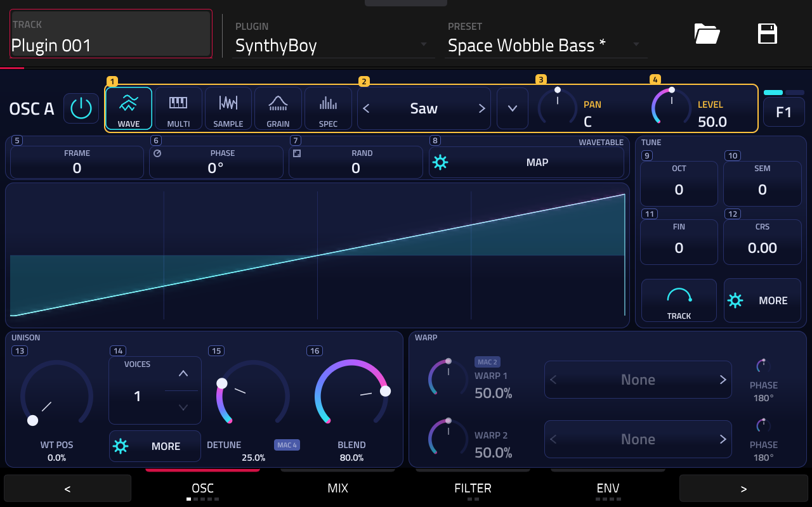

**MPC Key 61 (4 potméter, négy bank).** A négy potméter mindig négy értéket forgat. A **Q-Link** gomb négy bank között léptet: 1. bank = 1 - 4 helyek (az aktív csoport), 2. bank = 5 - 8 helyek, 3. bank = 9 - 12 helyek, 4. bank = 13 - 16 helyek. Ezen az eszközön az inaktív csipek az 1 - 4 számokat mutatják a bankhoz viszonyítva, így látható, melyik csoportba vezet az adott bank. A gazdarendszer fülenként megjegyzi a bankot.
(Standalone OS User Guide, "Other Features Explained > Q-Links": a Q-Link vezérlők négy bankra vannak osztva, amelyek a Q-Link gombbal válthatók; egy sárga, Q betűvel jelölt doboz keretezi az aktuális Screen-mode vezérlőt.)

**Léptetett célpontok (Stepped targets)** (kapcsolók, listák, egész számú léptetők, pl. polifónia): a Q-Link nem folyamatosan fut végig rajtuk az elfordulási útja 0-tól 100 százalékáig. A potméter **egy lépést mozdul kis elfordításonként**: a lista egy értékét, vagy a kapcsolót. Egy kis elfordítás a potméter 128 kattanásnyi elfordulásából körülbelül 6 kattanást jelent (nagyjából egyhuszad fordulat), így egy teljes lista elérhető egyetlen elfordítással, egy kétállású kapcsoló pedig rövid fordításra átbillen. Az irányváltás újraindítja a számlálást; a lista szélein a léptetés megáll. Egy nagyon gyors tekerés legfeljebb négy lépést mozdít egyszerre.
A finomabb felbontású egész számok (pl. szemcse-sűrűség [grain density], transzponálás félhangokban) nem így vannak léptetve: normál potméterként viselkednek.

**Potméter-kijelzők.** A név, az értékszöveg, a mértékegység és a tárcsapozíció, amelyet az MPC mutat egy potméterhez, annak a valós paraméternek felel meg, amelyet éppen vezérel (például "Filter 1 Cutoff" vagy "Macro 5"). Amikor megváltoztatjuk az aktív csoportot vagy az oldalt, a nevek ezzel együtt változnak. Célpont nélküli potméter esetén a felirat "Q n", és semmi más.

**Key 61 felugró ablak.** A Key 61-en a gazdarendszer egy "Q-Link Status" felugró ablakot jelenít meg a jobb oldalon, ha megérintünk egy potmétert. **Kapcsoljuk ki ezt a funkciót** (Preferences > General > "Show Q-Link Status When Touched"; 8. fejezet). Az XL-en nincs ilyen felugró ablak (a potméterek saját kijelzőkkel rendelkeznek).

### 4.4 USB egér

Egy csatlakoztatott USB egér pontosan úgy működik, mint egy ujj a plugin oldalain. Bármikor bedugható; a rendszer körülbelül két másodpercen belül észleli. A látható egérmutató az MPC saját mutatója, és az MPC továbbra is megkap minden egéreseményt.

- **Bal gomb = érintés.** A lenyomás és húzás úgy működik, mint a képernyőn: egy potméter lenyomása és húzása relatív módon forgatja azt (függőleges húzás; a teljes tartomány 200 pixel alatt, akár az ujjnál). **A potméter ívére történő kattintás nem ugrasztja az értéket** a mutató helyére, pontosan úgy, ahogyan a gyári felület sem teszi.
- **Görgő = Q-Link lépések** a mutató alatti vezérlőre, lenyomás nélkül. Egy rovátka a potméteren vagy sávon egy Q-Link lépésnek felel meg (a tartomány 1/128-a); számmezőn vagy fel/le léptetőn egy teljes lépést jelent (az elfelé görgetés a következő értékre lép). Listán az elfelé görgetés felfelé mozgat a listában. A Mod oldalon a görgő a sorokat görgeti ott, ahol nincs vezérlő a mutató alatt. Egy egyszerű nyomógomb nem fogad görgőlépést. Amíg egy ujj le van téve a képernyőre, a rendszer figyelmen kívül hagyja a görgőt.
- A többi egérgomb az MPC-hez tartozik. Két egér esetén azé a mozdulat, amelyiknek a gombját először nyomták le.
- Ahol a gazdarendszer saját képe átlátszik (a gazdarendszer egy felugró ablaka, vagy a Key 61 Q-Link felugró ablakához kivágott rész), a plugin oldalai nem fogadnak egérbemenetet, pontosan úgy, ahogy érintést sem.

### 4.5 Értékkijelzések

Minden vezérlő a paraméter saját mértékegységében mutatja az értékét. Az oszcillátor, mixer és szűrő oldalakon a panoráma formátuma C, L 35 vagy R 35 (más oldalakon, például az effekteknél, eltérő lehet); a szintek dB-ben vagy százalékban; az idők ms-ban vagy s-ben; a hangolások félhangban (st) vagy centben (ct) jelennek meg.

## 5. Az oldalak

Az alábbi fejezetekben a "tartomány" a `docs/params.json` fájlból származó valós paramétertartományt jelenti; a képernyőn lévő szöveg idézve van nagybetűkkel, ahogyan megjelenik.

### 5.1 Play

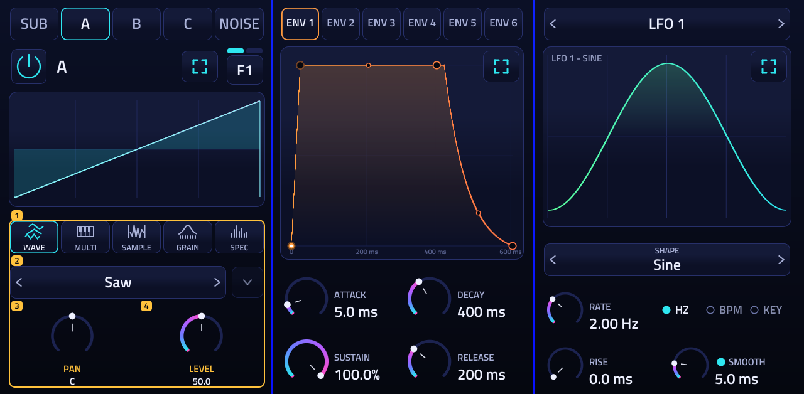

A Play fül EGY oldal: három élő panel egymás mellett, egy **oszcillátor** panel (balra), egy **burkoló (envelope)** panel (középen) és egy **LFO** panel (jobbra). Az első négy Q-Link (potméter) az oszcillátor panelé (típus, tábla vagy OCT, PAN, LEVEL), a következő négy a burkolóé (ATTACK, DECAY, SUSTAIN, RELEASE), a következő négy az LFO-é (SHAPE, RATE, RISE, SMOOTH). Az MPC XL-en mind a tizenkettő egyszerre a potméterekön van, és minden vezérlő a saját potméterének számát viseli. A Key 61-en a sárga keret jelöli az éppen aktív négy potmétert; egy másik panel vezérlőjének megérintése hozza a csoportját a négy potméterre (a többi sorban követi), a többihez a Q-Link bank gombok szolgálnak. Minden panel tetején egy választó van: középen az aktuális elem, két oldalán a szomszédai (egy érintéssel lépünk rá, vagy végighúzással), a névre koppintva megnyílik a lista. A kikapcsolt oszcillátor szürkén látszik (a bekapcsoló gomb piros).
Ez a felület való a játékra és az azonnali finomhangolásra: a három leggyakrabban használt elem fő vezérlői egyetlen nézetben érhetők el.

A Play oldal elrendezése:
- **Nincsenek fül-sorok:** A navigációt egyetlen választó biztosítja a képernyő mindegyik harmadában.
- **Nyilas léptetés, koppintásra nyíló lista:** Használd a nyilakat a léptetéshez, vagy koppints a névre a Sub, Osc A/B/C, Noise, Envelopes 1–6, LFOs 1–10 és R1–R4 teljes választási listájának megnyitásához.
- **Egységes kijelzőmagasság:** Mindhárom kijelző azonos magasságú és felül igazított. Mindegyik kijelző rendelkezik egy fejlécsávval a címével és gombjaival (bekapcsolás, útválasztás, teljes képernyő); a rajzolt tartomány a sáv alatt helyezkedik el.

Az LFO panel a csoportjával (SHAPE, RATE, RISE, SMOOTH: XL-en a 9–12. Q-Link):

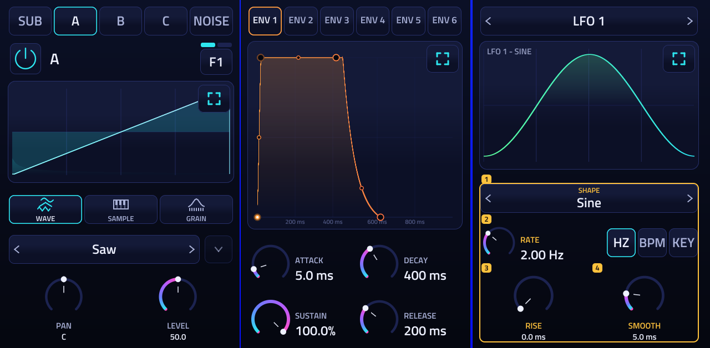

**Oszcillátor panel.**

| Vezérlő | Mit csinál |
|---|---|
| Forrásválasztó (Sub, Osc A, Osc B, Osc C, Noise) | Kiválasztja, melyik hangforrást mutatja és szerkeszti a panel (a projekttel együtt mentődik). A nyilak léptetnek, koppintásra megnyílik az ötös lista. |
| Bekapcsológomb és név | Be- és kikapcsolja a megjelenített forrást; a kijelző fejlécsávjának bal szélén található. A kikapcsolt forrás képe halványan jelenik meg egy kis OFF felirattal (lásd: 5.3). |
| Útválasztó gomb (Route button: F1 / F2 / F12 / M / DIR / BAL / OFF) | Koppintásra megnyitja az adott oszcillátor kimeneti felugró ablakát (célpont, balance, BUS 1, BUS 2); a kijelző fejlécsávjában található a teljes képernyő gomb bal oldalán. A Sub oszcillátornak itt nincs útválasztó gombja; az útválasztása a saját oldalán található (5.4). |
| Kijelző + teljes képernyő gomb | A kijelző rendelkezik egy fejlécsávval a bekapcsológombbal, a forrás nevével, az útválasztó gombbal és a teljes képernyő gombbal (négy sarokzárójel); az oszcillátor egyetlen ciklusa a sáv alatt jelenik meg. A teljes képernyő gomb megnyitja a teljes képernyős oszcillátor-oldalt (5.3 / 5.4 / 5.5 fejezet). |
| Típusgombok: WAVE / MULTI / SAMPLE / GRAIN / SPEC | Az oszcillátor típusa (hullámtábla, multiminta, hangminta, granuláris, spektrális), a kijelző alá rendezve. Q 1. |
| Forrásléptető és a listagomb | A hullámtábla neve (fájlból betöltött táblánál a fájl címe) vagy a betöltött fájl neve. Mindkettő megnyitja a hullámtábla-böngészőt (vagy a tartalomböngészőt); kompakt nézetből először a teljes képernyő nyílik meg. Q 2. |
| PAN | -100 .. +100 százalék (C, L n, R n). Q 3. |
| LEVEL | 0 .. 100 százalék. Q 4. |

A Sub és a Noise más vezérlőkkel rendelkezik (hullámforma, oktáv; zaj színe, szűrő): lásd az 5.4 és 5.5 fejezetet.

**Burkoló panel (Envelope panel).** A felső választó az **Env 1 .. Env 6** közötti burkolót választja ki (a nyilak léptetnek, koppintásra megnyílik a lista). A kijelző fejlécsávval rendelkezik a burkoló nevével és a jobb oldalon lévő teljes képernyő gombbal; a burkológörbe grafikonja a sáv alatt jelenik meg. A kijelző alatt találhatók az ATTACK, DECAY, SUSTAIN, RELEASE potméterek (az XL-en a Q 5–8). A grafikon itt mindig a panelhez illeszkedik; a zárolás és az idővonalzó a teljes oldalon található. Részletek az 5.8 fejezetben.

**LFO panel.** A felső választó az **LFO 1 .. LFO 10** vagy **RND 1 .. RND 4** elemet választja ki (a nyilak léptetnek, koppintásra megnyílik a lista). A kijelző fejlécsávval rendelkezik a névvel és a jobb oldalon lévő teljes képernyő gombbal; az LFO görbéje a sáv alatt jelenik meg. A kijelző alatt található a SHAPE léptető, a RATE potméter a **HZ / BPM / KEY** listával (három pont, a világító jelzi az üzemmódot), a RISE és a SMOOTH (az XL-en a Q 9–12; az első harmadban az LFO képe mutatja a hullámformát és a pozíciót). A SMOOTH neve előtt egy LED található: ez a simítás kapcsolója, a potméter pedig az idejét állítja be (a potméter halvány, amíg a LED ki van kapcsolva). Részletek az 5.9 fejezetben.

**Teljes képernyő.** A teljes képernyő gomb megnyitja az adott elem oldalát a teljes plugin-területen (ugyanaz az oldal, mint a megfelelő Osc, Env vagy LFO fül, egy CLOSE gombbal). A Play fül elhagyásakor ez bezáródik.

### 5.2 Macros (Makrók)

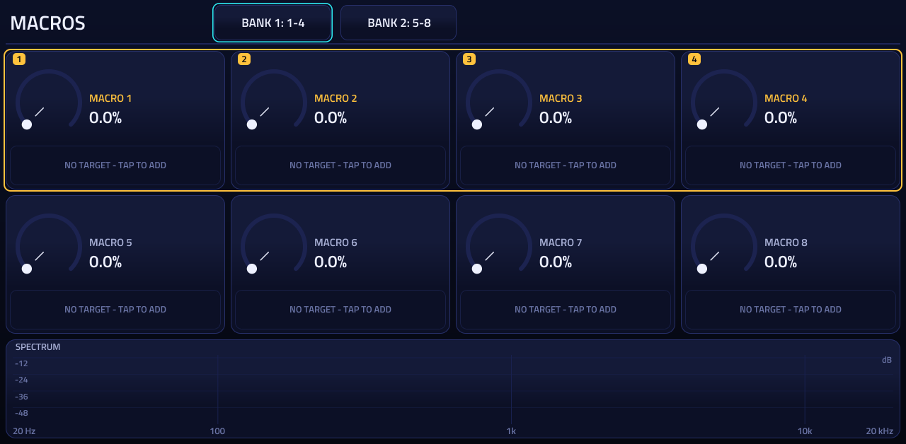

Nyolc makró kártyaként elrendezve, két négyes sorban, alattuk a plugin kimenetének élő spektrumával. A makró egyetlen olyan potméter, amely tetszőleges számú hozzárendelt paramétert mozgat egyszerre: kiváló módja annak, hogy egy komplett hangzásbeli változtatást egyetlen Q-Linkre helyezzünk.
A **BANK 1: 1-4 / BANK 2: 5-8** lista (a világító pont jelzi a bankot) kiválasztja, melyik sor legyen az aktív Q csoport (sárga keret).

- Minden kártya: egy potméter (neve MACRO n, értéke 0 .. 100 százalék, alapértelmezett: 0) és csipek, amelyek megnevezik, hogy a makró mit vezérel. A célpont nélküli kártyán a felirat: "NO TARGET - TAP TO ADD". A csipek területére koppintva megnyílik a makró **célpontoldala (targets page)** (az útvonalak listája mélységgel, UNI/BI polaritással, ON/OFF kapcsolóval és törléssel, valamint az ADD TARGET gombbal; lásd a 6. fejezetet).
- Q-Linkek: Bank 1 = 1 - 4 makrók, Bank 2 = 5 - 8 makrók. A Key 61-en a Q-Link gomb léptet a két sor között; az XL-en a másik sor egyidejűleg az 5 - 8 potmétereken érhető el (4.3 fejezet). A másik sor inaktív számozott csipeket visel (5 - 8 a képen; a kép 16 potméteres eszközhöz van renderelve).
- Minden makró rendelkezik egy **névvel** (legfeljebb 16 karakter, alapértelmezett: "Macro n"), amely a presetben tárolódik. A kártyán a névre koppintva (alá van húzva) megnyílik egy billentyűzetoldal (az OK elmenti a nevet, a CANCEL vagy a BACK elveti); a néven indított húzás továbbra is elforgatja a potmétert. A nevet a Mod oldal, a választók és a potméter-kijelzők is használják.
- **Spektrum** (alsó sáv): a plugin kimenetének spektruma a kimeneti fokozat után (20 Hz-től 20 kHz-ig, -12 és -48 dB közötti skálán). Ez kizárólag kijelzőként szolgál.

### 5.3 Osc A / B / C

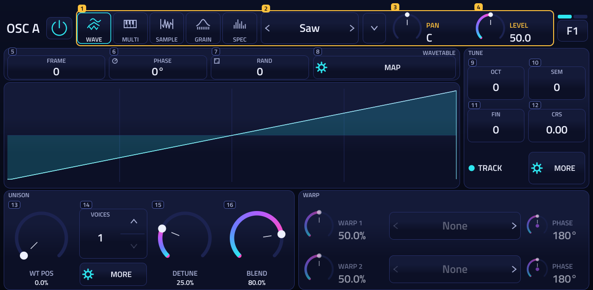

Három azonos oszcillátor (a paraméterlistában Osc A = Osc 1, B = Osc 2, C = Osc 3). Az oldal egyetlen oszcillátor teljes képernyős oldala. Mindegyik oszcillátor **öt típus** egyike lehet, amelyet a felül található öt gombbal választhatunk ki: **WAVE** (hullámtábla), **MULTI** (multimintás hangszer), **SAMPLE** (egyetlen hangminta), **GRAIN** (granuláris) és **SPEC** (spektrális). Minden, ami egy oszcillátoron beállítható, elérhető az oldalon vagy annak valamelyik részletező oldalán, valamint a Q-Linkekről.

A kép 16 potméteres eszközhöz van renderelve: a kis számok a Q-Link potmétereket jelzik (1 - 4 a sárga csoport, 5 - 16 a következő csoportok, 4.3 fejezet). A Key 61-en ugyanez az oldal 1 - 4 számokat mutat az inaktív csoportokon.

**Fejléc** (balról jobbra): a név (OSC A), a bekapcsológomb, az öt **típusgomb**, a forrásléptető a listagombbal, **PAN**, **LEVEL** és az **útválasztó gomb (route button)**.

| Vezérlő | Paraméter és tartomány | Megjegyzések |
|---|---|---|
| Power (Bekapcsoló) | Osc N On, Off/On | A kikapcsolt oszcillátor az aktuális tartalmának (hullámtábla, minta vagy spektrum) képét sötét fátyol alatt, halványan jeleníti meg egy kis **OFF** címkével a kijelző sarkában. Soha nem mutat üres kijelzőt. |
| WAVE | Osc N Type = Wavetable | |
| MULTI | Osc N Type = Multisample | |
| SAMPLE | Osc N Type = Sample | |
| GRAIN | Osc N Type = Granular | |
| SPEC | Osc N Type = Spectral | |
| Forrásléptető (WAVE) | Osc N Wavetable, 15 választás: Sine, Saw, Square, Triangle, Pulse 25%, Saw to Square, Sine to Saw, Harmonic Series, Odd Harmonics, Formant Sweep, FM Sweep, PWM Sweep, Bell Partials, Preset table, Saw Down; vagy a fájlból betöltött tábla címe | A névre vagy a listagombra koppintva megnyílik a **wavetable-böngésző**: kategóriák (Basic, Morph, a telepített csomagok kategóriái, a saját mappáid, User) és a táblák listája, az aktuális tábla megjelölve. A külső negyedek (és a Q-Link potméter) a beépített táblákat léptetik; ha a tábla fájlból való, akkor a kategóriája előző / következő fájljára lépnek (a végpontokon nincs körbefordulás). Saját táblák hozzáadásához másolj WAV fájlokat az SD-kártya, egy USB-meghajtó vagy a plugin saját Content mappájának `SynthyBoy/Wavetables/<Kategória>/` könyvtárába (lásd alább és: [factory-content.md](../factory-content.md)). Q 2. |
| Forrásléptető (egyéb típusok) | a betöltött fájl vagy hangszer | A névre vagy a listagombra koppintva megnyílik a **tartalomböngésző (content browser)** (lásd lentebb). |
| PAN | -100 .. 100 százalék, alapértelmezett: 0 | Q 3 |
| LEVEL | 0 .. 100 százalék, alapértelmezett: 50 | Q 4 |
| Route gomb | Osc N Destination: F1, F2, F12 (Filters 1+2), M (Effects only), DIR (Direct out), BAL (Filter blend), OFF (None) | Megérintve megnyílik a kimeneti ablak: célpont, balance (Osc N Filter Blend, 0 .. 100 százalék, csak a Filter blendnél), BUS 1 és BUS 2 küldések (0 .. 100 százalék). Alapértelmezett: F1. |

**Kijelző.** Egyetlen ciklus abból, amit az oszcillátor éppen előállít, beleértve a warp és unison hatását; egy halvány rétegsor mutatja a hullámtábla hullámformáit (frames), ha azok eltérnek. Az unison hangok vékony vonalként jelennek meg a fő görbe körül. A sample, grain és spectral oszcillátorok saját képet rajzolnak (a minta a tartományával és loopjával, a szemcsék sávokként rajta, illetve a spektrum).

**TUNE blokk (Hangolás)** (jobbra). OCT (egész oktávok, -4 .. +4), SEM (-11 .. +11 félhang; a teljes transzponálás 12 x OCT + SEM, +-48-ra korlátozva), FIN (finomhangolás, -100 .. +100 cent), CRS (durva hangolás, -48 .. +48 félhang, két tizedessel kijelezve), **TRACK** (LED kapcsoló: billentyűzetkövetés, alapértelmezés szerint bekapcsolva; kikapcsolva az oszcillátor nem követi a billentyűzetet) és **MORE** (a beállítási oldal, lásd lentebb).

**UNISON blokk** (balra lent). Az első potméter (WT POS hullámtábláknál, TIMBRE a MULTI-nál, SCAN a SAMPLE és GRAIN esetén, POSITION a SPEC típusnál), VOICES (1 .. 16 hang, a felső vagy alsó fél megérintésével), a **MORE** fogaskerék gomb (az unison oldal), DETUNE (0 .. 100 százalék, alapértelmezett: 25), BLEND (0 .. 100 százalék, alapértelmezett: 80). A több hang szélesebb, vastagabb hangzást eredményez. **Az, hogy valójában hány unison hang szólal meg, az eszköztől függ (7.1 fejezet).**

**WARP blokk** (jobbra lent). Két sor, **WARP 1** és **WARP 2**: egy potméter a mértékhez (0 .. 100 százalék, alapértelmezett: 50), egy léptető a típushoz (99 típus, a "None" a kikapcsolt állapot, ekkor a sor halvány; a névre koppintva megnyílik a lista) és egy kis **PHASE** (fázis) potméter (0 .. 360 fok, alapértelmezett: 180) az adott warphoz.
A warp meghajlítja a hullámot időben vagy szintben; két egymás utáni warp jóval több hullámformát tesz lehetővé, mint egyetlenegy. A warp mértéke és típusa a leghatásosabb vezérlő a karakter megváltoztatására.

**Unison oldal** (MORE gomb az unison dobozban):

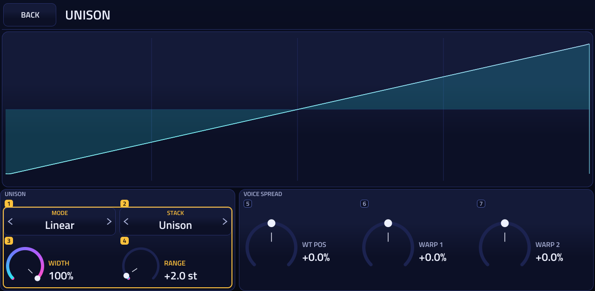

UNISON blokk: MODE (Linear, Super, Exp, Inv, Random), STACK (Unison, Center Drop 12, Center Drop 24, Octaves, Two Octaves, Power Chord, Two Power Chords, Major Chord, Minor Chord, Harmonic Series, Odd Harmonics), WIDTH (sztereó szélesség, 0 .. 100 százalék), RANGE (0 .. 48 félhang, alapértelmezett: 2). VOICE SPREAD blokk: WT POS, WARP 1, WARP 2 (mindegyik -100 .. +100 százalék: mennyire tér el a hullámforma és a két warp hangról hangra). A blokkok feletti kép az oszcillátor képe. SAMPLE, GRAIN és SPEC esetén az oldalon megtalálható a START és SPAN is (hol kezdődnek a hangok a fájlban, és milyen távol vannak egymástól). A BACK visszalép.

**Egy vezérlő modulációs oldala** (hosszú nyomás egy potméteren vagy számmezőn). Egy olyan vezérlő, amelyet még semmi sem modulál, a **forrástáblát (source board)** nyitja meg: mind az 57 forrás csipként jelenik meg, egyetlen koppintással létrehozható a moduláció. Ha már léteznek modulációk, az oldal listázza őket (forrás, mélységsáv, UNI/BI, ON/OFF, eltávolítás), alattuk egy kompakt hozzáadási sorral (6. fejezet).

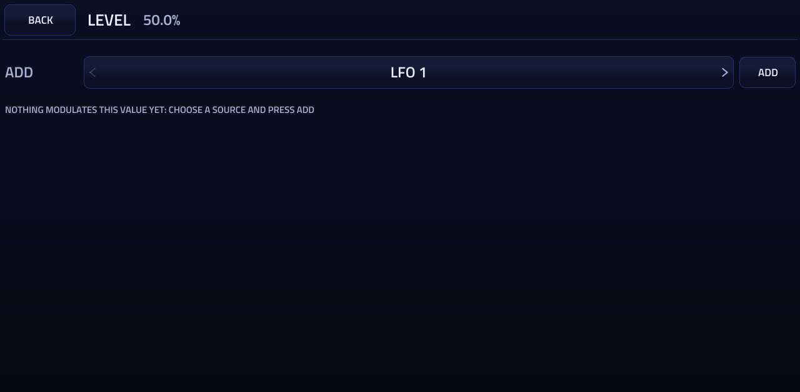

**Az oldal Q csoportjai** (olvasási sorrendben, minden csoport négy potméter): a fejléc (típus, forrás, PAN, LEVEL), a típus saját sávja (WAVE: FRAME, PHASE, RAND, MAP), Tune (OCT, SEM, FIN, CRS), Unison (az első potméter, VOICES, DETUNE, BLEND), majd a warp sorok.

#### Az öt típus

**WAVE (hullámtábla).** A kijelző feletti sáv elemei: FRAME (az éppen szóló hullámforma sorszáma; csak kijelzés, a frame-et a WT POS állítja vagy modulálja), PHASE (kezdőfázis, 0 .. 360 fok), RAND (véletlenszerű kezdőfázis, 0 .. 100 százalék) és **MAP**, amely megnyitja a FRAME MAP oldalt.

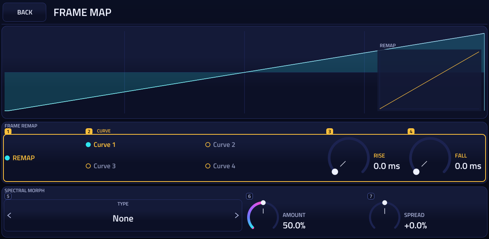

*FRAME MAP* (amit a kép mutat): a FRAME REMAP blokk tartalmazza a **REMAP** LED kapcsolót, a **CURVE** listát (Curve 1 .. Curve 4) és a **RISE** valamint **FALL** potmétereket (milliszekundumban, a remap bekapcsolt állapotában aktívak). Az újraképezési görbe a kijelzőre van rajzolva (a narancssárga vonal). A SPECTRAL MORPH blokk elemei: TYPE (None, Vocode, Formant Scale, Harmonic Stretch, Inharmonic Stretch, Smear, Random Amplitudes, Low Pass, High Pass, Phase Disperse, Shepard Tone, Time Skew), AMOUNT és SPREAD.
A remap segítségével megváltoztatható, hogyan fusson végig a hullámtábla-pozíció a táblán; a morph segítségével pedig átformálhatók az egyes hullámformák felharmonikusai.

#### A wavetable-böngésző (hullámtáblák betöltése)

A SynthyBoy az érintőképernyős kezelőfelületén egy egységes, teljes képernyős böngészőt kínál a hullámtáblák böngészéséhez és betöltéséhez.

**A böngésző megnyitása:**
1. Válasszuk ki az oszcillátor fület (**Osc A**, **Osc B** vagy **Osc C**), és állítsuk a típust **WAVE**-re.
2. Érintsük meg a hullámtábla nevét a forrásléptető mezőben (vagy a mellette lévő listagombot). Ez elérhető az Osc A / B / C teljes képernyős oldalain, valamint a Play oldal oszcillátor-harmadában (a kompakt nézetben) is — a Play oldalról megérintve először a teljes képernyős felület tárul fel.
3. A wavetable-böngésző egy kétszintű listaként nyílik meg a teljes plugin-terület felett (56 képpont magas sorokkal).
4. Mindig az éppen megszólaló hullámtábla **kategóriájában** nyílik meg, és az adott tábla ki van jelölve a listában (a beépített tábla a sorszáma alapján, a fájlból betöltött tábla a csomagja és elérési útja szerint).
5. A fejlécben az aktuális kategória neve látható egy balra mutató vissza-nyíllal: erre koppintva léphetünk fel a kategóriák főlistájához (fejléc: "WAVETABLES", a kategórianevek után kis háromszöggel), ahol bármely kategóriát megérintve megnézhetjük az abban található hullámtáblákat.

**Kategóriák a böngészőben:**
- **Basic**: a hat beépített, egyetlen ciklusból álló alap-hullámforma (Sine, Saw, Square, Triangle, Pulse 25%, Saw Down).
- **Morph**: a nyolc beépített, 64 képkockából álló morfózis-hullámtábla (Saw to Square, Sine to Saw, Harmonic Series, Odd Harmonics, Formant Sweep, FM Sweep, PWM Sweep, Bell Partials).
- **Csomag-kategóriák (pack categories)**: a telepített hullámtábla-csomagok (például a gyári csomag: `com.safian.synthyboy.factory-wavetables`) kategóriái, mint az Analog, Digital, Spectral, Vocal, Metallic, Noise (lásd a 7.4 fejezetet).
- **Saját mappák**: a felhasználó által létrehozott könyvtárak az SD-kártyán, USB-meghajtón vagy a belső tárhelyen.
- **User**: a közvetlenül a gyökér `SynthyBoy/Wavetables/` mappába helyezett WAV fájlok gyűjtőhelye.
- *Kategóriák összefésülése és sorrendje:* Az azonos nevű kategóriákat (kis- és nagybetűktől függetlenül) a csomagok és a felhasználói mappák között a böngésző automatikusan egyetlen kategóriává vonja össze. A kategóriák sorrendje rögzített: elöl a **Basic**, utána a **Morph**, ezt követik a további csomag- és felhasználói kategóriák ábécérendben, a sor legvégén pedig a **User** kategória áll. Egy kategórián belül először a beépített táblák szerepelnek a megszokott sorrendjükben, majd a fájlok következnek címük szerint ábécérendben.

**Tábla kiválasztása, háttérbeli betöltés és a sárga állapotjelző:**
- Érintsünk meg egy táblát a listában a megszólaltatásához.
- A beépített táblák azonnal betöltődnek, és a böngésző ablaka bezárul.
- A csomagból vagy saját fájlból származó táblát a háttérben olvassa be és dekódolja a megjelenítő szál (felépítve az FFT spektrumokat és a szinteket).
- Amíg a háttérbeli betöltés folyamatban van, az oldal tetején megjelenik a **sárga színű állapotjelző sáv (amber bar)**.
- **Zökkenőmentes váltás:** a korábban játszott hullámtábla folyamatosan és megszakítás nélkül szól mindaddig, amíg az új tábla teljesen el nem készül és publikálásra nem kerül. Nem keletkezik hangkimaradás, némulás vagy közbenső fűrészhullám-ugrás.
- Amikor az új tábla készen áll, a motor átvált rá, és a forrásléptető mező megjeleníti a fájl címét.
- Gyors egymásutánban leadott érintéseknél mindig a legutolsó kérés érvényesül.

**Képkockák (frames) és a WT POS:**
Egy hullámtábla egymást követő ciklusokból, úgynevezett **képkockákból (frames)** áll. Ezek között a **WT POS** (hullámtábla-pozíció) potméterrel vagy modulációval (LFO, burkoló, leütési dinamika, makró) pásztázhatunk végig folyamatosan az első kockától az utolsóig. Az egyetlen képkockából álló táblák önálló egyszeres ciklusok (single cycles).

**Léptetés a nyilakkal és a Q-Link potméterrel (kategórián belül, nincs körbefordulás):**
- Beépített tábla esetén a léptető bal és jobb szélén található nyilak (valamint a hozzárendelt Q-Link potméter, Q 2) a 15 beépített választás között léptetnek (a Preset table opciót a rendszer átugorja, amíg nincs fájl betöltve).
- Fájlból betöltött táblánál a nyilak és a Q-Link potméter **ugyanazon kategória előző / következő fájljára** léptetnek (a böngésző listájában elfoglalt sorrend szerint). Így a Q-Link tekerésével vagy a nyilakkal kényelmesen végighallgatható egy teljes kategória minden táblája anélkül, hogy a böngészőt újra meg kellene nyitni.
- A kategória legelső és legutolsó fájljánál **nem történik semmi: nincs körbefordulás (no wrap)**. A megfelelő irányú nyíl elhalványul, amint elértük a kategória határát.
- A beépített táblákhoz való visszatéréshez nyissuk meg újra a böngészőt.
- Ha egy betöltött fájl nem tartozik kategóriához (például egy olyan presetből származik, amelynek csomagja nincs telepítve a gépen), a léptetés a beépített táblákon mozog tovább.

**Használhatatlan vagy érvénytelen fájlok:**
Ha egy fájl nem használható hullámtáblaként (túl nagy, üres, hibás adatszerkezetű vagy nem támogatott formátumú):
- A böngésző listájában a fájl sora kiírja az elutasítás pontos okát (például: "not a wavetable file: ..."), és a fájl nem választható ki.
- A képernyő felső részén négy másodpercig megjelenik a hibaüzenet ("not a wavetable file: <ok>").
- **A hangzás és az oszcillátor állapota változatlan marad**, semmilyen nemkívánatos megszakadás vagy némulás nem történik.

#### Saját hullámtáblák hozzáadása

Saját WAV hullámtábla-fájlokat egyszerű fájlmásolással adhatunk a hangszerhez.

**A három mappa:**
Másoljuk a kívánt WAV fájlokat a **`SynthyBoy/Wavetables/`** könyvtárba az alábbi három hely valamelyikén:
1. Az **SD-kártya** legfelső szintjén: `/sdcard/SynthyBoy/Wavetables/`
2. Egy csatlakoztatott **USB-meghajtó** legfelső szintjén: `<meghajtó>/SynthyBoy/Wavetables/` (az MPC fájlrendszerében a `/media/<meghajtó>/SynthyBoy/Wavetables/` útvonalon)
3. A plugin saját belső **`Content`** mappájában: `Content/SynthyBoy/Wavetables/` (közvetlenül a plugin VST mappája mellett; SD-kártya és USB-meghajtó nélküli gépeken, a belső tárhelyre másolt pluginnál így adhatók hozzá fájlok).

Ha a könyvtár még nem létezik, hozzuk létre. Az Akai MPC belső "MPC Documents" mappáját a plugin nem pásztázza: a fájlokat az SD-kártyára, USB-meghajtóra vagy a plugin Content könyvtárába helyezzük.

**Mappaszerkezet és kategóriák:**
- A közvetlenül a `SynthyBoy/Wavetables/` gyökérmappába másolt WAV fájlok a **User** kategóriában jelennek meg a böngészőben.
- A `SynthyBoy/Wavetables/` mappán belül létrehozott almappák önálló **kategóriákká** válnak a mappa nevével megegyezően, és a bennük lévő WAV fájlok alkotják az adott kategória tábláit (például a `SynthyBoy/Wavetables/Pads/` almappa tartalma a "Pads" kategóriába kerül).
- A rendszer kizárólag **egyetlen almappaszintet** olvas be: a mélyebbre ágyazott almappákat és azok fájljait figyelmen kívül hagyja.
- A ponttal kezdődő rejtett fájlok és könyvtárak figyelmen kívül maradnak.
- Ha ugyanaz a mappanév létezik az SD-kártyán és az USB-meghajtón is, a böngésző egyetlen közös kategóriává fésüli össze őket.

**Dinamikus beolvasás (nincs indexelés, nincs újraindítás):**
A böngésző nem igényel külön indexfájl létrehozását vagy az MPC újraindítását: a böngésző **minden megnyitásakor újra beolvassa** a meghajtók aktuális tartalmát. A tárhelyre felmásolt új hullámtáblák a böngésző következő megnyitásakor azonnal megjelennek.

**Presetek hordozhatósága és a hiányzó fájlok kezelése:**
Egy saját fájlt használó preset a mappanév, a fájlnév és egy SHA-256 ellenőrzőösszeg alapján jegyzi meg a hullámtáblát. Ha a projektet átvisszük egy másik MPC-re, és azon ugyanez a fájl megtalálható ugyanolyan mappanéven a támogatott gyökérkönyvtárak bármelyikében, a hangzás pontosan azonos marad.
Ha a hivatkozott fájl hiányzik (vagy ellenőrzőösszege nem egyezik), az oszcillátor automatikusan egy tiszta **fűrészhullámra (saw)** áll vissza, a kijelzőn pedig megjelenik a "content missing: <fájlnév>" figyelmeztetés.

**Támogatott WAV fájlformátumok és követelmények:**
- Szabványos RIFF/WAVE formátum.
- **Mono** csatorna (ha sztereó fájlt töltünk be, a plugin automatikusan a bal csatornát használja hullámtáblaként).
- Mintamélység: 16, 24 vagy 32 bites egész (PCM), illetve 32 bites lebegőpontos (IEEE float), akár kiterjesztett (extensible) fejléccel is. Tetszőleges mintavételezési frekvencia támogatott.
- Fájlméret: legfeljebb **16 MB** (`kMaxWavetableFileBytes`).
- Hagyományos hullámtábla-szerkezet: **N darab 2048 mintás képkocka egymás után fűzve**, legfeljebb 256 képkockáig (a 256 feletti képkockákat a rendszer levágja).
- Más szintetizátorok által használt formátumok: a `clm ` metaadat-blokkot (a `<!>1024 ...` vagy hasonló formátumot, 64-től 8192 mintáig) tartalmazó fájloknál a plugin az abban rögzített képkockaméretet veszi alapul, és köbös újramintavételezéssel automatikusan 2048 minta / képkocka méretre konvertálja.
- Egyszeres ciklusú hullámformák (single cycles): azok a 16 és 4096 minta közötti fájlok, amelyek hossza nem 2048 egész számú többszöröse, egyetlen ciklusnak (single cycle) minősülnek, és a motor egyetlen 2048 mintás képkockává nyújtja őket.
- Nem támogatott fájlok: a 16 mintánál rövidebb adatok, a 4096 mintánál hosszabb, de nem 2048 többszörösét kitevő sima hangminták (`clm ` blokk nélkül), az érvénytelen `clm ` méretek, a 8 bites, ADPCM tömörített vagy 64 bites lebegőpontos hangok, a kettőnél több csatornás fájlok, a sérült vagy hiányos adatszeletek, az üres fájlok, a 16 MB-nál nagyobb méret, valamint a nem WAV formátumok (FLAC, MP3). Ezeket a rendszer nem fogadja el hullámtáblaként, és pontos hibaüzenettel elutasítja.

**Csomagok (Content packs):**
A `Content/packs/<csomag>/` mappában elhelyezett, `wavetables` típusú `contentpack.json` leíróval ellátott csomagok szintén megjelennek a böngészőben: a fájlokat a manifesztben megadott `category` mező (ennek hiányában a mappa neve) rendezi kategóriákba, a megjelenített nevet pedig a `title` határozza meg.

**Technikai korlátok:**
- Legfeljebb 32 csomag.
- Legfeljebb 1024 fájl csomagonként (manifesztenként).
- Legfeljebb 512 könyvtárbejegyzés mappánként (a fájlrendszer által visszaadott első 512 elem, névsorba rendezve).
- Legfeljebb 64 kategóriamappa gyökérenként.
- Legfeljebb 96 kategória összesen.
- Legfeljebb 4000 hullámtábla-fájl a teljes rendszerben.
- A fájlnevek nem tartalmazhatnak kettőspontot (`:`), fordított perjelet (`\`), és hosszuk legfeljebb 255 bájt lehet.

**MULTI (multimintás hangszer).** A forrás egy hangszerfájl (SFZ, vagy egy WAV, amely egyzónás hangszerré válik). Betöltött fájl nélkül a kijelző a NO SAMPLE feliratot és egy **LOAD INSTRUMENT** gombot mutat, amely megnyitja a tartalomböngészőt. A sávon található: **ENV** (megnyitja a multiminta burkoló oldalát: DELAY, ATTACK, HOLD, DECAY, SUSTAIN, RELEASE és az OVERRIDE kapcsoló, amely engedi, hogy ez a burkoló felülírja a hangszer sajátját), a **VEL TRK** LED kapcsoló az AMOUNT (0 .. 100) értékével és RAND (véletlen kezdőfázis). Az unison dobozban a TIMBRE (-100 .. +100 százalék) található.

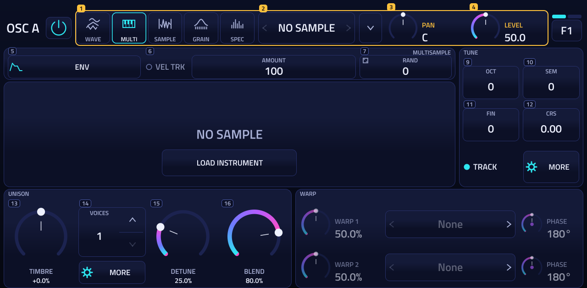

**SAMPLE (egyetlen hangminta).** A kijelző megjeleníti a hangmintát a tartomány START és END jelölőivel. A sávon található a PHASE, **REGION** (megnyitja a SAMPLE REGION oldalt), **SLICE** (megnyitja a SAMPLE SLICES AND SCAN oldalt) és az unison szám; az unison dobozban lévő potméter a SCAN. Betöltött fájl nélkül a **LOAD SAMPLE** gomb megnyitja a tartalomböngészőt.

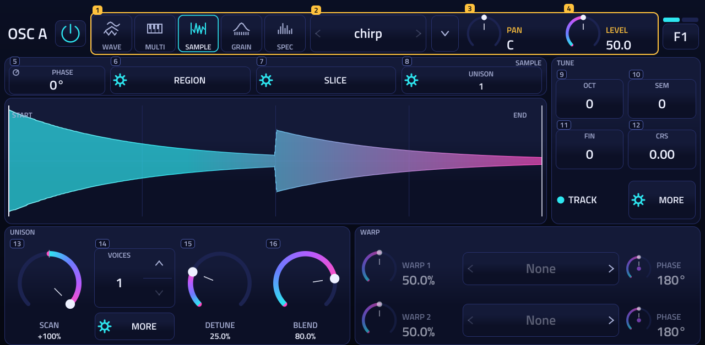

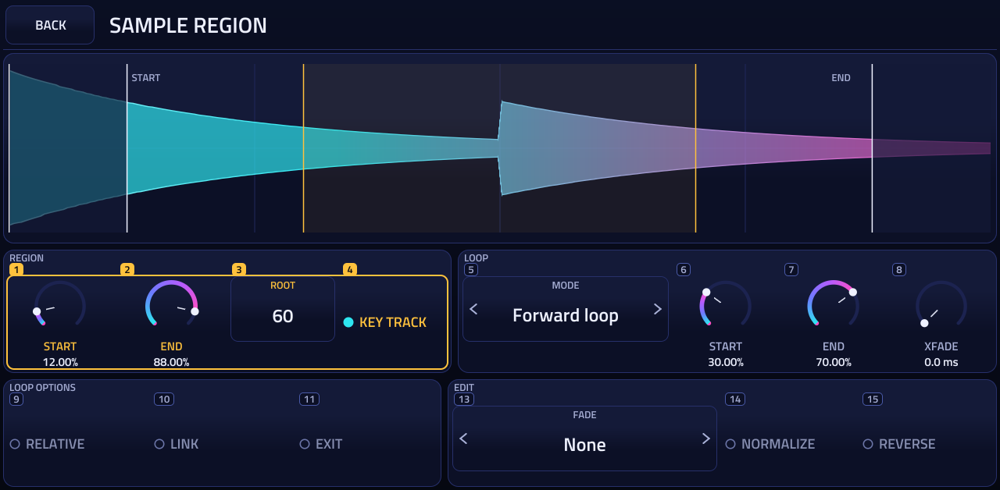

*SAMPLE REGION*: REGION blokk (a megszólaló rész START és END pontja, ROOT alaphang, amely a billentyűzetkövetés bekapcsolt állapotában látható, és a KEY TRACK kapcsoló); LOOP blokk (MODE: One-shot, Forward loop, Reverse loop, Forward/reverse loop, Tailed; a loop START, END és XFADE értéke, bekapcsolt loop mód esetén); LOOP OPTIONS blokk (RELATIVE, LINK = a loop hosszának összekapcsolása, EXIT = kilépés a loopból felengedéskor; loop közben látható); EDIT blokk (FADE szélek: None, 1 ms .. 128 ms; NORMALIZE; REVERSE).

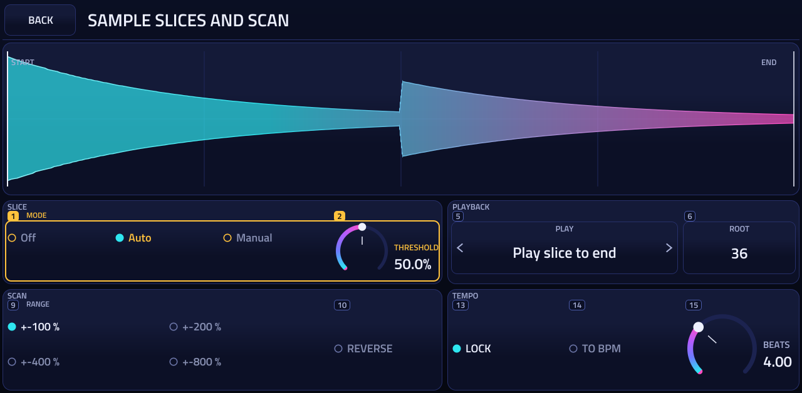

*SAMPLE SLICES AND SCAN*: SLICE blokk (MODE: Off, Auto, Manual; THRESHOLD Auto módban; a szeletválasztó Manual módban); PLAYBACK blokk (PLAY: Play slice to end vagy Play single slice, és a szelet ROOT alaphangja; szeleteléskor látható); SCAN blokk (RANGE +-100 %, +-200 %, +-400 %, +-800 % és REVERSE: mekkora tartományban mozgathatja a SCAN gomb a beolvasási pozíciót); TEMPO blokk (LOCK a tempóhoz, TO BPM, és a hosszúság BEATS-ben, ha valamelyik be van kapcsolva).

**GRAIN (granuláris).** A forrás egy hangminta, amely rövid szemcsék felhőjeként szólal meg. A kijelző mutatja a fájlt; egy keret jelzi, honnan olvasnak a szemcsék. A sávon található a **GRAIN** gomb (megnyitja a GRAIN ENGINE oldalt), **AMOUNT** (a szemcse-ablakozás mértéke az ablak ikonnal), a **LOOP** léptető (One-shot, Loop grains, Manual) és az unison szám. Az alsó blokkok: GRAIN (SCAN, DENS = sűrűség 0.1 .. 1000 Hz, LENGTH 1 .. 4000 ms, WARP menü), PLAYBACK (OFFSET, DIR, PITCH 0 .. 24 félhang) és RANDOM (LEN RAND, PAN RAND, LVL RAND; a hosszúság, panoráma és szint véletlenszerű szórása).
Betöltött fájl nélkül a **LOAD SAMPLE** gomb megnyitja a tartalomböngészőt.

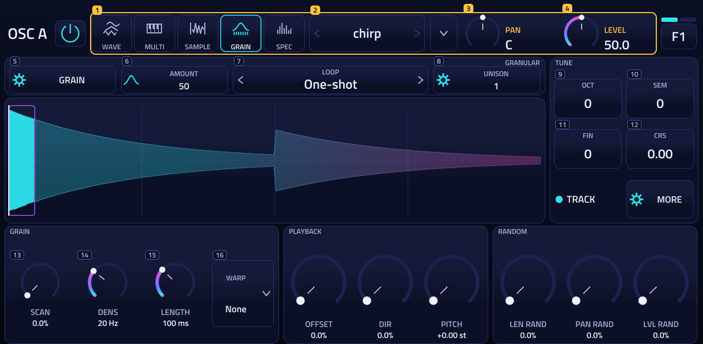

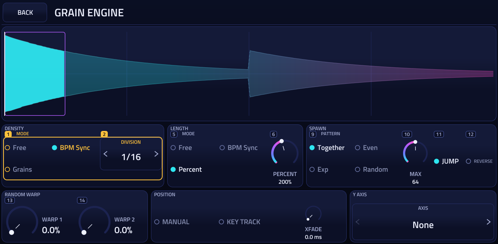

*GRAIN ENGINE*: DENSITY blokk (MODE Free, BPM Sync, Grains; a DIVISION a BPM Sync módban; a szemcsék száma Grains módban); LENGTH blokk (MODE Free, BPM Sync, Percent; division, percent); SPAWN blokk (PATTERN Together, Even, Exp, Random; MAX szemcseszám; JUMP = ugró indítás; REVERSE); RANDOM WARP blokk (WARP 1, WARP 2: véletlen mérték szemcsénként); POSITION blokk (MANUAL, KEY TRACK, XFADE); Y AXIS blokk (AXIS: a függőleges tengelyhez rendelt paraméter, és annak Y pozíciója, ha a tengely be van állítva).

**SPEC (spektrális).** Az oszcillátor egy minta vagy tábla spektrumát szólaltatja meg, és lehetővé teszi annak szűrését és pásztázását. A kijelző maga a spektrum. A sávon található a PHASE, **FILTER** (megnyitja a SPECTRAL FILTER oldalt), **SCAN** (megnyitja a SPECTRAL SCAN oldalt) és az unison szám; az unison dobozban lévő potméter a POSITION. Betöltött fájl nélkül a **LOAD SAMPLE** gomb megnyitja a tartalomböngészőt.

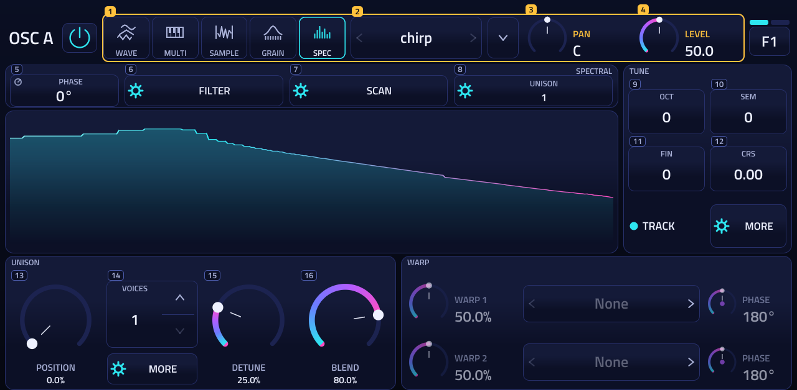

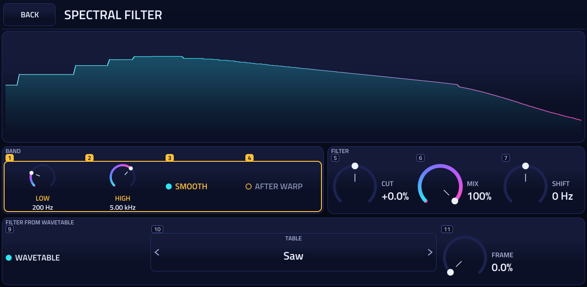

*SPECTRAL FILTER*: BAND blokk (LOW és HIGH vágási él Hz-ben, SMOOTH élek, AFTER WARP = a sáv alkalmazása a warpok után); FILTER blokk (CUT, MIX, SHIFT = frekvenciaeltolás Hz-ben); FILTER FROM WAVETABLE blokk (a WAVETABLE kapcsoló, majd TABLE és FRAME, amelyek a szűrőt formálják).

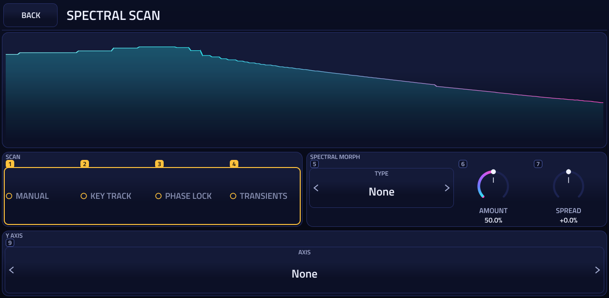

*SPECTRAL SCAN*: SCAN blokk (MANUAL pozíció, KEY TRACK, PHASE LOCK, TRANSIENTS); SPECTRAL MORPH blokk (TYPE, AMOUNT, SPREAD, mint a hullámtábla map oldalán); Y AXIS blokk (AXIS: None, Level, Warp, Warp 2, Spec Flt Cutoff, Spec Flt Wet/Dry, Freq Lo, Freq Hi).

**A tartalomböngésző (content browser).** A MULTI, SAMPLE, GRAIN és SPEC forrása egy fájl. A böngésző listaként nyílik meg: az első sor az aktuális mappa (koppintás: egy szinttel feljebb lépés), majd a mappák, végül a fájlok név szerint rendezve. A gyökérkönyvtárak felül: SD CARD, USB meghajtók (USB és a meghajtó neve formátumban) és PLUGIN CONTENT. A legutóbb betöltött fájl mappájában nyílik meg. Kizárólag WAV és SFZ fájlok választhatók (FLAC nem). Egy SFZ hangszernek saját mappában kell elhelyezkednie, alatta a mintáival. Egy fájl megérintése betölti azt; sikertelenség esetén a "LOAD FAILED" felirat négy másodpercig látható marad.

#### Az oszcillátor beállítási oldala (gomb MORE a tune blokkban)

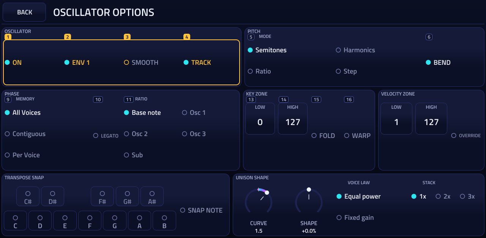

Az oldal nem tartalmaz kijelzőt: a hely hat blokknak ad teret, mindegyik egy-egy négyes Q csoport.

- **OSCILLATOR:** ON (a bekapcsológomb, hogy elérhető legyen a Q-Linkekről), ENV 1 (az Env 1 formálja ezt az oszcillátort), SMOOTH (simított interpoláció), TRACK (billentyűzetkövetés).
- **PITCH (Hangmagasság):** MODE (Semitones, Harmonics, Ratio, Step), BEND (az oszcillátor követi a pitch bendet, LED kapcsoló), és amíg a TRACK ki van kapcsolva, a **FIXED PITCH**: az a MIDI hang, amelyet az oszcillátor megszólaltat bármely billentyű leütésekor (0 az alapértelmezett, ez az oszcillátor saját C3-as hangja).
- **TRANSPOSE SNAP:** a tizenkét hangcella (C-től B-ig, az öt fekete billentyű a felső sorban) határozza meg az oszcillátor által megszólaltatható hangokat. Érintsünk meg egy cellát az engedélyezéséhez vagy tiltásához. A legközelebbi engedélyezett hang nyer; döntetlen esetén lefelé kerekít; ha nincs világító cella, a snap ki van kapcsolva. A **SNAP NOTE** kapcsoló a teljes leütött hangot illeszti a transzponálás helyett. Ez egyetlen billentyűből skálát vagy akkordot hoz létre. A maszkot reprezentáló potméter a Q-Linkeken durva lépésekben állítja azt; a finom szerkesztés érintéssel történik.
- **PHASE (Fázis):** MEMORY (All Voices: PHASE és RAND minden hanghoz, ez az alapértelmezett; Contiguous: a hang a korábbi hang pillanatnyi fázisaival folytatódik; Per Voice: minden hang az előző hangból rögzített fázisokkal indul), LEGATO (egy olyan hang, amely egy még lenyomva tartott billentyű mellett indul, átveszi annak fázisait ahelyett, hogy a PHASE és RAND értékekkel indulna; ez megegyezik a Master oldal PHASE LEG kapcsolójával) és a RATIO forrása (Base note, Osc 1, Osc 2, Osc 3, Sub).
- **KEY ZONE (Billentyűzóna):** LOW és HIGH hang, **FOLD** (a zónán kívüli hang úgy szólal meg, mint az az egy vagy több oktávval távolabbi hang, amely a zónán belülre esik; egy oktávnál szűkebb zóna nem tudja felvenni és néma marad) és **WARP** (a zónáján kívül az oszcillátor továbbra is fut a többi oszcillátor warp-forrásaként, de nem hallható és nem szerepel a mixer-sávokon).
- **VELOCITY ZONE (Dinamikazóna):** LOW és HIGH velocity és OVERRIDE.
- **UNISON SHAPE:** CURVE (detune görbe) és SHAPE (blend görbe), VOICE LAW (Equal power vagy Fixed gain: hogyan van súlyozva a hangok keverése) és STACK ismétlés (1x, 2x, 3x).

Azok a vezérlők, amelyek az aktuális állapotban nem érvényesek, rejtve maradnak (például a FIXED PITCH, amíg a TRACK be van kapcsolva), és a többiek veszik át a helyüket.

### 5.4 Sub

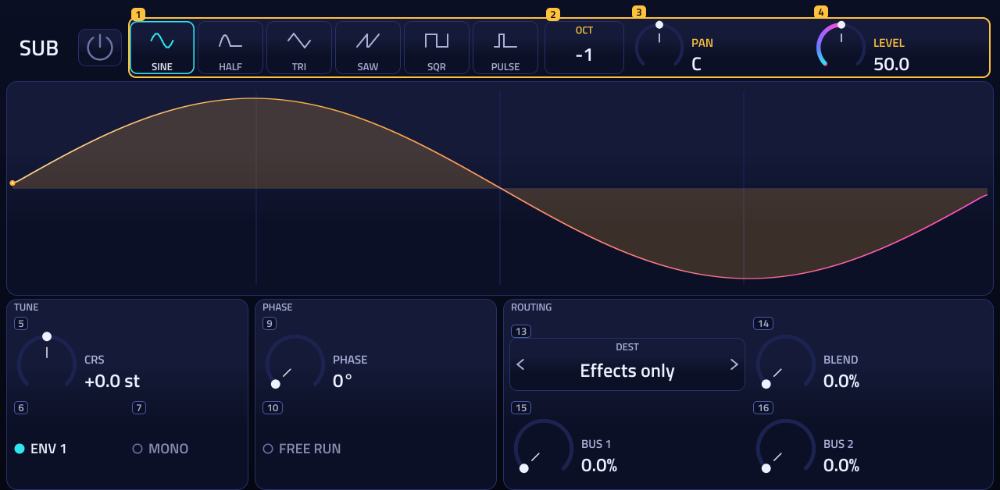

A szuboszcillátor: egyszerű hullámforma a mély tartomány megtámasztására a fő oszcillátorok alatt. Fejléc: bekapcsológomb (Sub On), a hat hullámforma-gomb: **SINE, HALF, TRI, SAW, SQR, PULSE** (Sub Waveform: Sine, Rounded Rect, Triangle, Saw, Square, Pulse; a HALF gomb a "Rounded Rect" választás), **OCT** (-4 .. +4, alapértelmezett: -1), **PAN** (-100 .. +100 százalék) és **LEVEL** (0 .. 100 százalék, alapértelmezett: 50). A Sub-nak nincs útválasztó gombja; az útválasztása az alatta lévő ROUTING blokkban történik.
A képen a bekapcsológomb halvány: a Sub ki van kapcsolva az Init hangszínben.

- Kijelző: a hullámforma egyetlen ciklusa.
- TUNE: CRS (Sub Coarse, -48 .. +48 félhang), **ENV 1** és **MONO** (LED kapcsolók: az Env 1 formálja a Sub-ot; MONO).
- PHASE: PHASE (0 .. 360 fok kijelezve), **FREE RUN** (LED kapcsoló; a paraméter: "Sub Phase Contiguous").
- ROUTING: DEST (Filter 1, Filter 2, Filters 1+2, Effects only, Direct out, Filter blend, None; alapértelmezett: Effects only), BLEND (0 .. 100 százalék), BUS 1, BUS 2 (0 .. 100 százalék).
- Q csoportok: fejléc (hullámforma, OCT, PAN, LEVEL), TUNE, PHASE, ROUTING.

### 5.5 Noise (Zajgenerátor)

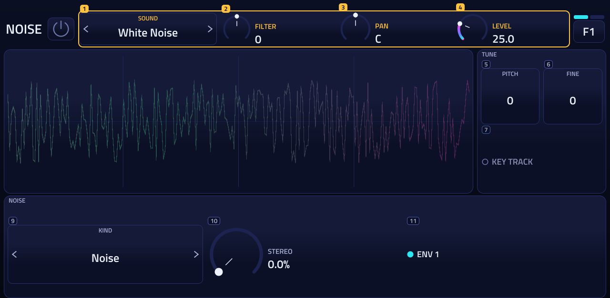

A zajgenerátor. Fejléc: bekapcsológomb (Noise On), a **SOUND** léptető (Noise Sample: White Noise, Pink Noise, Brown Noise, Geiger, Tape Hiss, Vinyl Clicks, Digital Hash, Velvet Noise, Atmosphere), **FILTER** (-100 .. +100 százalék), **PAN**, **LEVEL** (0 .. 100 százalék, alapértelmezett: 25) és az útválasztó gomb. A kijelző kirajzolja a zaj színét (halvány, amíg a zaj ki van kapcsolva).

- **TUNE:** PITCH és FINE (számmezők: -48 .. +48 félhang, -100 .. +100 cent), **KEY TRACK** (LED kapcsoló).
- **Két különböző léptető.** A fejléc SOUND léptetője kiválasztja, hogy a kilenc zajforrás közül melyiket szólaltassa meg a generátor. Az alsó blokkban lévő **KIND** léptető (Noise Type: Noise / Sample) azt választja ki, hogy a forrás a generált zaj (Noise) vagy egy mintafájl a plugin tartalmából (Sample). Ha Sample módban nincs mintafájl betöltve, a generált zaj szólal meg helyette.
- **Elrendezési változatok:**
  - **KIND = Noise** esetén (generált zaj, mint a képen): a kijelző a teljes szélességet kitölti. A kijelző alatt két blokk helyezkedik el egymás mellett: a **TUNE** a bal oldalon (PITCH, FINE, KEY TRACK) és a **NOISE** a jobb oldalon (KIND, STEREO 0 .. 100 százalék, valamint az **ENV 1** LED kapcsoló).
  - **KIND = Sample** esetén: a kijelző a bal oldalon található, mellette jobbra a **TUNE** oszlopával. Az alsó sor a **SOURCE** (KIND, START = Noise Phase 0 .. 100 százalék, STEREO, ENV 1) és a **PLAYBACK** (RANDOM, LOOP, BOUNCE LED kapcsolók) blokkokat tartalmazza.
- Q csoportok: fejléc (SOUND, FILTER, PAN, LEVEL), TUNE, valamint az alsó blokkok.

### 5.6 Mixer (Keverő)

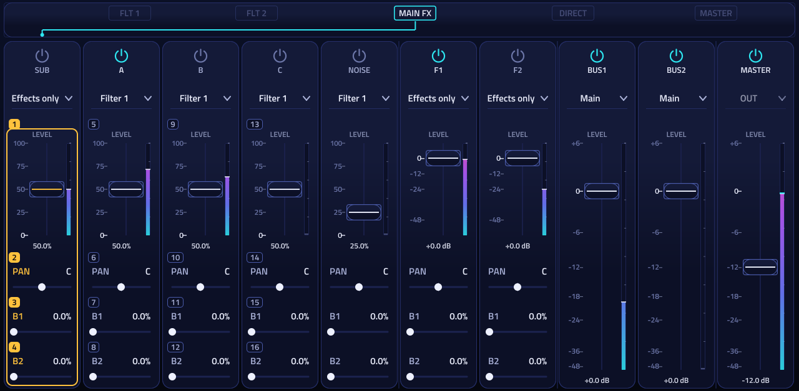

Tíz csatornasáv egymás mellett, a csúszkák körül keretek nélkül: a név és az érték egy vékony sáv felett helyezkedik el.
Balról jobbra haladnak: **SUB, A, B, C, NOISE, F1, F2, BUS1, BUS2, MASTER**, felettük pedig egy útválasztási sáv (FLT 1, FLT 2, MAIN FX, DIRECT, MASTER), amely kirajzolja a **kijelölt sáv** útvonalát (egy sáv megérintése kijelöli azt).

Minden sáv (fentről lefelé):
- **Bekapcsológomb**: a forrás On állapota (oszcillátorok, Sub, Noise, szűrők). A BUS1, BUS2 és MASTER sávokon ez az adott rack FX kapcsolója: ha világít, a rack effektjei aktívak (paraméterek: "Bus 1 FX Bypass", "Bus 2 FX Bypass", "Main FX Bypass", invertálva megjelenítve).
- **Célpont gomb (Destination button)** (koppintásra megnyílik a lista):
  - SUB, A, B, C, NOISE: Filter 1, Filter 2, Filters 1+2, Effects only, Direct out, Filter blend, None.
  - F1, F2: Effects only, Direct out, None.
  - BUS1, BUS2: Main, Direct, Other bus.
  - MASTER: OUT (rögzített).
- **LEVEL féder** mellette egy csúcsszintmérővel (peak meter): SUB, A, B, C, NOISE esetén 0 .. 100 százalék; F1, F2 esetén -60 .. +12 dB (alapértelmezett: 0); BUS1, BUS2 esetén -60 .. +6 dB (alapértelmezett: 0); MASTER = Master Volume -60 .. +6 dB (alapértelmezett: -12). Függőleges húzás; dupla koppintás = alapértelmezett érték. Egy csúcsérték-tartó vonal lassan süllyed a legmagasabb szintről. A kivezérlésjelző dB skálával rendelkezik (jelölés 12 dB-enként, vagy 0 / -6 / -12 / -24 / -48 értékeknél) és színsávval: csendes állapotban kékesszöld, a teljes skála közelében ibolyaszínű. Nyugalmi állapotban halvány alapvonalat mutat, soha nem üres dobozt.
- **PAN** (-100 .. +100 százalék), **B1** és **B2** (küldések az 1. és 2. buszra, 0 .. 100 százalék): vékony csúszkák keret nélkül, kizárólag a SUB, A, B, C, NOISE, F1, F2 sávokon. A buszok és a MASTER csak hangerőszinttel rendelkeznek; a PAN és a küldések náluk nincsenek feltüntetve (nem halványak, hanem hiányoznak).

Q csoport: a megérintett sáv (sárga keret a teljes sáv körül; a képen a SUB): LEVEL (1), PAN (2), B1 (3), B2 (4). Az XL-en a következő három sáv (körbefordulva) következik az 5 - 16 potmétereken: a képen az A az 5 - 8, a B a 9 - 12, a C a 13 - 16 helyet foglalja el. A Key 61-en a Q-Link gomb léptet rájuk (4.3 fejezet).

### 5.7 Filter 1 / 2 (Szűrők)

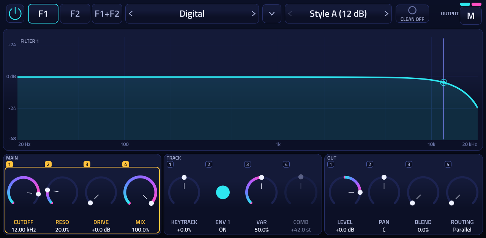

A kép a Filter 1-et ábrázolja Digital modellel, a frekvenciamenettel és a vágási frekvencia fogópontjával, valamint a három blokkal. A jobb felső sarokban lévő OUTPUT gomb M-et (Effects only) mutat.

A Filter fül oldala **egyszerre egy szűrőt mutat**: a Filter 1 fül az F1-en, a Filter 2 az F2-n nyílik meg. A bal felső sarokban található **CURVES** lista (F1, F2, F1+F2; a világító pont jelzi a választást) határozza meg, hogy mely görbéket rajzolja ki a kijelző, és melyik szűrőt szerkesztik a potméterek; az F1+F2 mindkét szűrő frekvenciamenetét és az összesített görbét is kirajzolja.
Ez nem az útválasztási lista (Parallel / Series), és nem az MPC Filter 1 / Filter 2 fülei, amelyek csak azt határozzák meg, hol nyílik meg az oldal.

**Fejléc:** bekapcsoló (Filter N On), modell-léptető (27 modell: Analog, Dirty, Ladder, Digital, Diode, Formant, Comb, Phaser, Multi SVF, Slope, EQ 6 dB, Ring Mod, Sample Hold, Smear, French LP, Add Bass, Scream, New Wsp, DJ Mixer, Diffusor, EMS Ladder, PZ SVF, Normal, Multi Morph, Flanges, Misc, New) listagombbal, stílusléptető (12 stílus: "Style A (12 dB)", "Style B (24 dB)" ... "Style L"), **CLEAN** LED kapcsoló (halvány Comb és Formant esetén), **OUTPUT** útválasztó gomb (alapértelmezés szerint M = Effects only; Filter N Destination: Effects only, Direct out, None; a felugró ablakban BUS 1, BUS 2, szint és panoráma is található).

**Kijelző.** A szűrő tényleges frekvenciamenete (logaritmikus frekvencia 20 Hz .. 20 kHz között, dB skála +24-től -48-ig), a legutóbb megszólalt hang élő vágási frekvenciájával és rezonanciájával kirajzolva (amelyet a moduláció is mozgat). Húzzuk el a görbén lévő fogópontot a vágási frekvencia és a rezonancia együttes módosításához; egy buborék mutatja az értékeket.

**Blokkok (egyenként egy Q csoport):**

| Blokk | Vezérlő | Paraméter, tartomány |
|---|---|---|
| MAIN | CUTOFF | 20 .. 20000 Hz, alapértelmezett: 12 kHz |
| | RESO | 0 .. 100 százalék, alapértelmezett: 20 |
| | DRIVE | 0 .. 20 dB |
| | MIX | 0 .. 100 százalék, alapértelmezett: 100 |
| TRACK | KEYTRACK | -100 .. +100 százalék |
| | ENV 1 | LED kapcsoló: az Env 1 formálja a szűrőt (alapértelmezés: On) |
| | VAR | 0 .. 100 százalék, alapértelmezett: 50 (Formant esetén halvány) |
| | COMB | Comb Blend Offset 0 .. 84 félhang, alapértelmezett: 42 (halvány, kivéve ha a modell Comb) |
| OUT | LEVEL | -60 .. +12 dB |
| | PAN | -100 .. +100 százalék |
| | BLEND | 0 .. 100 százalék |
| | ROUTING | háromtagú LED lista: Parallel, Series 1 to 2, Series 2 to 1 (mindkét szűrőre közös beállítás) |

A **Formant** modell esetén megjelenik egy negyedik, FORMANT csoport az X, Y (0 .. 100 százalék), TRANSPOSE (-12 .. +12 félhang) és SPREAD (-100 .. +100 százalék) paraméterekkel, és a kijelzőn megjelenik a formáns-pad. A Formant oldalról még nincs kép (11. fejezet).

Azok a vezérlők, amelyek az aktuális modellre nem érvényesek, halványak, beleértve az értékszövegüket is (a képen a COMB halvány, mert a modell nem Comb). Egy potméter hosszú megnyomása megnyitja a modulációs oldalát (6. fejezet).

### 5.8 Envelopes (Burkológörbék)

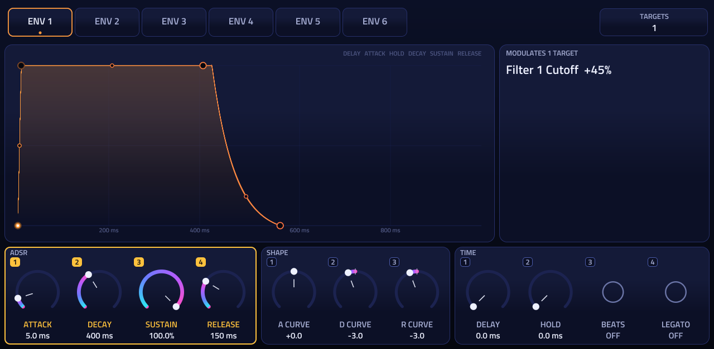

Az Env 1 - Env 4 oldalak mindegyike egy-egy burkolót mutat teljes képernyőn; a felül lévő **ENV 1 .. ENV 6** gombokkal átválthatunk egy másik burkolóra (a gomb alatti pont jelöli a modulációban részt vevő burkolót).
A fül csak azt határozza meg, melyik burkoló jelenjen meg először. A burkológörbe egy értéket formál a hang időtartama alatt: az Env 1 az amplitúdó-burkoló az Init hangszínben, a többiek szabadon hozzárendelhetők a szűrőhöz, a hangmagassághoz vagy bármi máshoz (6. fejezet).

- **Grafikon.** A grafikon a teljes szélességet kitölti. A DELAY, ATTACK, HOLD, DECAY, SUSTAIN, RELEASE fogópontjai a görbén helyezkednek el. Húzzunk meg egy idő-fogópontot az idő módosításához; a DECAY fogópont egyszerre módosítja a lecsengési időt és a kitartási (sustain) szintet; az attack, decay és release szakaszon lévő kis középső fogópont meghajlítja a görbét; egy fogópont dupla megérintése visszaállítja az alapértelmezett értéket. A kézben tartott fogópont neve és értéke megjelenik felette. Egy pont és egy lágy vonal követi a megszólaló hang(ok) futását; az Env 1 halványan megjelenik a többi burkoló mögött azonos időtengelyen.
- **LOCKED / FREE** (a gomb a grafikon bal felső sarkában). **LOCKED** (alapértelmezett): a burkoló mindig kitölti a grafikont, így az idők módosításakor a grafikon alatti **idővonalzó** változik, nem maga a rajz. **FREE**: a vonalzó mentén végzett vízszintes húzás zoomolja az időtengelyt (jobbra nagyít, balra kicsinyít); a burkoló ekkor túlfuthat a jobb szélen, és a határon túli fogópontok nem érinthetők. A FREE módra váltás megtartja az aktuális képet; a visszaváltás újra illeszti azt. A Play oldalon lévő kompakt grafikon mindig zárolt (locked), és nincs ilyen gombja.
- **Idővonalzó.** Kerek osztások ms-ban vagy s-ben a grafikon alatt (ütemekben, ha a BEATS be van kapcsolva); a jelölések egyben a függőleges rácsvonalak is.
- A 0 ms-os szakasz nem foglal szélességet a grafikonon: húzzuk a fogópontját jobbra, hogy időt adjunk neki.
- **Célpontok (Targets).** Hogy a burkoló mit modulál, az kis címkék formájában van kiírva a burkoló gombok és a TARGETS között: egy pont, a név és az előjeles mélység, például "Filter 1 Cutoff +45%", annyi, amennyi elfér, majd "+n". A címkék sima szövegek, nem gombok. A **TARGETS** gomb (jobbra fent, a célpontok számával) megnyitja az útvonalak listáját a mélységgel, UNI/BI, ON/OFF, törlés és ADD TARGET lehetőségekkel (6. fejezet).

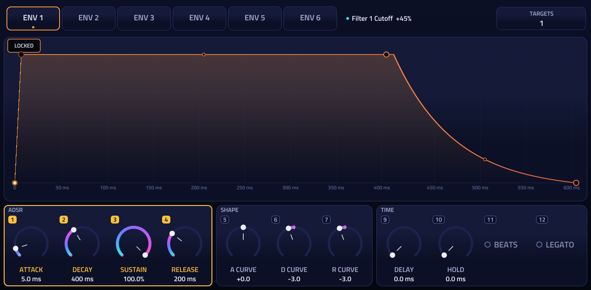

A grafikon alatti három blokk egy-egy Q csoport (a képen: ADSR sárga, SHAPE 5 - 7, TIME 9 - 12):

- **ADSR** (Q 1 - 4): ATTACK 0 .. 10000 ms (alapértelmezett: 5), DECAY 0 .. 10000 ms (400), SUSTAIN 0 .. 100 százalék (100), RELEASE 0 .. 10000 ms (200).
- **SHAPE:** A CURVE, D CURVE, R CURVE: -20 .. +20, alapértelmezettek: 0, -3, -3.
- **TIME:** DELAY 0 .. 4000 ms, HOLD 0 .. 4000 ms, **BEATS** (LED kapcsoló: idők ütemekben milliszekundum helyett: delay 0 .. 8, attack 0 .. 16, hold 0 .. 8, decay 0 .. 16, release 0 .. 16 ütem), **LEGATO** (LED kapcsoló; a paraméter: "Legato Inverted"). A Master oldalon lévő fő LEGATO kapcsolóval egy lenyomva tartott billentyű mellett leütött új hang átveszi a megszólaló hangot, és a burkolók nem indulnak újra. Ha ennél a burkolónál bekapcsoljuk a LEGATO-t, akkor **ez a burkoló** minden hangnál újraindul, még ebben a helyzetben is (az aktuális szintjéről indul újra, nem nulláról). Ennek nincs hatása, amíg a fő LEGATO ki van kapcsolva.

### 5.9 LFO-k és a rajzolt hullámforma-szerkesztő

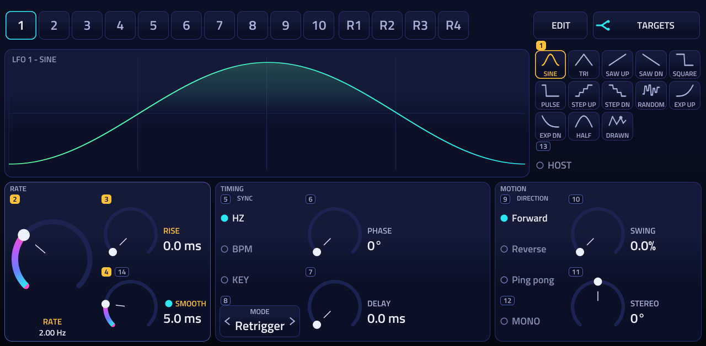

Az LFO 1 - LFO 4 oldalak mindegyike egy LFO-t mutat; a felső sáv átvált az **1 .. 10** (LFO-k) vagy az **R1 .. R4** (random LFO-k) bejegyzésekre, mindet egyetlen sorban megjelenítve. A fül csak azt határozza meg, melyik jelenjen meg először.
Az LFO egy ismétlődő hullámforma, amely periodikusan mozgat egy paramétert (vibrato, tremolo, lebegő szűrő). Célpontokat a **TARGETS** gombbal adhatunk hozzá (6. fejezet).

**Felső sáv:** a példánycellák, **EDIT** (megnyitja a hullámforma-szerkesztőt, lásd lentebb) és **TARGETS** (amit az LFO modulál, az útvonalak számával).

**Kijelző** (balra): egy ciklus alakja a fázisjelölővel és egy kurzorral, amely együtt fut a megszólaló hanggal. A grafikon feletti sáv mutatja a delay és rise értékeket, ha be vannak állítva. KEY követési módban (a sync lista KEY állásában) a kijelző teljes magasságában mutatja az alakot.

**Hullámformaválasztó (Shape picker)** (jobbra, 13 cella; Q 1): SINE, TRI, SAW UP, SAW DN, SQUARE, PULSE (25 százalék), STEP UP, STEP DN, RANDOM (véletlen lépések), EXP UP, EXP DN, HALF (fél szinusz), DRAWN (saját rajzolt hullámforma).
Alatta a **HOST** LED kapcsoló. A **HOST** csak akkor számít, ha az LFO MODE beállítása Free-run (és a szinkronizáció nem KEY): ekkor az LFO fázisa a gazdarendszer dalpozíciójából származik a lejátszás alatt, így a dal minden alkalommal azonosan szólal meg; kikapcsolt HOST mellett az LFO szabadon fut és saját óráját tartja.

**Blokkok (egyenként egy Q csoport; a vezérlők nincsenek egyenként bekeretezve):**

| Blokk | Vezérlő | Paraméter, tartomány |
|---|---|---|
| RATE | RATE (a nagy potméter) | 0.01 .. 200 Hz, alapértelmezett: 2 |
| | RISE | felúszás 0 .. 8000 ms |
| | SMOOTH | a **feliraton lévő LED** a simítás kapcsolója, a potméter a simítási idő 1 .. 1000 ms. A gomb halvány, amíg a LED ki van kapcsolva. A feliratra koppintva átkapcsol a LED. |
| TIMING | SYNC lista **HZ / BPM / KEY** | Free (Hz), Tempo (BPM), Key follow. A tempóváltozatok (pontozott, triola) a RATE blokkban lévő TRIP és DOT kapcsolók |
| | MODE | Retrigger, Free-run, Envelope, Sustain envelope, Loop at point, Loop and hold (léptető listával; a nevek hosszúak) |
| | PHASE | 0 .. 360 fok |
| | DELAY | 0 .. 4000 ms |
| MOTION | DIRECTION | lista: Forward, Reverse, Ping pong |
| | SWING | 0 .. 100 százalék |
| | STEREO | -180 .. +180 fok (eltolás a bal és jobb oldal között) |
| | MONO | LED kapcsoló |

**BPM mód.** A szinkronizációs listát BPM-re állítva a RATE potméter helyét átveszi a **DIVISION** léptető (13 választás: Freeze, 32 bars, 16 bars, 8 bars, 4 bars, 2 bars, 1 bar, 1/2 note, 1/4 note, 1/8 note, 1/16 note, 1/32 note, 1/64 note), alatta a **TRIP** (triola) és **DOT** (pontozott) LED kapcsolókkal; ezek kizárólag ebben a módban léteznek.

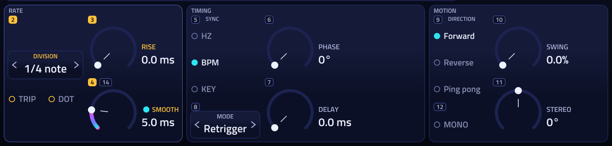

**KEY mód.** A szinkronizációs listát KEY-re állítva a frekvencia a leütött hangot követi, így a RATE potméter nem szerepel az oldalon. A blokk neve "RATE - FOLLOWS THE KEY", és tartalmazza a **TRANSPOSE** (-60 .. +36 félhang, alapértelmezett: -12) és **TUNE** (-100 .. +100 cent) vezérlőket, mindegyik saját Q csoportként közvetlenül a RATE után.

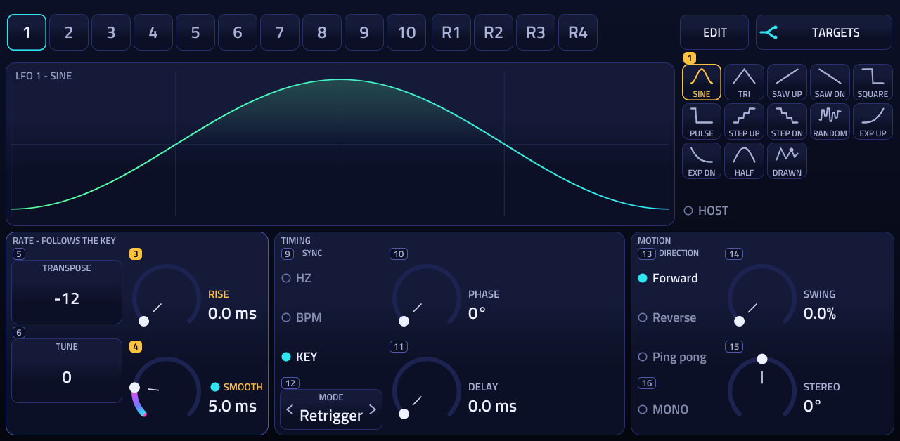

**Véletlenszerű LFO-k (Random LFOs, R1 - R4):**

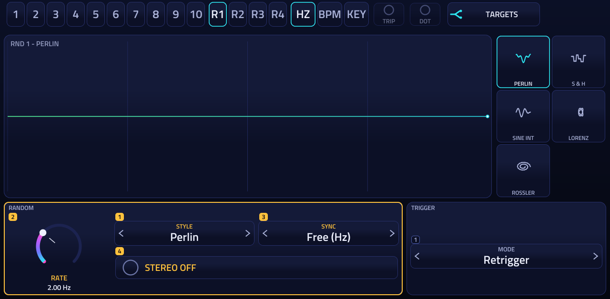

A stílusválasztó rács a Q 1, és nincs külön léptetője: PERLIN, S & H (mintavételezés és tartás [sample and hold]), SINE INT (szinusz-interpolált), LORENZ, ROSSLER. A kijelző a kimenet nyomvonala. A RANDOM blokk egyetlen sor: a RATE potméter (0.01 .. 200 Hz, alapértelmezett: 2), a HZ / BPM / KEY lista, a STEREO LED kapcsoló és az indítási MODE (kétágú lista: Retrigger, Free-run). KEY követésben a TRANSPOSE és TUNE blokk veszi át a frekvencia helyét a fentiek szerint. A véletlen LFO-knak nincs EDIT gombjuk.

**A rajzolt hullámforma-szerkesztő (The drawn-shape editor).** Az LFO oldal jobb felső sarkában lévő **EDIT** gomb megnyitja a szerkesztőoldalt az aktuális nézet felett (a visszatéréshez koppints a **BACK** gombra). Ha beépített forma kiválasztásakor nyomod meg az **EDIT** gombot, a forma szerkeszthető pontokká alakul át, és egyedi rajzolt formává válik (az LFO formája ekkor DRAWN lesz). Az LFO oldal formaválasztójával bármikor visszaválthatsz bármelyik gyári formára. A formaválasztóban a DRAWN cella kiválasztása átvált az egyedi formára (egy háromszögre, ha még nincsenek pontjai), de nem nyitja meg a szerkesztőt.

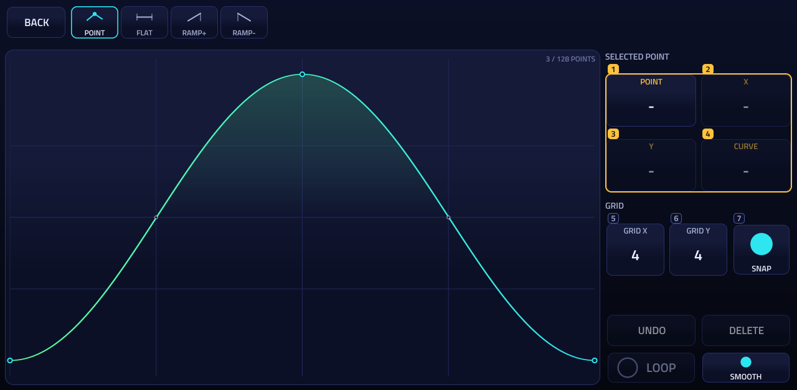

A szerkesztő egy nagy rajzfelületet kínál a ciklus megrajzolására és átformálására. A rajzfelület 2 és 128 közötti pontot jelenít meg. A jobb felső sarok mutatja a darabszámot (például: "9 / 128 POINTS"). A belső pontok nélküli forma egyenes vonalként értékelődik ki. A bal felső sarok három másodpercig állapotüzenetet jelenít meg forma mentésekor, betöltésekor vagy másolásakor.

**Felső sáv.** A képernyő tetején végigfutó sáv a navigációt, a rajzeszközöket és a műveleti menüket tartalmazza:

- **BACK:** Visszatér az LFO oldalra.
- **Eszközök:** Hét eszköz egy sorban (**POINT**, **FLAT**, **RAMP+**, **RAMP-**, **SELECT**, **SOFT**, **BEND**). Minden érintési gesztus egy visszavonási lépés.
- **SHAPES:** Megnyitja a forma preset menüt (gyári formák, mentett formák, mentés, csere, átnevezés és törlés).
- **MORE:** Megnyitja a segédeszközök menüjét (**EDIT**, **GRID** és **COPY** műveletek).
- **UNDO:** Visszavonja az előző módosítást (32 visszavonási lépés mélységig). A gomb halvány, ha a visszavonási lista üres.
- **DELETE:** Egyszerre törli az összes kijelölt belső pontot. A gomb halvány, ha nincs kijelölve törölhető pont.
- **MOD:** Megnyitja a kijelölt pontok pontmodulációs oldalát. Akkor aktív, ha legalább egy pont ki van jelölve.

**A hét eszköz.** Mindegyik eszköz egy adott szerkesztési feladatra szabja az érintési gesztusokat:

| Eszköz | Egyetlen érintési kézmozdulat |
|---|---|
| **POINT** | Koppints egy üres területre új pont hozzáadásához (bekapcsolt **SNAP** mellett rácshoz illesztve), majd húzd el. Érints meg egy meglévő pontot a kijelöléséhez és mozgatásához. A két végpont kizárólag függőlegesen mozog. Érintsd meg egy szakasz kerek középső fogópontját a görbületének húzásához (-20 és +20 között). Koppints duplán egy belső pontra a törléséhez (végpontra soha). Koppints duplán egy görbefogóra a görbe egyenessé tételéhez. Egy belső pont hosszú megnyomása (0,6 másodperc elmozdulás nélkül) szintén törli azt. |
| **FLAT** | Érints meg egy rácscellát, hogy vízszintes szakaszt rajzolj az adott oszlopon keresztül ujjmagasságban (bekapcsolt **SNAP** mellett a rácsvonalhoz igazítva), felülírva az oszlopban lévő pontokat. Oszlopokon át húzva az ujjat minden érintett oszlop kitöltődik az interpolált ujjmagassággal. |
| **RAMP+** | Érints meg egy rácscellát, hogy emelkedő rámpát rajzolj a cella alsó rácsvonalától a felső rácsvonaláig az adott oszlopban. Oszlopokon át húzva az ujjat emelkedő fűrészfogakat rajzol az összes érintett oszlopban. |
| **RAMP-** | Érints meg egy rácscellát, hogy lejtő rámpát rajzolj a cella felső rácsvonalától az alsó rácsvonaláig az adott oszlopban. Oszlopokon át húzva az ujjat lejtő fűrészfogakat rajzol az összes érintett oszlopban. |
| **SELECT** | Húzz egy téglalapot üres területen a benne lévő pontok kijelöléséhez. Koppints egy pontra a kijelöléshez adásához, vagy ha már egy többszörös kijelölés része, koppints rá az eltávolításához. Koppints üres felületre a kijelölés törléséhez. Húzz el bármelyik kijelölt pontot az összes kijelölt pont együttes mozgatásához, megtartva egymáshoz viszonyított távolságukat és alakjukat. |
| **SOFT** | Húzz egy pontot a többi pont lineáris elhalkulással (falloff) történő mozgatásához. A közelebbi pontok jobban elmozdulnak, amit a súlyozás szerinti szivárványszínek jeleznek. Két vagy több pont kijelölése esetén az elhalkulás a kijelölésre érvényesül. Kijelölés nélkül vagy egyetlen kijelölt pont esetén a ciklus 25 százalékán belüli összes pont követi az elhúzott pontot. |
| **BEND** | Húzd el bármely görbült szakasz görbefogóját a forma összes hajlítható görbéjének azonos mértékű hajlításához. |

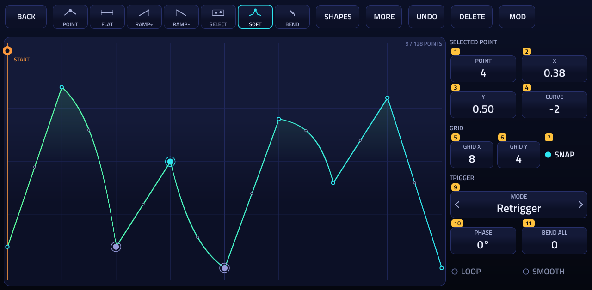

**Jobb oldali oszlop.** A jobb oldali oszlop három címmel ellátott Q csoportot és két alsó LED kapcsolót tartalmaz:

- **SELECTED POINT** (Q 1–4):
  - Egyetlen pont kijelölésekor: **POINT** (Q 1) mutatja a pont sorszámát (1-től n-ig). **X** (Q 2) beállítja az időpozíciót (0.00 és 1.00 között; végpontokon inaktív). **Y** (Q 3) beállítja a szintet (0.00 és 1.00 között). **CURVE** (Q 4) beállítja a pont utáni szakasz görbületét (-20 és +20 között).
  - Két vagy több pont kijelölésekor: **POINT** (Q 1) mutatja a kijelölt pontok számát (például: "3 SEL"). **X** (Q 2) mozgatja a kijelölés vízszintes középpontját, időben eltolva a pontokat a sorrendjük megőrzése mellett. **Y** (Q 3) függőlegesen mozgatja a kijelölés középpontját fel vagy le. **SCALE** (Q 4, felváltja a CURVE mezőt) méretezi a kijelölés magasságát (0.01 és 1.00 között) a függőleges középpont körül.
  - Ha nincs kijelölt pont, ezek a mezők kötőjelet mutatnak.
- **GRID** (Q 5–7 egy 16 potméteres eszközön):
  - **GRID X** (Q 5): Vízszintes ciklusosztások száma (2 és 32 oszlop között, alapértelmezett: 8).
  - **GRID Y** (Q 6): Függőleges magassági osztások száma (2 és 32 sor között, alapértelmezett: 8).
  - **SNAP** (Q 7): LED kapcsoló. Ha be van kapcsolva, a pontok hozzáadása, húzása, a jelölő mozgatása és a cellaeszközök rajzolása a rácsmetszetekhez igazodik.
  - A rács a hullámformával együtt mentődik a presetben. Rács nélkül mentett preset betöltésekor a szerkesztő automatikusan a legdurvább illeszkedő rácsot választja ki a 4, 8, 12, 16, 24, 32 értékek közül, vagy alapértelmezésként 8-at választ.
- **TRIGGER** (Q 9–11 egy 16 potméteres eszközön):
  - **MODE** (Q 9): Léptető a hat LFO indítási módhoz: Retrigger, Free-run, Envelope, Sustain envelope, Loop at point, Loop and hold. Koppints a névre a teljes választólista megnyitásához.
  - **PHASE** (Q 10): Fázisszög (0 és 360 fok között).
  - **BEND ALL** (Q 11): Az összes hajlítható szakasz átlagos görbülete (-20 és +20 között). Elforgatása minden ívelt szakaszt egyszerre hajlít meg.
- **LOOP** (LED kapcsoló): Átváltja a hurokpont jelzőt a kijelölt ponton. Halvány, ha nincs kijelölt pont.
- **SMOOTH** (LED kapcsoló): Bekapcsolja a koszinuszos S-görbe simítást a forma összes szakaszán.

A 16 potméteres MPC XL-en mind a tizenegy vezérlő egyszerre aktív az 1–11 potmétereken (a 8-as és a 12–16-os hely nincs használatban). A 4 potméteres MPC Key 61-en az aktív csoport sárga kerettel rendelkezik. Koppints egy csoportra vagy nyomd meg a Q-Link bank gombot a SELECTED POINT, GRID és TRIGGER közötti váltáshoz.

**A START / LOOP jelölő.** Egy függőleges vonal tetején elhelyezkedő kerek érintési fogópont jelzi a fázispozíciót a rajzfelületen. Húzd el a fogópontot az elmozgatásához. A jelölő közvetlenül hozzá van rendelve a motor **PHASE** paraméteréhez: a jelölő mozgatása frissíti a **PHASE** értéket, a **PHASE** potméter elforgatása pedig mozgatja a jelölőt. A jelölő jelentése az indítási **MODE** beállítástól függ:

- **Retrigger** és **Envelope** módban a jelölő felirata **START**. Ez határozza meg a ciklus kezdőpozícióját egy billentyű leütésekor. Folyamatosan húzható, és 14 pixelen belül lévő pontokhoz, illetve bekapcsolt **SNAP** esetén a rácshoz igazodik.
- **Sustain envelope**, **Loop at point** és **Loop and hold** módban a jelölő felirata **LOOP**. A meglévő pontokhoz igazodik, és ahhoz a ponthoz köti a forma hurokpontját. Sustain envelope módban az LFO ezen a ponton várakozik a billentyű nyomva tartása alatt. Loop at point módban az LFO lefut a forma végéig, majd visszaugrik erre a pontra. Loop and hold módban az LFO a kezdőpont és e pont között ismétlődik a billentyű kitartása közben, majd felengedéskor kifut a forma végéig.
- **Free-run** módban a jelölő halvány, a rajzfelület alján pedig megjelenik a "FREE-RUN: PHASE SHIFTS THE CYCLE" tájékoztató felirat. Free-run módban az LFO folyamatos közös órajelen fut, a **PHASE** pedig eltolja a ciklus időzítését.

**Pontmoduláció (a MOD oldal).** Koppints a felső sávban lévő **MOD** gombra, amikor egy vagy több pont ki van jelölve, hogy megnyisd a pontmodulációs oldalt. Az oldal a Q-Link potméterekre van leképezve a közvetlen paraméterbeállításhoz:

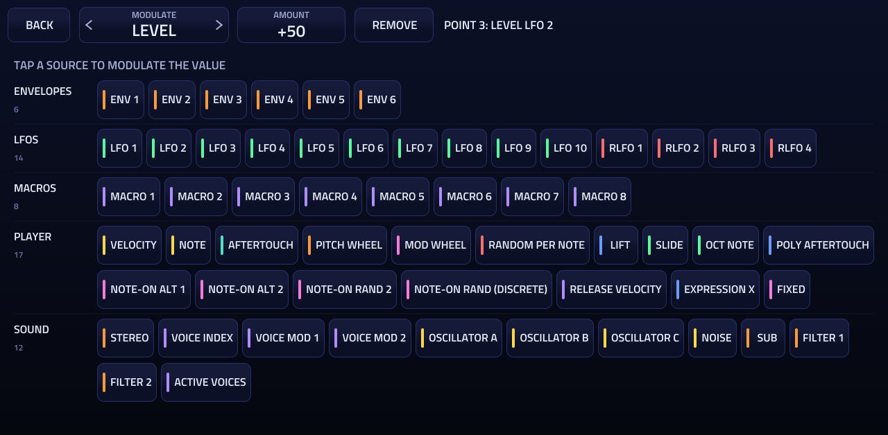

- **BACK:** Visszatér a szerkesztő rajzfelületére.
- **MODULATE** (léptető, **Q 1**): Kiválasztja a modulálandó célértéket: **TIME**, **LEVEL** vagy **CURVE**. A gombon a három érték a forgatási tartomány elején, közepén és végén van.
- **AMOUNT** (**Q 2**): Modulációs mélység -100 és +100 százalék között, egész százalékokban; a gombbal ugyanúgy, mint érintéssel (ugyanaz a szám látszik). A kijelölt pontok mindegyikének mélységét állítja. Amíg a kiválasztott értéket semmi sem modulálja, a mező halvány, és a gomb nem csinál semmit. A gomb egy folyamatos tekerése egy visszavonási lépés.
- **REMOVE:** Eltávolítja a modulációs hozzárendelést a kiválasztott célpontról.
- **Q-Link gombok:** az oldalnak egy két gombos Q csoportja van, Q 1 (MODULATE) és Q 2 (AMOUNT); amíg az oldal nyitva van, felváltja a szerkesztő saját Q vezérlőit, a **BACK** megérintésekor azok visszatérnek. A 16 gombos eszközön az 1-es és a 2-es címke áll a léptető és a mező felett (keret nélkül); a 4 gombos eszközön a csoport keretezett.
- **Összegzés:** Megjeleníti az állapotot a tábla felett (például: "POINT 3: LEVEL BY LFO 2, +45 PERCENT" vagy "3 POINTS: TIME NOT MODULATED").
- **Forrástábla:** Kategóriacsoportokba rendezve felsorolja a motor mind az 57 modulációs forrását. Érints meg bármelyik forrást a táblán, hogy hozzárendeld a választott célponthoz az összes aktuálisan kijelölt ponton.

A szerkesztő rajzfelületén a modulált idejű vagy szintű pont mellett egy színes sáv jelenik meg, amely a modulációs mozgástartományát jelzi. A modulált görbületű pont esetén egy színes gyűrű látható a szakasza görbefogója körül.

**A SHAPES lista.** Koppints a felső sáv **SHAPES** gombjára a kétszintű formaválasztó felugró ablak megnyitásához:

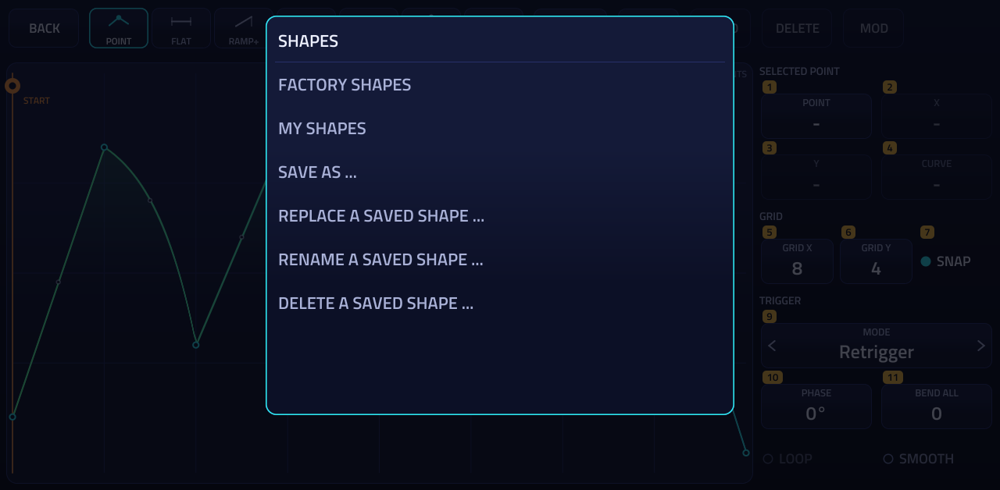

- **FACTORY SHAPES:** Felsorolja a tizenkét beépített gyári formát (Sine, Triangle, Saw Up, Saw Down, Square, Pulse, Step Up, Step Down, Random Steps, Exp Up, Exp Down, Half Sine) szerkeszthető pontokká alakítva. A Sine forma 3 ponttá alakul bekapcsolt simítással. A lépcsős formák pontos függőleges lépcsőkké válnak. Az ívelt formák 16 mintavételezett szakasszá alakulnak át. Egy gyári forma betöltése egyetlen visszavonási lépésben felülírja a rajzfelületet.
- **MY SHAPES:** Betűrendben felsorolja az összes felhasználó által mentett formát. Koppints egy formanévre a szerkesztőbe való betöltéséhez.
- **SAVE AS ...:** Megnyitja a képernyő-billentyűzetet név megadásához és a forma elmentéséhez.
- **REPLACE A SAVED SHAPE ...:** Felsorolja a mentett formáidat. Egyiket kiválasztva megerősítést kér ("REPLACE <név>?"), majd felülírja azt.
- **RENAME A SAVED SHAPE ...:** Felsorolja a mentett formáidat. Egyiket kiválasztva megnyitja a billentyűzetet az új név megadásához.
- **DELETE A SAVED SHAPE ...:** Felsorolja a mentett formáidat. Egyiket kiválasztva megerősítést kér ("DELETE <név>?"), majd törli a fájlt.

A mentett formák `<név>.lfoshape.json` nevű fájlokként tárolódnak a `SynthyBoy/LFO Shapes/` mappában. Ez a mappa az SD-kártyán, egy csatlakoztatott USB-meghajtón vagy a plugin saját Content mappájában jön létre (ugyanazokon a tárolóhelyeken, mint a felhasználói hullámtáblák). A fájlformátum megegyezik az asztali változat által írt JSON formátummal. Bármely számítógépről a `SynthyBoy/LFO Shapes/` mappába másolt szabványos JSON formafájlt a rendszer automatikusan felismeri és listázza. A pontmoduláció ugyanebben a fájlban tárolódik (egy opcionális `point_mod` lista, amely minden modulációs forrást a szöveges azonosítójával nevez meg, például `lfo2`); a mentett forma betöltése a pontmodulációt is visszahozza, ugyanabban a visszavonási lépésben. A lista nélküli fájl, például az asztali változat által írt, pontmoduláció nélkül töltődik be, az asztali változat pedig figyelmen kívül hagyja a listát.

**A MORE lista.** Koppints a felső sáv **MORE** gombjára a műveletek felugró ablakának megnyitásához, amely három csoportba van rendezve:

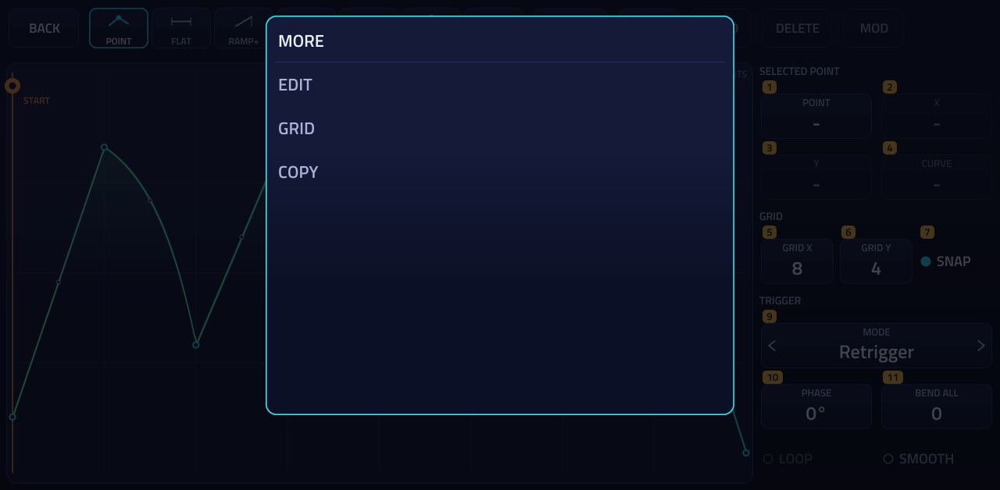

- **EDIT:**
  - **SELECT ALL:** Kijelöli a forma minden pontját.
  - **FLIP HORIZONTAL:** Időben megfordítja a formát. Az első pontból lesz az utolsó, a görbék előjele megfordul, és a hurokpont is tükröződik.
  - **FLIP VERTICAL:** Fejjel lefelé megfordítja az összes pont szintjét (az y szintből 1 - y lesz).
  - **SHIFT LEFT:** Balra tolja a formát egy rácsoszloppal, körbefordulással.
  - **SHIFT RIGHT:** Jobbra tolja a formát egy rácsoszloppal, körbefordulással.
  - **RESET ALL CURVES:** Egyenessé teszi az összes szakasz görbéjét 0 meredekséggel.
  - **CLEAR LOOP POINT:** Eltávolítja a hurokpont jelölést a formából.
- **GRID:**
  - **GRID 4 x 4**, **GRID 8 x 8**, **GRID 12 x 12**, **GRID 16 x 16**, **GRID 32 x 32:** Gyors felbontás-előbeállítások az oszlopokhoz és sorokhoz.
  - **HALVE THE GRID:** Megfelezi mindkét rácsfelbontást (legfeljebb a 2-es minimumig).
  - **DOUBLE THE GRID:** Megkettőzi mindkét rácsfelbontást (legfeljebb a 32-es maximumig).
  - **GRID FOLLOWS THE POINTS:** A legdurvább olyan felbontásra állítja a rácsot a 4, 8, 12, 16, 24, 32 értékek közül, amelynek vonalain az összes pont rajta fekszik.
- **COPY:**
  - **COPY TO LFO ...:** Megnyitja az LFO-k listáját (az LFO 1–10 között az aktuális kivételével). Átmásolja a formát és a rácsot a kiválasztott LFO-ra, és annak formáját DRAWN értékre állítja.
  - **OSC A CYCLE TO THIS LFO**, **OSC B CYCLE TO THIS LFO**, **OSC C CYCLE TO THIS LFO:** A kiválasztott oszcillátor egyetlen ciklusát legfeljebb 128 ponttá alakítja át ezen az LFO-n.
  - **THIS SHAPE TO OSC A**, **THIS SHAPE TO OSC B**, **THIS SHAPE TO OSC C:** Exportálja a formát egyetlen képkockás hullámtábla WAV fájlként a `SynthyBoy/Wavetables/` mappába, és betölti azt a kiválasztott oszcillátorba.

### 5.10 Mod matrix (Modulációs mátrix)

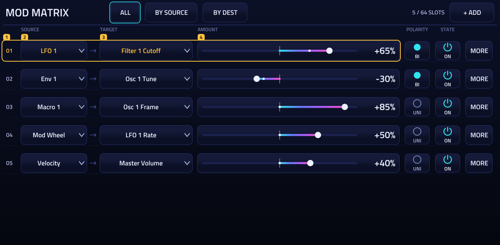

A mátrix összekapcsolja a forrásokat (burkolók, LFO-k, makrók, billentyűk és padok) az általuk mozgatott paraméterekkel. A képen öt útvonal látható, az első kijelölve (sárga keret; 1 - 4 közötti Q számai a SOURCE, TARGET és AMOUNT felett állnak).

Az oldal mutatja a modulációs helyeket (akár 64 slot; a számláló fent ezt jelzi: "5 / 64 SLOTS"). Az **ALL**, **BY SOURCE**, **BY DEST** fülek szűrik a listát (a BY SOURCE és BY DEST egy léptetőt mutat a forráscsoport vagy célmodul kiválasztásához). A **+ ADD** létrehoz egy új slotot az első szabad helyen (Env 1 forrás, a lista első célpontja, +50 százalék mérték), és megnyitja annak részletező oldalát (MORE, lásd lentebb), ahol módosítható a SOURCE és a TARGET.

Minden sor: a szám (megérintve kijelöli a sort), **SOURCE** (gomb, amely megnyitja a források listáját), egy nyíl, **TARGET** (megnyitja a célpontok csoportosított listáját: először a csoportokat, majd a paramétereket), az **AMOUNT** sáv (-100 .. +100 százalék, vízszintes húzás, dupla koppintás = alapértelmezett 0; a pont a pillanatnyi értéket mutatja), **POLARITY** (LED: UNI vagy BI), **STATE** (bekapcsoló ikon, ON / OFF) és **MORE**.

**Q csoport:** a kijelölt sor: Q 1 = sor (léptet a sorok között), Q 2 = SOURCE, Q 3 = TARGET, Q 4 = AMOUNT.

A **MORE** megnyitja a slot oldalát (BACK, egy cím, mint "SLOT 01 LFO 1 -> Filter 1 Cutoff", **DELETE** megerősítéssel) ugyanazzal a sorral a szerkesztéshez és három blokkal:

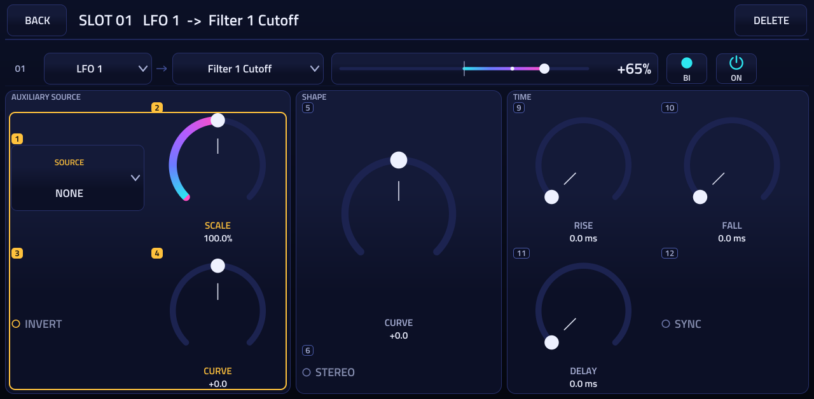

| Blokk | Vezérlő | Paraméter, tartomány |
|---|---|---|
| AUXILIARY SOURCE | SOURCE | Aux Source: egy második forrás, amely megszorozza az elsőt |
| | SCALE | Output Scale 0 .. 200 százalék, alapértelmezett: 100 |
| | INVERT | Aux Invert, LED kapcsoló |
| | CURVE | Aux Curve -10 .. +10 |
| SHAPE | CURVE | Curve -10 .. +10 |
| | STEREO | LED kapcsoló |
| TIME | RISE | 0 .. 5000 ms |
| | FALL | 0 .. 5000 ms |
| | DELAY vagy BEATS | Delay 0 .. 4000 ms, vagy 0 .. 8 ütem, ha a tempószinkron be van kapcsolva |
| | SYNC | Delay Tempo Sync, LED kapcsoló |

**Ha nincs használatban lévő slot**, az oldal a **forrástáblát (source board)** jeleníti meg (mind az 57 forrás csipként látható, ENVELOPES, LFOS, MACROS, PLAYER, SOUND csoportokban, mindegyik csoport a darabszámával, "TAP A SOURCE TO START A MODULATION" felirattal). Érintsünk meg egy csipet, majd válasszuk ki a célpontot. A tábla eltűnik, amint az első slot létrejön; a **+ ADD** gomb mindig ott van.

Ugyanez a tábla nyílik meg, ha hosszan megnyomunk egy **olyan vezérlőt, amelyet még semmi sem modulál** (a cím maga a vezérlő és az értéke, "TAP A SOURCE TO MODULATE THIS VALUE", lásd az 5.3-as képet). Egyetlen koppintás egy forráson létrehozza az adott vezérlő modulációját: nem kell végiglépegetni 57 forrás léptetőjén. Ha a vezérlőhöz már tartoznak modulációk, az oldal felsorolja őket, és egy kompakt hozzáadási sort tart alattuk.

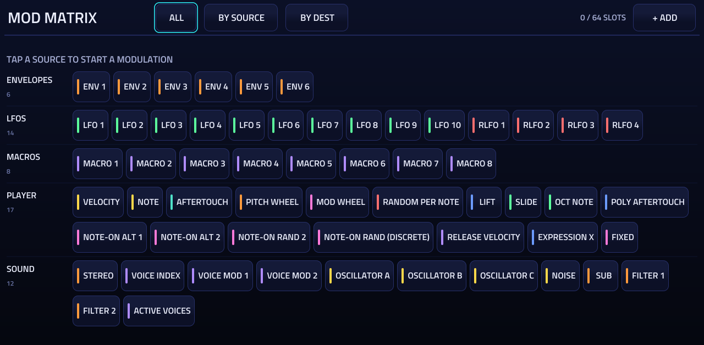

Bővebben a 6. fejezetben.

### 5.11 FX (Effektek)

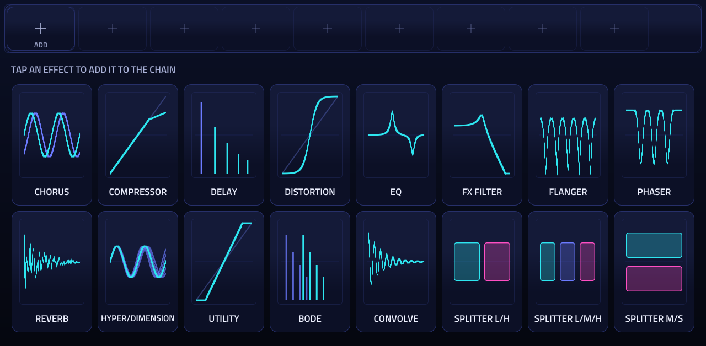

**A láncsáv (chain bar)** (fent) feldolgozási sorrendben ábrázolja az effekteket kártyákként az effekt ikonjával, nevével, a bekapcsoló ikonnal és a rack kis címkéjével (MAIN, B1, B2 vagy egy sáv); az üres helyek "+" jelet mutatnak. Érintsünk meg egy kártyát a kijelöléséhez, érintsük meg a bekapcsoló ikont az átkapcsolásához, **húzzuk el a kártyát oldalirányban az átrendezéshez**, a **+ ADD** (vagy az első szabad hely) hozzáad egy effektet: válasszuk ki a típust a listából.
Ha a lánc üres, az oldal a **galériát** mutatja: "TAP AN EFFECT TO ADD IT TO THE CHAIN" és egy kártyát a **16 effekt** (13 effekt és 3 sávosztó splitter) mindegyikéhez, egy kis képpel arról, amit csinál (egy görbe, egy átviteli karakterisztika, sávok). Egy kártya megérintése hozzáadja az adott effektet a Main rack végéhez, és megnyitja azt.

**Az effektoldal.** Minden effekt egyetlen saját **táblázatos oldallal** rendelkezik, négycellás sorokba rendezve. A fejléc tartalmazza a bekapcsolót, a helyet és nevet ("MAIN CHAIN" és a név), a **RACK** léptetőt, egy **PAGE n / m** léptetőt, ha az effektnek több sora van, mint amennyi elfér, és a **REMOVE** (Eltávolítás) gombot.
Minden sor az effekt egy blokkja és egyben egy Q csoport (4.3 fejezet): kijelző nélkül négy sor fér el egy oldalon, kijelző alatt kettő vagy három. A potméterek a paraméter saját nevét és értékét mutatják; az egész számok (VOICES) számmezők, a ki/be értékek LED kapcsolók, a rövid listák (3–8 választás) LED listaként jelenítik meg az összes lehetőséget; a hosszabb listák felugró ablakos léptetők, amelyek dinamikusan igazodnak a rendelkezésre álló sorok számához.
Az aktuális állapotban nem érvényes vezérlők egy szabályt követnek: egy olyan cella, amely két vezérlőt is tarthat, azt mutatja, amelyik éppen érvényes (**RATE** vagy **DIVISION** osztozik egy cellán, a SYNC által váltva; **TIME** vagy **DIVISION** a delay-nél); egy olyan vezérlő, amely nem érvényes, és nincs utána élő vezérlő a sorában, **rejtve marad**, és a sor összezárul (a Q csoportjának kevesebb tagja lesz; a teljesen kiürült sor eltűnik, és az alatta lévő sorok feljebb lépnek, így az oldalak a megmaradt sorokból állnak össze); ellenkező esetben **halványan** jelenik meg a helyén, és nem fogad érintést.
Az alábbi képen látható zengető elrejti a ROOM és a FEEDBACK paramétereket, mert a "Dense" algoritmus egyiket sem használja.

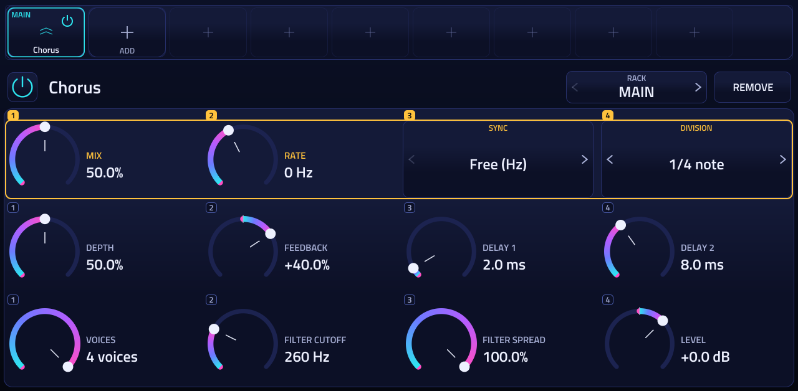

A chorus oldala: blokkonként egy sor (MODULATION, VOICES AND DELAY, FILTER AND OUTPUT), három sor az oldalon, az 1 - 12 számok egy 16 potméteres eszköz Q-Link potméterei. A SYNC lista (Free (Hz), Tempo, Tempo dotted, Tempo triplet) határozza meg, hogy az első cella RATE vagy DIVISION legyen.

Az EQ, compressor, delay, FX filter és distortion effektek a potméterek felett egy **kijelzővel** rendelkeznek: EQ (frekvenciamenet sávonként egy ponttal), compressor (az egyes sávok átviteli görbéje), delay (a leütések az időben), FX filter (a frekvenciamenet), distortion (az átviteli görbe és az aktuális szint egy pontként).
Az EQ és a kompresszor görbéi a beállítások tankönyvi képletei alapján vannak kirajzolva, nem a hangból kimérve.

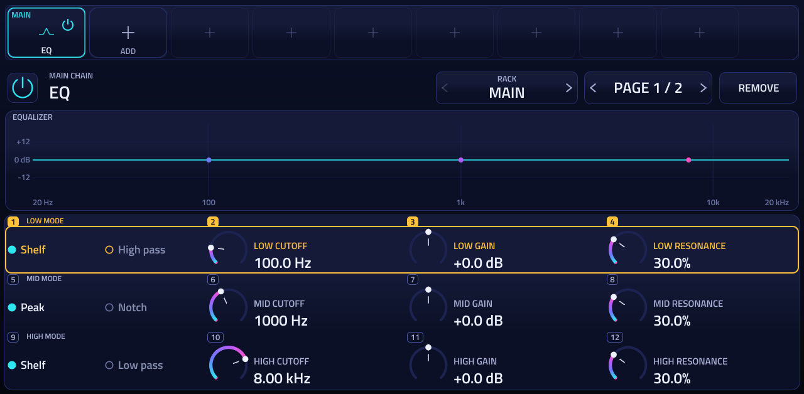

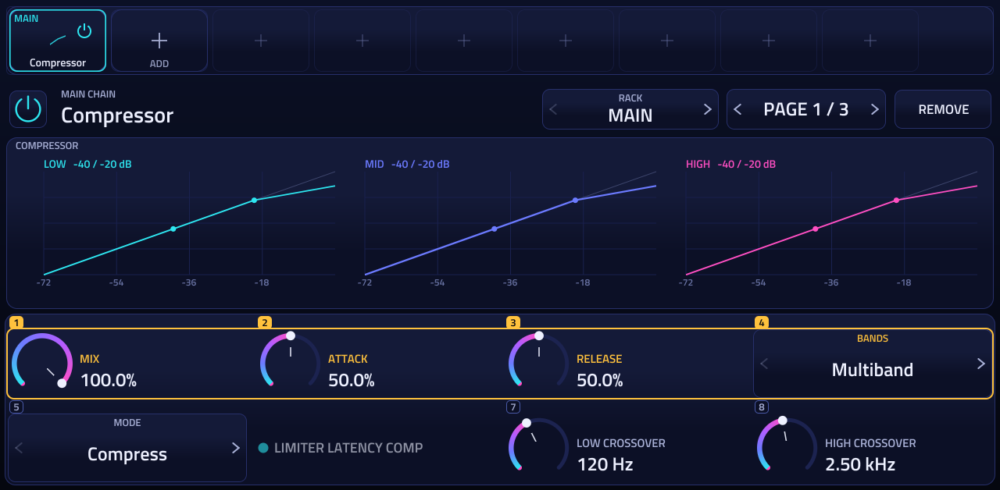

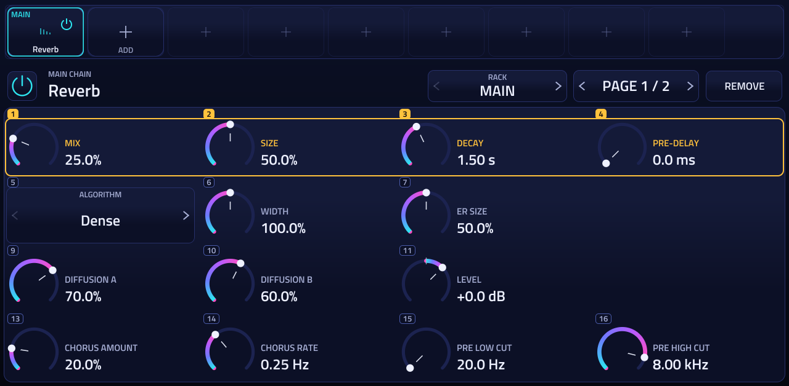

**Rackek és korlátok.** Három fő rack áll rendelkezésre. A **MAIN** dolgozza fel a teljes hangot, amely a szűrőkből és a Mixer "Effects only" útvonalaiból érkezik. A **BUS 1** és **BUS 2** két mellékútvonal: mindkettőt a Mixer sávok **B1** és **B2** küldései táplálják (5.6 fejezet), saját effektlánccal rendelkeznek, majd a Mixer sávjukon beállított célpontra jutnak (Main, Direct vagy a másik busz). A motornak **összesen 16 effekthelye (slotja)** van, amelyeken a három rack osztozik: összesen legfeljebb 16 effekt adható hozzá a MAIN, BUS 1 és BUS 2 tetszőleges elosztásában; a láncsáv csak addig enged új effektet hozzáadni, amíg van szabad slot. A motor fix láncában elhelyezkedő effektek is fel vannak sorolva, be- vagy kikapcsolt állapotban.

**Az, hogy mely effekteket halljuk, az eszköztől függ (7.1 fejezet).** Az MPC XL mind a 16 effektet futtatja. Az MPC Key 61 kihagyja a zengetőt (reverb), a flangert, a Hyper/Dimensiont, a Bode-t és a Convolve-ot: az ezeket használó presetek nélkülük szólalnak meg (a beállításaik megmaradnak a presetben, és az XL-en szólnak).

#### A 16 effekt

Mindegyik effekt az oldal sorrendjében sorolja fel a blokkjait. A nevek megegyeznek a képernyőn láthatókkal.

1. **Chorus** késleltetett másolatokkal dúsítja a hangot, amelyek késleltetési idejét lassú moduláció mozgatja. Blokkok: MODULATION (RATE 0.02 .. 8 Hz vagy DIVISION, SYNC, DEPTH, FEEDBACK -95 .. +95 százalék), VOICES AND DELAY (VOICES 1 .. 4, DELAY 1 és DELAY 2 1 .. 20 ms), FILTER AND OUTPUT (FILTER CUTOFF, FILTER SPREAD, MIX, LEVEL).
2. **Compressor** kieenlíti a hangos és halk részeket. Három sávban (mély, közép, magas) vagy egyetlen sávban képes működni; minden sáv rendelkezik alsó és felső küszöbértékkel, arányokkal és erősítéssel. Kijelző: sávonként egy görbe. Blokkok: COMPRESSOR (MIX, ATTACK, RELEASE, BANDS: Multiband, Low band, High band, Single band), MODE AND CROSSOVERS (MODE: Compress, Limit, Peak; LIMITER LATENCY COMP, Limit módban látható; LOW és HIGH CROSSOVER, az ezeket használó sávoknál látható), LOW BAND, MID BAND, HIGH BAND (küszöbértékek és arányok; a BANDS által nem használt sáv rejtve marad) és GAINS (sávonkénti erősítés és LEVEL).
3. **Delay** visszhangként ismétli a hangot. Az idő szabad vagy tempóhoz szinkronizált, a visszacsatolás határozza meg az ismétlések számát, a stílusok között pedig megtalálható a ping-pong is. Kijelző: a leütések az időben. Blokkok: TIME (SYNC, TIME vagy DIVISION, TIME 2 vagy DIVISION 2, STYLE: Mono, Stereo, Ping pong, Mid ping pong, Tap->Delay), FEEDBACK AND OUTPUT (FEEDBACK, MIX, LEVEL, HQ = magas minőség), FILTER AND OFFSET (FILTER CUTOFF, FILTER SPREAD, OFFSET, OFFSET LEFT).
4. **Distortion** felharmonikusokat ad hozzá a jel vágásával (clipping), hajtogatásával (folding) vagy felbontáscsökkentésével. Kijelző: az átviteli görbe. Blokkok: DISTORTION (TYPE: Soft clip, Hard clip, Linear fold, Sine fold, Bit crush, Down sample, Tube, Diode 1, Diode 2, Zero-Square, Asym, Rectify, X-Shaper, X-Shaper (Asym); DRIVE -30 .. +30 dB; MIX; LEVEL), FILTER (FILTER ORDER: None, Pre, Post; CUTOFF, RESONANCE, BLEND, a Pre vagy Post sorrendnél látható) és FILTER KEY (billentyűzetkövetés, a szűrővel együtt látható).
5. **EQ** egy hangszínszabályzó három sávval, valamint egy opcionális második középsávval. Kijelző: a frekvenciamenet sávonként egy ponttal. Blokkok: LOW BAND (MODE Shelf vagy High pass; CUTOFF; GAIN -24 .. +24 dB; RESONANCE), MID BAND (Peak vagy Notch), HIGH BAND (Shelf vagy Low pass), MID BAND 2 (Off, Peak, Notch; az értékei láthatók, hacsak nem Off) és OUTPUT (LEVEL és **BAND SHAPE**: State variable vagy Biquad, a sávok számításának két módja).
6. **FX Filter** a teljes jelen effektként használt szűrő, amely a hangszűrőkkel azonos modellekkel rendelkezik. Kijelző: a frekvenciamenet. Blokkok: FILTER (MODEL, STYLE, CUTOFF, RESONANCE), MODEL (COMB OFFSET a comb modellben; X, Y, RESONANCE, SPREAD a formant modellben; más modellekben rejtve vannak), SHAPE (DRIVE, BLEND, KEY TRACKING, CLEAN MODE), OUTPUT (VAR, PAN, MIX, LEVEL) és FORMANT PITCH (TRANSPOSE, csak a formant modellben).
7. **Flanger** egy nagyon rövid késleltetést pásztáz visszacsatolással, mozgó, fémes fésűszűrős hangzást keltve. Blokkok: MODULATION (RATE 0.04 .. 4 Hz vagy DIVISION, SYNC, DEPTH, CENTER 20 .. 16000 Hz), FEEDBACK AND OUTPUT (FEEDBACK -100 .. +100 százalék, PHASE OFFSET, MIX, LEVEL).
8. **Phaser** bemetszések sorozatát pásztázza végig a hangon visszacsatolással, örvénylő mozgást keltve. Blokkok: MODULATION (RATE 0.04 .. 4 Hz vagy DIVISION, SYNC, DEPTH, DEPTH 2), SWEEP (CENTER, BLEND, FEEDBACK, PHASE OFFSET) és OUTPUT (MIX, LEVEL).
9. **Reverb** szoba vagy terem térérzetét adja hozzá. Két oldal (mindegyik négy soros, kijelző nélkül). Blokkok: REVERB (MIX, SIZE, DECAY 20 .. 30000 ms, PRE-DELAY), ALGORITHM (ALGORITHM: Dense, Plate, Hall, Vintage, Nitrous, Basin; WIDTH; ER SIZE; ROOM, Nitrous esetén látható), DIFFUSION (DIFFUSION A, DIFFUSION B, LEVEL, FEEDBACK, Nitrous és Basin esetén látható), MODULATION AND INPUT (CHORUS AMOUNT, CHORUS RATE, PRE LOW CUT, PRE HIGH CUT), DAMPING (az alsó és felső polcszűrő frekvenciája és erősítése) és TIER (**FORCE ON**: engedélyezi a zengető futtatását olyan eszközön is, amely egyébként kihagyná; a presettel együtt tárolódik).
10. **Hyper/Dimension**: a Hyper több elhangolt másolattal dúsítja a hangot, a Dimension kiszélesíti a sztereó képet. Blokkok: HYPER (RATE 0.05 .. 10 Hz, UNISON 0 .. 7, DETUNE, RETRIGGER) és DIMENSION AND OUTPUT (SIZE, DIM MIX, MIX, LEVEL).
11. **Utility** kisegítő funkciók: csatornánkénti fázisfordítás, sztereó szélesség, panoráma, aluláteresztő és felüláteresztő szűrők, mono mélytartomány és szint. Blokkok: POLARITY AND STEREO (POLARITY L, POLARITY R, WIDTH 0 .. 200 százalék, PAN), FILTERS (LOW PASS, HIGH PASS, MONO BASS, és annak FREQUENCY értéke 20 .. 500 Hz a mono bass bekapcsolt állapotában) és OUTPUT (MIX, LEVEL).
12. **Bode** a hang minden frekvenciáját egy fix értékkel tolja el (frekvenciaeltoló), késleltetéssel, visszacsatolással és elkenéssel. Blokkok: SHIFT (SHIFT, RANGE, DIRECTION, BALANCE), DELAY (DELAY vagy DIVISION, SYNC, FEEDBACK, BLUR), STEREO (WIDTH, MONO INPUT, RETRIGGER) és OUTPUT (MIX, LEVEL).
13. **Convolve** egy felvett tér vagy eszköz karakterét adja a hanghoz egy impulzusválasszal (impulse response) történő konvolúció révén. Blokkok: IMPULSE (IMPULSE: None, Preset IR; SIZE; TONE; MINIMUM PHASE), TIME (PRE-DELAY vagy DIVISION, SYNC, ATTACK, DECAY), TAIL (DAMPING, IR GAIN, **SCALING**: Relative vagy Seconds, amely megadja, hogy a méret és lecsengés az impulzushoz képest relatív vagy másodpercben értendő) és OUTPUT (MIX, LEVEL).
14. **Splitter L/H**, 15. **Splitter L/M/H**, 16. **Splitter M/S** sávokra osztják a hangot, és minden sáv saját effektláncot kap (lásd lentebb). A splitter oldalon található a SPLIT FREQUENCY (L/H), LOW SPLIT és HIGH SPLIT (L/M/H), LOW BYPASS, MID BYPASS, HIGH BYPASS vagy MID BYPASS, SIDE BYPASS (M/S) LED kapcsolók és LEVEL. Az M/S a középső tartalomra (amely mindkét csatornán azonos) és az oldalirányú különbségekre osztja a jelet.

**Sávosztók és sáv-rackek (Splitters and band racks).** Egy splitter oldalán a kijelző helyét **sávonként egy sáv-pálya (lane)** veszi át (LOW / HIGH, LOW / MID / HIGH vagy MID / SIDE). Minden sáv egy **csempével** rendelkezik (a sáv neve és leírása, például "below 200 Hz" vagy "200 Hz to 3.0 kHz", az effektjeinek száma, vagy BYPASS, illetve SPLITTER OFF) és a **sáv láncával** kártyák formájában, majd a **+ ADD** gombbal.

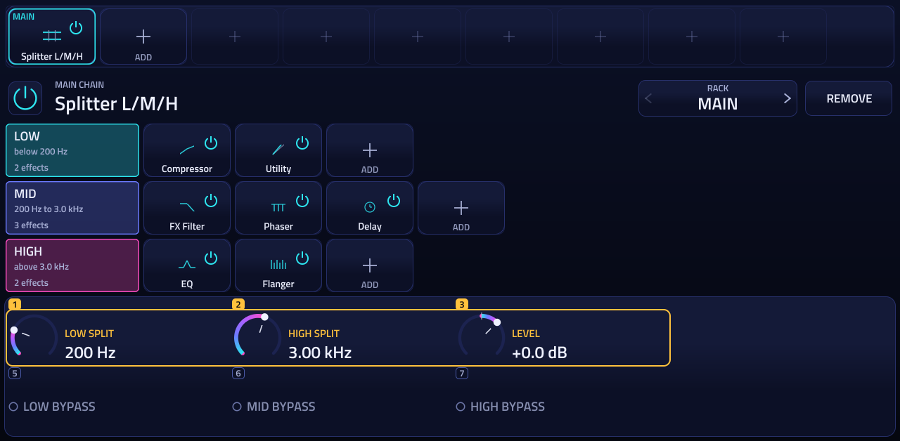

Egy kártyára, a csempére vagy a + ADD gombra koppintva **megnyílik az adott sáv**: a láncsáv ekkor az adott sáv kártyáit jeleníti meg, legelöl a **BACK** kártyával (amely megnevezi a splittert és a sávot, és egy szinttel feljebb visz). A cím mutatja az elérési utat, például "MAIN CHAIN > SPLITTER L/M/H > MID BAND", a kiválasztott effekt oldala pedig ugyanaz a táblázatos oldal, mint a főláncban (azonos sorokkal és Q csoportokkal). A sávon belüli **+ ADD** a még szabad effekteket ajánlja fel: egy effekt egyszerre egyetlen helyen létezhet, így az a típus, amely már szerepel a láncban vagy egy másik sávban, nem jelenik meg; az új effekt a sáv végére kerül és bekapcsol. Az üres sáv a szabad effektek galériáját mutatja. A kártyákat húzással átrendezhetjük a sávban és a láncon belül is; a bekapcsoló ikon a sáv kártyáján anélkül kapcsolja át az effektet, hogy megnyitná a sávot; a REMOVE kikapcsolja és kiveszi az effektet a sávjából. Egy effekt **RACK** kapcsolója tíz racket tartalmaz (MAIN, BUS 1, BUS 2 és a hét frekvenciasáv, pl. L/M/H MID); az oldal követi az effektet a sávjába. Egy sávban lévő effekt csak akkor működik, ha a splittere be van kapcsolva.

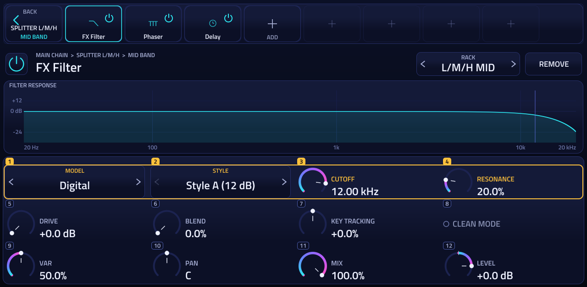

A képen látható a BACK kártya, a sáv három effektje (kiválasztott FX Filter, Phaser, Delay) és az FX Filter oldala a frekvenciamenet kijelzőjével és a tizenkét vezérlővel.

### 5.12 Master

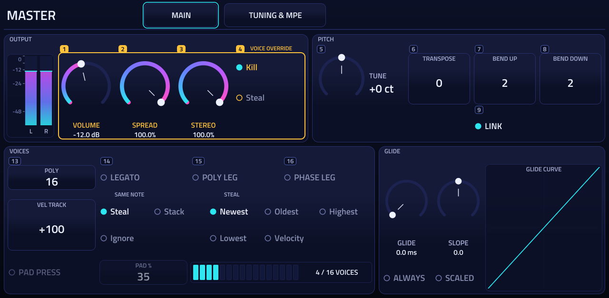

Két oldal, amelyek a felül található **MAIN** és **TUNING & MPE** gombokkal választhatók ki. A kép 16 potméteres eszközhöz van renderelve: a csoportok olvasási sorrendben vannak számozva, és az első négy alkotja az aktív csoportot. A Key 61-en az inaktív csoportok 1 - 4 számokat mutatnak, és a Q-Link gomb léptet rájuk.

**MAIN oldal** (négy blokk):

| Blokk | Vezérlő | Paraméter, tartomány |
|---|---|---|
| OUTPUT | L / R mérők (a motor master csúcsszintmérője tartóvonallal, dB skálával külön oszlopban és színsávval) | |
| | VOLUME | Master Volume -60 .. +6 dB, alapértelmezett: -12 |
| | SPREAD | Stereo Spread 0 .. 100 százalék, alapértelmezett: 100 |
| | STEREO | Stereo Routing 0 .. 100 százalék, alapértelmezett: 100 (potméter, mint a másik kettő) |
| | VOICE OVERRIDE | LED lista: Kill / Steal |
| | LIMIT | Kimeneti limiter LED kapcsoló, alapértelmezés szerint **be**: a plugin utóerősítése (make-up gain: -2,5 dB, a gyári presetek a gyári Akai hangszerekhez igazítva) utáni előretekintő (look-ahead) csúcslimiter. A limiter normál esetben inaktív (biztonsági védelmet nyújt), minden mintát -0,5 dBFS plafon alatt tart (a plugin után nincs vágás), elkapva a tranzienseket és akkordcsúcsokat; 3 milliszekundum késleltetést ad. Kikapcsolva: csak a plugin erősítése, késleltetés nélkül, a hangos hangok túlléphetik a teljes kivezérlést. A projekttel együtt mentődik |
| | QUALITY | NO SMOOTHING (kikapcsolja a paramétersimítást, így a változások azonnal ugranak az átúszás helyett; a presetben tárolódik); OVERSAMPLE 4X (megtisztítja a hullámtábla-oszcillátor magas hangjait torzítás nélkül; több processzort használ; az 1. generációs profilon 2x) |
| PITCH | TUNE | -100 .. +100 cent |
| | TRANSPOSE | -48 .. +48 félhang |
| | BEND UP, BEND DOWN | 0 .. 24 félhang, alapértelmezett: 2; a **LINK** LED kapcsoló a lefelé hajlítás tartományát a felfelé hajlításéhoz köti |
| VOICES | POLY | Polyphony 1 .. 32, alapértelmezett: 16 (lásd a lenti megjegyzést) |
| | LEGATO, POLY LEG, PHASE LEG | LED kapcsolók (Master Legato, Master Poly Legato, Voice Phase Legato) |
| | VEL TRACK | -100 .. +100 százalék, alapértelmezett: 100 |
| | SAME NOTE | LED lista: Steal, Stack, Ignore |
| | STEAL | LED lista: Newest, Oldest, Highest, Lowest, Velocity |
| | PAD PRESS, PAD % | a plugin globális padnyomás kapcsolója és mértéke (alapértelmezés: ki, 35 százalék; lásd lentebb). A PAD % halvány, amíg a kapcsoló ki van kapcsolva |
| | hang-sáv (voice bar) | megszólaló hangok / polifónia, például "4 / 16 VOICES" |
| GLIDE | GLIDE | Portamento Time 0 .. 8000 ms |
| | SLOPE | -8 .. +8; a glide görbe jobbra van kirajzolva |
| | ALWAYS | Portamento Always, LED kapcsoló |
| | SCALED | Portamento Scaled By Interval, LED kapcsoló |

**POLY és az eszköz.** Az oldal lehetővé teszi akár 32 hang beállítását is, de a valóságban megszólaló hangok számát korlátozza az eszköz: **8 a Key 61-en, 16 az XL-en** (7.1 fejezet). A több hanggal elmentett preset egyszerűen az eszköz által megengedett hangszámmal szólal meg.

Q csoportok (olvasási sorrendben): OUTPUT (VOLUME, SPREAD, STEREO, VOICE OVERRIDE), PITCH (TUNE, TRANSPOSE, BEND UP, BEND DOWN), LINK, VOICES (POLY, LEGATO, POLY LEG, PHASE LEG), a VOICES második sora (VEL TRACK, SAME NOTE, STEAL), GLIDE.

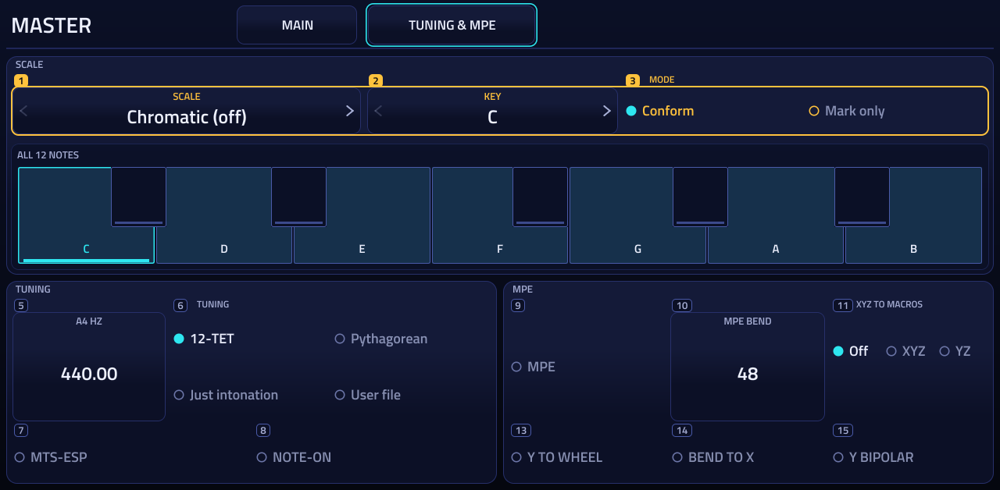

**TUNING & MPE oldal:**

- **SCALE (Skála):** SCALE (Chromatic (off), Major, Natural Minor, Harmonic Minor, Melodic Minor, Dorian, Phrygian, Lydian, Mixolydian, Locrian, Major Pentatonic, Minor Pentatonic, Blues, Whole Tone, Diminished (H-W), Diminished (W-H), Phrygian Dominant, Hungarian Minor, Double Harmonic, Hirajoshi), KEY (C ... B; az alatta lévő billentyűzetrajz beállítja a hangnemet, ha megérintünk vagy elhúzunk egy billentyűt), MODE (LED lista: Conform, Mark only). A sötét billentyűzet mutatja a skála hangjait (fehér billentyűk C-től B-ig, a skálába tartozó hangok fényesebben világítanak); a felette lévő felirat "ALL 12 NOTES", amíg a skála ki van kapcsolva.
- **TUNING (Hangolás):** A4 HZ (400 .. 480 Hz, alapértelmezett: 440), TUNING (LED lista: 12-TET, Pythagorean, Just intonation, User file), MTS-ESP kapcsoló, NOTE-ON kapcsoló (csak MTS-ESP note-on).
- **MPE:** MPE on/off, MPE BEND (1 .. 96 félhang, alapértelmezett: 48), XYZ TO MACROS (LED lista: Off, XYZ, YZ; az XYZ a Macro 1, 2, 3-at, az YZ a Macro 1, 2-t mozgatja), Y TO WHEEL, BEND TO X, Y BIPOLAR (LED kapcsolók).

**Padnyomás (MPC XL padok).** Az XL padjai minden lenyomva tartott padra nyomásértéket küldenek. Ennek kétféle felhasználási módja van (lásd még a részletes útmutatót az expresszív padokról és játéktechnikákról: [mpce-padok.md](mpce-padok.md)):
- **Egy presetben:** modulációs útvonal a **Poly Aftertouch** forrásból egy paraméterhez, például a Filter 1 Cutoff-hoz. Sok gyári preset tartalmazza ezt az útvonalat (10.4 fejezet; [mpce-padok.md](mpce-padok.md)).
- **Minden hangszínre globálisan:** a **PAD PRESS** kapcsoló (az oldal VOICES blokkjában, alapértelmezés szerint ki van kapcsolva) lehetővé teszi, hogy a nyomás kinyissa a Filter 1-et, a **PAD %** (alapértelmezett: 35) pedig meghatározza, mennyire: a teljes nyomás 35 százaléknál körülbelül egy oktávval nyitja a vágási frekvenciát, 100 százaléknál pedig körülbelül hárommal. Egy olyan hang, amelynek presetje már tartalmazza a Poly Aftertouch -> Filter 1 Cutoff útvonalat, nem nyílik ki kétszeresen. A kapcsoló és az érték magához a pluginhoz tartozik, nem a presethez: a presetváltás nem érinti őket, a projekt pedig megjegyzi az állapotukat.

Ahhoz, hogy bármilyen padnyomás megérkezzen, a pad **Full Level funkciójának kikapcsolva kell lennie** (bekapcsolt Full Level mellett minden leütés 127-es dinamikával rendelkezik és nem küld nyomást). Kizárólag a padonkénti (polifónikus) nyomás számít; a csatorna-aftertouch-ot a PAD PRESS figyelmen kívül hagyja.

### 5.13 Voice control (Hangvezérlés)

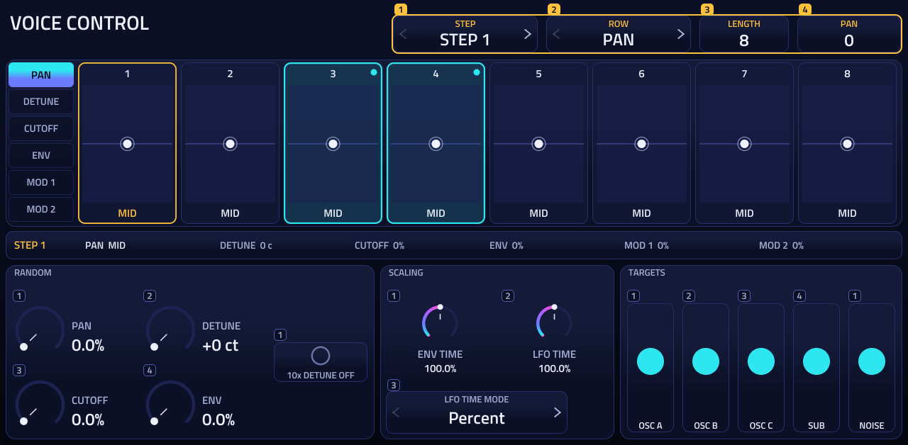

Hangonkénti eltolások szekvenszere: nyolc lépés és hat sor. Minden új leütött hang a következő lépést veszi fel, így egy akkord vagy egy hangfutam minden hangja kissé eltérő panorámát, hangolást, szűrőt vagy burkolóidőt kap. Ez teszi a padot vagy az unison hangzást élővé a teljesen egyforma másolatok helyett.

- **Fejléc** (STEP Q csoport): **STEP** (léptető, 1 .. 8: melyik lépést szerkeszti a Q-Link), **ROW** (LED lista a rács bal oldalán: PAN, DETUNE, CUTOFF, ENV, MOD 1, MOD 2; ez a Q 2), **LENGTH** (1 .. 8 lépés) és a kijelölt lépés értéke az adott sorban (itt PAN, MID).
- **Rács:** nyolc oszlop. Egy oszlop megérintése az ujj magasságára állítja az adott lépést; az oszlopokon keresztüli húzással folyamatos vonal rajzolható (a gyors mozdulatok kitöltik a köztes oszlopokat). A középső vonal a nulla (MID). Az a lépés, amelyet egy megszólaló hang éppen játszik, világít (ciánkék színnel, egy ponttal). A képen a 3. és 4. lépés világít.
  Tartományok: PAN -100 .. +100 százalék, DETUNE -100 .. +100 cent, CUTOFF -100 .. +100 százalék, ENV (burkolóidő) -100 .. +100 százalék, MOD 1 és MOD 2 -100 .. +100 százalék.
- **Sáv** a rács alatt: a kijelölt lépés mind a hat értéke (STEP n: PAN, DETUNE, CUTOFF, ENV, MOD 1, MOD 2).
- **RANDOM:** PAN 0 .. 100 százalék, DETUNE 0 .. 100 cent, CUTOFF 0 .. 100 százalék, ENV 0 .. 100 százalék, és egy **10x DETUNE** LED kapcsoló.
- **SCALING:** ENV TIME és LFO TIME 25 .. 400 százalék (alapértelmezett: 100), LFO TIME MODE (LED lista: Percent, Rate).
- **TARGETS:** OSC A, OSC B, OSC C, SUB, NOISE LED kapcsolók (alapértelmezés szerint mind bekapcsolva): mely hangforrásokra hasson a hangvezérlés.
- Q csoportok: STEP, RANDOM, 10x DETUNE, SCALING, TARGETS, NOISE.

**Hogyan használódnak a lépések?** Minden új hang a következő lépést veszi fel, és a szekvencia LENGTH lépés után körbefordul (1. hang az 1. lépést játssza, 2. hang a 2. lépést ... a LENGTH+1. hang újra az 1. lépést). Egy akkord hangonként egy lépést használ el. A számlálást nem állítja vissza egy új akkord vagy a lejátszás megállítása; csak akkor indul újra az 1. lépéstől, ha a plugin audiója újraindul (például egy projekt betöltésekor).

---

## 6. Moduláció

A **moduláció** összeköt egy **forrást** egy **célponttal** (egy paraméterrel) egy megadott **mélységgel** (-100 .. +100 százalék), polaritással (UNI vagy BI) és egy be/ki kapcsolóval. A motor 64 slottal rendelkezik.

**Források (57):**
- Burkolók (Envelopes): Env 1 .. Env 6.
- LFO-k (14): LFO 1 .. LFO 10, RLFO 1 .. RLFO 4 (a véletlen LFO-k).
- Makrók: Macro 1 .. Macro 8.
- Játékos (Player) (17): Velocity, Note, Aftertouch, Pitch Wheel, Mod Wheel, Random per Note, Lift, Slide, Oct Note, Poly Aftertouch, Note-On Alt 1, Note-On Alt 2, Note-On Rand 2, Note-On Rand (Discrete), Release Velocity, Expression X, Fixed.
- Hang (Sound) (12): Stereo, Voice Index, Voice Mod 1, Voice Mod 2, Oscillator A, Oscillator B, Oscillator C, Noise, Sub, Filter 1, Filter 2, Active Voices.

**Célpontok:** minden modulálható paraméter (1248 bejegyzés a paraméterlistában), kiválasztva egy olyan listából, amely először a csoportokat, majd a csoport paramétereit mutatja. Az MPC XL padokról a gazdarendszer a leütött hangot, a leütési dinamikát (velocity) és a padonkénti nyomást adja át a pluginnak; a padok X/Y pozíciója nem érkezik meg hozzá.

**Útvonal létrehozása:**

1. **A Mod oldalról.** Érintsünk meg egy forráscsipet a **forrástáblán** (amely akkor látható, ha nincs használatban lévő slot), és válasszuk ki a célpontot, vagy nyomjuk meg a **+ ADD** gombot (ekkor létrejön egy slot az Env 1-gyel és +50 százalékkal, és megnyílik az oldala), majd módosítsuk a SOURCE és TARGET értékeket. Szerkesszük a SOURCE, TARGET, AMOUNT, UNI/BI, ON/OFF paramétereket a sorban; a MORE gomb alatt található a segédforrás, a görbe és az időzítés.
2. **Egy burkolóból vagy LFO-ból.** Az Env vagy LFO oldalon nyomjuk meg a **TARGETS** gombot, majd az **ADD TARGET** lehetőséget, és válasszunk egy csoportot és egy paramétert. Az új útvonal fél mélységgel indul (bipolárisként, ha a paraméter a nulla körül mozog). Ezen az oldalon a célpont-sorok mélységgel, UNI/BI, ON/OFF és eltávolítási funkcióval rendelkeznek.
3. **Egy makróból.** A Macros oldalon érintsük meg a makró kártyájának csipterületét ("NO TARGET - TAP TO ADD"), majd nyomjuk meg az ADD TARGET gombot.
4. **Egy vezérlőről.** **Nyomjunk hosszan** (0,6 mp) egy potmétert vagy számmezőt bárhol a plugin oldalain: megnyílik a modulációs oldala. Ha még semmi sem modulálja a vezérlőt, az oldal maga a **forrástábla**: érintsük meg az 57 forrás egyikét, és az útvonal létrejön. Ha a vezérlőhöz már tartoznak útvonalak, azok listázva jelennek meg a mélységsávval, UNI/BI, ON/OFF és eltávolítási gombbal, alattuk egy kompakt hozzáadási sorral.
5. **Mélység állítása húzással.** Egy olyan potméter bal felső sarkán, amelyet a Play oldalon kiválasztott forrás modulál (az utoljára megérintett burkoló vagy LFO), egy színes fül található; a fülön végzett húzás módosítja az adott mélységet (200 pixel = a teljes -100 .. +100 százalékos tartomány).

A potméterek jelzik a modulációt: egy jelölő mutatja az élő (modulált) értéket, és egy ív húzódik az értéktől a kiválasztott forrás mélységéig. A bal felső fül színes, ha a kiválasztott forrás a potméter forrásai között van, szürke, ha más források modulálják, és üres (hollow), ha a kiválasztott útvonal ki van iktatva (bypassed).

**Makrók.** Nyolc makró (0 .. 100 százalék, alapértelmezett: 0) kizárólag forrásként működik: a makró nem csinál semmit, amíg nincs célpontja. A makró a források listájában "Macro n" néven jelenik meg.

## 7. Presetek és gyári tartalom

A plugin **161 programot** kínál a gazdarendszer felé: az "Init"-et (az alapértelmezett hangszín, 0. program) és 160 gyári presetet hat kategóriában. A lista kategóriák szerint (ábécérendben: Bass, FX, Keys, Lead, Pad, Pluck), azon belül pedig név szerint van rendezve.

Minden preset `.sbpreset` fájlként van elmentve, amely egy 4-es verziójú `synthyboy-state` dokumentumot tartalmaz, mind a 2637 paraméterkulcsot explicit módon megadva, darabszámban és állapotverzióban megegyezve a motor paramétertáblájával (`docs/params.json`). A forráskódban az állapotformátum verziója 5 (`kStateVersion` 5, `core/include/synthyboy/state.h`), amely a rajzolt LFO formák rácsbeállításait (`grid_x` és `grid_y`) a formával együtt tárolja; a 4-es verziójú presetek és dokumentumok zökkenőmentesen töltődnek be úgy, hogy a rács a pontokból kerül kiszámításra, a 4-es verziójú olvasók pedig biztonságosan olvassák az 5-ös verziójú dokumentumokat.

A presetek CC0 licenc alatt állnak (Safián Szabolcs).

### 7.1 Presetek böngészése

A SynthyBoy-ban két fő módja van a presetek böngészésének és kiválasztásának:

1. **A PRESET mező a plugin fejlécében (VST2 programok, azonnal működik):**
   - Track View vagy Track Edit módban egy Plugin sávon az MPC fejlécében látható az aktuális preset a **PRESET** mezőben.
   - A **PRESET** mező megérintése megnyitja a gazdarendszer szabványos görgethető programlistáját, amely mind a 161 programot tartalmazza (a 0. "Init" programot, majd a 160 gyári presetet kategória és név szerint rendezve).
   - Bármelyik presetet megérintve az azonnal betöltődik a motorba.
   - **Nincs "*" jelölés:** A preset neve a fejlécben mindig úgy jelenik meg, ahogy van; a plugin nem fűz jelölést a név mögé paraméter módosításakor vagy projekt visszaállításakor (a korábbi verzióval " *"-gal mentett projekt "Név"-ként jelenik meg). A projekt név szerint jegyzi meg a presetet, és akkor is visszaállítja, ha egy későbbi kiadás frissíti a programlistát; ha a név nem található, az elmentett hangszín presetnév nélkül marad meg.

2. **A Sounds böngésző (Sounds Mode — hardveres ellenőrzés alatt):**
   - Az Akai MPC hardverek rendelkeznek egy dedikált hangszer- és presetböngészővel, amely **Sounds Mode** néven ismert (Akai MPC Standalone OS User Guide v3.10.1, "Sounds Mode", 147–148. oldal; MPC Live III, MPC XL User Guide v3.10.1, "Sounds Mode", 153–154. oldal).
   - **A Sounds mód megnyitása:** Nyomjuk meg a hardveres **Sounds** gombot (MPC Key 61, MPC Key 37, MPC Live III, MPC XL), nyomjuk meg a Shift + **Arrange / Sounds** gombot (MPC One G2), vagy nyomjuk meg a **Menu** gombot, és érintsük meg a **Sounds** ikont.
   - **A SynthyBoy kiválasztása:** Sounds módban érintsük meg az **Instruments** (vagy balra fent a `<- Instruments`) elemet a hangszercsempék megjelenítéséhez. A SynthyBoy csempe a saját 270×110-es grafikájával jelenik meg (`Plugin Skins/browser_images/soundsmode.png`). A csempére koppintva megnyílik a presetböngésző, amely a csomag `Content/presets/` könyvtárából jeleníti meg a gyári presetlistát (vagy a felhasználói `.xpl` Plugin Programokat).
   - **Locate Preset (Preset megkeresése):** Az érintőképernyő tetején lévő **Locate Preset** gomb megérintése megnyitja az aktuálisan kiválasztott plugin hangszer presetlistáját.
   - **Edit Instrument (Hangszer szerkesztése):** A képernyő alján lévő **Edit Instrument** gomb megérintése megnyitja a Track Edit Mode-ot, közvetlenül feltárva a SynthyBoy rajzolt kezelőfelületét.
   - **Favorites (Kedvencek):** Érintsük meg a **Favorites** fület a bal alsó sarokban (vagy nyomjuk meg a Shift + **Sounds** gombot Key 61 / Live III-on, illetve a fizikai **Favorites** gombot az XL-en) a leggyakrabban használt hangszínek elmentéséhez és gyors előhívásához élő előadások során.
   - *Állapot:* Vegyük figyelembe, hogy az `.sbpreset` fájlok közvetlen betöltése a Sounds csempe-böngészőn keresztül jelenleg ellenőrzés alatt áll fizikai hardveren (lásd a 11. fejezetet).

**Presetek és projektek mentése** (Akai kézikönyvek):
- Egy **projekt** a Save ablakból menthető: nyomjuk meg a **Menu** gombot, érintsük meg a **Save** elemet, majd a **Project** vagy **Project As** lehetőséget (Standalone OS User Guide v3.10.1, "Save Window", 67. oldal; MPC Live III, MPC XL User Guide, 69. oldal). A projekt megőrzi a plugin teljes állapotát (state chunk), így a hangzás pontosan úgy tér vissza, ahogy hagytuk.
- Egyedi hangszín gazdarendszer-szintű presetfájlként való exportálásához válasszuk ki a plugin sávot, és érintsük meg a **Plugin Program** lehetőséget a Save ablakban ("Tap Plugin Program when a plugin track is selected to save the current plugin program"). A sáv plugin oldalán (Standalone OS leírás 253. oldal, XL leírás 278. oldal) a presetnév melletti mappa ikon megnyitja a fájlböngészőt egy `.xpl` plugin preset betöltéséhez, a lemez ikon pedig elment egy újat.
- A globális padnyomás kapcsoló (PAD PRESS és PAD %, 5.12 fejezet) nem része a presetnek (a presetváltás érintetlenül hagyja). A Play oldal választói (melyik oszcillátort, burkolót és LFO-t mutatja a Play oldal) a projekttel együtt mentődnek.

### 7.2 A gyári hangok

A gyári hangkönyvtár **136 presetet** tartalmaz hat kategóriára osztva:
- **Bass** (27 preset)
- **FX** (14 preset)
- **Keys** (20 preset)
- **Lead** (26 preset)
- **Pad** (30 preset)
- **Pluck** (19 preset)

A gazdarendszer név szerint listázza őket (a kategória nem része a megjelenített névnek):

| Kategória | Darabszám | Presetek |
|---|---|---|
| Bass | 27 | 808 Boom; Acid Saw Reso; Bend Formant Growl; Click Attack Bass; Comb Metal Bass; Custom Shape Wobble; Diode Saturated Bass; Dirty Distortion Bass; EMS Squelch Bass; Fast Arp Bass; Fat Reese; Formant Vowel Bass; Gritty Square Bass; Harmonic Sine Bass; Moog Ladder Bass; Odd Harmonics Bass; Pitch Drop 808; Pulse Width Bass; Punchy Pluck Bass; Scream Filter Bass; Solid Sub; Space Wobble Bass; Sub Duo Octave; Subterranean Duo; Sync Growl Bass; Triple Fold Reese; Warm Analog Bass |
| FX | 14 | Alien Communication; Bode Barber Riser; Bode Shifter Drone; Breath of Machines; Cosmic Teleport; Detonation Tail; Game Over Zap; Metal Gong Strike; Noise Riser; Sci-Fi Laser Sweep; Sonar Ping; Space Wind Storm; Sub Drop Boom; Vinyl Dust Crackle |
| Keys | 20 | Accordion Reed; B3 Drawbar Organ; Celesta Bells; Clavinet Funk; Dream Grand Piano; Dyno Electric Piano; FM Soft Organ; Glass Organ Tones; Harpsichord Bar; Just Intonation Keys; Lo-Fi Rhodes; Muted Honky Tonk; Rotary Rock Organ; Tempo Gate Chords; Tine Glass Keys; Utility Width Keys; Vibraphone Bars; Vintage Electric Tine; Wah Pressure Clav; Warm Toy Piano |
| Lead | 26 | Bell Chime Lead; Bell FM Ripple Lead; Chorused Saw Solo; Cosmic Drift Lead; Diode Bite Lead; Dirty Peak Lead; Dual Octave Hero; FM Digital Lead; Harmonic Shimmer Lead; Hyper Saw Lead; Laser Beam Lead; MPE Pressure Lead; Metallic Edge Lead; Phaser Sweep Lead; Plucked Lead Tone; Pulse Width Mod Lead; Screaming Sync Lead; Solo Square Lead; Staccato Bleep Lead; Sync Cry Lead; Tri Soft Solo; Triple Fifth Lead; Twin Warp Lead; Vocaloid Lead; Vowel Whistle Lead; Warm Vintage Lead |
| Pad | 30 | Bowed Pressure Strings; Brass Swell Ensemble; Cathedral Choir; Comb Reso Swell; Dark Cinema Drone; Deep Sea Ambient; Diffusor Cloud Pad; Ethereal Glass; Frozen Aurora; Gentle Flute Pad; Golden Dawn Pad; Harmonic Cloud; Hyper Dimension Pad; Infinite Horizon; Lorenz Garden; Lush Analog Pad; Mid Side Halo; Odd Harmonics Pad; Parallel Dusk Pad; Radiant Pulse Pad; Shepard Ascent; Slow Motion Waves; Space Odyssey Pad; Starlight Shimmer; Stretched Glass Choir; Subtle Tape Drift; Tri-Band Split Texture; Velvet Strings; Vintage Brass Pad; Vowel Choir Pad |
| Pluck | 19 | Acoustic Style Pluck; Aux Keyscale Pluck; Bell Mallet Pluck; Chime Drop; Comb Zither; Digital Glass Tap; Electric Mute Pluck; Formant Pop Pluck; Harmonic Tine Pluck; Harp Drops; Kalimba Tines; Karplus Harp; Marimba Synth; Pentatonic Step Pluck; Pizzicato Strings; Ring Mod Gamelan; Rubber Bass Pluck; Spruce Guitar; Trance Short Pluck |

#### A 24 új preset (Sound Set 1. adag)

A sound set batch 1 csomagban hozzáadott 24 presetnél (`docs/release/SOUND-SET-BATCH-1.md`) az alábbiakban bemutatjuk az egyes hangszínek karakterét és megszólaltatási módját:

**Bass (4 új preset):**
- **Subterranean Duo (Bass):** A szűrőt megkerülő tiszta szinusz szubbasszus párosítva egy morgó, billentyűzet-hajtogatott fűrészhullámmal; játsszunk különálló staccato vagy kitartott hangokat C1–B2 tartományban, nyomjunk rá a padra az extra szűrőharapásért, és használjuk a kereket a meghajtáshoz és lehangoláshoz.
- **Bend Formant Growl (Bass):** Dubstep stílusú beszélő basszus Bend warppal és párhuzamos Formant szűrővel; játsszunk staccato nyolcadokat C1–G2 között, miközben a kerékkel mozgatjuk a vokális magánhangzót és a drive-ot.
- **Triple Fold Reese (Bass):** Vaskos három-oszcillátoros Reese lehangolt fűrészhullámokkal, egy lefelé transzponált négyszöghullámmal és burkolóval formált szinusz-hajtogatásos (sine-fold) torzítással; játsszunk hosszú kvintakkordokat C1–C2 között, a Macro Fold és Drive megnyitásával agresszív attackot adva, amely sima testté olvad.
- **Pitch Drop 808 (Bass):** Ütős 808 lábdob-basszus gyors magasságzuhanással és impulzusos koppanással csöves meghajtáson keresztül; üssünk le határozottan C1–G1 hangokat a fényesebb tranziens koppanásért és a mély szub lecsengésért.

**Lead (4 új preset):**
- **Sync Cry Lead (Lead):** Éneklő hard-sync lead széles lehangolt fűrész kvint-réteggel megtámasztva; játsszunk expresszív legato frázisokat C3–C5 között, a padba nyomva kinyitva a sync pásztázást, a kereket felemelve pedig késleltetett vibrátót adva hozzá.
- **Vowel Whistle Lead (Lead):** Monofón vokális lead Formant warppal és csúcsrezonanciával, amely emberi hangként beszél; játsszunk sima legato vonalakat C4–C6 között, a kerékkel átúsztatva a magánhangzót, nyomással tátva a "szájat".
- **Triple Fifth Lead (Lead):** Hatalmas power-chord lead réteg (fűrész alaphang, oktáv impulzus, kvint háromszög) Multi SVF szűrésen keresztül; játsszunk egyhangos heroikus riffeket C3–C5 között (a réteg maga képezi az akkordot), belenyomva a szűrő élének és a felső rétegeknek az előcsalogatásához.
- **Bell FM Ripple Lead (Lead):** Üveges szinusz vivő fázismodulálva egy felső duodecimával harang-részhangos csillogással; játsszunk lassú, dinamikus dallamokat C4–C6 között, ahol a lágy ütések finoman csengenek, a kemény leütések pedig megütött fémként ugranak ki.

**Pad (7 új preset):**
- **Stretched Glass Choir (Pad):** Éteri kóruspad Harmonic Stretch morph funkcióval, amely véletlen LFO-val vándorol a felharmonikusokon; tartsunk ki lassú akkordokat C3–C5 között 4+ másodpercig, a padnyomással kinyitva a szűrő csillogását.
- **Mid Side Halo (Pad):** Széles, atmoszférikus pad szétválasztva egy stabil monokompatibilis középre és egy kavargó chorusos/phaseres oldalsó glóriára; játsszunk dús akkordokat C2–C4 között hatalmas sztereó szélességgel, amely monóban sem oltja ki magát.
- **Parallel Dusk Pad (Pad):** Sötét, filmszerű pad párhuzamos analóg aluláteresztő (bal) és fésűszűrővel (jobb), ellentétesen lélegző vágási frekvenciával; játsszunk lassú fejhallgatós akkordokat C2–C4 között, elmerülve a folyamatosan fejlődő sztereó térben.
- **Brass Swell Ensemble (Pad):** Meleg 1980-as évekbeli szintetizátor-fúvóskar lélegzetvételi zajjal és felúszó szűrőfelfutással; játsszunk akkordokat C2–C4 között, erősebben leütve a fúvós kivirágzásának felgyorsításához és a felúszás fényesítéséhez.
- **Shepard Ascent (Pad):** Hipnotikus emelkedő drón, amely végtelen felfelé tartó oktávmászást végez a Shepard Tone morph révén; tartsunk ki egy vagy két alaphangot C2–C3 között, a padot nyomva gyorsítva az emelkedés sebességét.
- **Lorenz Garden (Pad):** Organikus, soha nem ismétlődő ambient hangtáj, amelyet kaotikus Lorenz és Rössler véletlen modulátorok hajtanak; tartsunk ki akkordokat C3–C5 között, és engedjük kibontakozni a vándorló szűrőket és hullámtáblákat.
- **Bowed Pressure Strings (Pad):** Expresszív vonóskar, amely bensőségesen reagál az ujj súlyára; játsszunk akkordokat C2–C5 között kikapcsolt Full Level mellett, a lenyomva tartott padokba belenyomva a vonó húrba mélyedését szimulálva, kinyitva a szűrőt és kibontva a késleltetett vibrátót.

**Pluck (3 új preset):**
- **Karplus Harp (Pluck):** Fizikai modellezés jellegű pengetett húr, amelyet hangolt fésűszűrőn átvezetett zajlökések szintetizálnak; játsszunk csillogó arpeggiókat C3–C6 között, a kerékkel tenyértompítást (palm mute), a leütés dinamikájával pengetőharapást adva.
- **Ring Mod Gamelan (Pluck):** Fémes inharmonikus harangrudak gyűrűs modulációval szintetizálva 2.76x vivővel; játsszunk gyors pentaton mintákat C3–C6 között, keményebben leütve az élesebb fémes hangszínért és hosszabb csillogásért.
- **Pentatonic Step Pluck (Pluck):** Önmagát játszó 16 lépéses moll pentaton szekvenszer a gazdarendszer tempójához igazítva lépésenkénti pengetés-burkolókkal; tartsunk ki egyetlen alaphangot C3–C4 között, engedve a ritmikus minta lüktetését.

**Keys (3 új preset):**
- **Tine Glass Keys (Keys):** Dinamikus FM elektromos zongora, amely ötvözi a kerek, kis dinamikájú Rhodes meleget a kemény dinamikán csengő fémrudas pillekkel; játsszunk soulos akkordokat és szólókat C2–C6 között, a kereket használva sztereó tremolóhoz.
- **Tempo Gate Chords (Keys):** Ritmikusan vagdalt akkordok, amelyeket egy tempóhoz szinkronizált 16 lépéses ritmikus minta hajt szűrőpumpálással; tartsunk ki akkordokat C3–C5 között a groove hajtásához, vagy tekerjük fel a Macro Smooth-ot a paddá olvasztáshoz.
- **Wah Pressure Clav (Keys):** Funky clavinet expresszív wah pedállal közvetlenül az ujjunk alatt; játsszunk feszes kísérőakkordokat C2–C4 között, a padokba nyomva pásztázva a Multi SVF wah szűrőt és megszólaltatva a dióda meghajtást.

**FX (3 új preset):**
- **Breath of Machines (FX):** Mechanikus indusztriális drón, amely formáns és hangolt fésűs rezonátorokon átvezetett lélegző zajt tartalmaz; tartsunk ki mély hangokat C1–C2 között a hátborzongató sci-fi atmoszférákhoz és ritmikus gépi dadogáshoz.
- **Bode Barber Riser (FX):** Drámai feszültségkeltő emelkedés, amely felfelé tartó hangmagasság-pásztázást kombinál visszacsatolt Bode frekvenciaeltolással; tartsunk ki egy hangot C2–C4 között 5–6 másodpercig a kiállásig (drop), a padba dőlve intenzív gerjedéshullámot keltve.
- **Detonation Tail (FX):** Mennydörgő filmszerű becsapódás robbanásszerű zajütéssel, mély magasságzuhanó szub morajlással és barlangszerű sztereó zengető lecsengéssel; üssünk le egyetlen mély billentyűt C1–C2 között, és hagyjuk elzengeni a morajlást.

### 7.3 Hangminőség az egyes eszközökön

Ugyanaz a preset **kompatibilis** a két eszköz között: a presetek és projektek kizárólag a beállításainkat tárolják, soha nem azt, amit az eszköz le tud játszani, és semmi sem változik meg egy projekt áthelyezésekor. A két eszköz azonban nem rendelkezik azonos feldolgozási kapacitással, így a SynthyBoy eltérő minőségi szinten fut rajtuk, amelyet a plugin indításakor egyszer választ ki. Egy preset emiatt **teltebben szólhat az XL-en**.

| | MPC XL | MPC Key 61 |
|---|---|---|
| Hangok (egyszerre megszólaló hangok száma) | 16 | 8 |
| Oszcillátoronkénti unison hangok | akár 16 | legfeljebb 3 |
| Effektek | mind a 16 | a reverb, flanger, Hyper/Dimension, Bode és Convolve ki van hagyva |
| Warp | simább (a hullámforma négyszeres frekvencián kerül kiszámításra) | kétszeres frekvencián számolva: a szélsőséges warpok kissé több aliasinget eredményeznek |
| Spektrális morfózis (hullámtábla és spektrális morph) | teljes sebességgel frissül | fél sebességgel frissül: az LFO vagy burkoló által mozgatott morph kb. 12 ms-ot késik 6 ms helyett |
| Matematikai számítások szűrőkben, torzítókban és effektekben | egzakt | gyors közelítések: a jelszint azonos marad, a hullámforma finom alakja kissé eltér |

Egyszerű szavakkal megfogalmazva:
- **Hangok száma.** Egy 8 hangnál népesebb akkord (vagy a még lecsengő hangok) a Key 61-en hamarabb csippent le hangokat (voice stealing), mint az XL-en. A Master oldal POLY vezérlője ezt nem emelheti az eszköz korlátja fölé.
- **Unison.** Egy olyan beállítás, amely 7 unison hangot kér, a Key 61-en úgy szól, mint ugyanaz a beállítás 3 hanggal: azonos elhangolási szélességgel, sztereó terítéssel és aránnyal, de vékonyabb hangréteggel. A mérések szerint a jelszint 0,5 dB-en belül maradt egy egyszerű fűrészhullámon, és 3 dB-en belül a 14 olyan gyári preseten, amely 3-nál több hangot igényel.
- **Effektek.** A Key 61-en a zengetőt használó preset zengető nélkül szólal meg. A fennmaradó effektek (chorus, compressor, delay, distortion, EQ, FX filter, phaser) futnak. A zengető oldalán található egy **FORCE ON** kapcsoló, amely engedélyezi a zengető futtatását ennek ellenére; ez a presettel együtt tárolódik, és processzorteljesítménybe kerül.
- **Nagy gépigényű hangszínek.** A legösszetettebb gyári presetek (például a Diffusor Cloud Pad és a Scream Filter Bass) nyolc kitartott hang mellett szinte a Key 61 teljes rendelkezésre álló feldolgozási idejét lekötik; az XL-en bőven marad tartalék. Ha a Key 61-en egy kitartott akkord recseg, használjunk kevesebb hangot, kevesebb unison hangot vagy kevesebb effektet.
- Egy olyan eszközt, amelyet a plugin nem ismer fel, a rendszer a Key 61-hez hasonlóan kezel.

Az XL profilt a kezdeti 112 gyári presettel és 16 kitartott hanggal mértük ki; a Key 61 profil a biztonsági megfontolásból választott (a sound set batch 1 24 presetjét ezt követően mindkét profil alatt megterveztük és kimértük, lásd: docs/release/SOUND-SET-BATCH-1.md).

### 7.4 Gyári hullámtáblák (Factory Wavetables)

A SynthyBoy egy dedikált gyári tartalomcsomaggal (`com.safian.synthyboy.factory-wavetables`) érkezik, amely **72 gyári hullámtáblát** (18,5 MB) tartalmaz hat kategóriában, kategóriánként 12 táblával:

1. **Analog** (12 tábla): szűrő- és szinkronpásztázások (sync sweep), PWM rétegek, klasszikus analóg szintetizátorok karakterét idéző hullámformák.
2. **Digital** (12 tábla): frekvenciamodulációs (FM) és fázistorzításos (phase distortion) spektrumok, additív felharmonikus-sorok, digitális szintetizátorhangzások.
3. **Spectral** (12 tábla): formáns- és spektrális pásztázások, rezonáns és soksávos szűrt hullámformák, amelyek kiválóan alkalmasak spektrális szűrőtáblának is.
4. **Vocal** (12 tábla): emberi magánhangzók, vokális formánsok és kórustextúrák; ezek a táblák egy meghatározott zenei alaphangra készültek, így annak kb. egy oktávos környezetében érvényesülnek legszebben.
5. **Metallic** (12 tábla): inharmonikus fémek, harangok, gongok és ride cintányérok lecsengő spektrumai.
6. **Noise** (12 tábla): fagyasztott fehér- és rózsaszínzaj-spektrumok, rezonáns sávok és suhogások, amelyek zajból tiszta hanggá sűrűsödnek.

**Műszaki jellemzők és formátum:**
- Minden tábla 16 bites mono PCM WAV formátumú, 2048 minta / képkocka felbontású, és néhány lépcsős kivételtől eltekintve pontosan 64 képkockából áll.
- Mindegyik tábla egy folytonos pásztázás (scan): a hullámtábla-pozíció (**WT POS**) mozgatásával a hangzás simán, ugrások nélkül úszik át az első képkockától az utolsóig, miközben az érzékelt hangerő mindvégig kiegyenlített marad.
- A táblák elsődlegesen a hullámtábla-oszcillátorhoz (**WAVE**, Osc A, B, C) készültek, de spektrális szűrőtáblaként is betölthetők a spektrális oszcillátorban (**SPEC**).

**Licenc:**
A gyári tartalomcsomag teljes anyaga algoritmikusan, matematikai egyenletekből és fizikai modellezésből lett szintetizálva (`scripts/gen-content-pack.py`), így semmilyen harmadik féltől származó hangmintát vagy jogvédett anyagot nem tartalmaz.
- Licenc: Creative Commons Zero v1.0 Universal (`CC0-1.0`).
- Szerző: Safian Szabolcs.
- A táblák teljesen szabadon és jogdíjmentesen használhatók kereskedelmi zenei kiadványokban, filmzenékben és élő előadásokban.

**Teljes hullámtábla-katalógus:**
A 72 gyári hullámtábla tételes, részletes angol nyelvű műszaki leírása és pásztázási viselkedése az eredeti katalógusban található: [factory-content.md](../factory-content.md#2-factory-wavetables-comsafiansynthyboyfactory-wavetables).

## 8. Ismert korlátok

- **Key 61: kapcsoljuk ki a gazdarendszer "Q-Link Status" felugró ablakát.** Amikor megérintünk egy Q-Link potmétert, a Key 61 egy felugró sávot jelenít meg a jobb szélen. A plugin képe emiatt villoghat körülötte. Kapcsoljuk ki: **Preferences > General > Show Q-Link Status When Touched**, vagy tartsuk lenyomva a **Q-Link** gombot a Q-Links ablak megnyitásához, és érintsük meg a **Q-Link Status** elemet (Standalone OS User Guide v3.10.1, "Q-Links" fejezet, 314. oldal: a gomb engedélyezi vagy tiltja a felugró ablakot, ugyanez a beállítás a Preferences > General alatt is megtalálható). Kikapcsolt felugró ablakkal a kép stabil kell legyen (ezt a legutóbbi átdolgozás után eszközön még meg kell erősíteni). Az XL-en nincs ilyen felugró ablak.
- **Készenléti elsötétülés (Standby dim).** Amikor az MPC készenléti módban elsötétíti a képernyőt, a plugin ezzel együtt elsötétíti a saját képét is, és az első érintés csak felébreszti a képernyőt (az érintés nem jut el a vezérlőhöz). A gazdarendszer képe az elsötétítés alatt el is mosódik; a plugin képe sötétedik, de nem mosódik el. Ezt a plugin kezeli, és a Key 61 mért értékeivel lett tesztelve; az XL elsötétülési értékei még nincsenek kimérve (11. fejezet).
- **A régebbi projektek megtartják a régi Q-Link térképüket.** A plugin egy korábbi verziójával elmentett projekt megőrzi az adott sáv régi Q-Link hozzárendelését, amíg **újra be nem szúrjuk a plugint a sávra**. Tünet: a plugin oldalain a potméterek más paramétereket módosítanak, mint amit a kijelző mutat. Egy új projektben ez a probléma nem jelentkezik.
- **Kimeneti szint és limiter.** A kimeneti fokozat közös -2,5 dB-es utóerősítéssel (make-up gain) rendelkezik (amellyel a 160 gyári preset pontosan megegyezik a gyári Akai hangszerek hangerejével), ezt követi az előretekintő kimeneti limiter (LIMIT a Master oldalon, alapértelmezés szerint bekapcsolva, -0,5 dBFS plafonnal). A limiter normál esetben inaktív, csupán biztonsági védőkorlátként szolgál: a kemény akkordokat sima, előretekintő erősítéscsökkentés védi a digitális túlvezérléstől ahelyett, hogy az MPC levágná őket. Kikapcsolt LIMIT mellett a hangos presetek meghaladhatják a teljes kivezérlést; ilyenkor csökkentsük a sáv szintjét (vagy helyezzünk limitert a sávra). A hangszer belső szintszabályzója a Master Volume.
- **Q-Link automatizáció.** Az automatizáció rögzítése egy Q-Link potméteren a gazdarendszer "Q n" helyét rögzíti, amely az éppen aktív csoportba játssza vissza az adatot. Ehelyett a valós paraméteren rögzítsük az automatizációt (a saját kezelőszervén; egy olyan oldalon, ahol elérhető, vagy a gazdarendszer paraméterlistájából).
- **Kísérleti megjelenítési réteg.** Olyan képernyősíkot használ, amelyet az MPC firmware hivatalosan nem biztosít a pluginek számára. Egy firmware-frissítés, vagy ha maga az MPC használja a síkot, eltüntetheti a plugin képét a munkamenet hátralévő részére; a hangzás megszakítás nélkül folytatódik. A szerző a Key 61-en (MPC OS 3.10.1.12) és az MPC XL-en próbálta ki.
- **Gazdarendszeri felugró ablakok.** A gazdarendszer egy felugró ablaka a plugin területének közepén eltakarhatja a képet, amíg a képernyőn van.
- **Egyetlen ujj.** A rendszer kizárólag egyetlen ujjat követ.
- **Legfeljebb 16 példány.** A 17. és a további példányok soha nem jelenítik meg a rajzolt oldalakat.
- **Halvány vagy hiányzó vezérlők.** Minden oszcillátor-paraméter megtalálható az oldalakon. Az a vezérlő, amely az aktuális állapotban nem érvényes, halvány (nem fogad érintést), vagy az effektoldalakon és az oszcillátor részletező oldalain rejtve van, és a helyét a többiek veszik át (5.3 és 5.11 fejezet).
- **A hangminőség eltér az eszközök között.** A Key 61 8 hangot játszik le, legfeljebb 3 unison hanggal és öt effektet kihagy; az XL 16 hangot szólaltat meg, akár 16 unison hanggal és az összes effekttel (7.3 fejezet).
- **Nagy gépigényű hangszínek a Key 61-en.** A legösszetettebb presetek nyolc kitartott hang mellett szinte a teljes rendelkezésre álló feldolgozási időt felemésztik (7.3 fejezet).
- **Nem támogatott fájltípusok.** A tartalomböngésző kizárólag WAV és SFZ fájlokat kínál fel (FLAC-ot nem). Egy SFZ hangszernek saját mappában kell elhelyezkednie, alatta a mintáival.
- **A padnyomáshoz** szükséges, hogy a pad Full Level funkciója ki legyen kapcsolva. A globális padnyomás kapcsoló figyelmen kívül hagyja a csatorna-aftertouch-ot (Key 61 billentyű); kizárólag a padonkénti polifónikus nyomás működik.

## 9. Hibaelhárítás

| Probléma | Mit ellenőrizzünk |
|---|---|
| A plugin nem szerepel a böngészőben | A mappának pontosan `Safian - VST - SynthyBoy` nevűnek kell lennie a meghajtó gyökerében lévő `VST2 Plugins` mappában. MPC OS 3.10.1 vagy újabb szükséges. A Preferences > Enhancements (Beta) alatt mind az **Enable Enhancements**, mind az **External Plugin Support** opciónak bekapcsolva kell lennie. A plugin bemásolása után indítsuk újra az MPC alkalmazást. |
| A plugin betöltődik, de az oldalak sima gazdarendszeri oldalak vagy sötét területek | A megjelenítési réteg letiltja saját magát a munkamenet hátralévő részére, ha a kijelzőillesztő visszautasítja, vagy nem maradt szabad megjelenítési sík; indítsuk újra az MPC alkalmazást. A gazdarendszer felugró ablaka a terület felett szintén eltakarja azt. |
| A kép villog vagy le van vágva a jobb szélén (Key 61) | Kapcsoljuk ki a Q-Link Status felugró ablakot (8. fejezet). A fülváltás (például Play, Macros, Play) új referenciát vesz fel. |
| A kép sötét, vagy az érintés nem csinál semmit egy szünet után | Az eszköz készenléti állapotban elsötétült: az első érintés csak felébreszti a képernyőt (8. fejezet). |
| A kép hiányzik az egyik sávon | Mindig csak annak a példánynak a képe kerül kirajzolásra, amelynek oldala a képernyőn látható. 16-nál több példány esetén: a továbbiak soha nem jelennek meg. |
| A Q-Link potméterek más paramétereket módosítanak, mint ami látható | A projekt régi Q-Link térképpel rendelkezik (8. fejezet): szúrjuk be újra a plugint az adott sávra. |
| A potméternevek a Key 61 felugró ablakában elavultak | A gazdarendszer akkor frissíti a neveket, amikor egy csoport megváltozik; érintsük meg újra a potmétert (kb. fél másodperc). |
| Egy potméter folyamatos tekerés helyett lépteti a listát vagy kapcsolót | Tervezés szerint működik: egy kis elfordítás (a potméter 128 kattanásából kb. 6) egy lépéssel mozdítja el a léptetett értéket (4.3 fejezet). |
| A hang vékonyabb, mint a másik eszközön, vagy egy effekt néma | A Key 61 8 hangot játszik, legfeljebb 3 unison hanggal, és kihagyja a zengetőt, a flangert, a Hyper/Dimensiont, a Bode-t és a Convolve-ot (7.1 fejezet). |
| Egy elvárt vezérlő nem szerepel az oldalon | Nem érvényes az aktuális állapotban (például FIXED PITCH, amíg a TRACK be van kapcsolva): rejtve vagy halványan jelenik meg (5.3, 5.11 fejezet). |
| Az egérgörgő nem csinál semmit | A görgő a mutató alatti vezérlőt lépteti; a nyomógomb nem fogad lépést, a képernyőn lévő ujj pedig távol tartja a görgőt az oldaltól (4.4 fejezet). |
| Az érintés nem csinál semmit | A rendszer csak egy ujjat követ; emeljük fel az első ujjat. A Key 61 gazdarendszeri felugró ablakától jobbra eső érintéseket a rendszer nem fogadja. |
| Nincs hang | Gazdarendszer felőli oldal (Akai kézikönyvek, "Track Types > Plugin Tracks", keverő fejezetek): a megfelelő sáv van kijelölve, és a sáv egy betöltött SynthyBoy-t tartalmazó plugin sáv; a sáv nincs némítva és fel van hangosítva; a sáv MIDI bemeneti portja és csatornája megegyezik azzal, amin játszunk (MIDI Input Port, MIDI Input Channel); az MPC kimeneti szintje fel van hangosítva. Saját oldalunk: a Mixer oldal (5.6 fejezet): a sáv bekapcsolója világít és a célpontja nem None; a szintek nem 0-n állnak; a MASTER VOLUME a Master oldalon nincs a minimumon. Padok az XL-en: a padnyomás csak kikapcsolt Full Level mellett működik, de a hangok mindkét esetben megszólalnak. |
| Torzítás vagy vágás (clipping) | Ellenőrizzük, hogy a LIMIT be van-e kapcsolva (Master oldal, OUTPUT blokk, 8. fejezet): bekapcsolva a plugin kimenete sosem lépi túl a teljes kivezérlést. Ha így is torzít, az MPC sáv- vagy master-szintje van túlhúzva a plugin után: csökkentsük. |
| A preset megváltozik a projekt újratöltése után | A projekt név szerint tárolja a presetet; ha a név eltűnt a listából, az elmentett hang megmarad. |

## 10. Második generációs padok (MPCe): a SynthyBoy expresszív megszólaltatása

**Kizárólag második generációs hardvereken (MPC XL és egyéb gen 2 eszközök). Az első generáció, például az MPC Key 61, nem rendelkezik ezekkel a padokkal.** (A Key 61-en billentyűk vannak; annak aftertouch-a és kerekei szabványos MIDI-ként érik el a SynthyBoy-t, lásd a 6. fejezet forrásait.) Az expresszív padokról, a hardveres szenzordimenziókról, a gazdarendszer MIDI-láncának valóságáról és az öt konkrét játékreceptről szóló önálló részletes leírásért tekintse meg az [mpce-padok.md](mpce-padok.md) kísérő útmutatót.

A jelen fejezetben szereplő kézikönyvi hivatkozások az **MPC Live III, MPC XL User Guide v3.10.1** kézikönyvre vonatkoznak (az oldalszámok az adott kézikönyvből származnak) és a 3.6 valamint 3.7 kiadási megjegyzésekre. Olvassuk ezt a fejezetet egy alapszabályt szem előtt tartva: a kézikönyv azt írja le, mire képesek a padok **az MPC-n belül** (dobsávok, rétegek, a dobsáv saját modulációs mátrixa). Csak az tudja meghajtani a SynthyBoy-t, amit az MPC továbbküld egy plugin sávra. Ezt egy MPC XL-en (MPC OS 3.10.1.12) mértük ki.

### 10.1 Mit adnak a padok, és mi jut el a pluginhoz

A kézikönyv ezeket **MPCe padoknak** nevezi. Az ütési dinamika (strike velocity) mellett minden pad érzékeli a **nyomást**, az **ujj pozícióját (X és Y)** és a **sarkot (kvadránst)**, ahol megütötték; a négy sarok-mozdulat artikulációkat vagy rétegeket választhat ki a dobsávokon (kézikönyv 13., 234. oldal; 3.6, 3.7 kiadási megjegyzések).

| Padmozdulat | Mit mond a kézikönyv, mit tesz vele az MPC | Mit küld az MPC a SynthyBoy plugin sávra (az XL-en kimérve) | Hogyan érkezik meg a SynthyBoy-ba |
|---|---|---|---|
| Leütés (Strike) | Hang és dinamika | Note on / note off az 1. MIDI csatornán; a velocity változó (96 és 127 közötti értékeket láttunk), amíg a Full Level ki van kapcsolva | **Velocity** (és Note). A Master oldalon a sebességkövetés, a VEL TRACK skálázza |
| Leütés bekapcsolt Full Level mellett | Rögzített dinamika | A velocity mindig 127, nincs nyomás | A velocity mindig 127; a **Poly Aftertouch nulla** |
| Erősebb rányomás a leütés után | Az egyes padok nyomása (aftertouch); a pad Aftertouch beállítása lehet Off, Channel vagy Poly vezérlő módban (kézikönyv 369. oldal) | **Polifónikus aftertouch**, lenyomva tartott padonként egy adatfolyam, 1 .. 127 értékekkel, kb. 6 milliszekundumonként; nincs csatornanyomás | **Poly Aftertouch** (hangonként). Az **Aftertouch** (csatornanyomás) forrás nem mozdul |
| Ujjpozíció balra / jobbra (Pad X) és fel / le (Pad Y) | A **dobsáv** modulációs mátrixának Pad X, Pad Y, Pad XY Center Dist, Pad XY Press Dist, Pad dX, Pad dY modulációs forrásai; MPCe Q-Link mód (kézikönyv 350. oldal: csak Drum Tracken) | **Semmi**: nincs pitch bend, nincs CC (CC 74 sem), nincs más CC, nincs MPE csatornarotáció | **Nem érhető el**: a Slide, Expression X, Pitch Wheel, Mod Wheel nem mozdul a padoktól |
| Sarok (kvadráns) | Artikulációk és rétegek a dobsávokon | Nincs külön üzenet (az X / Y-ból kellene származtatni) | Nem érhető el |
| Az ujj felengedése | Note off | A note off megérkezett; a felengedési sebesség (release velocity) értéke nem volt leolvasva | Release Velocity / Lift: nincs ellenőrizve a SynthyBoy-jal |
| MPCe Q-Link mód (padok mint paraméterek XY vezérlői) | Csak dobsávokon | Nem volt kimérve a plugin sáv felé | Nincs ellenőrizve a SynthyBoy-jal |
| 8x8 (64 pad) mód, Pad Perform skálák és akkordok, Note Repeat, 16 Levels | Gazdarendszeri funkciók (kézikönyv 72., 83. oldal) | Nem volt kimérve a plugin sáv felé | Nincs ellenőrizve a SynthyBoy-jal |

A SynthyBoy esetében tehát a padok **leütési dinamikát és padonkénti nyomást** biztosítanak. **Nem** biztosítanak hangonkénti X / Y adatot: ne építsünk olyan előadást, amely Slide, Expression X vagy MPE üzeneteket vár a padokról.

### 10.2 Gazdarendszeri beállítások

- **A Full Level funkciónak kikapcsolva kell lennie.** Az XL gombjának neve **Full Level / Set Level** (kézikönyv 389. oldal, hardver áttekintés). Bekapcsolt állapotában minden leütés 127-es dinamikával rendelkezik és a padok nem küldenek nyomást (kimérve). Ellenőrizzük a **Preferences > General > Enable Pads User Level By Default** beállítást is, amely alapértelmezés szerint rögzített szinten szólaltatja meg a padokat (kézikönyv 66. oldal): hagyjuk bejelöletlenül a normál dinamikatartományhoz.
- **Padérzet** (kézikönyv 63. oldal, Preferences > Hardware): **Pad Threshold**, **Pad Sensitivity**, **Pad Curve** (az A szinte lineáris, a B-től D-ig terjedők exponenciálisak) és a **Velocity & Aftertouch** mérők. Használjuk a mérőket a pad megnyomása közben, hogy lássuk, mekkora nyomást fejtünk ki valójában; a plugin ugyanezt a nyomást látja.
- **Aftertouch a padokon Pad Perform módban:** a Pad Perform ablak tartalmaz egy **Use Aftertouch** jelölőnégyzetet; az XL-en a Shift plusz **Notes / Pad CTRL** kapcsolja a pad aftertouch-ot (kézikönyv 83. oldal). Az, hogy ez a négyzet változtat-e azon, ami eléri a SynthyBoy-t, nem volt kimérve. A fenti mérések a padok normál beállításával készültek.
- **Felvétel:** a **Preferences > Sequencer > Record Pad Aftertouch Events** dönti el, hogy a pad aftertouch rögzítésre kerüljön-e a szekvenciába (kézikönyv 64. oldal). Az, hogy a rögzített nyomás visszajátszódik-e a SynthyBoy-ba, nem volt kimérve.
- **MPE a Master oldalon: hagyjuk kikapcsolva a padokhoz.** Az MPE kapcsolók (5.12 fejezet) olyan MPE vezérlőkkel működnek, amelyek minden hangot saját MIDI csatornán küldenek. Az XL padjai mindent az 1. csatornán küldenek és nem adnak X / Y értéket, így az MPE ON, XYZ MACRO, Y TO WHEEL és BEND TO X funkcióknak nincs min működniük a padokról.
- Globális padnyomás: a SynthyBoy rendelkezik egy olyan kapcsolóval, amely a Filter 1-et nyitja a padnyomással; ez alapértelmezés szerint ki van kapcsolva (5.12 fejezet). Az alábbi receptekhez nincs rá szükség: azok a modulációs mátrixot használják presetenként.

### 10.3 Receptek

Minden recept a Mod oldalt használja (5.10 fejezet). Helyezzük a plugint egy plugin sávra az XL-en, kapcsoljuk ki a Full Levelt, és tartsunk lenyomva egy padot a szerkesztés közben a hatás hallgatásához. A mátrixban létrehozott útvonal a preset hangzásának részévé válik és elmentődik a projekttel.

**1. recept: a nyomás kinyitja a szűrőt.**
1. Nyomjuk meg a **Mod** funkciógombot.
2. Használatban lévő útvonal nélkül a forrástábla jelenik meg; koppintsunk a **POLY AFTERTOUCH** elemre (PLAYER csoport). Létező útvonalak esetén nyomjuk meg a **+ ADD** gombot, majd érintsük meg az új sor **SOURCE** mezőjét, és válasszuk a Poly Aftertouch lehetőséget.
3. Válasszuk ki a célpontot: először a csoportok listáját, majd válasszuk a **Filter 1 Cutoff** elemet (létező soron a **TARGET** mezőt).
4. Húzzuk az **AMOUNT** sávot körülbelül +50 és +60 százalék közé (az "MPE Pressure Lead" gyári preset +55 százalékot használ).
5. Válasszunk egy olyan presetet, amelynek vágási frekvenciája elég alacsony a kinyíláshoz, játsszunk le egy padot és nyomjunk bele.

**2. recept: a nyomás mozgatja a hullámtábla-pozíciót.**
1. Ugyanaz, mint az 1. recept, de célpontként az **Osc 1 Frame**-et válasszuk (Osc 2 Frame, Osc 3 Frame a többi oszcillátorhoz).
2. Válasszunk olyan hullámtáblát, amely változik a frame-jei mentén, például Saw to Square vagy FM Sweep (Osc oldal, forrásléptető, 5.3 fejezet), állítsuk a WT POS gombot a kezdőpozícióra, a mértéket pedig ízlés szerint.

**3. recept: a nyomás vibrátót ad hozzá** (az útvonal mértéke modulált).
1. Hozzunk létre egy útvonalat az **LFO 1**-től az **Osc 1 Tune**-hoz kis mértékkel (a Tune paraméter centben értendő, így egy kis mérték is elegendő), és állítsuk be az LFO frekvenciáját az LFO oldalon (5.9 fejezet).
2. Hozzunk létre egy második útvonalat a **Poly Aftertouch** forrásból, és célpontként válasszuk az első útvonal mértékét (a célpont neve **Mod NN Amount**, ahol az NN az első útvonal slot-száma).
3. A pad megnyomása ekkor felúsztatja a vibrátót. A motor a modulációs célpontok között listázza az útvonalmélységeket; ez a recept **nem volt ellenőrizve a padokkal fizikai eszközön**.

**4. recept: padonkénti kifejezés MPE X / Y tengellyel.** A padokkal nem lehetséges, mivel az X / Y nem jut el a pluginhoz (10.1). Az "MPE Pressure Lead" gyári preset rendelkezik egy **Slide** útvonallal is; az XL padjairól ez az útvonal néma marad, csak egy MPE vezérlő mozgatja meg.

**5. recept: dinamika és felengedési sebesség (velocity és release velocity).**
- Master oldal, **VEL TRACK** (-100 .. +100 százalék, alapértelmezett: +100): milyen erősen formálja a dinamika a hangzást.
- Ahhoz, hogy a leütési erősség világosabbá tegye a hangzást, hozzunk létre egy útvonalat a **Velocity** forrásból a **Filter 1 Cutoff** felé.
- A **Release Velocity** (és a **Lift**, amely ugyanazt az értéket olvassa) ugyanígy hozzárendelhető, például egy lecsengéssel kapcsolatos paraméterhez. Az, hogy a padok küldenek-e használható felengedési sebességet, **nem volt ellenőrizve**.

**6. recept: makrók a Q-Linkeken padjáték közben.** Az XL-en mind a 16 Q-Link potméter aktív (4.3 fejezet). Hozzuk létre a makró-útvonalakat a Macros oldalon (5.2 fejezet), nyissuk meg a Macros oldalt úgy, hogy az 1 - 4 és 5 - 8 potméterek a nyolc makrót vezéreljék, és forgassuk őket az egyik kézzel, miközben a másik a padokon játszik. A makrók bármely modulálható paramétert meghajthatnak, így egyetlen gombbal több dolog is megváltoztatható egyszerre. Kombináljuk az 1. recepttel, így a padok nyomása és egy makró együtt vezérli a hangzást.

### 10.4 Gyári presetek, amelyek reagálnak a padokra

Megvizsgáltuk a 136 gyári presetben a Velocity, Release Velocity, Poly Aftertouch, Aftertouch, Slide, Lift, Expression X, Pitch Wheel, Mod Wheel, Note, Random per Note, a Note-On források és az Oct Note útvonalait (kizárólag az aktív útvonalakat). Csak a Poly Aftertouch és a Slide rendelkezik hozzárendelésekkel:

| Kategória | Presetek a Poly Aftertouch -> Filter 1 Cutoff útvonallal |
|---|---|
| Pad (30-ból 30) | mindegyik: +40 vagy +45 százalék; Lush Analog Pad és Vintage Brass Pad +70 százalék; Bowed Pressure Strings +46 százalék; Stretched Glass Choir +42 százalék; Shepard Ascent +35 százalék; Lorenz Garden, Mid Side Halo, Parallel Dusk Pad +40 százalék; Brass Swell Ensemble +45 százalék |
| Lead (26-ból 24) | mindegyik, kivéve a Plucked Lead Tone és Staccato Bleep Lead: +30 százalék; Hyper Saw Lead +70 százalék; MPE Pressure Lead +55 százalék (ez a Poly Aftertouch-ot az Osc 1 Unison Detune-hoz is hozzárendeli +20 százalékkal, a **Slide**-ot pedig az Osc 1 Warp Amount-hoz +50 százalékkal, ami az XL padjairól néma marad); Sync Cry Lead +26 százalék; Triple Fifth Lead +24 százalék; Vowel Whistle Lead +18 százalék; Bell FM Ripple Lead +14 százalék |
| Keys (20-ból 8) | Accordion Reed, B3 Drawbar Organ, FM Soft Organ, Glass Organ Tones, Vibraphone Bars (+25 százalék), Rotary Rock Organ (+70 százalék), Tempo Gate Chords (+18 százalék), Wah Pressure Clav (+46 százalék) |
| FX (14-ből 2) | Bode Shifter Drone (+30 százalék), Breath of Machines (+35 százalék); ezen kívül a Bode Barber Riser a Poly Aftertouch-ot a Bode Feedback-hez (+30 százalék) és a Noise Level-hez (+22 százalék) rendeli |
| Bass (27-ből 1) | Subterranean Duo (+18 százalék) |
| Pluck | egyik sem (19-ből 0) |

Összesen 65 preset nyitja ki a szűrőjét, ha erősebben nyomjuk a padot (és összesen 66 preset irányítja valahová a padnyomást). A többieknél rendeljük hozzá a nyomást manuálisan (1. recept), vagy kapcsoljuk be a PAD PRESS funkciót (5.12 fejezet). A leütési dinamika minden presetben érvényesül a Master oldal VEL TRACK paraméterén keresztül. (Frissítsük ezt a táblázatot, ha új presetek érkeznek vagy változnak).

## 11. Az eszközön megerősítendő pontok

Ezek a pontok a fejlesztői jegyzetekből, a kódból vagy a renderelt képekből származnak, és **nem** lettek leellenőrizve fizikai eszközön (vagy nem mindkét eszközön). Amíg ez meg nem történik, kezeljük őket tervként, nem ígéretként.

**Oszcillátorok**
- A SAMPLE, GRAIN, SPEC és MULTI oldalak, valamint a hét részletező oldal képei tesztmintával készült renderelések, nem eszközről származó képek. Meg kell erősíteni az elrendezést mindkét eszközön.
- Hogy pontosan mit állít be az **AMOUNT** cella (az ablak ikonnal) a GRAIN típus sávján, és hogy a korábbi tervezésű szemcse-ablakozási oldal még mindig megnyitható-e róla.
- Hogy mit tesznek az **Y AXIS** választási lehetőségek (Level, Warp, Warp 2, density, ...) a granuláris és spektrális oldalakon.
- Az oszcillátor beállításai (rögzített hangmagasság [fixed pitch], transzponálás illesztése a hangmaszkkal, billentyűzet-hajtogatás, billentyűzet-warp, fázismemória, fázislegato) tesztelve vannak a motorban a gazdagépen; füllel még nem lettek kipróbálva fizikai eszközön. Egy eltérés ismert más szintetizátorokhoz képest: a lecsippentett hang ebben a motorban visszaállítja a fázisát.
- A Formant szűrő oldala (X, Y, TRANSPOSE, SPREAD és a formáns pad) nem rendelkezik képpel, és az sincs leírva, melyik vezérlő állítja be a formáns rezonanciát (30 .. 100 százalék).

**Q-Linkek, egér, eszközök**
- A 16 potméteres Q-Link táblázat az **MPC XL**-en: az 5 - 16 csipek láthatók egy korábbi build XL képernyőképén; a potméterenkénti leképezést, az XL potméter-kijelzőin megjelenő neveket és a léptetett célpontok elmozdulását (egy lépés kb. 6 kattintásonként, egy XL-en végzett próba alapján beállítva) a végleges builddel kell megerősíteni.
- Az **egér az XL-en**: a mutató hegyének pozíciója (hot spot) az adott elforgatás alapértelmezett értéke, és nem volt kimérve az XL-en; a görgő sem volt kipróbálva ott. A Key 61-en a teljes egérlánc csak a gazdagépen lett tesztelve.
- **Key 61 Q-Link Status felugró ablak**: a funkció kikapcsolásával a képnek stabilnak kell lennie; a javítás csak a gazdagépen lett tesztelve, és nem ismert, hogy a gazdarendszer mikor írja ki a módosított beállítást a konfigurációs fájljába.
- **Készenléti elsötétülés (Standby dim)**: az elsötétített kép és az ébresztő érintés a Key 61 mért értékeivel lett tesztelve; az XL elsötétülési értékei nincsenek kimérve.
- Az XL fül-sávja: négy fület és < > gombokat mutat a képernyőképen; hogy a tíz fül hogyan érhető el velük, azt a gyakorlati megtekintés után kell leírni.
- 2. fejezet: annak a listának vagy fülnek a neve, amely alatt a SynthyBoy megjelenik a plugin ablakban (a fejlesztői feljegyzések szerint "External Plugins"). A kézikönyvek nem közlik.

**Presetek és Sounds böngésző**
- **Sounds böngésző (.sbpreset a Sounds Mode-on keresztül):** A presetek böngészése és betöltése a gazdarendszer Sounds módján keresztül (megnyomva a **Sounds** > **Instruments** elemet > megérintve a **SynthyBoy** csempét > kiválasztva a csomag Presets mappájából) jelenleg ellenőrzés alatt áll fizikai hardveren; a gazdarendszer fejlécének **PRESET** mezőjén keresztüli böngészés (0..136 VST2 programok) jelenleg is működik.

**Hangzás**
- Az XL és a Key 61 közötti hangzásbeli különbséget a gyári preseteken mérésekkel (szintek, spektrumok) vizsgálták, nem emberi füllel ítélték meg.
- Hogy a legösszetettebb presetek valóban recsegnek-e a Key 61-en nyolc kitartott hang mellett (a feldolgozási idő a határon van a tesztekben).
- Hogy mit kap egy olyan eszköz, amely sem a Key 61, sem az XL (a rendszer a Key 61-hez hasonlóan kezeli).
- Hogyan szól a PAD PRESS szűrőnyitása (alapértelmezett 35 százalék) az XL-en és a Key 61-en, a felengedési sebesség a padokról, valamint a vibrátó recept a 10.3 fejezetben (3. recept).
- A sávosztók BYPASS kapcsolóinak jelentése a hangzásban, és a FORCE ON költsége a Key 61-en.
- Az effektek egy- és kétmondatos leírását a szerzőnek át kell olvasnia.

**Frissítendő a kezelőfelület változásakor**
- Az `img/` mappában lévő összes kép a `scripts/render-ui-gallery.py` szkripttel készült (az `osc-led` galériakészlet, a plugin területére vágva; az `xl-osc-a.png` egy XL képernyőkép), és a kezelőfelület változása után újra kell őket renderelni.
- 10. fejezet: a 10.1 táblázat és a receptek attól függenek, mit küld az MPC a plugin sávra (firmware-frissítés után újra kell mérni), valamint a gyári presetektől (10.4).
